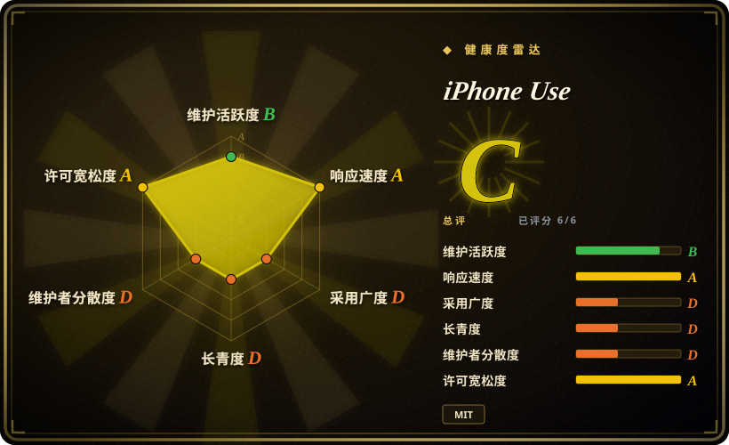
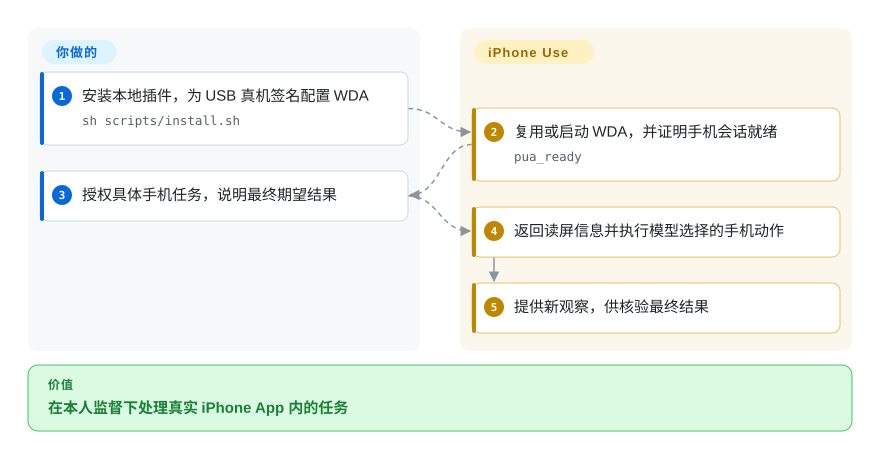

# iPhone Use

助手能改电脑里的项目，任务最后一步却在你真机上的 App 里。iPhone Use 把本地 MCP 服务接到已签名的 WebDriverAgent，通过 USB 给助手提供读屏与手机操作能力。

## 何时使用

你想让 Mac 上的 Codex、WorkBuddy 或豆包工作台操作已安装的 iPhone App，准备草稿或读取一小段列表，同时自己看实时预览。你拥有这台手机，也能安装并签名测试执行器。任务必须使用真机现有 App 状态，选它而不是模拟器工具；想直接拿到 MCP 工具、配置指引和截图恢复，而不是自己写客户端，选它而不是裸 WebDriverAgent。模型仍负责选动作，并核验用户最终结果；工具成功不等于任务成功。

## 何时不用

- 要有成熟客户端和可重复断言的 Android／iOS 回归测试，选 [Appium](appium.zh.md)。这是年轻的助手驱动真机工作流，不是跨平台测试框架。
- 只需可复现的模拟器流程，选 [Maestro](maestro.zh.md) 的 YAML 测试，不必把个人手机交给模型操作，但它不支持 iOS 真机。
- 正在自建自动化协议或执行器，直接用 [WebDriverAgent](webdriveragent.zh.md)。iPhone Use 在该依赖外加了特定宿主、插件和观察合同。
- 没有 Mac、完整 Xcode、匹配 iOS 的工具链或自己的签名团队，选经过授权的托管设备测试服务或模拟器环境。单独一个 Python MCP 服务装不了手机端执行器。
- 不允许外部使用统计，在使用前设置 `IPHONE_USE_ANALYTICS=0` 或 `DO_NOT_TRACK=1` 并重启服务。Codex 路径默认向 PostHog 和 GA4 报告；文档中的 WorkBuddy／豆包适配器默认关闭统计。
- 要有完备性保证的 App 记录导出，优先用 App 自带导出或 API。列表工具有界采集、按可见字段去重，而且明确不承诺完整。

## 横向对比

| 替代品 | 是否收录 | 我们的评价 | 取舍 |
|---|---|---|---|
| [Appium](appium.zh.md) | ✅ | 成熟跨平台测试基础设施选 Appium；需要助手在受监督的 USB 真机上办事，选 iPhone Use。 | MCP 工具和预览减少客户端胶水，但规划依赖模型，插件也只有十几天历史。 |
| [Maestro](maestro.zh.md) | ✅ | 可读、可重复的模拟器流程选 Maestro；必须使用真机数据与已安装 App，选 iPhone Use。 | Maestro 提供测试流程模型，但不支持 iOS 真机；本页要承担签名与监督成本。 |
| [WebDriverAgent](webdriveragent.zh.md) | ✅ | 自建自动化层直接选 WDA；要通过现成配置和 MCP 工具消费它，选 iPhone Use。 | 手机端依赖相同，但额外多了宿主集成、工具政策、预览界面与遥测需要审查。 |

## 快速上手

先审阅安装器，在有完整 Xcode、Python 3.9+、Node/npm 和 USB iPhone 的 Mac 上准备独立副本。Codex 路径执行文档中的 `sh scripts/install.sh`，它会准备包、安装本地市场插件并注册 MCP，之后需重新连接会话。使用自己的苹果团队与包标识配置设备，再构建并启动固定版本的 WDA Runner。只有 `pua_ready` 返回 `ready=true` 才开始手机任务，然后给模型明确授权的操作，并查看最终结果证据。插件提供配置任务、手机工具和预览；设备信任、开发者模式、签名、秘密与高后果操作审批仍由你负责。密码、验证码和生物认证交给本人；WorkBuddy 和豆包使用各自的安装器。

<!-- flow-steps:begin (generated from flows/iphone-use.json by tools/flow_card.py — do not edit) -->

流程文字版

1. **你**：安装本地插件，为 USB 真机签名配置 WDA — `sh scripts/install.sh`
2. **iPhone Use**：复用或启动 WDA，并证明手机会话就绪 — `pua_ready`
3. **你**：授权具体手机任务，说明最终期望结果
4. **iPhone Use**：返回读屏信息并执行模型选择的手机动作
5. **iPhone Use**：提供新观察，供核验最终结果

**价值**：在本人监督下处理真实 iPhone App 内的任务

<!-- flow-steps:end -->

## 技术要点

<!-- mechanism:begin (generated from mechanisms/iphone-use.json by tools/mechanism_card.py; do not edit) -->

机制文字版

- 宿主助手的已授权工具调用
- 共享操作锁与已保存会话①
- 本地 USB 通道连接已签名 WDA①
- 紧凑控件树与带比例的截图②
- 不确定写入或界面恢复证据①②
- 读取真实状态；不盲目重放②

- 宿主助手的已授权工具调用 → 共享操作锁与已保存会话①
- 共享操作锁与已保存会话① → 本地 USB 通道连接已签名 WDA①
- 本地 USB 通道连接已签名 WDA① → 紧凑控件树与带比例的截图②
- 本地 USB 通道连接已签名 WDA① → 不确定写入或界面恢复证据①②（超时或界面异常）
- 紧凑控件树与带比例的截图② → 读取真实状态；不盲目重放②
- 不确定写入或界面恢复证据①② → 读取真实状态；不盲目重放②

<!-- mechanism:end -->

### 1. 串行操作手机，区分不确定写入

- **解决：** 多个助手进程可能共用手机，而超时的点击或输入也可能已经生效。
- **做法：** 运行时分派先获取非阻塞文件锁，再复用匹配的已保存 WDA 会话。客户端只接受本地 HTTP 地址，对读取和写入采用不同的传输错误分类；不确定写入返回 `action_uncertain`，明确要求不要重放。
- **边界：** 锁只协调使用同一插件状态目录的调用方，管不了所有手机控制程序。它防并发冲突，不防错误决策；超时后仍要读新状态，才能判断还缺什么。
- **源码：** [共享操作锁](https://github.com/zhongerxin/iPhone-use/blob/80006885df81531ce7a874b3b0df65980e25e59b/server/iphone_use.py#L274-L353)、[本地地址与传输分类](https://github.com/zhongerxin/iPhone-use/blob/80006885df81531ce7a874b3b0df65980e25e59b/server/wda_client.py#L28-L99)。

### 2. 界面异常先交回截图，不暗中换动作

- **解决：** 无障碍树能匹配到的控件可能被弹窗遮住，截图像素也不等于手机触点坐标。
- **做法：** 选择器、焦点和页面预期失败会附截图及恢复指引。图片带 `pixel_to_point` 比例；传入观察编号时，坐标操作前检查前台 App 与视口。常规导航可以延后验证，但最终关键结果必须另有证据。
- **边界：** 观察编号不证明每个元素未变或没有遮挡。看图与下一步仍由模型决定，`action_complete=true` 本身不证明业务成功；本地证据图片会保存，并按上限清理。
- **源码：** [截图换算与异常恢复](https://github.com/zhongerxin/iPhone-use/blob/80006885df81531ce7a874b3b0df65980e25e59b/server/wda_controller.py#L335-L470)、[延后验证与点击](https://github.com/zhongerxin/iPhone-use/blob/80006885df81531ce7a874b3b0df65980e25e59b/server/wda_controller.py#L557-L593)、[使用政策](https://github.com/zhongerxin/iPhone-use/blob/80006885df81531ce7a874b3b0df65980e25e59b/skills/iphone-use/SKILL.md)。

## 技术栈

Python 标准库 MCP／运行时服务、iOS 上的 Appium WebDriverAgent、使用固定 `appium-ios-device` 的 Node USB 转发与屏幕流，以及 TypeScript MCP Apps 预览界面。项目代码是 MIT，随包界面的第三方声明保留了各依赖许可。

## 依赖

macOS、支持手机 iOS 版本的完整 Xcode、自己的苹果账户与团队、已信任的 USB 真机，以及签名后的 WDA Runner。文档要求 Python 3.9+、Node `^20.19.0 || ^22.12.0 || >=24.0.0`、npm 10+ 和 `appium-ios-device` 3.1.24。WDA 固定为 16.14.0，不需要独立 Appium Server，也不需要越狱。运行配置、构建和截图放在私有本地状态目录，不放源码副本。

## 运维难度

**初次中到高，日常中。** 签名、设备信任、开发者模式和 Xcode／iOS 兼容主导配置成本。日常还要处理 USB 就绪、会话恢复、升级与本地手机截图保护。设备认证期间必须暂停自动化。发送、购买等高后果动作保留人工审批，本地传输不能替代授权系统。

## 健康度与可持续性

- **截至 2026-10-18：** 10 月 6 日创建，未归档，v0.3.15 于 10 月 16 日发布，此前一周也有多次发布。十二天历史没有长期兼容记录，也不能构成长寿先验。
- 贡献主要来自 `zhongerxin`，另有少量外部贡献。仓库有测试、CI、源码打包与第三方许可声明，但插件维护仍集中。
- 约四千 star 反映发布关注度，不代表任务可靠完成。近期公开 issue 标题涉及 Xcode 设备识别和首次注册，依赖前应验证自己的设备与工具链组合。
- GitHub 当前报告仓库公开，但本次读取的英文 README 仍声称私有，是具体的文档不一致。应以 API 可见性和固定源码为准，不照搬旧句子。

## 存疑（未验证）

- [未验证：没有真实设备操作授权，且禁止执行上游代码] 安装、签名、USB 控制和各宿主工具加载均未复现。
- [未验证：没有设备验收与运行时抓包] 任务可靠性、宿主一致性及实际遥测载荷没有测量，只读过控制开关与字段白名单源码。
- [未验证：没有逐条读取所有设备故障 issue] 近期 issue 标题提示工具链风险，不证明每个问题在本次版本仍可复现或尚未解决。
