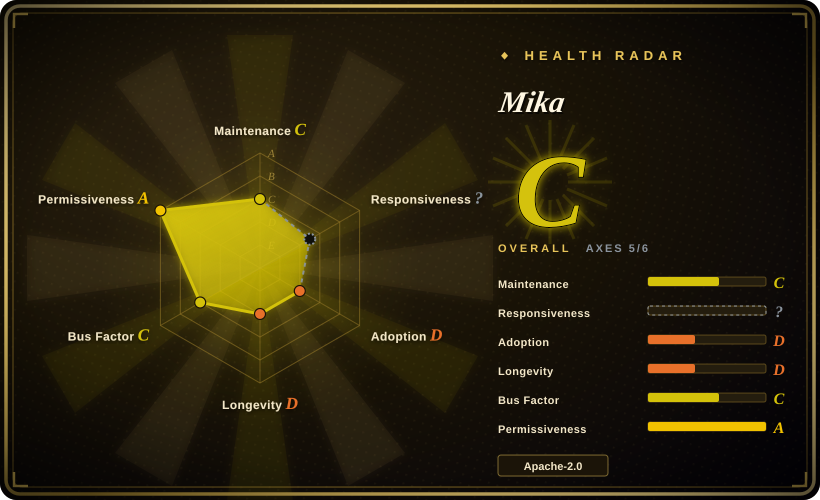
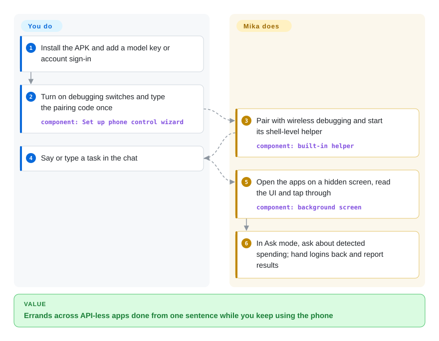
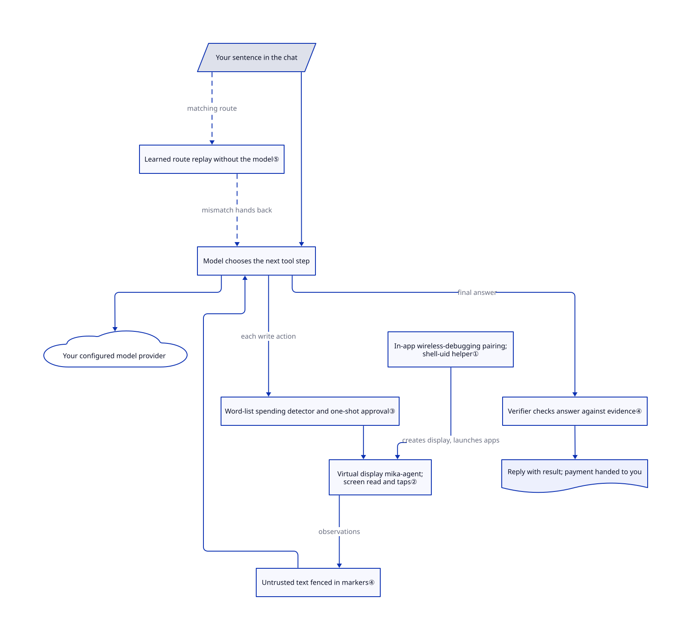

# Mika

Phone chores like "read today's group chat and summarise it" mean minutes of tapping through apps that have no API. Mika lets your chosen model operate them on a hidden Android screen without an attached computer; its default Ask mode requests approval for actions flagged by a heuristic spending detector, not every outward action or every possible purchase.

## When to use

You live on your Android phone and want to hand it errands in plain words: "what did the family group say today?", "greet the recruiters for three of these jobs", "set alarms for 9:40 and 10:00". The apps involved — WeChat, Xiaohongshu, a shopping app — offer no API, and the agent tools you have seen either need a laptop running `adb` beside the phone or take over the screen you are using. Mika runs the app-control layer on the phone: it pairs with Android's wireless debugging, starts a privileged helper and opens apps on an invisible display. The configured model still receives observations and chooses actions; phone-side control does not imply on-device model inference.

Pick it over computer-driven phone agents such as Mobilerun (formerly droidrun) or Open-AutoGLM when "no computer, no cable" and "don't steal my screen" matter more than scripting from Python; pick it over test frameworks such as [Maestro](maestro.md) or [Appium](appium.md) because those replay flows you wrote, whereas Mika decides the steps from a sentence. You pay with a three-day-old beta that holds shell-level control of your phone and sends your screen content to whichever model provider you configure.

## When NOT to use

- **You need repeatable automated tests of your own app.** Use [Maestro](maestro.md) or [Appium](appium.md): they run declared flows deterministically in CI. Mika chooses steps with a language model and has no assertion or reporting model for your test suite.
- **You want a confirmation before every outward action.** In the default Ask mode only spending steps are confirmed; the [modes doc](https://github.com/wangzan101/Mika/blob/2c35c9b670a4e8b42430d14bb7d7ac20dc4382c5/docs/modes.en.md#L7-L10) states that sending messages, posting, submitting forms, deleting and changing settings are just done. If a wrong message or deletion is unacceptable, use a computer-side agent you can step through (Mobilerun, Open-AutoGLM) or keep doing it by hand.
- **Your apps are mostly non-Chinese, non-English or priced in euros/pounds.** The spending detector is a word list (mostly Chinese plus a short English list) and its amount pattern recognises `¥`, `$` and `元` only ([RiskJudge](https://github.com/wangzan101/Mika/blob/2c35c9b670a4e8b42430d14bb7d7ac20dc4382c5/core/src/main/kotlin/com/wangzan101/mika/core/action/RiskJudge.kt#L28-L41)). A "Comprar" or "€24" checkout may not be flagged; do not rely on Ask mode there.
- **You cannot grant shell-level access or keep developer options on.** Phone control requires USB and wireless debugging enabled permanently and a helper running as the shell user, which can do most of what `adb shell` can. On managed/work phones, HarmonyOS NEXT containers ([#150](https://github.com/wangzan101/Mika/issues/150)) or Android 11, use web-and-chat only, or an accessibility-only automation tool you trust.
- **You need data to stay on the device.** There is no Mika server, but every screen read, screenshot and message goes to the model provider you configure. For sensitive apps, point it at a local model ("Custom" provider on your LAN) or do not use it.
- **You need something stable to build on.** It was created on 2026-10-29, ships several releases per day and its own disclaimer says it was mainly tested on one Android 14 phone and upgrades may break things. For long-lived integrations, wait, or build on a slower-moving framework such as Mobilerun.
- **You want to drive an iPhone.** Mika is Android-only; for iOS see [iPhone Use](iphone-use.md) or [iCTRL](ictrl.md).

## Comparison

| Alternative | In index | Our verdict | Tradeoff |
|---|---|---|---|
| [Mobilerun](https://github.com/droidrun/mobilerun) (formerly droidrun) | not indexed | Choose Mobilerun when a computer runs the agent and you want a Python framework covering Android and iOS devices; choose Mika when the phone alone must do it on a hidden screen. | Mobilerun gives scripting, a 1.5-year history and MIT licence, but needs `adb` or its Portal app and drives the visible screen; Mika needs no computer but is days old. Not added in this tab batch. |
| [Open-AutoGLM](https://github.com/zai-org/Open-AutoGLM) | not indexed | Choose Open-AutoGLM to run Zhipu's phone-agent model from a computer over ADB; choose Mika to bring your own provider and run on the phone. | AutoGLM pairs a purpose-trained vision model with the framework but needs a computer, ADB Keyboard and has not been pushed since 2026-03; Mika is model-agnostic and active but untrained for the task. Not added in this tab batch. |
| [iPhone Use](iphone-use.md) | ✅ | Choose iPhone Use to let a computer agent operate a real iPhone over USB and MCP; choose Mika for Android without a computer. | Different platforms; both are young agent tools that need high device privileges (signed WDA vs shell-uid helper). |
| [Maestro](maestro.md) | ✅ | Choose Maestro for deterministic YAML end-to-end tests of your own app; choose Mika to do personal errands across third-party apps from a sentence. | Maestro is repeatable and CI-friendly but needs written flows; Mika improvises with a model and is not a test harness. |
| [Shizuku](https://github.com/RikkaApps/Shizuku) | not indexed | Choose Shizuku when you only need other apps to get shell-level API access via wireless debugging; Mika embeds its own equivalent helper for its own agent. | Shizuku is an eight-year-old general enabler with no agent; Mika's helper serves only Mika. Not added in this tab batch. |

## Quick start

Download the APK from the repository's [Releases](https://github.com/wangzan101/Mika/releases) (Android 11+, about 89 MB), then in Settings › Model add a provider with an API key or sign in with a ChatGPT, xAI or OpenRouter account; "Test and save" makes one small tool call to check it ([README](https://github.com/wangzan101/Mika/blob/2c35c9b670a4e8b42430d14bb7d7ac20dc4382c5/README.md#L69-L78), [models doc](https://github.com/wangzan101/Mika/blob/2c35c9b670a4e8b42430d14bb7d7ac20dc4382c5/docs/models.en.md)). To let it operate apps (Android 12+), run the six-step "Set up phone control" wizard: turn on developer options, USB debugging and wireless debugging — Android's built-in way to connect a debugger over Wi-Fi — and type the pairing code once ([setup guide](https://github.com/wangzan101/Mika/blob/2c35c9b670a4e8b42430d14bb7d7ac20dc4382c5/docs/setup-guide.en.md)). Mika then starts its helper, turns its accessibility service on by itself, and from then on you just type or say a task in the chat; it works on a background screen you can watch in a small live view, hands logins, verification codes and payments back to you, and replies with the result. You own the model bill, the developer-option switches staying on, and whatever it sends or deletes in Ask mode. Nothing was installed or run for this page.

<!-- flow-steps:begin (generated from flows/mika.json by tools/flow_card.py — do not edit) -->

Text version of the flow

1. **You**: Install the APK and add a model key or account sign-in
2. **You**: Turn on debugging switches and type the pairing code once — component: `Set up phone control wizard`
3. **Mika**: Pair with wireless debugging and start its shell-level helper — component: `built-in helper`
4. **You**: Say or type a task in the chat
5. **Mika**: Open the apps on a hidden screen, read the UI and tap through — component: `background screen`
6. **Mika**: In Ask mode, ask about detected spending; hand logins back and report results

**Value**: Errands across API-less apps done from one sentence while you keep using the phone

<!-- flow-steps:end -->

## Key techniques

<!-- mechanism:begin (generated from mechanisms/mika.json by tools/mechanism_card.py; do not edit) -->

Text version of the mechanism

- Your sentence in the chat
- In-app wireless-debugging pairing; shell-uid helper①
- Learned route replay without the model⑤
- Model chooses the next tool step
- Your configured model provider
- Virtual display mika-agent; screen read and taps②
- Ask-mode word-list detector and one-shot approval③
- Untrusted text fenced in markers④
- Verifier checks answer against evidence④
- Reply with the result

- Your sentence in the chat → Learned route replay without the model⑤ (matching route) [optional/fallback]
- Your sentence in the chat → Model chooses the next tool step
- Learned route replay without the model⑤ → Model chooses the next tool step (mismatch hands back) [optional/fallback]
- Model chooses the next tool step → Your configured model provider
- In-app wireless-debugging pairing; shell-uid helper① → Virtual display mika-agent; screen read and taps② (creates display, launches apps)
- Model chooses the next tool step → Ask-mode word-list detector and one-shot approval③ (checked writes in Ask mode)
- Ask-mode word-list detector and one-shot approval③ → Virtual display mika-agent; screen read and taps②
- Model chooses the next tool step → Virtual display mika-agent; screen read and taps② (Autonomous or unchecked actions) [optional/fallback]
- Virtual display mika-agent; screen read and taps② → Untrusted text fenced in markers④ (observations)
- Untrusted text fenced in markers④ → Model chooses the next tool step
- Model chooses the next tool step → Verifier checks answer against evidence④ (final answer)
- Verifier checks answer against evidence④ → Reply with the result

<!-- mechanism:end -->

### 1. Pair with the phone's own debugger instead of a computer

- **Problem:** Starting apps on another display and injecting input needs shell-level rights, which normally come from a computer running `adb`.
- **How:** The app contains its own wireless-debugging client: it finds the pairing and connect ports through mDNS, runs TLS 1.3, derives a password from the pairing code plus exported key material, exchanges SPAKE2 messages and sends its key in an AES-GCM-encrypted packet. Once paired, it connects to the local `adbd` and starts a helper process as the shell user that the app talks to through an AIDL interface.
- **Limits:** Requires Wi-Fi at pairing, wireless debugging allowed on that network and USB debugging left on; Android may revoke old pairings, and some systems lack wireless debugging (a USB start command is the fallback).
- **Source:** [pairing protocol:35–75](https://github.com/wangzan101/Mika/blob/2c35c9b670a4e8b42430d14bb7d7ac20dc4382c5/core/src/main/kotlin/com/wangzan101/mika/core/adb/AdbPairing.kt#L35-L75), [helper states and failure kinds:5–55](https://github.com/wangzan101/Mika/blob/2c35c9b670a4e8b42430d14bb7d7ac20dc4382c5/core/src/main/kotlin/com/wangzan101/mika/core/shell/BuiltinShell.kt#L5-L55), [shell interface](https://github.com/wangzan101/Mika/blob/2c35c9b670a4e8b42430d14bb7d7ac20dc4382c5/app/src/main/aidl/com/wangzan101/mika/shell/IMikaShell.aidl).

### 2. Work on an invisible virtual display

- **Problem:** An agent that taps on the screen you are holding fights you for it.
- **How:** The shell helper creates a virtual display named `mika-agent`, first with trusted flags and then without if the system refuses, rendering into an `ImageReader` inside the app. Apps are launched onto that display and its frames are processed at most 10 per second for screenshots and the small live preview.
- **Limits:** App control needs Android 12+, and the README recommends 14+ for a separate input focus; screens marked secure (payments, passwords) cannot be captured, so Mika asks you to take over there.
- **Source:** [agent display:18–70](https://github.com/wangzan101/Mika/blob/2c35c9b670a4e8b42430d14bb7d7ac20dc4382c5/app/src/main/java/com/wangzan101/mika/cap/phone/display/AgentDisplay.kt#L18-L70), [virtual display creation:90–117](https://github.com/wangzan101/Mika/blob/2c35c9b670a4e8b42430d14bb7d7ac20dc4382c5/app/src/main/java/com/wangzan101/mika/cap/phone/shell/ShellService.kt#L90-L117), [phone requirements:125–133](https://github.com/wangzan101/Mika/blob/2c35c9b670a4e8b42430d14bb7d7ac20dc4382c5/README.md#L125-L133).

### 3. Gate spending with word lists and a one-shot approval

- **Problem:** A model that misreads a page could place an order or pay without the user noticing.
- **How:** In Ask mode, selected write actions are matched against send/delete/order/pay word lists. Spending requires an existing hit: pay/order, or a non-send hit with a recognized on-screen amount. Approval is tied to the app, action, target, text and amount, usable once within the permitted step window. A flagged payment is not approved through this gate and requires takeover.
- **Limits:** An amount alone without a word-list hit is insufficient. Autonomous mode returns clear before this gate, including for payments; Ask mode is not universal confirmation for messages, deletion or unknown checkout wording. Language and currency coverage is limited.
- **Source:** [word lists:30–104](https://github.com/wangzan101/Mika/blob/2c35c9b670a4e8b42430d14bb7d7ac20dc4382c5/core/src/main/kotlin/com/wangzan101/mika/core/gate/IrreversibleDetector.kt#L30-L104), [risk levels:20–42](https://github.com/wangzan101/Mika/blob/2c35c9b670a4e8b42430d14bb7d7ac20dc4382c5/core/src/main/kotlin/com/wangzan101/mika/core/action/RiskJudge.kt#L20-L42), [approval binding:32–96](https://github.com/wangzan101/Mika/blob/2c35c9b670a4e8b42430d14bb7d7ac20dc4382c5/core/src/main/kotlin/com/wangzan101/mika/core/gate/ConfirmationGate.kt#L32-L96), [three-step expiry:203](https://github.com/wangzan101/Mika/blob/2c35c9b670a4e8b42430d14bb7d7ac20dc4382c5/core/src/main/kotlin/com/wangzan101/mika/core/gate/ConfirmationGate.kt#L203-L203).

  [Mode bypass and check selection](https://github.com/wangzan101/Mika/blob/2c35c9b670a4e8b42430d14bb7d7ac20dc4382c5/core/src/main/kotlin/com/wangzan101/mika/core/action/ConfirmDecision.kt#L58-L93).

### 4. Fence untrusted text and check answers against evidence

- **Problem:** Web pages, chat messages and other AIs' replies can contain instructions aimed at the agent, and a model can report success it never saw.
- **How:** Text from pages, script results, network responses and channels is wrapped once in `<untrusted>` markers, with any closing marker inside escaped so the content cannot end the fence early. Before an answer is delivered, a verifier model checks it against criteria, a fresh look at the current screen and an evidence ledger of everything read during the task.
- **Limits:** The fence is a prompt convention, not isolation — a model can still obey injected text; verification is another model call and can be wrong.
- **Source:** [untrusted markers:1–22](https://github.com/wangzan101/Mika/blob/2c35c9b670a4e8b42430d14bb7d7ac20dc4382c5/core/src/main/kotlin/com/wangzan101/mika/core/observation/Untrusted.kt#L1-L22), [verifier evidence:25–63](https://github.com/wangzan101/Mika/blob/2c35c9b670a4e8b42430d14bb7d7ac20dc4382c5/core/src/main/kotlin/com/wangzan101/mika/core/verify/Verifier.kt#L25-L63), [verify entry:105–118](https://github.com/wangzan101/Mika/blob/2c35c9b670a4e8b42430d14bb7d7ac20dc4382c5/core/src/main/kotlin/com/wangzan101/mika/core/verify/Verifier.kt#L105-L118).

### 5. Replay a learned route without calling the model

- **Problem:** Repeating "send X to Y" through the model every time costs tokens and adds variance.
- **How:** A successful run that used only UI tools is recorded as a route; typed text may only come from fragments that appear exactly once in your original words, stored as slots. On a matching request the replayer checks the foreground app, anchors and a unique selector before each step, and stops before any irreversible step or on the first mismatch, handing back to the model. The app turns this on by default.
- **Limits:** Runs that involved takeovers, payments, password fields, the browser or the sandbox are never recorded; app updates that change layouts invalidate routes.
- **Source:** [recording rules:13–38](https://github.com/wangzan101/Mika/blob/2c35c9b670a4e8b42430d14bb7d7ac20dc4382c5/core/src/main/kotlin/com/wangzan101/mika/core/replay/RouteRecorder.kt#L13-L38), [replay checks:39–53](https://github.com/wangzan101/Mika/blob/2c35c9b670a4e8b42430d14bb7d7ac20dc4382c5/core/src/main/kotlin/com/wangzan101/mika/core/replay/Replayer.kt#L39-L53), [default on:109–110](https://github.com/wangzan101/Mika/blob/2c35c9b670a4e8b42430d14bb7d7ac20dc4382c5/app/src/main/java/com/wangzan101/mika/settings/FeatureFlags.kt#L109-L110).

## Tech stack

- Kotlin with Jetpack Compose UI; a pure-Kotlin `:core` module (agent loop, tools, prompts, knowledge) testable on a computer with a fake model, and an Android `:app` host ([CONTRIBUTING](https://github.com/wangzan101/Mika/blob/2c35c9b670a4e8b42430d14bb7d7ac20dc4382c5/.github/CONTRIBUTING.md)). `minSdk` 30, `targetSdk` 35.
- OkHttp, kotlinx serialization/coroutines, commonmark-java, OpenTelemetry protobuf messages; model adapters for OpenAI-compatible, Responses, Anthropic and Gemini APIs.
- Linux sandbox: PRoot (GPL-2.0+, shipped as standalone `libproot.so` with talloc) over a bundled Alpine 3.22 root filesystem, plus a small C launcher.
- Built-in knowledge as Markdown `APP.md` / `SITE.md` files (23 apps, 18 sites, mostly in Chinese) and five how-to skills.

## Dependencies

- **Device:** Android 11+ for chat/web/files, Android 12+ for app control (14+ recommended), arm64 for the sandbox; Wi-Fi for wireless-debugging pairing.
- **Model access:** your own API key for one of ~20 provider presets or any OpenAI-compatible/Anthropic/Gemini/Responses endpoint, or account sign-in (ChatGPT Plus/Pro, xAI, OpenRouter). The xAI sign-in reuses the public client of xAI's official command-line tool, which the docs say xAI may restrict.
- **Permissions:** developer options, USB and wireless debugging kept on; the manifest requests `WRITE_SECURE_SETTINGS`, `REQUEST_INSTALL_PACKAGES`, `RECORD_AUDIO`, `RECEIVE_BOOT_COMPLETED` and exact alarms, among others.
- **Optional:** a computer with an MCP client or the bundled `mika` CLI/skill to send tasks over USB or Wi-Fi (network access off by default, bearer token, browser-origin requests rejected).

## Ops difficulty

**Low to install, medium to keep working.** There is no server: install an APK and add a key. The burden is on the device: Android turns wireless debugging off when Wi-Fi changes or the phone restarts (Mika re-enables it if you allowed that network), pairings can be revoked, OEM ROMs need the self-check and device reports, and the beta ships several releases a day that may change behaviour. The in-app updater downloads only from GitHub Releases and checks the SHA-256 when one is published. Cleanup: uninstalling the app removes its data; turn off developer options and USB/wireless debugging yourself and revoke any OpenRouter key or account sessions it created.

## Health & viability

- **Maintenance, as of 2026-11-01:** extremely active — 324 commits and 32 tagged releases (v0.1.0 to v0.1.31) since the repository was created on 2026-10-29; the first commit already carried the full codebase, so earlier history is not public.
- **Governance and bus factor:** a personal account; 246 of 324 commits are by the owner `wangzan101`, with 23 other contributors in the first three days. No foundation, company or CLA; roadmap in `docs/dev/roadmap.md`.
- **Age and Lindy:** three days old. No Lindy credit; the README calls it an early public beta.
- **Adoption:** 3,608 stars and 646 forks in three days, and about 3,100 downloads of v0.1.31 alone. Stars this fast on a three-day-old repo are a hype signal, not proof of reliability [推断: based on the star/age ratio, no star-audit performed].
- **Quality signals:** a large test tree (about 670 files under the unit, CLI and device-test directories) and a 12-check compatibility self-check, but its own disclaimer says testing was mainly on one Android 14 phone; open issues already report OEM and HarmonyOS incompatibilities.
- **Risk flags:** shell-uid helper and secure-settings permission, model-provider data egress, the borrowed xAI sign-in client, and automation that may breach third-party apps' terms (the disclaimer warns of account bans).

## Caveats (unverified)

- [未验证: no APK installed, no phone paired, no model connected] Task success rates, speed, and the behaviour of apps on the virtual display were not reproduced; demo GIFs are the author's.
- [未验证: OpenAI sign-in terms not checked] The code comment says the ChatGPT sign-in is a path OpenAI provides for open-source local apps (`dynamic_agent_client`, plan scope); whether it remains available or permitted for this use was not confirmed.
- [推断: based on reading `RiskJudge` and `IrreversibleDetector`, not on running them] Purchases in other languages or currencies (€, £) may not be flagged as spending in Ask mode.
- [未验证: privilege scope not audited] The full set of operations the shell-uid helper (`ShellService.kt`, about 85 KB) exposes was not reviewed line by line; this page relies on the pairing, display and permission code read.
- [推断: star/age ratio only] Whether the 3,608 stars reflect organic adoption was not audited.
- [未验证: upstream moved during review] The recorded upstream snapshot is `e781333`, one commit after the reviewed `2c35c9b`; the GitHub compare shows it only refreshes the Star History image in six README files, so no code in that delta was reviewed or needed.
