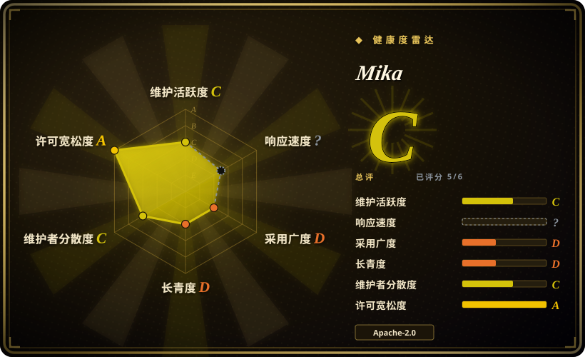
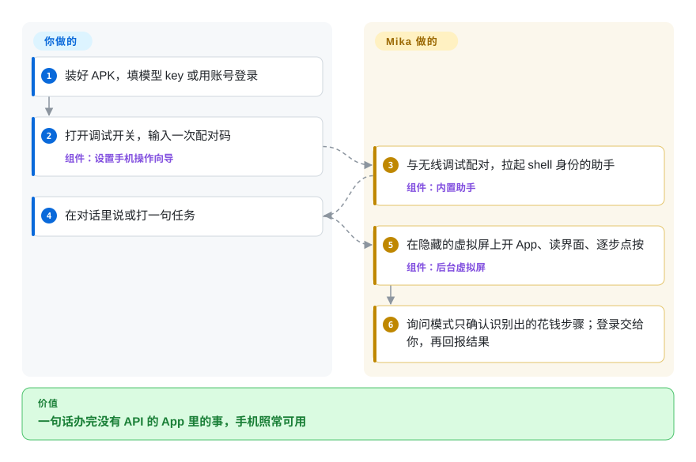
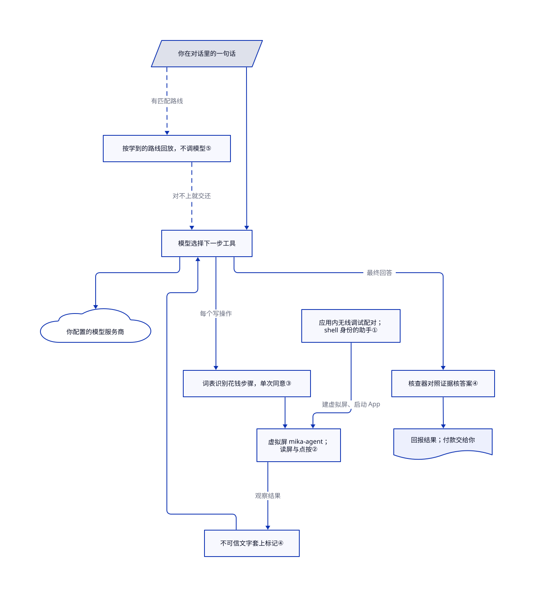

# Mika

“总结今天群聊”这类手机杂事，要在没有接口的 App 里点上好几分钟。Mika 让你选的模型在安卓隐藏屏上操作，不必接电脑；默认询问模式只审批启发式规则识别出的花钱动作，不覆盖全部对外动作或所有购买。

## 何时使用

你几乎所有事都在安卓手机上办，想用一句话把杂事交出去：“家人群今天说了啥？”“给这三个职位的招聘方打招呼”“明早 9:40 和 10:00 各定一个闹钟”。涉及的 App——微信、小红书、购物 App——都没有开放接口；你见过的手机 agent 要么得在旁边开一台电脑跑 `adb`，要么会占住你正在用的屏幕。Mika 把 App 控制层放在手机上：与安卓无线调试配对，拉起特权助手，在隐藏屏上打开 App。配置的模型仍会接收观察并选择动作；手机端控制不代表模型推理也在设备内。

“不要电脑、不接线”和“别抢我的屏幕”比用 Python 写脚本更重要时，选它而不是 Mobilerun（原 droidrun）或 Open-AutoGLM 这类靠电脑驱动的手机 agent；它也不同于 [Maestro](maestro.zh.md)、[Appium](appium.zh.md) 这类测试框架——那些重放你写好的流程，Mika 则从一句话里自己决定步骤。代价是：一个刚满三天的测试版拿着你手机的 shell 级控制权，并把屏幕内容发给你配置的模型服务商。

## 何时不用

- **你要给自己的 App 做可重复的自动化测试。** 用 [Maestro](maestro.zh.md) 或 [Appium](appium.zh.md)：它们在 CI 里确定性地跑声明好的流程。Mika 由大模型挑步骤，没有给测试套件用的断言和报告。
- **你要每个对外动作之前都确认一次。** 默认的“询问”模式只确认花钱的步骤；[模式文档](https://github.com/wangzan101/Mika/blob/2c35c9b670a4e8b42430d14bb7d7ac20dc4382c5/docs/modes.en.md#L7-L10)写明发消息、发帖、提交表单、删除、改设置都不问，直接做。发错一条消息或删错东西不可接受时，用可以逐步审的电脑端 agent（Mobilerun、Open-AutoGLM），或者继续手动。
- **你常用的 App 不是中文或英文，或者用欧元／英镑标价。** 花钱识别靠词表（以中文为主，加一小段英文），金额只认 `¥`、`$` 和 `元`（[RiskJudge](https://github.com/wangzan101/Mika/blob/2c35c9b670a4e8b42430d14bb7d7ac20dc4382c5/core/src/main/kotlin/com/wangzan101/mika/core/action/RiskJudge.kt#L28-L41)）。“Comprar”按钮或“€24”的结算页可能不会被拦，这时别指望询问模式兜底。
- **你给不了 shell 级权限，或不能一直开着开发者选项。** 操作 App 要求 USB 调试和无线调试长期打开，并有一个以 shell 用户身份运行的助手，它能做 `adb shell` 能做的大部分事。公司管理的手机、鸿蒙 NEXT 的卓易通容器（[#150](https://github.com/wangzan101/Mika/issues/150)）或安卓 11 上，只用它聊天、上网和处理文件，或者换一个你信得过、只用无障碍的自动化工具。
- **你要求数据不出手机。** Mika 没有自己的服务器，但每次读屏、截图和消息都会发给你配置的模型服务商。处理敏感 App 时，接局域网里的本地模型（服务商选“自定义”），或者干脆不用。
- **你要一个稳定的底座来二次开发。** 它 2026-10-29 才创建，一天发好几个版本，自己的免责声明也说主要只在一台安卓 14 手机上测过、升级可能有不兼容改动。要做长期集成，先等等，或者基于变化更慢的框架（如 Mobilerun）。
- **你要控制 iPhone。** Mika 只支持安卓；iOS 看 [iPhone Use](iphone-use.zh.md) 或 [iCTRL](ictrl.zh.md)。

## 横向对比

| 替代品 | 是否收录 | 我们的评价 | 取舍 |
|---|---|---|---|
| [Mobilerun](https://github.com/droidrun/mobilerun)（原 droidrun） | 未收录 | agent 跑在电脑上、要一个同时覆盖安卓和 iOS 设备的 Python 框架时，选 Mobilerun；只靠手机自己、在隐藏屏上完成时，选 Mika。 | Mobilerun 能写脚本、有一年半的历史、MIT 许可，但需要 `adb` 或它的 Portal App，并操作可见屏幕；Mika 不要电脑，但才几天大。本批标签收录未添加。 |
| [Open-AutoGLM](https://github.com/zai-org/Open-AutoGLM) | 未收录 | 想在电脑上经 ADB 跑智谱的手机 agent 模型，选 Open-AutoGLM；想自带服务商、在手机上跑，选 Mika。 | AutoGLM 配了专门训练的视觉模型，但要电脑和 ADB Keyboard，且 2026-03 后没有推送；Mika 不绑模型、更新活跃，但模型没为这个任务专门训练过。本批标签收录未添加。 |
| [iPhone Use](iphone-use.zh.md) | ✅ | 要让电脑上的 agent 经 USB 和 MCP 操作真 iPhone，选 iPhone Use；安卓、不要电脑，选 Mika。 | 平台不同；两者都是年轻的 agent 工具，都要很高的设备权限（签名的 WDA 对比 shell 身份助手）。 |
| [Maestro](maestro.zh.md) | ✅ | 给自己的 App 做确定性的 YAML 端到端测试，选 Maestro；用一句话在第三方 App 里办个人杂事，选 Mika。 | Maestro 可重复、适合 CI，但流程要自己写；Mika 靠模型临场发挥，不是测试框架。 |
| [Shizuku](https://github.com/RikkaApps/Shizuku) | 未收录 | 只想让别的 App 经无线调试拿到 shell 级接口时，选 Shizuku；Mika 内嵌了自己的同类助手，只给自己的 agent 用。 | Shizuku 是八年历史的通用底座，不带 agent；Mika 的助手只服务 Mika。本批标签收录未添加。 |

## 快速上手

从仓库的 [Releases](https://github.com/wangzan101/Mika/releases) 下载 APK（安卓 11 以上，约 89 MB），在“设置 › 模型”里添加服务商并填 API key，或用 ChatGPT、xAI、OpenRouter 账号登录；“测试并保存”会发一次很小的工具调用来验证（[README](https://github.com/wangzan101/Mika/blob/2c35c9b670a4e8b42430d14bb7d7ac20dc4382c5/README.md#L69-L78)、[模型文档](https://github.com/wangzan101/Mika/blob/2c35c9b670a4e8b42430d14bb7d7ac20dc4382c5/docs/models.en.md)）。要让它操作 App（安卓 12 以上），走一遍六步的“设置手机操作”向导：打开开发者选项、USB 调试和无线调试（安卓自带、通过 Wi-Fi 连接调试器的功能），输入一次配对码（[设置指南](https://github.com/wangzan101/Mika/blob/2c35c9b670a4e8b42430d14bb7d7ac20dc4382c5/docs/setup-guide.en.md)）。之后 Mika 自己拉起助手、自己打开无障碍服务；你只要在对话里打字或说一句任务，它就在后台屏上干活（可以点小画面看），把登录、验证码和付款交还给你，最后回报结果。模型费用、开发者开关保持打开，以及询问模式下它发出或删掉的东西，都由你负责。本页没有安装或运行任何东西。

<!-- flow-steps:begin (generated from flows/mika.json by tools/flow_card.py — do not edit) -->

流程文字版

1. **你**：装好 APK，填模型 key 或用账号登录
2. **你**：打开调试开关，输入一次配对码 — 组件：`设置手机操作向导`
3. **Mika**：与无线调试配对，拉起 shell 身份的助手 — 组件：`内置助手`
4. **你**：在对话里说或打一句任务
5. **Mika**：在隐藏的虚拟屏上开 App、读界面、逐步点按 — 组件：`后台虚拟屏`
6. **Mika**：规则识别花钱步骤才询问；登录交给你，再回报结果

**价值**：一句话办完没有 API 的 App 里的事，手机照常可用

<!-- flow-steps:end -->

## 技术要点

<!-- mechanism:begin (generated from mechanisms/mika.json by tools/mechanism_card.py; do not edit) -->

机制文字版

- 你在对话里的一句话
- 应用内无线调试配对； shell 身份的助手①
- 按学到的路线回放，不调模型⑤
- 模型选择下一步工具
- 你配置的模型服务商
- 虚拟屏 mika-agent； 读屏与点按②
- 词表识别花钱步骤，单次同意③
- 不可信文字套上标记④
- 核查器对照证据核答案④
- 回报结果；付款交给你

- 你在对话里的一句话 → 按学到的路线回放，不调模型⑤（有匹配路线）〔可选／兜底〕
- 你在对话里的一句话 → 模型选择下一步工具
- 按学到的路线回放，不调模型⑤ → 模型选择下一步工具（对不上就交还）〔可选／兜底〕
- 模型选择下一步工具 → 你配置的模型服务商
- 应用内无线调试配对； shell 身份的助手① → 虚拟屏 mika-agent； 读屏与点按②（建虚拟屏、启动 App）
- 模型选择下一步工具 → 词表识别花钱步骤，单次同意③（每个写操作）
- 词表识别花钱步骤，单次同意③ → 虚拟屏 mika-agent； 读屏与点按②
- 虚拟屏 mika-agent； 读屏与点按② → 不可信文字套上标记④（观察结果）
- 不可信文字套上标记④ → 模型选择下一步工具
- 模型选择下一步工具 → 核查器对照证据核答案④（最终回答）
- 核查器对照证据核答案④ → 回报结果；付款交给你

<!-- mechanism:end -->

### 1. 和手机自己的调试器配对，不用电脑

- **解决：** 在另一块屏上启动 App、注入输入需要 shell 级权限，通常得靠电脑上的 `adb`。
- **做法：** App 里自带无线调试客户端：用 mDNS 找到配对和连接端口，跑 TLS 1.3，用配对码加导出的密钥材料生成口令，交换 SPAKE2 消息，再用 AES-GCM 加密的包发出自己的公钥。配对后它连上本机的 `adbd`，以 shell 用户身份启动一个助手进程，App 通过 AIDL 接口和它通信。
- **边界：** 配对时要有 Wi-Fi，该网络要允许无线调试，USB 调试要一直开着；安卓可能撤销旧的配对，有的系统没有无线调试（那时退回用 USB 启动命令）。
- **源码：** [配对协议第 35–75 行](https://github.com/wangzan101/Mika/blob/2c35c9b670a4e8b42430d14bb7d7ac20dc4382c5/core/src/main/kotlin/com/wangzan101/mika/core/adb/AdbPairing.kt#L35-L75)、[助手状态与失败类别第 5–55 行](https://github.com/wangzan101/Mika/blob/2c35c9b670a4e8b42430d14bb7d7ac20dc4382c5/core/src/main/kotlin/com/wangzan101/mika/core/shell/BuiltinShell.kt#L5-L55)、[shell 接口定义](https://github.com/wangzan101/Mika/blob/2c35c9b670a4e8b42430d14bb7d7ac20dc4382c5/app/src/main/aidl/com/wangzan101/mika/shell/IMikaShell.aidl)。

### 2. 在看不见的虚拟屏上干活

- **解决：** agent 在你手里那块屏上点来点去，就会和你抢屏幕。
- **做法：** shell 助手建一块名为 `mika-agent` 的虚拟屏，先用受信任标志，系统拒绝时退回不带；画面输出到 App 内的 `ImageReader`。App 被启动到这块屏上，帧处理限速到每秒最多 10 帧，用于截图和小画面预览。
- **边界：** 操作 App 要安卓 12 以上，README 推荐 14 以上以获得独立的输入焦点；标记为安全的界面（付款、密码）截不到图，Mika 会请你接管。
- **源码：** [虚拟屏第 18–70 行](https://github.com/wangzan101/Mika/blob/2c35c9b670a4e8b42430d14bb7d7ac20dc4382c5/app/src/main/java/com/wangzan101/mika/cap/phone/display/AgentDisplay.kt#L18-L70)、[建屏逻辑第 90–117 行](https://github.com/wangzan101/Mika/blob/2c35c9b670a4e8b42430d14bb7d7ac20dc4382c5/app/src/main/java/com/wangzan101/mika/cap/phone/shell/ShellService.kt#L90-L117)、[机型要求第 125–133 行](https://github.com/wangzan101/Mika/blob/2c35c9b670a4e8b42430d14bb7d7ac20dc4382c5/README.md#L125-L133)。

### 3. 用词表加单次同意拦住花钱

- **解决：** 模型看错页面，可能在用户没察觉时下单或付款。
- **做法：** 每个写操作执行前，一个确定性的检测器拿按钮名、资源 ID、回车键和横滑列表行去匹配发送／删除／下单／付款词表；动作是付款或下单，或者屏上出现 `¥`、`$`、`元` 金额时，就算花钱。询问模式下模型必须先申报这一步；你的同意只用一次，且要求三步之内同一 App、同类动作、屏上对象、要发的原文和金额都对得上。付款本身永远交给你。
- **边界：** 询问模式只问花钱；自主模式什么都不问；词表和金额规则认不出其他语言和币种。
- **源码：** [词表第 30–104 行](https://github.com/wangzan101/Mika/blob/2c35c9b670a4e8b42430d14bb7d7ac20dc4382c5/core/src/main/kotlin/com/wangzan101/mika/core/gate/IrreversibleDetector.kt#L30-L104)、[风险分级第 20–42 行](https://github.com/wangzan101/Mika/blob/2c35c9b670a4e8b42430d14bb7d7ac20dc4382c5/core/src/main/kotlin/com/wangzan101/mika/core/action/RiskJudge.kt#L20-L42)、[同意绑定第 32–96 行](https://github.com/wangzan101/Mika/blob/2c35c9b670a4e8b42430d14bb7d7ac20dc4382c5/core/src/main/kotlin/com/wangzan101/mika/core/gate/ConfirmationGate.kt#L32-L96)、[三步过期第 203 行](https://github.com/wangzan101/Mika/blob/2c35c9b670a4e8b42430d14bb7d7ac20dc4382c5/core/src/main/kotlin/com/wangzan101/mika/core/gate/ConfirmationGate.kt#L203-L203)。

### 4. 给不可信文字加围栏，按证据核对答案

- **解决：** 网页、聊天消息和别的 AI 的回答里可能藏着冲着 agent 来的指令，模型也可能报告它根本没看到的成功。
- **做法：** 网页正文、脚本结果、网络响应和渠道消息只在生成观察时套一次 `<untrusted>` 标记，内容里的结束标记被转义，没法提前合上围栏。回答交出前，核查模型拿它对照标准、当前屏幕的再看一眼，以及本次任务读到的全部内容组成的证据账本。
- **边界：** 围栏是提示词约定，不是隔离——模型仍可能照着注入的文字做；核查本身也是一次模型调用，会出错。
- **源码：** [不可信标记第 1–22 行](https://github.com/wangzan101/Mika/blob/2c35c9b670a4e8b42430d14bb7d7ac20dc4382c5/core/src/main/kotlin/com/wangzan101/mika/core/observation/Untrusted.kt#L1-L22)、[核查证据第 25–63 行](https://github.com/wangzan101/Mika/blob/2c35c9b670a4e8b42430d14bb7d7ac20dc4382c5/core/src/main/kotlin/com/wangzan101/mika/core/verify/Verifier.kt#L25-L63)、[核查入口第 105–118 行](https://github.com/wangzan101/Mika/blob/2c35c9b670a4e8b42430d14bb7d7ac20dc4382c5/core/src/main/kotlin/com/wangzan101/mika/core/verify/Verifier.kt#L105-L118)。

### 5. 不调模型，按学到的路线回放

- **解决：** 每次“把 X 发给 Y”都走一遍模型，既费 token 又多变数。
- **做法：** 只用了界面工具的成功运行会被记成路线；输入的字只能来自你原话里恰好出现一次的片段，存成槽位。遇到匹配的请求，回放器每步先核对前台 App、锚点和唯一选择器，遇到不可逆步骤或第一次对不上就停下交还模型。App 默认打开这一功能。
- **边界：** 有接管、付款、密码框、用过浏览器或沙箱的运行一律不记；App 更新改了界面，路线就失效。
- **源码：** [记录规则第 13–38 行](https://github.com/wangzan101/Mika/blob/2c35c9b670a4e8b42430d14bb7d7ac20dc4382c5/core/src/main/kotlin/com/wangzan101/mika/core/replay/RouteRecorder.kt#L13-L38)、[回放核对第 39–53 行](https://github.com/wangzan101/Mika/blob/2c35c9b670a4e8b42430d14bb7d7ac20dc4382c5/core/src/main/kotlin/com/wangzan101/mika/core/replay/Replayer.kt#L39-L53)、[默认开启第 109–110 行](https://github.com/wangzan101/Mika/blob/2c35c9b670a4e8b42430d14bb7d7ac20dc4382c5/app/src/main/java/com/wangzan101/mika/settings/FeatureFlags.kt#L109-L110)。

## 技术栈

- Kotlin 加 Jetpack Compose 界面；纯 Kotlin 的 `:core` 模块（主循环、工具、提示词、知识）可以在电脑上配假模型跑单元测试，`:app` 是安卓宿主（[贡献指南](https://github.com/wangzan101/Mika/blob/2c35c9b670a4e8b42430d14bb7d7ac20dc4382c5/.github/CONTRIBUTING.md)）。`minSdk` 30，`targetSdk` 35。
- OkHttp、kotlinx 序列化与协程、commonmark-java、OpenTelemetry 的 protobuf 消息；模型适配覆盖 OpenAI 兼容、Responses、Anthropic 和 Gemini 接口。
- Linux 沙箱：PRoot（GPL-2.0+，以独立的 `libproot.so` 发布，静态链接 talloc）跑在随包附带的 Alpine 3.22 根文件系统上，外加一个小的 C 启动器。
- 内置知识是 Markdown 写的 `APP.md`／`SITE.md`（23 个 App、18 个网站，大多用中文写），另有 5 个通用技能。

## 依赖

- **设备：** 聊天、上网、文件要安卓 11 以上；操作 App 要安卓 12 以上（推荐 14 以上）；沙箱要 arm64；无线调试配对时要连 Wi-Fi。
- **模型：** 约 20 家服务商预设之一的 API key，或任意 OpenAI 兼容／Anthropic／Gemini／Responses 接口；也可以用账号登录（ChatGPT Plus／Pro、xAI、OpenRouter）。xAI 登录借用的是 xAI 官方命令行工具的公开客户端，文档自己说 xAI 可能会限制这种用法。
- **权限：** 开发者选项、USB 调试和无线调试要一直开着；清单里申请了 `WRITE_SECURE_SETTINGS`、`REQUEST_INSTALL_PACKAGES`、`RECORD_AUDIO`、`RECEIVE_BOOT_COMPLETED` 和精确闹钟等权限。
- **可选：** 电脑上的 MCP 客户端或附带的 `mika` 命令行／技能，经 USB 或 Wi-Fi 派任务（网络访问默认关闭，用 Bearer 令牌，带浏览器来源头的请求一律拒绝）。

## 运维难度

**安装低，保持可用中等。** 没有服务器：装 APK、填 key 即可。负担都在手机上：换 Wi-Fi 或重启后安卓会关掉无线调试（你允许过该网络的话 Mika 会自己再打开），配对可能被撤销，各厂商的系统要靠自检和设备报告排查，测试版一天发好几版、行为可能变。App 内更新只从 GitHub Releases 下载，发布里给了 SHA-256 时会校验。清理：卸载 App 会删掉它的数据；开发者选项、USB／无线调试要你自己关，它建过的 OpenRouter key 和账号会话要你自己撤销。

## 健康度与可持续性

- **维护（截至 2026-11-01）：** 极其活跃——仓库 2026-10-29 创建以来已有 324 次提交、32 个标签发布（v0.1.0 到 v0.1.31）；第一次提交就带着完整代码，更早的历史没有公开。
- **治理与巴士系数：** 个人账号；324 次提交里 246 次出自所有者 `wangzan101`，前三天另有 23 位贡献者。没有基金会、公司或 CLA；路线图在 `docs/dev/roadmap.md`。
- **年龄与林迪：** 三天大，拿不到林迪加分；README 自称早期公开测试版。
- **采用度：** 三天 3,608 星、646 个分叉，仅 v0.1.31 就约 3,100 次下载。一个三天大的仓库涨星这么快，是热度信号，不是可靠性证明 [推断：依据星数与仓库年龄之比，未做星标审计]。
- **质量信号：** 测试目录很大（单元、命令行和真机测试目录下约 670 个文件），还有 12 项兼容性自检；但免责声明说主要只在一台安卓 14 手机上测过，已有 issue 报告厂商系统和鸿蒙的不兼容。
- **风险信号：** shell 身份助手和安全设置写权限、数据发往模型服务商、借用的 xAI 登录客户端，以及自动操作可能违反第三方 App 条款（免责声明提醒可能被封号）。

## 存疑（未验证）

- [未验证：未安装 APK、未配对手机、未接模型] 任务成功率、速度以及 App 在虚拟屏上的表现都没有复现；演示动图出自作者。
- [未验证：未核对 OpenAI 登录条款] 代码注释说 ChatGPT 登录是 OpenAI 为开源本地 App 提供的路径（`dynamic_agent_client`、套餐权限），是否持续可用、是否允许这种用法没有确认。
- [推断：依据阅读 `RiskJudge` 和 `IrreversibleDetector`，未实际运行] 其他语言或币种（€、£）的购买，在询问模式下可能不会被识别为花钱。
- [未验证：未审计权限范围] shell 身份助手（`ShellService.kt`，约 85 KB）开放的全部操作没有逐行审读；本页依据的是读过的配对、虚拟屏和权限代码。
- [推断：仅依据星数与年龄之比] 3,608 颗星是否来自自然增长，没有审计。
- [未验证：审阅期间上游有新提交] 记录的上游快照是 `e781333`，比审阅的 `2c35c9b` 多一次提交；GitHub 对比显示它只刷新了 6 个 README 文件里的 Star History 图，这部分没有代码需要审阅。
