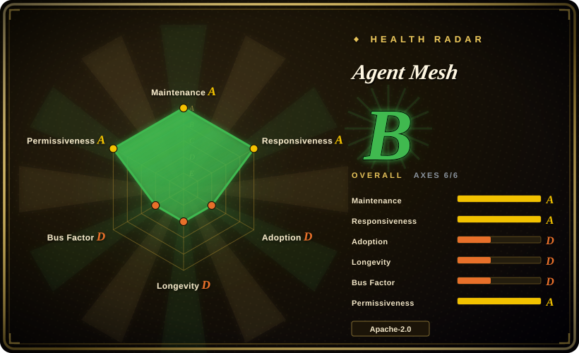
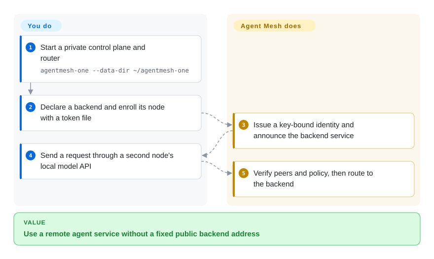
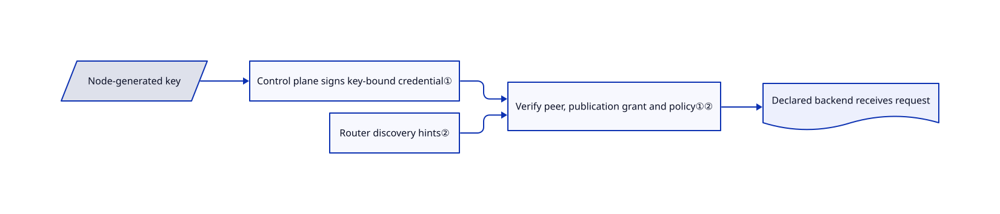

# Agent Mesh

Your agent can reach a model on one laptop but not a tool behind another machine's firewall. Agent Mesh joins those services through authenticated peers and relays, with permissions tied to service names rather than changing addresses.

## When to use

You run agent tools and model servers across laptops, containers and clusters. Hand-maintained hostnames and port forwards break whenever a device moves networks. Choose Agent Mesh when you need service discovery, verified node identities and per-service authorization together, rather than a generic network tunnel or a central HTTP gateway. A local node presents MCP tools and an OpenAI-compatible model API while the mesh handles finding and reaching remote providers.

The Google project is distinct from Microsoft's similarly named `agentmesh` governance package. This repository supplies a distributed service network, not an agent reasoning framework.

## When NOT to use

- **Only one API edge needs plugins and rate limits.** Choose [Kong](../api-gateway/kong.md); a control plane, relay routers and per-machine nodes add little to that deployment.
- **You need policy checks around in-process agent functions.** Choose [agent-governance-toolkit](../agent-governance/agent-governance-toolkit.md); mesh policy does not intercept arbitrary local code.
- **You need a general-purpose private IP network.** Consider Headscale instead; Agent Mesh exposes declared services rather than making every host port reachable.
- **You need a production-ready managed network.** Evaluate a supported managed networking product instead of treating the public developer testnet as infrastructure. The README gives that testnet no uptime promise and explicitly disclaims official Google product support.
- **You intend to share the default laptop setup unchanged.** Use explicit narrow policy before sharing. `agentmesh-one` seeds an open development policy that lets enrolled members publish and call any service; the general deny-by-default design is not the example's seeded policy.

## Comparison

| Alternative | In index | Our verdict | Tradeoff |
|---|---|---|---|
| [Kong](../api-gateway/kong.md) | ✅ | Choose Kong for centralized HTTP API management; choose Agent Mesh for service identity and discovery across independently connected machines. | Kong's plugin ecosystem versus an additional peer network and enrollment lifecycle. |
| [agent-governance-toolkit](../agent-governance/agent-governance-toolkit.md) | ✅ | Choose the toolkit to govern local tool dispatch; choose Agent Mesh to authorize calls between machines. | Function-level middleware versus network service boundaries; they address different enforcement points. |
| Headscale | not indexed | Choose Headscale for a self-hosted Tailscale control server and general private connectivity; choose Agent Mesh for named agent-service permissions. | Existing private-network clients versus protocol-aware service publication; real repository, not added in this tab batch. |

## Quick start

Obtain the released binaries and start `agentmesh-one --data-dir ~/agentmesh-one` for a local control plane, router and console. Declare an existing model or tool backend in a node YAML file, then enroll and run a node using the printed control-plane address and a bootstrap token file. Start another node and point your agent at its local MCP server or OpenAI-compatible endpoint, meaning the same request format many model clients already use. Agent Mesh discovers the provider and routes the authorized call; it does not supply or pay for the model. You operate the backends, keys, persistent state and policy; replace the seeded development policy before sharing the mesh.

<!-- flow-steps:begin (generated from flows/agentmesh.json by tools/flow_card.py — do not edit) -->

Text version of the flow

1. **You**: Start a private control plane and router — `agentmesh-one --data-dir ~/agentmesh-one`
2. **You**: Declare a backend and enroll its node with a token file
3. **Agent Mesh**: Issue a key-bound identity and announce the backend service
4. **You**: Send a request through a second node's local model API
5. **Agent Mesh**: Verify peers and policy, then route to the backend

**Value**: Use a remote agent service without a fixed public backend address

<!-- flow-steps:end -->

## Key techniques

<!-- mechanism:begin (generated from mechanisms/agentmesh.json by tools/mechanism_card.py; do not edit) -->

Text version of the mechanism

- Node-generated key
- Control plane signs key-bound credential①
- Router discovery hints②
- Verify peer, publication grant and policy①②
- Declared backend receives request

- Node-generated key → Control plane signs key-bound credential①
- Control plane signs key-bound credential① → Verify peer, publication grant and policy①②
- Router discovery hints② → Verify peer, publication grant and policy①②
- Verify peer, publication grant and policy①② → Declared backend receives request

<!-- mechanism:end -->

### 1. Bind short-lived credentials to peer keys

- **Problem:** Knowing an address or discovering a service is not sufficient authorization to use it.
- **How:** Enrollment binds a signed Biscuit credential to a node-generated Ed25519 key. Peers verify the credential and possession of the key; stream handlers wait for authentication and reset streams that never authenticate.
- **Limits:** The control plane remains the trust root. Offline verification does not remove renewal, revocation distribution or signing-key operations.
- **Source:** [Identity model](https://github.com/google/agentmesh/blob/c34e3ca698425c6a1120c93d8d84f27d288775fc/site/content/docs/concepts/identity.md#L15-L115), [stream gate](https://github.com/google/agentmesh/blob/c34e3ca698425c6a1120c93d8d84f27d288775fc/internal/node/auth_gate.go#L54-L149).

### 2. Separate discovery hints from provider authorization

- **Problem:** A service announcement can be stale or claim a provider the caller should not trust.
- **How:** Routers maintain discovery records, nodes probe backends before advertising, and callers verify a provider's credential and publication grant before forwarding. Required labels can further constrain which provider receives data. libp2p connects peers directly or relays encrypted traffic when direct access fails.
- **Limits:** Discovery is not an availability guarantee. Operators still choose grants and provider-label requirements; a node with no egress label floor adds no such restriction.
- **Source:** [Networking path](https://github.com/google/agentmesh/blob/c34e3ca698425c6a1120c93d8d84f27d288775fc/site/content/docs/concepts/networking.md#L44-L149), [configuration model](https://github.com/google/agentmesh/blob/c34e3ca698425c6a1120c93d8d84f27d288775fc/api/policy.go#L69-L87).

## Tech stack

Go, libp2p transport and discovery, Biscuit authorization tokens, OIDC identity integration, protobuf/gRPC components and local HTTP APIs. The reviewed build uses Go 1.26.6; SDK and console sources add JavaScript and Python.

## Dependencies

A control plane, at least one reachable router and nodes beside your existing MCP, A2A or OpenAI-compatible backends. The standalone binary combines the first two with a console. Persistent state can be local or PostgreSQL-backed; OIDC is an enrollment option, not mandatory for bootstrap-token enrollment. Cross-machine control-plane access requires HTTPS. Model runtimes, provider accounts and their costs remain external.

## Ops difficulty

**Medium locally, high for shared infrastructure.** A single binary makes the laptop demo approachable. A shared mesh adds durable control-plane state, policy review, enrollment approval, credential renewal, router capacity, TLS and backend availability. Keep admin/join tokens out of logs and replace the example policy; a successful connection is not proof of safe policy.

## Health & viability

- **2026-10-18 — pre-1.0.** Release v0.1.0 was published on October 16. The repository was created in April 2026 and is actively maintained, but has little longevity evidence.
- **Backing.** Google owns the repository and source headers name Google LLC. The README expressly says this is not an officially supported Google product; organization ownership is not an SLA.
- **Continuity.** The contributor snapshot shows several contributors, with most history concentrated in the leading author. Apache-2.0 is verified from LICENSE and source headers.
- **Selection judgment.** Pilot it for distributed agent-service access, with pinned releases and explicit policy; do not equate the vendor namespace or public testnets with production maturity.

## Caveats (unverified)

- [未验证：未运行多节点环境] NAT traversal, latency, failover and policy enforcement were source-reviewed, not reproduced on this network.
- [推断：依据是首版发布日期与半年仓库历史] A pilot is a safer commitment than replacing an established production network before workload-specific testing.
