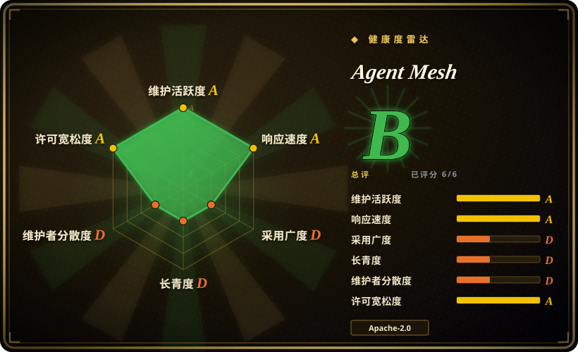
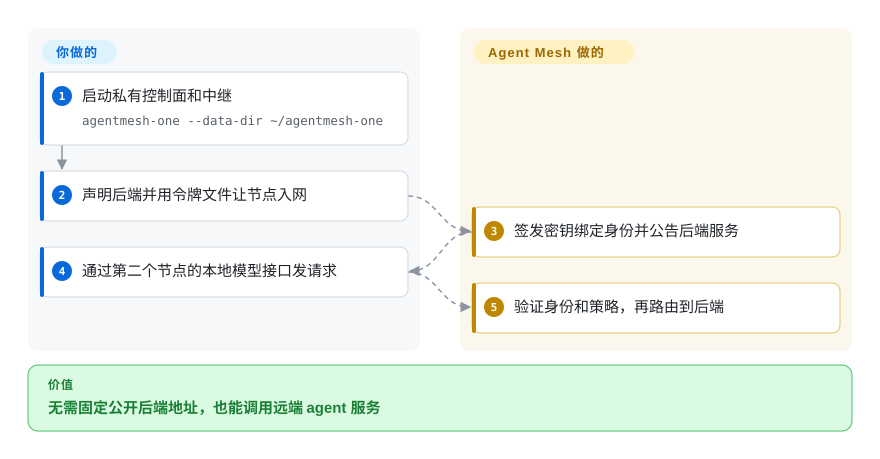
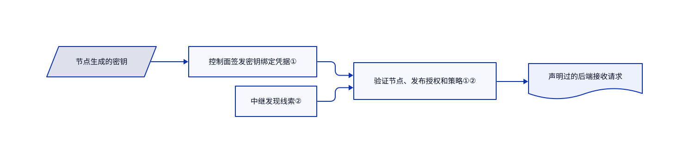

# Agent Mesh

agent 能调用一台电脑上的模型，却够不到另一台防火墙后的工具。Agent Mesh 用认证节点和中继连接服务，按服务名授权，不依赖不断变化的地址。

## 何时使用

你把 agent 工具和模型服务分散在笔记本、容器和集群里。设备一换网络，手写主机名和端口转发就失效。当你同时需要服务发现、节点身份和逐服务授权，而不只是通用隧道或集中式 HTTP 网关时，选 Agent Mesh。本地节点提供 MCP 工具和兼容 OpenAI 的模型接口，网络负责发现并连接远端提供方。

Google 的这个项目不同于微软同名的 `agentmesh` 治理包。它提供分布式服务网络，不提供 agent 推理框架。

## 何时不用

- **只有一个 API 入口需要插件和限流。** 选 [Kong](../api-gateway/kong.zh.md)；额外的控制面、中继和逐机节点没有多少收益。
- **要约束进程内的 agent 函数调用。** 选 [agent-governance-toolkit](../agent-governance/agent-governance-toolkit.zh.md)；网络策略不会拦截任意本地代码。
- **要通用的私有 IP 网络。** 考虑 Headscale；Agent Mesh 暴露声明过的服务，不是让所有主机端口互通。
- **需要带生产承诺的托管网络。** 应评估有支持承诺的托管产品，不要把公共开发测试网当基础设施。README 不承诺测试网可用性，也明确不是 Google 官方支持产品。
- **想原样共享笔记本示例。** 共享前先制定窄授权策略。`agentmesh-one` 会预置开放开发策略，允许已加入成员发布和调用任意服务；默认拒绝的架构不等于示例预置策略收紧了权限。

## 横向对比

| 替代品 | 是否收录 | 我们的评价 | 取舍 |
|---|---|---|---|
| [Kong](../api-gateway/kong.zh.md) | ✅ | 集中式 HTTP 管理选 Kong；跨独立联网机器的服务身份和发现选 Agent Mesh。 | Kong 有插件生态；Agent Mesh 多出对等网络和入网生命周期。 |
| [agent-governance-toolkit](../agent-governance/agent-governance-toolkit.zh.md) | ✅ | 本地工具分发治理选微软工具包；跨机器调用授权选 Agent Mesh。 | 函数中间件与网络服务边界，约束点不同。 |
| Headscale | 未收录 | 自托管 Tailscale 控制服务及通用私网选 Headscale；按 agent 服务名授权选 Agent Mesh。 | 现有私网客户端与协议感知的服务发布之间取舍；真实仓库，本次标签批次未收录。 |

## 快速上手

取得发布二进制，运行 `agentmesh-one --data-dir ~/agentmesh-one`，启动本地控制面、中继和控制台。在节点 YAML 中声明已有模型或工具后端，再用打印的控制面地址和引导令牌文件启动入网节点。另起一个节点，让 agent 连接其本地 MCP 服务或兼容 OpenAI 的接口，也就是许多模型客户端已有的请求格式。Agent Mesh 发现提供方并路由获准请求，不提供模型，也不承担推理费用。后端、密钥、持久状态和策略由你维护，共享前必须替换开发策略。

<!-- flow-steps:begin (generated from flows/agentmesh.json by tools/flow_card.py — do not edit) -->

流程文字版

1. **你**：启动私有控制面和中继 — `agentmesh-one --data-dir ~/agentmesh-one`
2. **你**：声明后端并用令牌文件让节点入网
3. **Agent Mesh**：签发密钥绑定身份并公告后端服务
4. **你**：通过第二个节点的本地模型接口发请求
5. **Agent Mesh**：验证身份和策略，再路由到后端

**价值**：无需固定公开后端地址，也能调用远端 agent 服务

<!-- flow-steps:end -->

## 技术要点

<!-- mechanism:begin (generated from mechanisms/agentmesh.json by tools/mechanism_card.py; do not edit) -->

机制文字版

- 节点生成的密钥
- 控制面签发密钥绑定凭据①
- 中继发现线索②
- 验证节点、发布授权和策略①②
- 声明过的后端接收请求

- 节点生成的密钥 → 控制面签发密钥绑定凭据①
- 控制面签发密钥绑定凭据① → 验证节点、发布授权和策略①②
- 中继发现线索② → 验证节点、发布授权和策略①②
- 验证节点、发布授权和策略①② → 声明过的后端接收请求

<!-- mechanism:end -->

### 1. 把短期凭据绑定到节点密钥

- **解决：** 知道地址或发现服务，不代表有权调用。
- **做法：** 入网把签名的 Biscuit 授权凭据绑定到节点生成的 Ed25519 密钥。对端验证凭据及密钥持有证明；流处理器等待认证，始终未认证的流会被重置。
- **边界：** 控制面仍是信任根。离线验证不免除续期、吊销传播及签名密钥运维。
- **源码：** [身份模型](https://github.com/google/agentmesh/blob/c34e3ca698425c6a1120c93d8d84f27d288775fc/site/content/docs/concepts/identity.md#L15-L115)、[流认证门](https://github.com/google/agentmesh/blob/c34e3ca698425c6a1120c93d8d84f27d288775fc/internal/node/auth_gate.go#L54-L149)。

### 2. 将发现线索与提供方授权分开

- **解决：** 服务公告可能过期，也可能指向调用方不该信任的提供方。
- **做法：** 中继维护发现记录，节点先探测后端再公告。转发前验证提供方凭据和发布授权，还可要求特定身份标签。libp2p 优先直连，无法直连时中继加密流量。
- **边界：** 发现记录不是可用性承诺。授权和提供方标签仍由运维选择；没有配置出口标签底线就没有这层额外约束。
- **源码：** [网络路径](https://github.com/google/agentmesh/blob/c34e3ca698425c6a1120c93d8d84f27d288775fc/site/content/docs/concepts/networking.md#L44-L149)、[配置模型](https://github.com/google/agentmesh/blob/c34e3ca698425c6a1120c93d8d84f27d288775fc/api/policy.go#L69-L87)。

## 技术栈

Go、libp2p 传输与发现、Biscuit 授权令牌、OIDC 身份接入、protobuf/gRPC 组件和本地 HTTP 接口。所读构建要求 Go 1.26.6；SDK 与控制台另有 JavaScript 和 Python。

## 依赖

需要控制面、至少一个可达中继，以及运行在已有 MCP、A2A 或兼容 OpenAI 后端旁的节点。独立二进制把控制面、中继和控制台合在一起。状态可本地保存，也可使用 PostgreSQL；引导令牌入网不强制使用 OIDC。跨机访问控制面要求 HTTPS。模型运行时、提供方账号及费用仍在项目外。

## 运维难度

**本地中，共享基础设施高。** 单个二进制降低了演示门槛。共享部署还要维护持久状态、策略、入网审批、凭据续期、中继容量、TLS 和后端可用性。避免把管理员及入网令牌写进日志，并替换示例策略；连接成功不证明授权安全。

## 健康度与可持续性

- **2026-10-18，尚未到 1.0。** v0.1.0 发布于 10 月 16 日。仓库建于 2026 年 4 月，目前活跃，但长期存续证据有限。
- **背书边界。** 仓库属于 Google，源码署名 Google LLC。README 明确不是官方支持产品，组织归属不等于服务承诺。
- **维护持续性。** 贡献者快照显示多人参与，但大部分历史集中在首位作者。LICENSE 及源码头确认 Apache-2.0。
- **选型判断。** 适合固定发布版、明确策略后试点跨机 agent 服务；不能把厂商命名空间和公共测试网当成生产成熟度证据。

## 存疑（未验证）

- [未验证：未运行多节点环境] NAT 穿透、延迟、故障切换及策略执行只核对源码，没有在当前网络复现。
- [推断：依据是首版发布日期与半年仓库历史] 先做试点，比未经过自身负载测试就替换成熟生产网络更稳妥。
