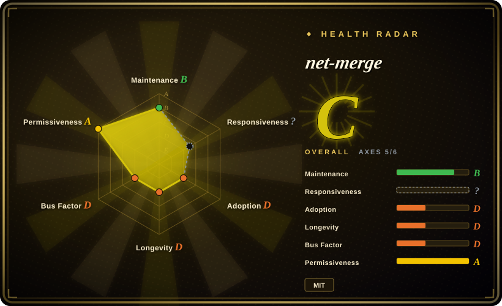
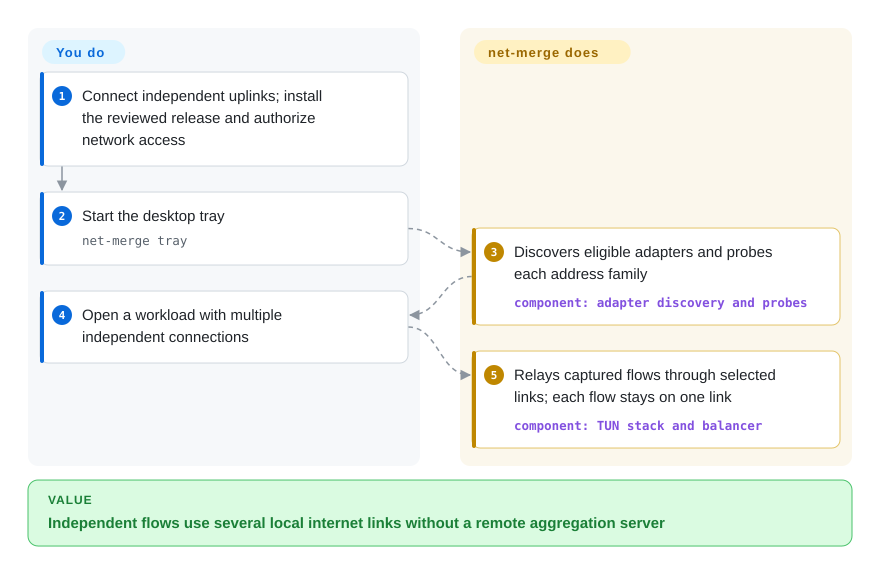
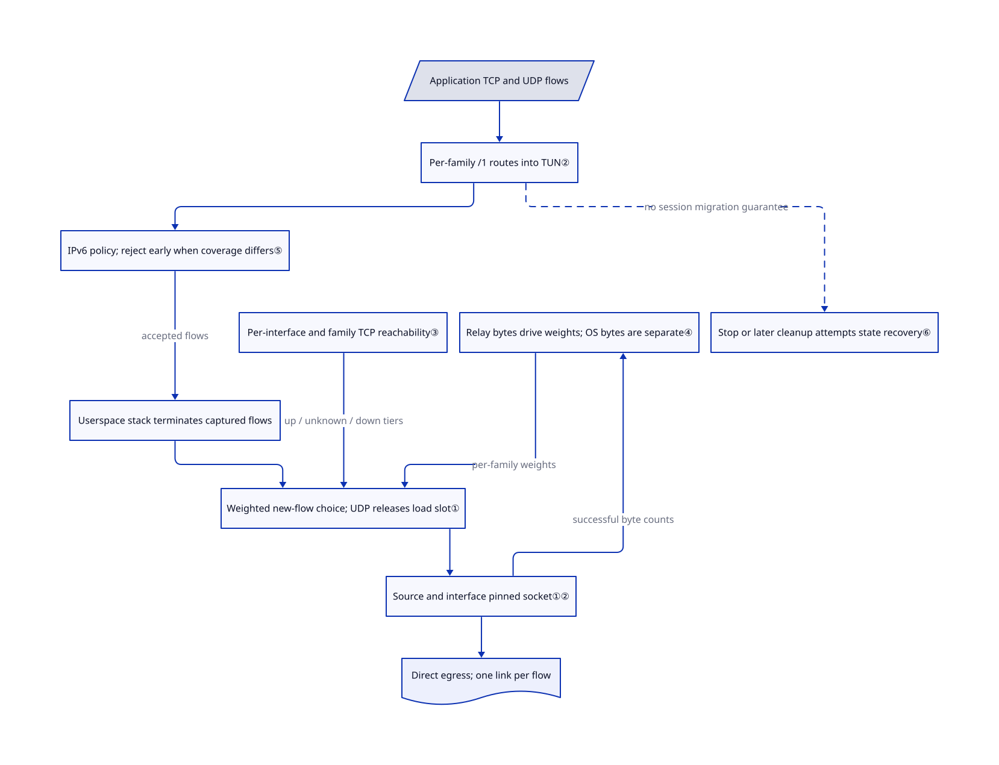

# net-merge

Your laptop downloads through Wi-Fi while its phone tether sits idle. net-merge sends different connections through different adapters; it does not combine their bandwidth for one connection.

## When to use

You download game updates or many files on a Windows, macOS or Linux workstation. Wi-Fi and a mobile-data tether have independent internet paths, but applications keep choosing just one. You can accept a privileged local relay and changing public IPs between connections. net-merge captures outbound TCP and UDP through a virtual network adapter, then assigns each new flow to an eligible physical link. Applications must open multiple flows to use multiple links.

Choose it over a router distribution when only this workstation needs balancing and you do not want a remote aggregation server. Choose it over [Clash Verge Rev](../dev-utilities/ops-infra/clash-verge-rev.md) when the goal is using local uplinks, not selecting proxy servers by site rules. Its lower setup burden comes with no single-flow bonding, stable shared exit IP or transparent migration of established sockets.

## When NOT to use

- **One TCP download, one persistent HTTP/2 connection or one QUIC session must exceed one link's speed.** Evaluate [OpenMPTCProuter](https://github.com/Ysurac/openmptcprouter) with its remote VPS aggregation endpoint instead. net-merge keeps each TCP connection or UDP socket on one adapter; requests multiplexed inside that connection do not get separate choices.
- **Wi-Fi and Ethernet share the same saturated home internet line.** Keep the operating system's normal route through the better adapter. net-merge cannot remove a bottleneck upstream of both links; a phone must use an independent mobile-data path, not the same Wi-Fi.
- **A disconnected tether must not break an existing session, or every connection must share one public IP.** Evaluate OpenMPTCProuter's server-terminated multipath design instead. net-merge retries certain TCP dial failures before establishment; it does not move an established TCP or UDP socket to another link. Applications must reconnect, and some sites bind logins to an exit IP.
- **The job is LAN-wide multi-WAN policy routing.** Choose [mwan3](https://github.com/openwrt/packages/tree/master/net/mwan3) on OpenWrt for interface policies and connection tracking. Choose [dae](dae.md) for a Linux gateway's direct-versus-proxy rules. This project relays a host's captured TCP/UDP; it is not a general router or arbitrary-IP tunnel.
- **Corporate VPN policy, Windows Internet Connection Sharing or a mobile hotspot must remain unchanged.** Keep the managed VPN/default route, or use Clash Verge Rev for an approved proxy-routing task. Auto-discovery excludes VPNs and most virtual interfaces; forcing `-include` bypasses those filters, not compatibility problems. Windows capture disables weak-host sending and forwarding on used adapters, pausing sharing; macOS TetherKit links may drop when the virtual adapter is created or destroyed.
- **You cannot authorize network privileges.** For a TCP-only, opt-in application, use `net-merge socks` rather than system-wide mode. Its SOCKS5 listener has no authentication and supports CONNECT only, not UDP ASSOCIATE; keep its default loopback binding. For a host that must remain untouched, keep the OS default route.
- **IPv6-only destinations must work despite mixed IPv6 availability.** Prefer the native route with working IPv6, or explicitly review `-ipv6 on` before using net-merge. Default `auto` rejects new captured IPv6 flows when usable IPv4 adapters lack IPv6; it depends on applications falling back to IPv4. This is not a VPN kill switch.

## Comparison

| Alternative | In index | Our verdict | Tradeoff |
| --- | --- | --- | --- |
| [OpenMPTCProuter](https://github.com/Ysurac/openmptcprouter) | not indexed | For aggregation through one remote exit, choose OpenMPTCProuter; for distributing a workstation's independent flows without a server, choose net-merge. | OpenWrt-based router plus a VPS and multipath tunnels, rather than a desktop tray. Not added within this targeted two-project intake. |
| [mwan3](https://github.com/openwrt/packages/tree/master/net/mwan3) | not indexed | For a whole LAN with weighted WAN policies and sticky rules, choose mwan3; for a single desktop without router changes, choose net-merge. | Kernel routing and connection tracking on OpenWrt instead of a userspace TCP/UDP relay; neither is single-flow bonding by itself. Not added within this targeted two-project intake. |
| [Clash Verge Rev](../dev-utilities/ops-infra/clash-verge-rev.md) | ✅ | For site rules and proxy subscriptions, choose Clash Verge Rev; for direct use of several local internet links, choose net-merge. | Adds proxy configuration and remote nodes where required; it solves proxy selection, not this project's local-link aggregation task. |
| [dae](dae.md) | ✅ | For Linux gateway rules with direct traffic staying in-kernel, choose dae; for local multi-uplink balancing across three desktop OSes, choose net-merge. | dae requires a suitable Linux kernel and routing configuration; net-merge passes captured traffic through a userspace stack and has no comparable domain/process rule language. |

## Quick start

First connect two independent internet links and review the [installation instructions](https://github.com/rohit267/net-merge/blob/fe343c69b2020bed415e8ed669cee5a7f34d8918/README.md#install) and privileged changes below. Install a release/package, or build with `go build -o net-merge ./cmd/net-merge`; the manifest requires Go 1.27, and macOS builds need Xcode command-line tools. After granting the platform's required rights, start `net-merge tray`, which provides the menu-bar or tray control. You supply the links, mobile-data budget and any adapter/IPv6 choices; it discovers adapters and distributes new captured flows without a remote server or per-app proxy setting. Open a workload with multiple independent connections to use more than one path; this page reviewed sources only and did not install or run these commands.

<!-- flow-steps:begin (generated from flows/net-merge.json by tools/flow_card.py — do not edit) -->

Text version of the flow

1. **You**: Connect independent uplinks; install the reviewed release and authorize network access
2. **You**: Start the desktop tray — `net-merge tray`
3. **net-merge**: Discovers eligible adapters and probes each address family — component: `adapter discovery and probes`
4. **You**: Open a workload with multiple independent connections
5. **net-merge**: Relays captured flows through selected links; each flow stays on one link — component: `TUN stack and balancer`

**Value**: Independent flows use several local internet links without a remote aggregation server

<!-- flow-steps:end -->

## Key techniques

<!-- mechanism:begin (generated from mechanisms/net-merge.json by tools/mechanism_card.py; do not edit) -->

Text version of the mechanism

- Application TCP and UDP flows
- Per-family /1 routes into TUN②
- IPv6 policy; reject early when coverage differs⑤
- Userspace stack terminates captured flows
- Per-interface and family TCP reachability③
- Relay bytes drive weights; OS bytes are separate④
- Weighted new-flow choice; UDP releases load slot①
- Source and interface pinned socket①②
- Direct egress; one link per flow
- Stop or later cleanup attempts state recovery⑥

- Application TCP and UDP flows → Per-family /1 routes into TUN②
- Per-family /1 routes into TUN② → IPv6 policy; reject early when coverage differs⑤
- IPv6 policy; reject early when coverage differs⑤ → Userspace stack terminates captured flows (accepted flows)
- Userspace stack terminates captured flows → Weighted new-flow choice; UDP releases load slot①
- Per-interface and family TCP reachability③ → Weighted new-flow choice; UDP releases load slot① (up / unknown / down tiers)
- Relay bytes drive weights; OS bytes are separate④ → Weighted new-flow choice; UDP releases load slot① (per-family weights)
- Weighted new-flow choice; UDP releases load slot① → Source and interface pinned socket①②
- Source and interface pinned socket①② → Direct egress; one link per flow
- Source and interface pinned socket①② → Relay bytes drive weights; OS bytes are separate④ (successful byte counts)
- Per-family /1 routes into TUN② → Stop or later cleanup attempts state recovery⑥ (no session migration guarantee) [optional/fallback]

<!-- mechanism:end -->

### 1. Assign sockets, not packets or HTTP requests

- **Problem:** A workstation's normal default route leaves other independent uplinks unused.
- **How:** Per address family, the scheduler selects the smallest `(active + 1) / weight`, randomizing ties. TCP binds its source address and interface before dialing; a UDP session gets one similarly pinned socket.
- **Limits:** Established flows stay on that socket. UDP releases the active-flow slot immediately, so long-lived UDP sessions do not contribute to the active-load count; this is not a packet scheduler or a promise that every browser request switches links.
- **Source:** [Selection](https://github.com/rohit267/net-merge/blob/fe343c69b2020bed415e8ed669cee5a7f34d8918/internal/engine/sched.go#L269-L319), [TCP dial](https://github.com/rohit267/net-merge/blob/fe343c69b2020bed415e8ed669cee5a7f34d8918/internal/engine/balancer.go#L132-L172), [UDP lifetime](https://github.com/rohit267/net-merge/blob/fe343c69b2020bed415e8ed669cee5a7f34d8918/internal/engine/flowconn.go#L70-L98).

### 2. Capture through TUN, then force physical egress

- **Problem:** Applications that ignore proxy settings still need a common capture path, without sending relayed traffic back into itself.
- **How:** Two `/1` routes per family capture matching traffic through Linux TUN, macOS utun or Windows Wintun. tun2socks/gVisor terminates TCP/UDP locally; outbound sockets use Linux `SO_BINDTOIFINDEX` with a device-name fallback, macOS `IP_BOUND_IF`/`IPV6_BOUND_IF`, or Windows unicast-interface options.
- **Limits:** This is route-based capture, not a WFP interception driver; more-specific routes and directly bound applications can bypass it. Discovery normally requires hardware/default routes and filters virtual interfaces; `-include` overrides checks. IPv6 setup is best-effort and can leave IPv6 on its normal path.
- **Source:** [Capture and relay](https://github.com/rohit267/net-merge/blob/fe343c69b2020bed415e8ed669cee5a7f34d8918/internal/tun/tun.go#L26-L66), [Linux binding](https://github.com/rohit267/net-merge/blob/fe343c69b2020bed415e8ed669cee5a7f34d8918/internal/nics/egress_linux.go#L10-L33), [macOS binding](https://github.com/rohit267/net-merge/blob/fe343c69b2020bed415e8ed669cee5a7f34d8918/internal/nics/egress_darwin.go#L9-L28), [Windows binding](https://github.com/rohit267/net-merge/blob/fe343c69b2020bed415e8ed669cee5a7f34d8918/internal/nics/egress_windows.go#L8-L30), [discovery](https://github.com/rohit267/net-merge/blob/fe343c69b2020bed415e8ed669cee5a7f34d8918/internal/nics/nics.go#L36-L111).

### 3. Probe each link and family, but only TCP reachability

- **Problem:** An adapter can have an address and gateway but no useful internet service.
- **How:** Each adapter/family probes two public anycast IPs on TCP port 443 using both the source address and forced interface. The first successful TCP connection marks it up; healthy links are rechecked every 15 seconds, failed links every 4 seconds, with a 2-second timeout per target.
- **Limits:** No TLS, HTTP, DNS, UDP or captive-portal validation occurs. The scheduler prefers up over unknown over down, but still selects down links if that is the only tier available. Passing a probe is not proof that the intended service works.
- **Source:** [Bound probe targets and cadence](https://github.com/rohit267/net-merge/blob/fe343c69b2020bed415e8ed669cee5a7f34d8918/internal/engine/probe.go#L10-L97), [fallback tiers](https://github.com/rohit267/net-merge/blob/fe343c69b2020bed415e8ed669cee5a7f34d8918/internal/engine/sched.go#L269-L300).

### 4. Separate relayed throughput from whole-adapter traffic

- **Problem:** A busy adapter does not prove that net-merge carried its traffic or increased internet capacity.
- **How:** Socket wrappers count successful TCP/UDP bytes per selected slot and family; one-second samples derive weights from observed receive-plus-send peaks. Separate OS counters read Linux sysfs, macOS route information or Windows interface counters by interface index for the whole adapter.
- **Limits:** Whole-adapter totals include applications that bypass the relay. Weights use observed relay traffic, not an active bandwidth test; they stay equal until every present link/family passes the measurement threshold, and combine upload with download rather than modeling asymmetric capacity separately.
- **Source:** [Socket byte accounting](https://github.com/rohit267/net-merge/blob/fe343c69b2020bed415e8ed669cee5a7f34d8918/internal/engine/flowconn.go#L12-L68), [sampling and weights](https://github.com/rohit267/net-merge/blob/fe343c69b2020bed415e8ed669cee5a7f34d8918/internal/engine/sched.go#L174-L263), [Linux counters](https://github.com/rohit267/net-merge/blob/fe343c69b2020bed415e8ed669cee5a7f34d8918/internal/nics/counters_linux.go), [macOS counters](https://github.com/rohit267/net-merge/blob/fe343c69b2020bed415e8ed669cee5a7f34d8918/internal/nics/counters_darwin.go), [Windows counters](https://github.com/rohit267/net-merge/blob/fe343c69b2020bed415e8ed669cee5a7f34d8918/internal/nics/counters_windows.go).

### 5. Reject captured IPv6 early when families differ

- **Problem:** IPv6-preferring applications can send all their traffic through the one adapter with IPv6.
- **How:** Default `auto` checks IPv6 coverage of usable IPv4 adapters. When coverage differs, the userspace TCP handler resets IPv6 at the initial SYN; UDP remains unhandled so the stack returns an unreachable response, allowing an application to try IPv4.
- **Limits:** IPv6-only services fail in that state, and not every application retries another family. `on` permits IPv6 through the available IPv6 links; `off` rejects captured IPv6. These controls apply to captured flows, not traffic bypassing failed IPv6 capture setup.
- **Source:** [Family policy](https://github.com/rohit267/net-merge/blob/fe343c69b2020bed415e8ed669cee5a7f34d8918/internal/engine/balancer.go#L26-L78), [coverage test](https://github.com/rohit267/net-merge/blob/fe343c69b2020bed415e8ed669cee5a7f34d8918/internal/engine/sched.go#L321-L353), [TCP/UDP rejection](https://github.com/rohit267/net-merge/blob/fe343c69b2020bed415e8ed669cee5a7f34d8918/internal/tun/forward.go#L17-L56).

### 6. Restore routing separately from session continuity

- **Problem:** Stopping a privileged capture process must release its routes, but some platform changes outlive the virtual adapter.
- **How:** Normal teardown removes capture routes and closes the stack/device; startup and `cleanup` attempt stale-state repair. macOS adds scoped defaults and keeps utun while paused; Windows records original weak-host/forwarding settings before restoring them on normal stop or later recovery.
- **Limits:** Removing capture does not migrate established sessions. Windows settings may remain changed after a crash until restart/cleanup, and macOS scoped defaults can survive; cleanup calls include ignored errors. Device-linked route removal is the recovery design, not a verified blanket crash-safety guarantee.
- **Source:** [Teardown and stale cleanup](https://github.com/rohit267/net-merge/blob/fe343c69b2020bed415e8ed669cee5a7f34d8918/internal/tun/tun.go#L169-L218), [macOS scoped cleanup](https://github.com/rohit267/net-merge/blob/fe343c69b2020bed415e8ed669cee5a7f34d8918/internal/tun/tun_darwin.go#L133-L233), [Windows saved settings](https://github.com/rohit267/net-merge/blob/fe343c69b2020bed415e8ed669cee5a7f34d8918/internal/tun/tun_windows.go#L132-L247).

## Tech stack

- Go 1.27 module; tun2socks v2.7.0 and gVisor userspace TCP/IP stack; Fyne systray for desktop controls.
- Linux uses netlink for address/route changes; macOS invokes system routing tools; Windows invokes `netsh`, `route` and PowerShell and uses Wintun. There is no separate WFP driver in this source tree.
- [Root MIT license](https://github.com/rohit267/net-merge/blob/fe343c69b2020bed415e8ed669cee5a7f34d8918/LICENSE) covers project code. [Third-party notices](https://github.com/rohit267/net-merge/blob/fe343c69b2020bed415e8ed669cee5a7f34d8918/THIRD-PARTY-NOTICES.md) describe library licenses; the Windows DLL instead carries the separate Prebuilt Binaries License in the [Wintun 0.14.1 archive](https://www.wintun.net/builds/wintun-0.14.1.zip), including redistribution conditions. Do not treat the whole Windows package as MIT.

## Dependencies

- Two independent internet paths for aggregate benefit, adequate mobile-data allowance, OS-supported network adapters/tether drivers, and outbound probe access to the listed public IPs.
- Linux system-wide mode needs `/dev/net/tun` and root or `CAP_NET_ADMIN`; packages/install paths also grant `CAP_NET_RAW`. macOS needs root; `net-merge install` copies a root-owned binary and adds exact passwordless `tray` **and** `cleanup` commands to sudoers after `visudo` validation.
- Windows system-wide mode needs administrator rights and `wintun.dll`; the build helper checks a pinned archive hash and DLL signature, but that does not sign net-merge's own executables. The README states those executables are unsigned.
- A Linux tray needs StatusNotifierItem support. macOS Android USB tethering needs TetherKit according to upstream; it is not an included driver. No account, remote aggregation server or database is required.

## Ops difficulty

**Medium.** The controls are simple, but their effects are system-wide. Review the installers before execution: the shell script adds package sources/keys or installs a release binary, grants privileges and may start the tray; the PowerShell script downloads and starts an elevated installer. The tarball branch does not verify an archive checksum before executing/installing it. Prefer a reviewed, pinned installation source over piping the moving default branch into a shell.

Use `net-merge list` for skipped interfaces and `net-merge status` to distinguish whole-link traffic from relayed traffic. `quit` closes the tray; `cleanup` is a privileged repair attempt, not a read-only diagnostic. Turning capture on/off can interrupt connections; upstream's automatic pause uses delays to reduce interruptions, not eliminate them. Review [platform privilege code](https://github.com/rohit267/net-merge/blob/fe343c69b2020bed415e8ed669cee5a7f34d8918/internal/platform/install_darwin.go#L19-L79), [installer behavior](https://github.com/rohit267/net-merge/blob/fe343c69b2020bed415e8ed669cee5a7f34d8918/install.sh#L36-L81) and recovery paths before using a machine needed for remote access.

## Health & viability

- **2026-10-22 — active, extremely young.** Created 2026-10-12; latest release v0.3.3 was published 2026-10-20, following several releases within days. The reviewed default-branch commit is `fe343c69b2020bed415e8ed669cee5a7f34d8918`; recent commits include smoke-test fixes. Ten days of activity is no durability record.
- **Governance/backing.** User-owned; the contributor API reports 34 commits from the owner and one each from four others. CONTRIBUTING and SECURITY exist, with only the latest release receiving security fixes. No foundation or corporate support commitment was found in those documents.
- **Radar coverage.** Automated aggregate C, with 5/6 axes scored. Responsiveness remains `?` because the scoring window has no qualifying signal; this is not a measured response-time verdict.
- **Adoption versus Lindy.** 1636 stars and 83 forks are dated discovery signals, not proof of production reliability. [推断：依据是十天仓龄、快速发版和权限路径，未做运行验收] Treat it as an experimental workstation utility, not a conservative dependency for an unattended gateway.
- **Test and risk boundary.** The repository has scheduler/relay tests and CI definitions for three desktop OSes, Linux end-to-end and platform smoke tests; these were read, not run here. **The automated license axis measures root MIT metadata, not Wintun redistribution conditions or privileged-network safety.** Neither the radar nor upstream performance/security claims establish crash recovery on your machine.

## Caveats (unverified)

- [未验证：本次授权仅限静态读取] No installer, CLI, driver, bandwidth benchmark or upstream runtime test was executed. Upstream speed/CPU figures and claims that internet always survives a crash were not reproduced.
- [未验证：缺少三平台多网卡运行环境且禁止修改网络] Actual TCP/UDP throughput, IPv6 fallback, hotplug, VPN coexistence, captive-portal behavior and crash-time route/settings recovery need acceptance tests on the intended machine. Source inspection establishes intended paths and known side effects, not universal compatibility.
- [推断：依据是十天仓龄、快速发版和已读权限代码] Experimental-workstation positioning is a selection judgment; future support, maintainer continuity and production adoption are not established by stars or releases.
