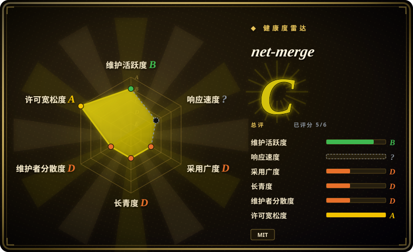
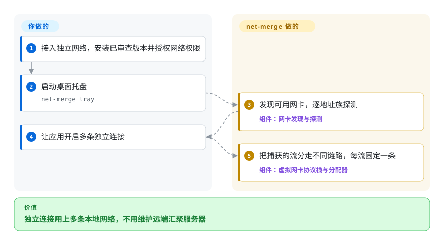
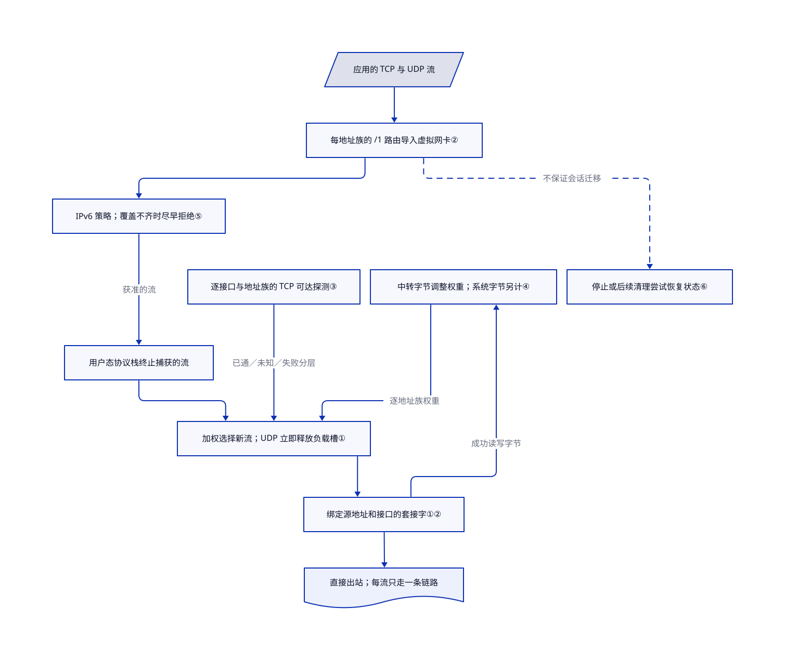

# net-merge

电脑走 Wi-Fi 下载，手机共享网络却闲着。net-merge 把不同连接交给不同网卡，不会给单条连接叠加带宽。

## 何时使用

你在 Windows、macOS 或 Linux 电脑上下载游戏更新或多份文件。Wi-Fi 和移动数据热点各有独立出口，应用却总选同一条。你能接受本机程序以网络管理权限中转，也能接受不同连接使用不同公网 IP。net-merge 用虚拟网卡接住出站 TCP 和 UDP，再把新流分给可用物理链路。应用必须开多条流，才能用上多条网络。

只有这台电脑需要分流，又不想维护远端汇聚服务器时，可以选它而不是路由器发行版。目标是利用本地多条网络，而不是按网站选代理节点时，可以选它而不是 [Clash Verge Rev](../dev-utilities/ops-infra/clash-verge-rev.zh.md)。省掉服务器的代价是：没有单流叠速、统一出口 IP，也不透明迁移已经建立的连接。

## 何时不用

- **一条 TCP 下载、持久 HTTP/2 连接或 QUIC 会话就要超过单链路速度。** 改评估 [OpenMPTCProuter](https://github.com/Ysurac/openmptcprouter) 与远端 VPS 汇聚方案。net-merge 把每条 TCP 连接或 UDP 套接字固定在一张网卡上；同一连接中复用的请求不会重新选网卡。
- **Wi-Fi 和网线共用同一条已跑满的家庭宽带。** 保持操作系统经较好网卡直连。net-merge 消不掉两条链路共同上游的瓶颈；手机也必须走独立移动数据，而不是同一 Wi-Fi。
- **拔掉热点不能断开已有会话，或所有连接必须共享一个公网 IP。** 改评估 OpenMPTCProuter 经服务器汇聚的多路径方案。net-merge 只在 TCP 建连失败时，对部分错误尝试另一网卡；不会迁移已建立的 TCP 或 UDP 套接字。应用要自己重连，绑定出口 IP 的网站也可能要求重新登录。
- **要给整个局域网做多出口策略。** OpenWrt 上选 [mwan3](https://github.com/openwrt/packages/tree/master/net/mwan3)，获得接口策略和连接跟踪；Linux 网关按规则选择直连或代理，则看 [dae](dae.zh.md)。本项目中转的是本机被捕获的 TCP／UDP，不是通用路由器或任意 IP 隧道。
- **公司 VPN 策略、Windows 网络共享或移动热点不能受影响。** 保持受管 VPN 和默认路由；经批准的代理分流任务可用 Clash Verge Rev。自动发现会排除 VPN 和大部分虚拟网卡；强行 `-include` 只绕过筛选，不解决兼容问题。Windows 捕获期间会关闭所用网卡的弱主机发送和转发，从而暂停共享；macOS 创建或销毁虚拟网卡时，TetherKit 链路可能掉线。
- **不能授权网络管理权限。** 单个应用只需 TCP 时，可选 `net-merge socks`，不要启用全机模式。其 SOCKS5 监听无认证，仅支持 CONNECT，不支持 UDP ASSOCIATE；保留默认本机回环监听。机器完全不能改，则保持系统默认路由。
- **网卡的 IPv6 支持不齐，但必须访问仅有 IPv6 的站点。** 优先保留能通 IPv6 的原生路由，或审查后显式选 `-ipv6 on`。默认 `auto` 在可用 IPv4 网卡缺少 IPv6 时拒绝新捕获的 IPv6 流，依赖应用回退到 IPv4。这不是 VPN 断网保护。

## 横向对比

| 替代品 | 是否收录 | 我们的评价 | 取舍 |
| --- | --- | --- | --- |
| [OpenMPTCProuter](https://github.com/Ysurac/openmptcprouter) | 未收录 | 需要经统一远端出口汇聚时选 OpenMPTCProuter；只想让单台电脑的独立连接分走多条本地网络时选 net-merge。 | 要维护基于 OpenWrt 的路由器、VPS 和多路径隧道，不是桌面托盘即可。未在本次定向两项目范围收录。 |
| [mwan3](https://github.com/openwrt/packages/tree/master/net/mwan3) | 未收录 | 整个局域网需要加权出口策略与粘性规则时选 mwan3；只有一台电脑需要分流且不改路由器时选 net-merge。 | OpenWrt 内核路由与连接跟踪，替代用户态 TCP／UDP 中转；两者本身都不是单流叠速。未在本次定向两项目范围收录。 |
| [Clash Verge Rev](../dev-utilities/ops-infra/clash-verge-rev.zh.md) | ✅ | 按站点规则使用代理订阅时选 Clash Verge Rev；直接利用本地多条上网链路时选 net-merge。 | 需要相应代理配置与远端节点；解决的是代理选择，不是这里的本地多链路利用。 |
| [dae](dae.zh.md) | ✅ | Linux 网关要按规则分流，并让直连流量留在内核时选 dae；三种桌面系统上分配本地多出口时选 net-merge。 | dae 要合适的 Linux 内核和路由配置；net-merge 让捕获流量经过用户态协议栈，没有同等域名／进程规则语言。 |

## 快速上手

先接好两条独立上网链路，再读[安装说明](https://github.com/rohit267/net-merge/blob/fe343c69b2020bed415e8ed669cee5a7f34d8918/README.md#install)和下文的权限改动。安装发布包或软件包，也可用 `go build -o net-merge ./cmd/net-merge` 构建；清单要求 Go 1.27，macOS 构建还要 Xcode 命令行工具。授权对应平台权限后，用 `net-merge tray` 打开菜单栏或托盘控制。你负责链路、手机流量预算和网卡／IPv6 选择；它负责发现网卡和分配新捕获的流，不用远端服务器或逐应用设代理。让应用开启多条独立连接，才会用上多条路径；本页只核源码，没有安装或执行上述命令。

<!-- flow-steps:begin (generated from flows/net-merge.json by tools/flow_card.py — do not edit) -->

流程文字版

1. **你**：接入独立网络，安装已审查版本并授权网络权限
2. **你**：启动桌面托盘 — `net-merge tray`
3. **net-merge**：发现可用网卡，逐地址族探测 — 组件：`网卡发现与探测`
4. **你**：让应用开启多条独立连接
5. **net-merge**：把捕获的流分走不同链路，每流固定一条 — 组件：`虚拟网卡协议栈与分配器`

**价值**：独立连接用上多条本地网络，不用维护远端汇聚服务器

<!-- flow-steps:end -->

## 技术要点

<!-- mechanism:begin (generated from mechanisms/net-merge.json by tools/mechanism_card.py; do not edit) -->

机制文字版

- 应用的 TCP 与 UDP 流
- 每地址族的 /1 路由导入虚拟网卡②
- IPv6 策略；覆盖不齐时尽早拒绝⑤
- 用户态协议栈终止捕获的流
- 逐接口与地址族的 TCP 可达探测③
- 中转字节调整权重；系统字节另计④
- 加权选择新流；UDP 立即释放负载槽①
- 绑定源地址和接口的套接字①②
- 直接出站；每流只走一条链路
- 停止或后续清理尝试恢复状态⑥

- 应用的 TCP 与 UDP 流 → 每地址族的 /1 路由导入虚拟网卡②
- 每地址族的 /1 路由导入虚拟网卡② → IPv6 策略；覆盖不齐时尽早拒绝⑤
- IPv6 策略；覆盖不齐时尽早拒绝⑤ → 用户态协议栈终止捕获的流（获准的流）
- 用户态协议栈终止捕获的流 → 加权选择新流；UDP 立即释放负载槽①
- 逐接口与地址族的 TCP 可达探测③ → 加权选择新流；UDP 立即释放负载槽①（已通／未知／失败分层）
- 中转字节调整权重；系统字节另计④ → 加权选择新流；UDP 立即释放负载槽①（逐地址族权重）
- 加权选择新流；UDP 立即释放负载槽① → 绑定源地址和接口的套接字①②
- 绑定源地址和接口的套接字①② → 直接出站；每流只走一条链路
- 绑定源地址和接口的套接字①② → 中转字节调整权重；系统字节另计④（成功读写字节）
- 每地址族的 /1 路由导入虚拟网卡② → 停止或后续清理尝试恢复状态⑥（不保证会话迁移）〔可选／兜底〕

<!-- mechanism:end -->

### 1. 分配套接字，不分配数据包或 HTTP 请求

- **解决：** 系统默认路由让其他独立上网链路闲置。
- **做法：** 调度器按地址族选择 `(active + 1) / weight` 最小的网卡，同分时随机打散。TCP 在建连前绑定源地址和接口；每个 UDP 会话也取得一个固定出口套接字。
- **边界：** 已建立的流不换套接字。UDP 选完后立即释放活跃流计数，因此长时间 UDP 会话不计入活跃负载；这不是逐包调度，也不保证每个浏览器请求都换网卡。
- **源码：** [网卡选择](https://github.com/rohit267/net-merge/blob/fe343c69b2020bed415e8ed669cee5a7f34d8918/internal/engine/sched.go#L269-L319)、[TCP 建连](https://github.com/rohit267/net-merge/blob/fe343c69b2020bed415e8ed669cee5a7f34d8918/internal/engine/balancer.go#L132-L172)、[UDP 生命周期](https://github.com/rohit267/net-merge/blob/fe343c69b2020bed415e8ed669cee5a7f34d8918/internal/engine/flowconn.go#L70-L98)。

### 2. 用虚拟网卡捕获，再强制从物理网卡出去

- **解决：** 不理代理设置的应用也要统一接入，同时不能让中转流量绕回自己。
- **做法：** 每个地址族的两条 `/1` 路由把匹配流量交给 Linux TUN、macOS utun 或 Windows Wintun。tun2socks／gVisor 在本机终止 TCP／UDP；出站套接字分别使用 Linux `SO_BINDTOIFINDEX` 及设备名回退、macOS `IP_BOUND_IF`／`IPV6_BOUND_IF`、Windows 单播接口选项。
- **边界：** 这是路由捕获，不是 WFP 拦截驱动；更具体的路由或直接绑定网卡的应用可以绕过。默认发现要求物理设备与默认路由，并排除虚拟网卡；`-include` 会覆盖筛选。IPv6 配置是尽力而为，失败时可能仍走系统原路径。
- **源码：** [捕获与中转](https://github.com/rohit267/net-merge/blob/fe343c69b2020bed415e8ed669cee5a7f34d8918/internal/tun/tun.go#L26-L66)、[Linux 绑定](https://github.com/rohit267/net-merge/blob/fe343c69b2020bed415e8ed669cee5a7f34d8918/internal/nics/egress_linux.go#L10-L33)、[macOS 绑定](https://github.com/rohit267/net-merge/blob/fe343c69b2020bed415e8ed669cee5a7f34d8918/internal/nics/egress_darwin.go#L9-L28)、[Windows 绑定](https://github.com/rohit267/net-merge/blob/fe343c69b2020bed415e8ed669cee5a7f34d8918/internal/nics/egress_windows.go#L8-L30)、[发现规则](https://github.com/rohit267/net-merge/blob/fe343c69b2020bed415e8ed669cee5a7f34d8918/internal/nics/nics.go#L36-L111)。

### 3. 逐链路与地址族探测，但只判断 TCP 可达

- **解决：** 网卡有地址和网关，不代表实际能上网。
- **做法：** 每张网卡的每个地址族，都用绑定源地址与强制接口的连接探测两个公共任播 IP 的 TCP 443 端口。任一 TCP 建连成功就记为可用；健康链路每 15 秒复测，失败链路每 4 秒复测，每目标超时 2 秒。
- **边界：** 不验证 TLS、HTTP、DNS、UDP 或门户认证。调度器优先选已通，再选未探测，最后选失败；只剩失败层时仍会分配。探测通过不代表目标业务可用。
- **源码：** [绑定探测、目标与周期](https://github.com/rohit267/net-merge/blob/fe343c69b2020bed415e8ed669cee5a7f34d8918/internal/engine/probe.go#L10-L97)、[分层回退](https://github.com/rohit267/net-merge/blob/fe343c69b2020bed415e8ed669cee5a7f34d8918/internal/engine/sched.go#L269-L300)。

### 4. 分开统计中转流量与整张网卡流量

- **解决：** 网卡忙，不代表流量经过 net-merge，更不代表互联网容量增加。
- **做法：** 套接字包装按选中网卡和地址族累计成功读写的 TCP／UDP 字节，每秒采样收发之和的观测峰值来调整权重。另一套系统计数按接口索引读取 Linux sysfs、macOS 路由信息或 Windows 网卡计数，覆盖整张网卡。
- **边界：** 整卡统计包含绕过中转的应用。权重来自已经中转的流量，不主动测带宽；同地址族所有在场链路达到测量阈值前保持等权，而且把上传与下载相加，不分别建模上下行不对称容量。
- **源码：** [套接字字节统计](https://github.com/rohit267/net-merge/blob/fe343c69b2020bed415e8ed669cee5a7f34d8918/internal/engine/flowconn.go#L12-L68)、[采样与权重](https://github.com/rohit267/net-merge/blob/fe343c69b2020bed415e8ed669cee5a7f34d8918/internal/engine/sched.go#L174-L263)、[Linux 计数](https://github.com/rohit267/net-merge/blob/fe343c69b2020bed415e8ed669cee5a7f34d8918/internal/nics/counters_linux.go)、[macOS 计数](https://github.com/rohit267/net-merge/blob/fe343c69b2020bed415e8ed669cee5a7f34d8918/internal/nics/counters_darwin.go)、[Windows 计数](https://github.com/rohit267/net-merge/blob/fe343c69b2020bed415e8ed669cee5a7f34d8918/internal/nics/counters_windows.go)。

### 5. 地址族不齐时尽早拒绝捕获的 IPv6

- **解决：** 偏好 IPv6 的应用可能只挤到唯一支持 IPv6 的网卡。
- **做法：** 默认 `auto` 检查可用 IPv4 网卡的 IPv6 覆盖。不齐时，用户态 TCP 处理器在初始 SYN 就重置 IPv6 连接；UDP 不接管，让协议栈返回不可达，给应用改试 IPv4 的机会。
- **边界：** 此时仅有 IPv6 的服务不可用，也不是每个应用都会换地址族。`on` 允许使用现有 IPv6 链路，`off` 拒绝捕获的 IPv6；这些开关不约束 IPv6 捕获配置失败后绕行的流量。
- **源码：** [地址族策略](https://github.com/rohit267/net-merge/blob/fe343c69b2020bed415e8ed669cee5a7f34d8918/internal/engine/balancer.go#L26-L78)、[覆盖检查](https://github.com/rohit267/net-merge/blob/fe343c69b2020bed415e8ed669cee5a7f34d8918/internal/engine/sched.go#L321-L353)、[TCP／UDP 拒绝](https://github.com/rohit267/net-merge/blob/fe343c69b2020bed415e8ed669cee5a7f34d8918/internal/tun/forward.go#L17-L56)。

### 6. 路由恢复与会话连续性分开处理

- **解决：** 停止高权限捕获进程要释放路由，但有些平台状态比虚拟网卡活得更久。
- **做法：** 正常退出会删捕获路由并关协议栈和设备；启动和 `cleanup` 尝试修复遗留状态。macOS 增加接口专属默认路由，暂停时保留 utun；Windows 记录原始弱主机／转发设置，在正常关闭或后续恢复时写回。
- **边界：** 撤掉捕获不迁移已建立会话。Windows 崩溃后设置可能要等重启程序或清理才恢复，macOS 专属默认路由也可能留下；部分清理调用忽略错误。设备关联路由随设备消失是恢复设计，不是本次证实的全场景崩溃安全保证。
- **源码：** [退出与遗留清理](https://github.com/rohit267/net-merge/blob/fe343c69b2020bed415e8ed669cee5a7f34d8918/internal/tun/tun.go#L169-L218)、[macOS 专属路由清理](https://github.com/rohit267/net-merge/blob/fe343c69b2020bed415e8ed669cee5a7f34d8918/internal/tun/tun_darwin.go#L133-L233)、[Windows 状态保存](https://github.com/rohit267/net-merge/blob/fe343c69b2020bed415e8ed669cee5a7f34d8918/internal/tun/tun_windows.go#L132-L247)。

## 技术栈

- Go 1.27 模块，tun2socks v2.7.0 与 gVisor 用户态 TCP／IP 协议栈，Fyne systray 提供桌面控制。
- Linux 用 netlink 改地址和路由；macOS 调系统路由工具；Windows 调 `netsh`、`route`、PowerShell 并使用 Wintun。源码树没有单独的 WFP 驱动。
- [根目录 MIT 许可](https://github.com/rohit267/net-merge/blob/fe343c69b2020bed415e8ed669cee5a7f34d8918/LICENSE)覆盖项目代码。[第三方声明](https://github.com/rohit267/net-merge/blob/fe343c69b2020bed415e8ed669cee5a7f34d8918/THIRD-PARTY-NOTICES.md)列出库的许可；Windows DLL 则受 [Wintun 0.14.1 压缩包](https://www.wintun.net/builds/wintun-0.14.1.zip)中的独立预编译二进制许可约束，包含再分发条件。不能把整个 Windows 包当作 MIT。

## 依赖

- 要得到总吞吐收益，需要两条独立上网路径、足够的移动数据额度、系统可用的网卡／共享网络驱动，以及到探测公共 IP 的出站访问。
- Linux 全机模式需要 `/dev/net/tun` 和 root 或 `CAP_NET_ADMIN`；软件包／安装路径还授予 `CAP_NET_RAW`。macOS 需要 root；`net-merge install` 复制 root 所有的二进制，经 `visudo` 检查后在 sudoers 添加精确的免密 `tray` **和** `cleanup` 命令。
- Windows 全机模式需要管理员权限及 `wintun.dll`；构建辅助脚本检查固定压缩包哈希与 DLL 签名，但这不会给 net-merge 自身签名。README 明确说其可执行文件尚未签名。
- Linux 托盘需要 StatusNotifierItem。按上游说明，macOS 的安卓 USB 共享网络需要 TetherKit，项目不附带该驱动。不需要账号、远端汇聚服务器或数据库。

## 运维难度

**中。** 操作按钮简单，影响范围却是全机网络。执行前审查安装器：Shell 脚本会加软件源／密钥或安装发布二进制、授予权限，还可能启动托盘；PowerShell 脚本下载并启动提权安装器。压缩包分支在执行或安装前没有校验压缩包哈希。优先采用已审查且固定版本的安装源，不要直接把持续变化的默认分支脚本交给 Shell。

用 `net-merge list` 看网卡为何被跳过，用 `net-merge status` 区分整卡与中转流量。`quit` 关闭托盘；`cleanup` 是高权限修复操作，不是只读诊断。开关捕获会打断连接；上游自动暂停加了延时，只是减少打断，不是消除。依赖远程访问的机器，应先审查[平台权限代码](https://github.com/rohit267/net-merge/blob/fe343c69b2020bed415e8ed669cee5a7f34d8918/internal/platform/install_darwin.go#L19-L79)、[安装行为](https://github.com/rohit267/net-merge/blob/fe343c69b2020bed415e8ed669cee5a7f34d8918/install.sh#L36-L81)与恢复路径。

## 健康度与可持续性

- **2026-10-22——活跃，但极年轻。** 2026-10-12 创建，最新 v0.3.3 在 2026-10-20 发布，数天内连续发版。核查的默认分支提交是 `fe343c69b2020bed415e8ed669cee5a7f34d8918`，近期提交还在修冒烟测试。十天活跃不能提供耐久记录。
- **治理与背书。** 用户账号持有；贡献者 API 显示，所有者 34 次提交，另四人各 1 次。有贡献指南与安全政策，只有最新版本接收安全修复；这些文档中未发现基金会或公司支持承诺。
- **雷达覆盖。** 机器总评 C，六轴中五轴已评分。响应性因评分窗口没有符合条件的信号而保留 `?`，不是已测得的响应速度结论。
- **采用与林迪判断。** 1636 星、83 个分叉只是当日发现信号，不是生产可靠性证据。[推断：依据是十天仓龄、快速发版和权限路径，未做运行验收] 更适合作为实验性工作站工具，不适合当作无人值守网关的保守依赖。
- **测试与风险边界。** 仓库有调度／中转测试，以及三桌面系统、Linux 端到端和平台冒烟测试定义；本次只读，没有运行。**机器许可轴读取根 MIT 元数据，不覆盖 Wintun 分发限制或高权限网络安全。** 雷达和上游性能／安全声明都不能证明你的机器崩溃后会完整恢复。

## 存疑（未验证）

- [未验证：本次授权仅限静态读取] 没有运行安装器、命令行、驱动、带宽测试或上游运行测试。没有复现上游速度／CPU 数字，也没有证实崩溃后网络总能继续工作的声明。
- [未验证：缺少三平台多网卡运行环境且禁止修改网络] 实际 TCP／UDP 吞吐、IPv6 回退、热插拔、VPN 共存、门户认证和崩溃时路由／设置恢复，需要在目标机器验收。源码只能证明实现路径和已知副作用，不能证明普遍兼容。
- [推断：依据是十天仓龄、快速发版和已读权限代码] 实验性工作站定位是选型判断；星数与发版记录不能确立未来支持、维护连续性或生产采用。
