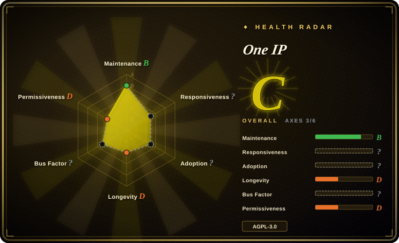
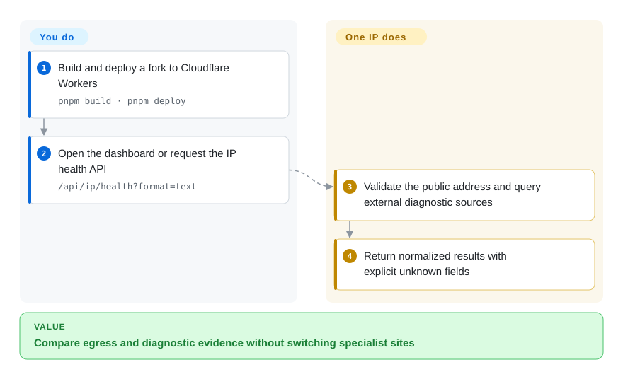
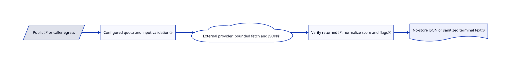

# One IP

Your browser and terminal appear to leave through different public addresses, and an AI site still fails to load. One IP gathers egress, IP reputation, browser checks and service-status probes in one self-hosted dashboard, without pretending they prove account eligibility.

## When to use

You troubleshoot a proxy or a remote worker's browser environment and keep switching between IP lookup, DNS, fingerprint and provider-status websites. Choose One IP when a combined Chinese/English interface and a deployable Worker backend are more useful than separate specialist pages. It also exposes a small IP-health API for terminal scripts, so you can compare the terminal's egress with the browser's observations. This is a diagnostic aggregation app, not a VPN, an IP reputation database or an account-unlock tool.

## When NOT to use

- **You need the complete browser-fingerprint reference application.** Use CreepJS directly; One IP deliberately integrates only selected modules and omits several upstream probes and ratings.
- **You only need distributed network measurements.** Use Globalping directly; its probe network is an external source here, not infrastructure One IP operates for you.
- **You need contractual IP intelligence quality or volume.** Evaluate IPinfo's hosted service and its terms. One IP's free public data sources may rate-limit or fail, and classifications are not authoritative decisions by AI platforms.
- **The deployment must remain offline or keep queried IPs private.** Use a locally managed dataset and appropriate local diagnostics instead. Self-hosting this UI does not remove its calls to third-party lookup services.
- **You want ordinary static hosting.** Use a static-only diagnostic page or keep the Worker backend: `/api/*` depends on Cloudflare Workers, not just the built frontend.

## Comparison

| Alternative | In index | Our verdict | Tradeoff |
|---|---|---|---|
| CreepJS | not indexed | Choose CreepJS for its complete fingerprint investigation interface; choose One IP for combined network and browser diagnosis. | Deeper specialist surface versus aggregation; real repository, not added in this tab batch. |
| Globalping | not indexed | Choose Globalping for programmable distributed measurements; choose One IP when those results must sit beside egress and browser checks. | Direct measurement API versus a dashboard consuming it; real repository, not added in this tab batch. |
| IPinfo hosted service | not a repo | Choose the hosted service when paid IP intelligence and contractual limits decide; choose One IP for a self-hosted combined diagnostic UI. | This row names the commercial service, not its SDK repositories; fees and source terms differ. |

## Quick start

Use Node.js 24+ and the pinned pnpm release, install the locked dependencies, then run `pnpm worker:dev` for the local frontend and Worker. Build with `pnpm build` before `pnpm deploy`, or connect a fork to Cloudflare Workers Builds. After deployment, call `/api/ip/health?format=text` to inspect the request's public egress; local development requires an explicit `ip` because it cannot infer a real Cloudflare visitor address. The app queries public providers and normalizes the response, while you supply hosting, review the AGPL obligations and protect optional verification secrets. Core features need no app API key, but external sources and Cloudflare quotas still apply.

<!-- flow-steps:begin (generated from flows/one-ip.json by tools/flow_card.py — do not edit) -->

Text version of the flow

1. **You**: Build and deploy a fork to Cloudflare Workers — `pnpm build · pnpm deploy`
2. **You**: Open the dashboard or request the IP health API — `/api/ip/health?format=text`
3. **One IP**: Validate the public address and query external diagnostic sources
4. **One IP**: Return normalized results with explicit unknown fields

**Value**: Compare egress and diagnostic evidence without switching specialist sites

<!-- flow-steps:end -->

## Key techniques

<!-- mechanism:begin (generated from mechanisms/one-ip.json by tools/mechanism_card.py; do not edit) -->

Text version of the mechanism

- Public IP or caller egress
- Configured quota and input validation②
- External provider; bounded fetch and JSON②
- Verify returned IP; normalize score and flags①
- No-store JSON or sanitized terminal text①

- Public IP or caller egress → Configured quota and input validation②
- Configured quota and input validation② → External provider; bounded fetch and JSON②
- External provider; bounded fetch and JSON② → Verify returned IP; normalize score and flags①
- Verify returned IP; normalize score and flags① → No-store JSON or sanitized terminal text①

<!-- mechanism:end -->

### 1. Preserve unknown reputation fields rather than converting them to safe values

- **Problem:** Missing provider flags can falsely look like “not a proxy,” and a mismatched lookup result can describe the wrong address.
- **How:** The health handler validates a public IP, checks that the provider returns the same normalized address, accepts only finite scores from 0–100 and maps absent scores or flags to null. Text responses strip terminal control characters.
- **Limits:** A carefully normalized response is still one provider's classification, not independent reputation verification or proof of AI account access.
- **Source:** [IP health handler](https://github.com/zhihui-hu/one-ip/blob/3d6531437cd1bf5e03711339c7d96b674d3e1e16/public/worker/ip-health.js#L3-L82), [contract fixtures](https://github.com/zhihui-hu/one-ip/blob/3d6531437cd1bf5e03711339c7d96b674d3e1e16/tests/ip-health.test.mjs#L8-L115).

### 2. Bound third-party responses at the Worker boundary

- **Problem:** A diagnostic aggregator inherits provider timeouts, oversized responses and sensitive failure bodies.
- **How:** Shared HTTP helpers apply a ten-second fetch deadline, limit JSON bodies and convert external failures into typed HTTP errors. The entry point applies configured rate-limit bindings, rejects cross-origin browser calls and emits no-store responses without logging visitor addresses or raw upstream bodies.
- **Limits:** A missing limiter binding skips that limiter; same-origin checks are not user authentication. The shipped Wrangler config supplies quotas but a public deployment still needs abuse and cost monitoring.
- **Source:** [HTTP boundary](https://github.com/zhihui-hu/one-ip/blob/3d6531437cd1bf5e03711339c7d96b674d3e1e16/public/worker/http.js#L72-L135), [entry point](https://github.com/zhihui-hu/one-ip/blob/3d6531437cd1bf5e03711339c7d96b674d3e1e16/public/worker/index.js#L33-L149), [bindings](https://github.com/zhihui-hu/one-ip/blob/3d6531437cd1bf5e03711339c7d96b674d3e1e16/wrangler.toml#L23-L31).

## Tech stack

React 19, Vite 8, TypeScript, Tailwind/shadcn UI, TanStack Query and Cloudflare Workers with static assets. Browser checks include FingerprintJS and selected vendored CreepJS modules. Use the locked dependency graph rather than resolving the manifest's numerous `latest` ranges afresh.

## Dependencies

Node.js 24+ and pnpm 10.32.1 for building; a Cloudflare Workers deployment for APIs. Public IP lookups, Globalping, RDAP and provider status feeds remain external. Optional maps and human-verification pages need their own secrets. Browser WebMCP is experimental and requires native browser support; the repository includes no origin-trial token. Normal UI use does not require WebMCP.

## Ops difficulty

**Medium.** Deploying a fork is straightforward, but source uptime, quotas, user privacy and third-party changes remain yours. Do not expose verification secrets through frontend `VITE_*` variables. Avoid automatic upstream syncing unless you accept reviewed-source drift. Publishing a modified network-accessible AGPL application requires attention to source-availability obligations; a separately advertised closed commercial edition does not change the public repository's license.

## Health & viability

- **2026-10-18 — very young.** The repository was created September 9; no GitHub release was returned. Approximately five weeks of history offers little Lindy protection.
- **Ownership.** A personal-account project, with no reliable contributor-count conclusion from the empty contributor API response. Do not turn missing API data into a claim of broad governance.
- **License and provenance.** The actual root license is AGPLv3 and the package specifies AGPL-3.0-only. Vendored CreepJS and Claude-environment material retain separate MIT notices and attribution.
- **Sustainability judgment.** The combined interface is reusable, but its useful results depend on public providers and one author's integration work; stars are not an availability or accuracy warranty.

## Caveats (unverified)

- [未验证：未部署或查询真实用户环境] Source availability, browser results, reputation accuracy and real Worker costs were not exercised.
- [推断：依据是第三方调用路径和短项目历史] Adopt as a replaceable troubleshooting view, not the sole gate for identity, abuse prevention or account decisions.
