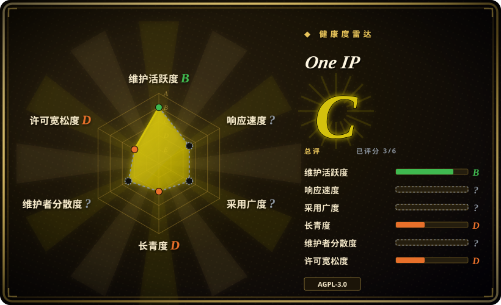
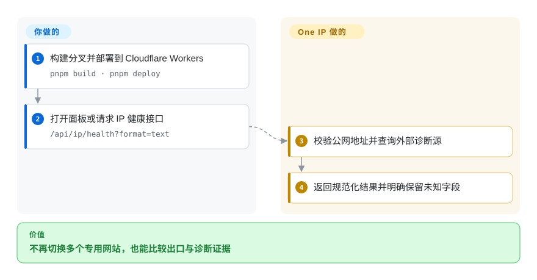
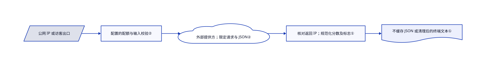

# One IP

浏览器和终端似乎走了不同公网出口，AI 网站仍打不开。One IP 把出口、IP 信誉、浏览器检查和服务状态聚到自托管面板里，但不把这些结果冒充账号资格证明。

## 何时使用

你排查代理或远程同事的浏览器环境，总要在 IP 查询、DNS、指纹和服务商状态页之间切换。当中英双语整合界面及可部署 Worker 后端比独立专用页面更省事时，选 One IP。它还提供小型 IP 健康接口，可对照终端出口与浏览器观察。它是诊断聚合应用，不是 VPN、IP 信誉数据库或解封工具。

## 何时不用

- **需要完整浏览器指纹参考应用。** 直接用 CreepJS；One IP 只整合选定模块，刻意省略部分上游探针和评分。
- **只要分布式网络测量。** 直接用 Globalping；这里调用的是外部探针网络，不是项目替你运维的基础设施。
- **需要有合同保障的 IP 情报质量和调用量。** 评估 IPinfo 托管服务及条款。公共源可能限流或失败，分类也不是 AI 平台的官方裁决。
- **必须离线，或不能外发所查 IP。** 使用本地管理的数据集及适当本地诊断。自托管界面不会消除第三方查询请求。
- **只想放到普通静态托管。** 选纯静态诊断页，或保留 Worker 后端；`/api/*` 依赖 Cloudflare Workers，不是只有前端文件。

## 横向对比

| 替代品 | 是否收录 | 我们的评价 | 取舍 |
|---|---|---|---|
| CreepJS | 未收录 | 完整指纹调查界面选 CreepJS；网络与浏览器联合诊断选 One IP。 | 专用检查更深，聚合界面更广；真实仓库，本次标签批次未收录。 |
| Globalping | 未收录 | 可编程分布式测量选 Globalping；要和出口及浏览器结果同屏时选 One IP。 | 直接测量 API 与消费该 API 的面板之间取舍；真实仓库，本次标签批次未收录。 |
| IPinfo 托管服务 | 非仓库 | 付费 IP 情报和合同限额决定选型时选托管服务；自托管综合诊断界面选 One IP。 | 本行指商业服务，不指它的 SDK 仓库；费用和数据源条款不同。 |

## 快速上手

使用 Node.js 24+ 和固定的 pnpm 版本，安装锁定依赖后运行 `pnpm worker:dev`，同时启动本地前端与 Worker。先 `pnpm build` 再 `pnpm deploy`，或将分叉接入 Cloudflare Workers Builds。部署后调用 `/api/ip/health?format=text` 检查请求公网出口；本地开发必须显式给 `ip`，因为没有真实 Cloudflare 访客地址。应用查询公共源并规范化结果，你负责托管、AGPL 义务和可选验证密钥。核心功能不需应用 API key，但外部源和 Cloudflare 配额仍适用。

<!-- flow-steps:begin (generated from flows/one-ip.json by tools/flow_card.py — do not edit) -->

流程文字版

1. **你**：构建分叉并部署到 Cloudflare Workers — `pnpm build · pnpm deploy`
2. **你**：打开面板或请求 IP 健康接口 — `/api/ip/health?format=text`
3. **One IP**：校验公网地址并查询外部诊断源
4. **One IP**：返回规范化结果并明确保留未知字段

**价值**：不再切换多个专用网站，也能比较出口与诊断证据

<!-- flow-steps:end -->

## 技术要点

<!-- mechanism:begin (generated from mechanisms/one-ip.json by tools/mechanism_card.py; do not edit) -->

机制文字版

- 公网 IP 或访客出口
- 配置的配额与输入校验②
- 外部提供方；限定请求与 JSON②
- 核对返回 IP；规范化分数及标志①
- 不缓存 JSON 或清理后的终端文本①

- 公网 IP 或访客出口 → 配置的配额与输入校验②
- 配置的配额与输入校验② → 外部提供方；限定请求与 JSON②
- 外部提供方；限定请求与 JSON② → 核对返回 IP；规范化分数及标志①
- 核对返回 IP；规范化分数及标志① → 不缓存 JSON 或清理后的终端文本①

<!-- mechanism:end -->

### 1. 保留未知信誉字段，不转成安全值

- **解决：** 缺失标志可能被误读为“不是代理”，错配查询结果还可能描述另一个地址。
- **做法：** 处理器验证公网 IP，检查提供方返回同一规范化地址，只接受 0–100 的有限分数，并将缺失分数或标志保留为 null。文本响应去掉终端控制字符。
- **边界：** 规范化再仔细，也仍是一个提供方的分类，不是独立信誉验证或 AI 账号可用证明。
- **源码：** [IP 健康处理器](https://github.com/zhihui-hu/one-ip/blob/3d6531437cd1bf5e03711339c7d96b674d3e1e16/public/worker/ip-health.js#L3-L82)、[契约用例](https://github.com/zhihui-hu/one-ip/blob/3d6531437cd1bf5e03711339c7d96b674d3e1e16/tests/ip-health.test.mjs#L8-L115)。

### 2. 在 Worker 边界约束第三方响应

- **解决：** 诊断聚合会继承外部超时、超大响应和敏感失败正文。
- **做法：** 共用 HTTP 函数限定十秒请求时间及 JSON 大小，把失败转换为带状态的错误。入口应用已配置的限流绑定，拒绝跨源浏览器请求，并返回不缓存响应，不记录访客地址和上游原始正文。
- **边界：** 缺少限流绑定就跳过该限流；同源检查不是身份认证。仓库配置提供配额，但公开部署仍需监控滥用和费用。
- **源码：** [HTTP 边界](https://github.com/zhihui-hu/one-ip/blob/3d6531437cd1bf5e03711339c7d96b674d3e1e16/public/worker/http.js#L72-L135)、[入口](https://github.com/zhihui-hu/one-ip/blob/3d6531437cd1bf5e03711339c7d96b674d3e1e16/public/worker/index.js#L33-L149)、[绑定](https://github.com/zhihui-hu/one-ip/blob/3d6531437cd1bf5e03711339c7d96b674d3e1e16/wrangler.toml#L23-L31)。

## 技术栈

React 19、Vite 8、TypeScript、Tailwind/shadcn UI、TanStack Query，以及带静态资源的 Cloudflare Workers。浏览器检查包含 FingerprintJS 和选取的 CreepJS 内置模块。应使用锁文件，不要重新解析清单里大量 `latest` 范围。

## 依赖

构建需要 Node.js 24+ 和 pnpm 10.32.1；API 需要 Cloudflare Workers。公共 IP 查询、Globalping、RDAP 和官方状态源仍在外部。可选地图及人机验证页面各需密钥。浏览器 WebMCP 是实验功能，要求浏览器原生支持；仓库不含源试用令牌。普通界面不需要 WebMCP。

## 运维难度

**中。** 分叉部署简单，但数据源可用性、配额、隐私和第三方变更由你承担。不要把验证密钥放进前端 `VITE_*` 变量。不接受审查后源码漂移时，不要开启自动同步。修改后提供网络服务的 AGPL 应用须关注源码提供义务；另售的闭源商业版不改变公开仓库许可。

## 健康度与可持续性

- **2026-10-18，非常年轻。** 仓库建于 9 月 9 日，未获取到 GitHub 发布。约五周历史缺少 Lindy 保护。
- **归属。** 个人账号项目，贡献者 API 返回空列表，不能可靠判断维护人数，更不能把缺数据写成广泛治理。
- **许可与来源。** 根许可是 AGPLv3 实文，包清单指定 AGPL-3.0-only。内置的 CreepJS 和 Claude 环境素材保留各自 MIT 声明及署名。
- **持续性判断。** 聚合界面有复用价值，但结果依赖公共源和作者集成维护；星标不是可用性及准确性保证。

## 存疑（未验证）

- [未验证：未部署或查询真实用户环境] 未实测数据源、浏览器结果、信誉准确性及 Worker 实际费用。
- [推断：依据是第三方调用路径和短项目历史] 宜作为可替换排障界面，不宜成为身份、反滥用或账号决策的唯一门禁。
