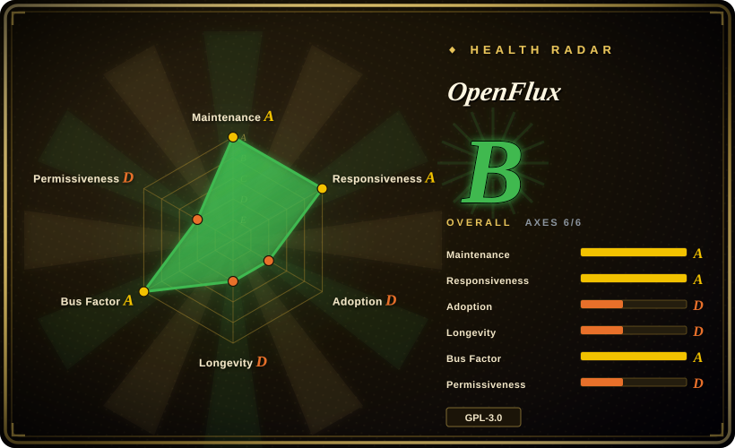
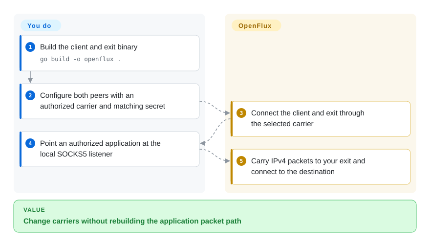
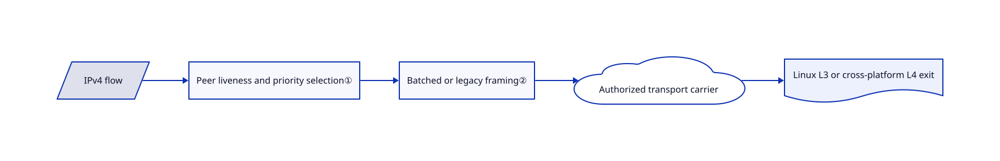

# OpenFlux

Your authorized tunnel needs several interchangeable carriers rather than one fixed network path; OpenFlux moves IPv4 packets through pluggable transports to an exit you operate.

## When to use

You are testing a network you control and need to compare document/WebSocket carriers, direct transport and failover without rewriting the packet path. Pick OpenFlux for transport research with a client and exit pair, not as a general privacy guarantee. Its rootless L4 exit is convenient across platforms; its Linux raw-packet L3 exit is a different operational choice. Obtain permission for every carrier and comply with the platform's terms.

## When NOT to use

- For ordinary private connectivity over a reachable endpoint, choose WireGuard rather than accepting application-carrier fragility and OpenFlux's young protocol.
- For Linux LAN split-routing, choose [dae](dae.md); it routes existing proxy protocols rather than researching a new carrier stack.
- For an AmneziaWG-only dedicated server setup, choose [amneziawg-installer](amneziawg-installer.md), not a custom document transport.
- For a security-reviewed anonymity system, use a separately audited design. Encryption is optional in classic mode, and negotiated mode does not provide forward secrecy.

## Comparison

| Alternative | In index | Our verdict | Tradeoff |
| --- | --- | --- | --- |
| [dae](dae.md) | ✅ | Choose dae for kernel-assisted Linux routing; choose OpenFlux when the carrier itself is the experiment. | Routing policy over existing nodes versus a client/exit transport stack. |
| [amneziawg-installer](amneziawg-installer.md) | ✅ | Choose the installer for a dedicated AmneziaWG VPS; choose OpenFlux for rootless L4 exits and interchangeable carriers. | A tightly scoped Linux setup versus broader experimental transport complexity. |
| [WireGuard](https://github.com/WireGuard/wireguard-go) | not indexed | Choose WireGuard when normal endpoint connectivity works; choose OpenFlux only when carrier experimentation is required. | A more established VPN protocol versus flexible carriers; not added in this tab batch. |

## Quick start

Build the reviewed Go source with `go build -o openflux .`. The README demonstrates an L4 exit and SOCKS5 client using the same transport document URL; configure both peers, then point one authorized application at `127.0.0.1:1080`. OpenFlux carries packets to your exit, which connects to the destination; you provide hosting, carrier access and credentials. Do not mistake that basic example for encrypted operation: configure a matching secret and review negotiated-session settings before sensitive traffic. See [quick start](https://github.com/p1neappleXpress/OpenFlux/blob/edcf77a1848a72370cfba9f346d3b897b61e7e7d/README.md#quickstart) and [session contract](https://github.com/p1neappleXpress/OpenFlux/blob/edcf77a1848a72370cfba9f346d3b897b61e7e7d/docs/sessions.md).

<!-- flow-steps:begin (generated from flows/openflux.json by tools/flow_card.py — do not edit) -->

Text version of the flow

1. **You**: Build the client and exit binary — `go build -o openflux .`
2. **You**: Configure both peers with an authorized carrier and matching secret
3. **OpenFlux**: Connect the client and exit through the selected carrier
4. **You**: Point an authorized application at the local SOCKS5 listener
5. **OpenFlux**: Carry IPv4 packets to your exit and connect to the destination

**Value**: Change carriers without rebuilding the application packet path

<!-- flow-steps:end -->

## Key techniques

<!-- mechanism:begin (generated from mechanisms/openflux.json by tools/mechanism_card.py; do not edit) -->

Text version of the mechanism

- IPv4 flow
- Peer liveness and priority selection①
- Batched or legacy framing②
- Authorized transport carrier
- Linux L3 or cross-platform L4 exit

- IPv4 flow → Peer liveness and priority selection①
- Peer liveness and priority selection① → Batched or legacy framing②
- Batched or legacy framing② → Authorized transport carrier
- Authorized transport carrier → Linux L3 or cross-platform L4 exit

<!-- mechanism:end -->

### 1. Negotiate and select live carriers per flow

- **Problem:** A carrier attached locally may still be unusable at its peer.
- **How:** The session prefers carriers recently heard from the peer, orders candidates by priority, and hashes flows across equally preferred links. Negotiated envelopes carry session identity and sequence numbers.
- **Limits:** The documented exit serves one active client; negotiated mode has no forward secrecy. This is not a multi-tenant VPN service.
- **Source:** [Carrier selection](https://github.com/p1neappleXpress/OpenFlux/blob/edcf77a1848a72370cfba9f346d3b897b61e7e7d/transport/session.go#L969-L1051), [session limits](https://github.com/p1neappleXpress/OpenFlux/blob/edcf77a1848a72370cfba9f346d3b897b61e7e7d/docs/sessions.md#L62-L103).

### 2. Accept both legacy and batched framing

- **Problem:** Peers using different frame codecs otherwise silently discard packets.
- **How:** CodecTransport distinguishes batch and legacy frames by their first byte, accepts both, and adjusts its send format from peer observations or timed probes. Batched frames use zstd when useful.
- **Limits:** Reliable ordered carriers can still cause head-of-line blocking; supporting UDP payloads does not make the carrier a native datagram link.
- **Source:** [Codec selection](https://github.com/p1neappleXpress/OpenFlux/blob/edcf77a1848a72370cfba9f346d3b897b61e7e7d/transport/codec.go#L12-L96), [carrier limits](https://github.com/p1neappleXpress/OpenFlux/blob/edcf77a1848a72370cfba9f346d3b897b61e7e7d/docs/architecture.md#L173-L198).

## Tech stack

Go 1.26.6, gVisor userspace networking, gorilla WebSocket, Pion WebRTC, zstd/LZ4 and goja for signed JavaScript transports. GPL-3.0-or-later is stated in COPYRIGHT; dependencies retain separate licenses.

## Dependencies

A client and exit with a permitted carrier. L3 exit requires Linux and root or raw-socket capability; L4 exit is rootless and cross-platform. Full-system Windows tunneling needs administrator access and Wintun. Mobile GUI clients are separate distributions.

## Ops difficulty

**High.** You own peer version compatibility, secrets, carrier logins/captchas, exit security and routing. Native L3 exits on Windows/macOS are not implemented; the architecture document says the QEMU L3 path is planned, despite an earlier sentence suggesting it as an intended path.

## Health & viability

- On 2026-10-18, v0.13.0 was two days old; several contributors and protocol tests are visible.
- Created June 2026, the project is only months old. [推断：依据是创建时间与协议演进] It is suitable for a controlled trial, not a strong Lindy bet for a critical link.
- The license is copyleft, and carrier availability depends on external platforms. The README's noncommercial description is not an extra noncommercial license restriction.

## Caveats (unverified)

- [未验证：本批禁止运行上游和外网实验] Throughput, carrier reliability and encryption interoperability were not reproduced.
- [未验证：未取得平台与网络实验授权] No claim is made that any carrier is permitted or reachable in your jurisdiction or account.
- [推断：依据是创建时间与协议演进] Long-term protocol and carrier durability remain unproven.
