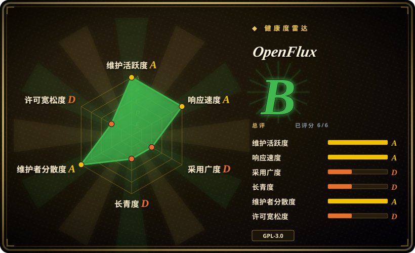
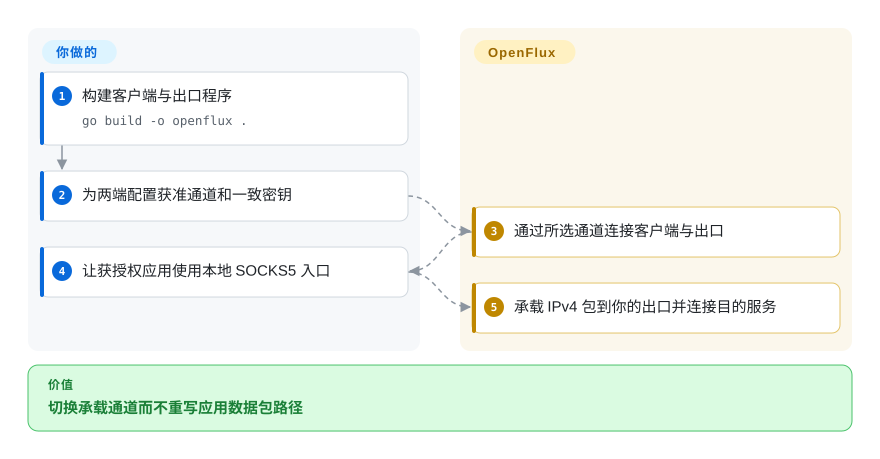
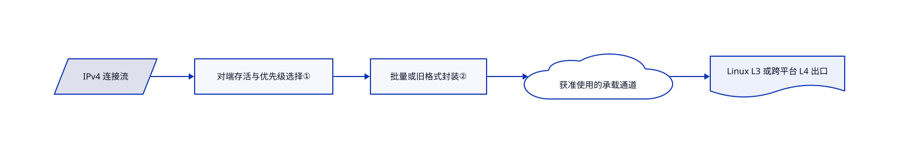

# OpenFlux

获授权的隧道实验需要切换多种承载通道。OpenFlux 把 IPv4 数据包送入可替换传输，再由你运营的出口转发。

## 何时使用

你在自己控制的网络测试文档、WebSocket、直连通道和故障切换，不想每次都重写数据包路径。OpenFlux 的主场是客户端与出口成对运行的传输研究，不是通用隐私保证。免特权 L4 出口便于跨平台实验；Linux 原始包 L3 出口则是另一种运维选择。使用每种通道前都要取得授权，并遵守平台条款。

## 何时不用

- 普通端点可达的私网连接，选 WireGuard，避免应用通道波动和年轻协议。
- Linux 局域网分流，选 [dae](dae.zh.md)。它对已有代理协议做路由，不是研究新通道。
- 专用服务器只需 AmneziaWG，选 [amneziawg-installer](amneziawg-installer.zh.md)，不必引入文档传输。
- 要经过安全审计的匿名系统，应另选已审设计。经典模式的加密可选，协商模式也没有前向保密。

## 横向对比

| 替代品 | 是否收录 | 我们的评价 | 取舍 |
| --- | --- | --- | --- |
| [dae](dae.zh.md) | ✅ | 要内核辅助的 Linux 分流选 dae；实验对象是承载通道本身时选 OpenFlux。 | 已有节点上的路由策略，对比客户端与出口传输栈。 |
| [amneziawg-installer](amneziawg-installer.zh.md) | ✅ | 专用 AmneziaWG 主机选安装器；要免特权 L4 出口与可换通道选 OpenFlux。 | 窄范围 Linux 部署，对比更复杂的实验传输。 |
| [WireGuard](https://github.com/WireGuard/wireguard-go) | 未收录 | 普通端点可达时选 WireGuard；确需实验承载通道才选 OpenFlux。 | 较成熟的 VPN 协议，对比灵活通道；本次标签批次不新增该仓库。 |

## 快速上手

从已审源码运行 `go build -o openflux .` 构建。说明提供使用同一文档地址的 L4 出口和 SOCKS5 客户端示例，配置两端后，把获授权应用指向 `127.0.0.1:1080`。OpenFlux 将包送到出口，再连接目的服务；主机、通道账号和密钥由你提供。基础示例不等于启用加密，敏感流量前必须配置一致密钥并审阅协商设置。来源为[上手说明](https://github.com/p1neappleXpress/OpenFlux/blob/edcf77a1848a72370cfba9f346d3b897b61e7e7d/README.md#quickstart)和[会话契约](https://github.com/p1neappleXpress/OpenFlux/blob/edcf77a1848a72370cfba9f346d3b897b61e7e7d/docs/sessions.md)。

<!-- flow-steps:begin (generated from flows/openflux.json by tools/flow_card.py — do not edit) -->

流程文字版

1. **你**：构建客户端与出口程序 — `go build -o openflux .`
2. **你**：为两端配置获准通道和一致密钥
3. **OpenFlux**：通过所选通道连接客户端与出口
4. **你**：让获授权应用使用本地 SOCKS5 入口
5. **OpenFlux**：承载 IPv4 包到你的出口并连接目的服务

**价值**：切换承载通道而不重写应用数据包路径

<!-- flow-steps:end -->

## 技术要点

<!-- mechanism:begin (generated from mechanisms/openflux.json by tools/mechanism_card.py; do not edit) -->

机制文字版

- IPv4 连接流
- 对端存活与优先级选择①
- 批量或旧格式封装②
- 获准使用的承载通道
- Linux L3 或跨平台 L4 出口

- IPv4 连接流 → 对端存活与优先级选择①
- 对端存活与优先级选择① → 批量或旧格式封装②
- 批量或旧格式封装② → 获准使用的承载通道
- 获准使用的承载通道 → Linux L3 或跨平台 L4 出口

<!-- mechanism:end -->

### 1. 按流选择对端仍可达的通道

- **解决：** 本地接通的通道，对端可能仍卡在验证码。
- **做法：** 会话优先选择最近收到对端消息的通道，再按优先级筛选，同级通道按连接流哈希分配。协商封装带有会话身份和序列号。
- **边界：** 文档说明出口一次服务一个活跃客户端；协商不提供前向保密，不能当多租户 VPN 服务。
- **源码：** [通道选择](https://github.com/p1neappleXpress/OpenFlux/blob/edcf77a1848a72370cfba9f346d3b897b61e7e7d/transport/session.go#L969-L1051)、[会话边界](https://github.com/p1neappleXpress/OpenFlux/blob/edcf77a1848a72370cfba9f346d3b897b61e7e7d/docs/sessions.md#L62-L103)。

### 2. 同时接收旧帧和批量帧

- **解决：** 两端使用不同编码时，原本可能静默丢掉所有包。
- **做法：** CodecTransport 按首字节辨别批量与旧帧，同时接收两者，并根据对端消息或定时探测调整发送格式。批量帧在有收益时使用 zstd。
- **边界：** 可靠有序通道仍可能出现队头阻塞；承载 UDP 内容不等于原生数据报链路。
- **源码：** [编码选择](https://github.com/p1neappleXpress/OpenFlux/blob/edcf77a1848a72370cfba9f346d3b897b61e7e7d/transport/codec.go#L12-L96)、[通道限制](https://github.com/p1neappleXpress/OpenFlux/blob/edcf77a1848a72370cfba9f346d3b897b61e7e7d/docs/architecture.md#L173-L198)。

## 技术栈

Go 1.26.6、gVisor 用户态网络栈、gorilla WebSocket、Pion WebRTC、zstd、LZ4，以及执行签名 JavaScript 通道的 goja。COPYRIGHT 明确 GPL-3.0-or-later，依赖保留独立许可。

## 依赖

客户端、出口和获准使用的通道。L3 出口需 Linux 与 root 或原始套接字能力；L4 免特权且跨平台。Windows 全系统隧道需管理员和 Wintun。手机图形客户端是独立发布物。

## 运维难度

**高。** 你负责版本兼容、密钥、登录与验证码、出口安全和路由。Windows、macOS 原生 L3 出口尚未实现；架构文档明确 QEMU 路径仍是计划，不能把前文的目标路径误当成现成能力。

## 健康度与可持续性

- 截至 2026-10-18，v0.13.0 发布两天，多名贡献者和协议测试可见。
- 仓库创建于 2026 年 6 月，历史仅数月。[推断：依据是创建时间与协议演进] 适合受控试验，不宜把关键链路押在强 Lindy 假设上。
- 许可证是著佐权，通道可用性依赖外部平台。说明中的“非商业项目”不是额外的禁止商用许可条款。

## 存疑（未验证）

- [未验证：本批禁止运行上游和外网实验] 未复现吞吐、通道可靠性与加密互通。
- [未验证：未取得平台与网络实验授权] 不声称任何通道在你的地区或账号获准、可达。
- [推断：依据是创建时间与协议演进] 协议和外部通道的长期可持续性尚未证明。
