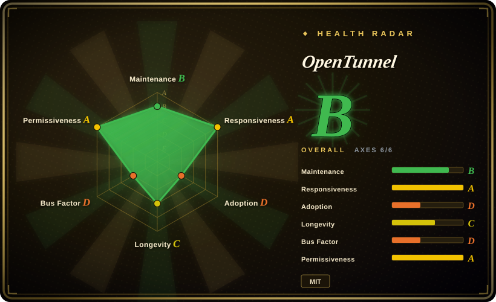
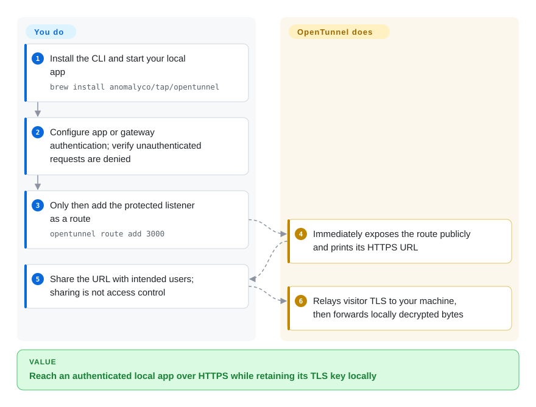
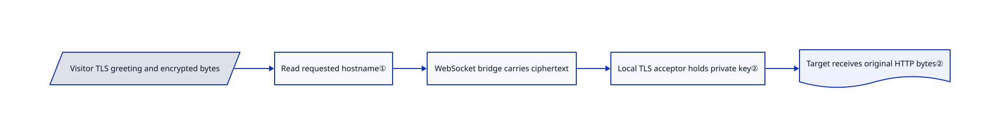

# OpenTunnel

You need a public HTTPS URL for a local app, but do not want the relay holding its TLS private key. OpenTunnel routes encrypted visitor connections to your machine and decrypts them there.

## When to use

You are sharing a local development app or receiving a webhook on port 3000. Port forwarding is unavailable, and an HTTP-terminating relay would see request bodies. Choose OpenTunnel when local possession of the visitor-facing TLS key decides the choice: its relay reads the requested hostname, not the HTTP payload, and the client forwards plaintext only after local TLS termination. You still authenticate the exposed app yourself.

## When NOT to use

- Need arbitrary TCP/UDP exposure or richer self-hosted reverse-proxy controls? Choose frp instead; OpenTunnel's main path is hostname-routed TLS, not a general VPN or UDP tunnel.
- Need edge-managed HTTP inspection and access integration? Choose cloudflared with Cloudflare's service instead; a deliberately blind relay cannot inspect or rewrite your HTTP traffic.
- Want ordinary browser sharing with a small Node API and no local certificate machinery? Choose localtunnel; choose OpenTunnel only when its local TLS boundary matters.
- Your app skips authentication for loopback peers or trusts `Host: localhost`? Do not route it unchanged. Use an authenticated application gateway first, because OpenTunnel's target sees a local peer and visitor-controlled headers.

## Comparison

| Alternative | In index | Our verdict | Tradeoff |
|---|---|---|---|
| [frp](https://github.com/fatedier/frp) | not indexed | Choose frp for TCP/UDP and a server you control; choose OpenTunnel for hosted HTTPS sharing with local visitor-TLS termination. | Broader forwarding and operator controls versus a narrower certificate-aware client. Not added in this tab batch. |
| [cloudflared](https://github.com/cloudflare/cloudflared) | not indexed | Choose cloudflared when Cloudflare routing and access infrastructure are desired; choose OpenTunnel when the relay must not hold visitor TLS keys. | Managed edge integration versus an explicitly blind data relay; cloudflared is a real repo, not the hosted service itself. Not added in this tab batch. |
| [localtunnel](https://github.com/localtunnel/localtunnel) | not indexed | Choose localtunnel for session-scoped Node-based sharing; choose OpenTunnel for its locally terminated TLS and persistent route service. | Simpler HTTP-oriented API versus a daemon, certificate lifecycle and protocol contract. Not added in this tab batch. |

## Quick start

Install a release binary or use `brew install anomalyco/tap/opentunnel`, then start your app locally. Before creating any route, configure application authentication or an authenticated gateway on the listener you intend to expose, and verify that unauthenticated requests are denied while authorized requests succeed. Only after those checks run `opentunnel route add 3000` against that protected listener; this immediately creates a public route, starts the background service and prints its URL. Share the URL with intended users, but neither sharing it, withholding it nor a random route name constitutes access control. OpenTunnel handles the encrypted relay and certificate lifecycle; you operate the app and enforce access permissions. Follow the pinned [target trust boundary](https://github.com/anomalyco/opentunnel/blob/2daac123b79c565ec931e0b660048a315ed38ecd/docs/trust-boundary.md#L17-L31): never bypass authentication for loopback peers or visitor-controlled headers, and keep local-only endpoints on a separate, unrouted listener.

<!-- flow-steps:begin (generated from flows/opentunnel.json by tools/flow_card.py — do not edit) -->

Text version of the flow

1. **You**: Install the CLI and start your local app — `brew install anomalyco/tap/opentunnel`
2. **You**: Configure app or gateway authentication; verify unauthenticated requests are denied
3. **You**: Only then add the protected listener as a route — `opentunnel route add 3000`
4. **OpenTunnel**: Immediately exposes the route publicly and prints its HTTPS URL
5. **You**: Share the URL with intended users; sharing is not access control
6. **OpenTunnel**: Relays visitor TLS to your machine, then forwards locally decrypted bytes

**Value**: Reach an authenticated local app over HTTPS while retaining its TLS key locally

<!-- flow-steps:end -->

## Key techniques

<!-- mechanism:begin (generated from mechanisms/opentunnel.json by tools/mechanism_card.py; do not edit) -->

Text version of the mechanism

- Visitor TLS greeting and encrypted bytes
- Read requested hostname①
- WebSocket bridge carries ciphertext
- Local TLS acceptor holds private key②
- Target receives original HTTP bytes②

- Visitor TLS greeting and encrypted bytes → Read requested hostname①
- Read requested hostname① → WebSocket bridge carries ciphertext
- WebSocket bridge carries ciphertext → Local TLS acceptor holds private key②
- Local TLS acceptor holds private key② → Target receives original HTTP bytes②

<!-- mechanism:end -->

### 1. Route from the TLS greeting without decrypting HTTP

- **Problem:** A conventional HTTPS proxy needs the server key to route at HTTP level.
- **How:** The server parses the ClientHello, including fragmented records, to extract SNI — the requested hostname — and ALPN, the requested application protocol. The relay selects the client's bridge from that hostname while preserving visitor TLS bytes.
- **Limits:** This path requires a usable SNI greeting; it does not make addresses, hostnames, timing or availability invisible to the relay.
- **Source:** [ClientHello parsing](https://github.com/anomalyco/opentunnel/blob/2daac123b79c565ec931e0b660048a315ed38ecd/crates/opentunnel-server/src/sni.rs#L1-L145), [architecture](https://github.com/anomalyco/opentunnel/blob/2daac123b79c565ec931e0b660048a315ed38ecd/README.md#architecture).

### 2. Terminate TLS locally and copy bytes, not trusted HTTP headers

- **Problem:** Keeping the key local must not accidentally grant external callers localhost privileges.
- **How:** Each bridged channel feeds a local TLS acceptor, opens the configured target and copies bytes bidirectionally. Optional PROXY protocol supplies the relay-reported visitor address before the unmodified request.
- **Limits:** The target still sees a loopback peer; `Host` and forwarding headers remain visitor-controlled. PROXY headers are trustworthy only on an isolated, correctly configured listener.
- **Source:** [Local channel](https://github.com/anomalyco/opentunnel/blob/2daac123b79c565ec931e0b660048a315ed38ecd/crates/opentunnel/src/tunnel.rs#L742-L803), [trust boundary](https://github.com/anomalyco/opentunnel/blob/2daac123b79c565ec931e0b660048a315ed38ecd/docs/trust-boundary.md).

## Tech stack

Rust 2024, Tokio, rustls, WebSockets and shared wire vectors; a TypeScript SDK uses the same protocol. The self-hosted server stores records and issuance jobs in MySQL and issues certificates using ACME/DNS-01.

## Dependencies

For hosted use: CLI binary, outbound network access and a local TCP application. For self-hosting: public raw TCP listeners, MySQL, a domain/DNS provider and certificate issuer credentials; the documented production setup uses Fly.io, PlanetScale, Cloudflare DNS and ZeroSSL.

## Ops difficulty

**Low for the hosted client, high for a public relay.** The daemon and routes are simple locally; production self-hosting adds DNS automation, certificate renewal, database state and abuse/availability responsibilities. TLS secrecy does not replace application authentication.

## Health & viability

- On 2026-10-18, v0.5.2 was two days old; the repository dates to 2026-03-30 and remains active.
- Anomaly maintains the project; the contributor snapshot is led by `thdxr`. The README does not accept pull requests and routes contributions through issues, so roadmap control stays centralized.
- [推断] Seven months of activity supports experimentation, not a long Lindy record. Pin client/server versions when self-hosting because the protocol and 0.x product are still young.
- MIT source, Rust/TypeScript interoperability vectors and explicit trust-boundary documentation are useful signals. Hosted service guarantees are separate from repository licensing.

## Caveats (unverified)

- [未验证] No live tunnel or self-hosted relay was run; availability, throughput and end-to-end secrecy were inspected in code/docs, not independently tested.
- [推断] Long-term stability is uncertain because the project has less than a year of history and centralized maintenance.
