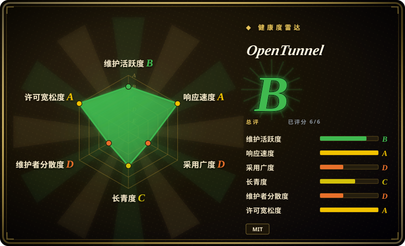
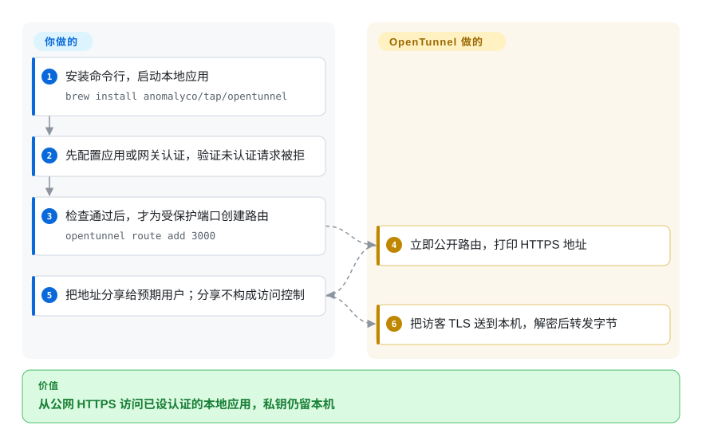
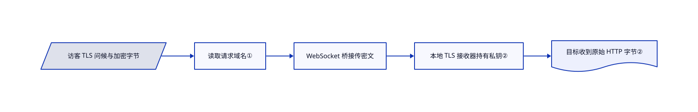

# OpenTunnel

你要把本地应用变成公网 HTTPS 地址，却不想让中继持有证书私钥。OpenTunnel 把访客的加密连接送到本机，再由本机解密。

## 何时使用

你要分享本机 3000 端口的开发应用，或接收外部回调，网络却不允许做端口映射。普通 HTTPS 中继会在服务端看到请求正文。若决定性要求是让访客侧证书私钥留在本机，就选 OpenTunnel：中继只按请求域名分流，不读取 HTTP 正文，本机完成 TLS 解密后才转发明文。你仍要给公开应用设置真实认证。

## 何时不用

- 需要任意 TCP／UDP 暴露与丰富的自托管反向代理控制时，选 frp。OpenTunnel 主路径是按域名分流的 TLS，不是通用 VPN 或 UDP 隧道。
- 需要边缘 HTTP 检查与访问管理集成时，选 cloudflared 及 Cloudflare 服务。刻意不解密的中继无法检查或改写 HTTP。
- 只要普通浏览器分享与小型 Node 接口、不在乎证书由本机管理时，选 localtunnel。只有本地 TLS 边界重要时才承担 OpenTunnel 的复杂度。
- 应用若对本地来源跳过认证，或信任 `Host: localhost`，不要直接暴露。先配置有认证的应用网关，因为目标看到的是本地连接和访客自带的请求头。

## 横向对比

| 替代品 | 是否收录 | 我们的评价 | 取舍 |
|---|---|---|---|
| [frp](https://github.com/fatedier/frp) | 未收录 | 要 TCP／UDP 与自管服务器时选 frp；要托管 HTTPS 分享且访客 TLS 在本机终止时选 OpenTunnel。 | 更广的转发协议与运维控制，换范围较窄的证书感知客户端；本批标签未安排收录。 |
| [cloudflared](https://github.com/cloudflare/cloudflared) | 未收录 | 要 Cloudflare 路由与访问基础设施时选 cloudflared；中继不能持有访客 TLS 私钥时选 OpenTunnel。 | 托管边缘集成换明确不解密的数据中继；cloudflared 本身是真实仓库，不等于托管服务，本批标签未安排收录。 |
| [localtunnel](https://github.com/localtunnel/localtunnel) | 未收录 | 要按会话运行的 Node 分享工具时选 localtunnel；要本地终止 TLS 与常驻路由服务时选 OpenTunnel。 | 简单的 HTTP 接口，换后台进程、证书生命周期与协议合同；本批标签未安排收录。 |

## 快速上手

下载发行版二进制，或运行 `brew install anomalyco/tap/opentunnel` 安装，再启动本地应用。在创建任何路由前，先给准备暴露的监听端口配置应用认证或认证网关，并验证未认证请求被拒绝、已授权请求可正常访问。只有检查通过后，才对该受保护端口运行 `opentunnel route add 3000`；这会立即建立公网路由、启动后台服务并打印地址。可以把地址分享给预期用户，但分享、不分享地址或使用随机路由名都不构成访问控制。OpenTunnel 负责加密中继与证书生命周期；你负责应用运行和权限执行。遵守固定版本的[目标信任边界](https://github.com/anomalyco/opentunnel/blob/2daac123b79c565ec931e0b660048a315ed38ecd/docs/trust-boundary.md#L17-L31)，不得因本地来源或访客自带请求头跳过认证，只允许本地访问的端点应放在独立且不建路由的监听器上。

<!-- flow-steps:begin (generated from flows/opentunnel.json by tools/flow_card.py — do not edit) -->

流程文字版

1. **你**：安装命令行，启动本地应用 — `brew install anomalyco/tap/opentunnel`
2. **你**：先配置应用或网关认证，验证未认证请求被拒
3. **你**：检查通过后，才为受保护端口创建路由 — `opentunnel route add 3000`
4. **OpenTunnel**：立即公开路由，打印 HTTPS 地址
5. **你**：把地址分享给预期用户；分享不构成访问控制
6. **OpenTunnel**：把访客 TLS 送到本机，解密后转发字节

**价值**：从公网 HTTPS 访问已设认证的本地应用，私钥仍留本机

<!-- flow-steps:end -->

## 技术要点

<!-- mechanism:begin (generated from mechanisms/opentunnel.json by tools/mechanism_card.py; do not edit) -->

机制文字版

- 访客 TLS 问候与加密字节
- 读取请求域名①
- WebSocket 桥接传密文
- 本地 TLS 接收器持有私钥②
- 目标收到原始 HTTP 字节②

- 访客 TLS 问候与加密字节 → 读取请求域名①
- 读取请求域名① → WebSocket 桥接传密文
- WebSocket 桥接传密文 → 本地 TLS 接收器持有私钥②
- 本地 TLS 接收器持有私钥② → 目标收到原始 HTTP 字节②

<!-- mechanism:end -->

### 1. 读取 TLS 问候报文，而不解密 HTTP

- **解决：** 普通 HTTPS 代理要拿到服务端私钥，才能按 HTTP 请求分流。
- **做法：** 服务端解析 ClientHello，也处理跨记录分片，取出 SNI 请求域名和 ALPN 应用协议。中继用域名挑选客户端桥接连接，同时保留访客 TLS 字节流。
- **边界：** 这条路径要求可用的 SNI。它不会向中继隐藏地址、域名、时序或可用性信息。
- **源码：** [问候报文解析](https://github.com/anomalyco/opentunnel/blob/2daac123b79c565ec931e0b660048a315ed38ecd/crates/opentunnel-server/src/sni.rs#L1-L145)、[架构](https://github.com/anomalyco/opentunnel/blob/2daac123b79c565ec931e0b660048a315ed38ecd/README.md#architecture)。

### 2. 本机终止 TLS，只转字节，不创造可信请求头

- **解决：** 私钥留在本机，不能顺带让外部访客获得本地访问特权。
- **做法：** 桥接通道送入本地 TLS 接收器，再打开配置的目标连接，双向复制字节。可选 PROXY 协议先传入中继报告的访客地址，随后仍是未经改写的请求。
- **边界：** 目标看到的仍是本地连接；`Host` 与转发请求头由访客控制。只有隔离且正确配置的监听器，才能信任 PROXY 头。
- **源码：** [本地通道](https://github.com/anomalyco/opentunnel/blob/2daac123b79c565ec931e0b660048a315ed38ecd/crates/opentunnel/src/tunnel.rs#L742-L803)、[信任边界](https://github.com/anomalyco/opentunnel/blob/2daac123b79c565ec931e0b660048a315ed38ecd/docs/trust-boundary.md)。

## 技术栈

Rust 2024、Tokio、rustls、WebSocket 与共享协议测试向量；TypeScript SDK 遵守同一协议。自托管服务端在 MySQL 存记录和签发任务，经 ACME／DNS-01 签发证书。

## 依赖

使用托管服务只需命令行二进制、可出站的网络与本地 TCP 应用。自托管还要公网原始 TCP 监听、MySQL、域名、DNS 服务及证书签发凭据；文档里的生产部署采用 Fly.io、PlanetScale、Cloudflare DNS 与 ZeroSSL。

## 运维难度

**托管客户端低，公网中继高。** 本地后台服务和路由简单；自托管生产环境还要负责 DNS 自动化、证书续期、数据库状态、滥用与可用性。TLS 保密不等于应用认证。

## 健康度与可持续性

- 截至 2026-10-18，v0.5.2 刚发布两天。仓库创建于 2026-03-30，仍在活跃开发。
- 项目由 Anomaly 维护，贡献者快照以 `thdxr` 为主。README 明确不接收拉取请求，只通过议题收反馈，路线控制集中。
- [推断] 七个月活跃记录足以支持试用，还不足以构成长寿先验。自托管应固定客户端与服务端版本，因为协议和零点几版本都年轻。
- MIT 源码、跨 Rust／TypeScript 测试向量与明确的信任边界文档是正向信号。托管服务承诺与仓库许可证是两回事。

## 存疑（未验证）

- [未验证] 没有运行真实隧道或自托管中继；可用性、吞吐与端到端保密只查了源码和文档，没有独立实测。
- [推断] 长期稳定性仍不明确，因为项目不足一年且维护权集中。
