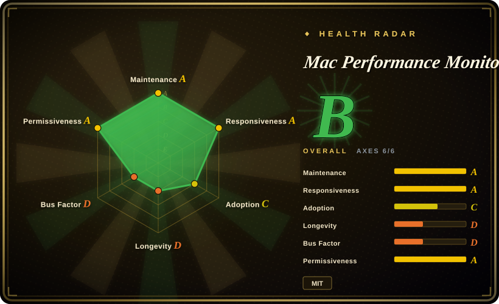
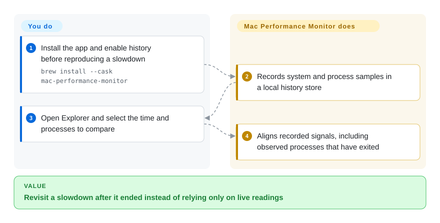
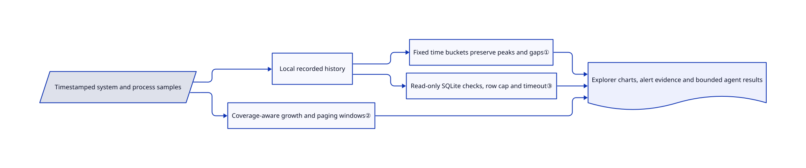

# Mac Performance Monitor

Your Mac was slow ten minutes ago, but the process responsible has already exited. This app records machine and process samples locally so you can return to that moment instead of watching only current CPU usage.

## When to use

You run builds, browsers and local models on an Apple-silicon Mac. A slowdown disappears before you open a live process list, and you need to align memory pressure, GPU activity, disk traffic and the processes that existed then. Choose this app when local recorded history, linked time cursors and read-only agent queries decide the choice over a menu-bar glance. It records evidence; it does not prove which process caused a slowdown or that growing memory is a leak.

## When NOT to use

- On Intel, Linux or Windows? Choose a supported live tool such as btop; this app targets Apple silicon and macOS 15+.
- Only need a live menu-bar readout on an older supported Mac? Consider Stats, which supports macOS 12+; historical investigation is the reason to take on this app's recorder and storage.
- Need one quick look without installing another recorder? Use Apple's Activity Monitor; recording cannot recover a period before it was enabled.
- Need server-fleet metrics, distributed traces or remote retention? Use [Prometheus](prometheus.md) and [Grafana](grafana.md), not a single-Mac desktop history database.
- Cannot send process names/paths to a model provider? Keep agent integration off. The bundled query tool is read-only, but an external agent sends the data it reads to its provider.

## Comparison

| Alternative | In index | Our verdict | Tradeoff |
|---|---|---|---|
| [Stats](https://github.com/exelban/stats) | not indexed | Choose Stats for a menu-bar-first monitor with a macOS 12 floor; choose this app when recorded local process/system history is the central investigation surface. | Broader older-system support and a glance-oriented UI versus a dedicated history explorer. Not added in this tab batch. |
| Activity Monitor | not a repo | Choose Apple's built-in app for immediate current-process inspection; choose this recorder when you need to revisit an already-ended episode. | Zero extra installation versus retained samples, linked charts and an agent-readable history store; the macOS utility is not an OSS repository. |
| [btop](https://github.com/aristocratos/btop) | not indexed | Choose btop for terminal-based live inspection across supported Unix-like systems; choose this app for native Mac history investigation. | Terminal portability versus Mac-specific sensors, recording and desktop evidence views. Not added in this tab batch. |

## Quick start

Install the signed release package or use `brew install --cask mac-performance-monitor`. Enable history recording and choose detail/retention before reproducing a slowdown; menu-bar display and recording have separate switches. Open Explorer, select the relevant time range and compare machine/process charts, including exited processes that were recorded. The app collects and stores evidence; you decide which permissions to grant and whether a correlation explains the problem. Optional `mpm` CLI/MCP access reads the same history, while privileged-helper coverage, Full Disk Access and model explanations are separate choices.

<!-- flow-steps:begin (generated from flows/mac-performance-monitor.json by tools/flow_card.py — do not edit) -->

Text version of the flow

1. **You**: Install the app and enable history before reproducing a slowdown — `brew install --cask mac-performance-monitor`
2. **Mac Performance Monitor**: Records system and process samples in a local history store
3. **You**: Open Explorer and select the time and processes to compare
4. **Mac Performance Monitor**: Aligns recorded signals, including observed processes that have exited

**Value**: Revisit a slowdown after it ended instead of relying only on live readings

<!-- flow-steps:end -->

## Key techniques

<!-- mechanism:begin (generated from mechanisms/mac-performance-monitor.json by tools/mechanism_card.py; do not edit) -->

Text version of the mechanism

- Timestamped system and process samples
- Local recorded history
- Fixed time buckets preserve peaks and gaps①
- Coverage-aware growth and paging windows②
- Read-only SQLite checks, row cap and timeout③
- Explorer charts, alert evidence and bounded agent results

- Timestamped system and process samples → Local recorded history
- Local recorded history → Fixed time buckets preserve peaks and gaps①
- Timestamped system and process samples → Coverage-aware growth and paging windows②
- Local recorded history → Read-only SQLite checks, row cap and timeout③
- Fixed time buckets preserve peaks and gaps① → Explorer charts, alert evidence and bounded agent results
- Coverage-aware growth and paging windows② → Explorer charts, alert evidence and bounded agent results
- Read-only SQLite checks, row cap and timeout③ → Explorer charts, alert evidence and bounded agent results

<!-- mechanism:end -->

### 1. Downsample on a fixed time grid and preserve missing values

- **Problem:** Re-bucketing by array length makes old chart shapes change whenever a new sample arrives, while filling gaps invents history.
- **How:** Chart buckets are anchored to absolute time and sized from the selected span. Different signals keep means or peaks as appropriate; absent optional measurements remain absent, and large sampling gaps split the series.
- **Limits:** Coarser retained data cannot regain lost resolution when zoomed. Gap detection is a heuristic, and averages can hide detail not retained elsewhere.
- **Source:** [Gap splitting and time-grid aggregation](https://github.com/Zesty0wl/mac-performance-monitor/blob/46159ea842e0cba5513aeee83f747e9bedae99e4/Sources/MacPerfMonitorCore/Persistence/HistoryDownsample.swift#L3-L152).

### 2. Alert on sustained change instead of occupancy alone

- **Problem:** Large but stable swap usage is not the same as continuing paging stress.
- **How:** Growth windows reject invalid/out-of-order samples, reset across long gaps and require enough coverage for a fitted trend. Swap detection compares growth and slope across windows, adjusts against observed quiet noise and separately checks sustained paging under pressure.
- **Limits:** These are diagnostic heuristics, not memory-leak proofs. Missing samples delay readiness; the selected hardware and workload can change what an alert means.
- **Source:** [Growth windows and swap detector](https://github.com/Zesty0wl/mac-performance-monitor/blob/46159ea842e0cba5513aeee83f747e9bedae99e4/Sources/MacPerfMonitorCore/Analysis/AlertGrowthWindow.swift#L25-L163).

### 3. Bound agent reads in the database layer

- **Problem:** A diagnostic agent must not mutate the recorder or hold a long read that blocks database housekeeping.
- **How:** AgentStore opens SQLite read-only, enables query-only mode, accepts one restricted statement and checks SQLite's own read-only flag. It caps returned rows, marks truncation and interrupts queries after a timeout.
- **Limits:** Read-only is not private: result text can contain app names and paths. These controls protect writes and query cost, not disclosure through the calling agent.
- **Source:** [AgentStore read boundary](https://github.com/Zesty0wl/mac-performance-monitor/blob/46159ea842e0cba5513aeee83f747e9bedae99e4/Sources/MacPerfMonitorCore/Agent/AgentStore.swift#L4-L95).

## Tech stack

Swift 6 package, SwiftUI/AppKit, C shims for system process APIs, SQLite through GRDB and Sparkle updates. Current SECURITY.md describes Ask as Apple's on-device Foundation Models on macOS 27 and says earlier downloaded model support was removed.

## Dependencies

Apple-silicon Mac with macOS 15+, local history storage and optional approved privileged helper for fuller process/sensor coverage. Ask requires macOS 27; ordinary monitoring does not. Source app bundling needs Xcode 27/macOS 27 SDK, while core builds/tests use Swift 6. Optional agent queries require the app to have recorded a database first.

## Ops difficulty

**Low to medium.** Normal monitoring is a desktop install, but history uses disk and must be enabled ahead of the event. Review retention, helper approval, Full Disk Access and export contents. No usage telemetry does not mean no network: updates, signed content and network diagnostics make requests.

## Health & viability

- On 2026-10-18, release v2.4.0.289 and push metadata both dated to 2026-10-17. Created 2026-07-05, it has about three months of public history.
- `Zesty0wl` dominates the contributor snapshot with a few small external contributions. Actual MIT text credits the project's contributors; GRDB/Sparkle and model-related material have their own notices.
- [推断] Frequent releases and public tests are positive, but do not offset the short age and concentrated maintenance. Keep backups before downgrading a history database.
- Privacy boundaries are explicitly documented: local recording, read-only agent access and outbound provider disclosure are separate. GPU bandwidth is labeled an estimate; sampled running history is not verified foreground usage.

## Caveats (unverified)

- [未验证] No app, helper, recorder or MCP server was installed/run; overhead, sensor accuracy and release notarization were not independently tested.
- [推断] Long-term reliability remains uncertain because the app is young and maintenance is concentrated.
