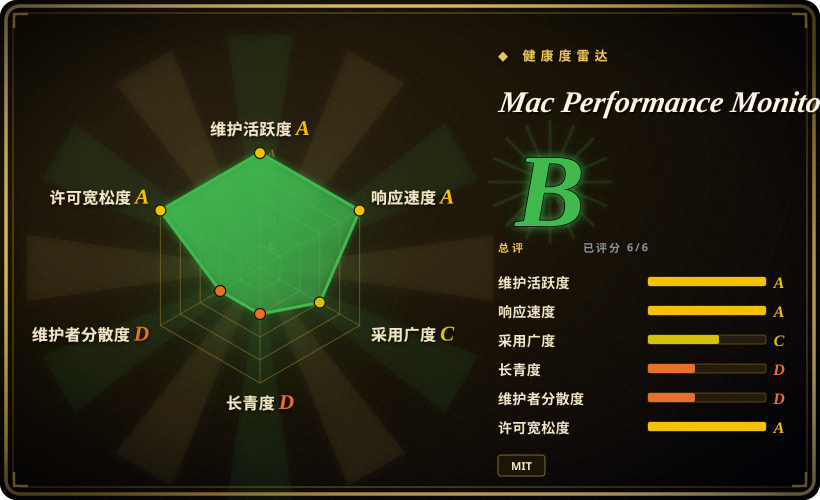
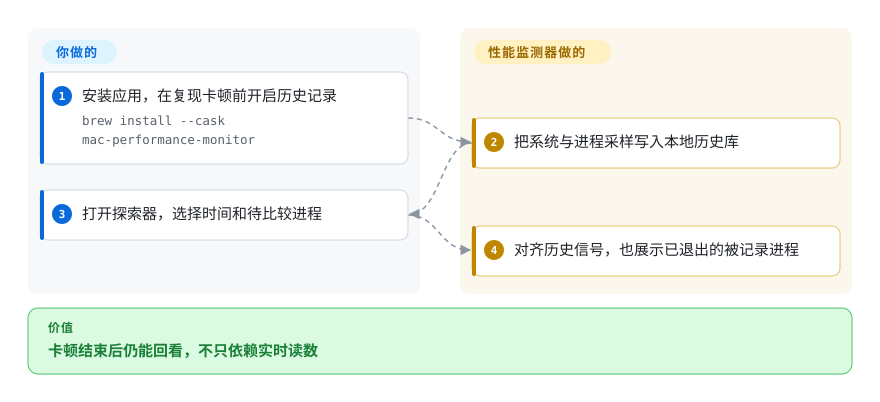

# Mac Performance Monitor

Mac 十分钟前卡过，打开进程列表时元凶已经退出。这个应用把系统与进程采样保存在本机，让你回到当时，而非只看当前 CPU。

## 何时使用

你在苹果芯片 Mac 上同时跑构建、浏览器和本地模型。卡顿常在打开实时进程表前消失，你需要对齐当时的内存压力、显卡活动、磁盘流量与进程。若决定性需求是本地历史、联动时间光标与只读助手查询，而非菜单栏瞄一眼，就选它。它记录证据，不证明哪个进程导致卡顿，也不把内存增长直接判作泄漏。

## 何时不用

- 用 Intel、Linux 或 Windows 时，选 btop 等支持对应平台的实时工具；本项目只面向苹果芯片与 macOS 15 以上。
- 只要较旧 Mac 上的菜单栏读数时，考虑支持 macOS 12 以上的 Stats；历史排查才是承担本项目记录器与存储的理由。
- 只要立即看看当前进程、不想另装记录器时，使用苹果自带活动监视器；未开启记录前的时段无法补回。
- 要服务器集群指标、分布式追踪或远程留存时，选 [Prometheus](prometheus.zh.md) 与 [Grafana](grafana.zh.md)，不要用单台 Mac 的桌面历史库。
- 不能把进程名或路径交给模型提供商时，关闭助手集成。查询工具虽只读，外部助手仍会把读到的数据发给其提供商。

## 横向对比

| 替代品 | 是否收录 | 我们的评价 | 取舍 |
|---|---|---|---|
| [Stats](https://github.com/exelban/stats) | 未收录 | 菜单栏优先且需 macOS 12 支持时选 Stats；本地系统与进程历史是核心排查入口时选本项目。 | 较旧系统支持与即时概览，换专门历史探索器；本批标签未安排收录。 |
| 活动监视器 | 非仓库 | 立即查看当前进程时用苹果自带应用；要回看已结束的卡顿时选本记录器。 | 无需另装，换历史采样、联动图表与可供助手查询的数据库；系统工具不是开源仓库。 |
| [btop](https://github.com/aristocratos/btop) | 未收录 | 在多种类 Unix 系统终端实时查看时选 btop；要原生 Mac 历史排查时选本项目。 | 终端可移植性，换 Mac 专用传感器、记录与桌面证据视图；本批标签未安排收录。 |

## 快速上手

安装签名发行包，或运行 `brew install --cask mac-performance-monitor`。复现卡顿前开启历史，选择记录精度与保留周期；菜单栏显示和记录是两个独立开关。打开 Explorer，选择时间范围，对比系统与进程图表，包括已退出但曾记录的进程。应用负责采集和存证，你负责授权哪些权限，以及判断相关性是否能解释问题。可选 `mpm` 命令行／MCP 读取同一历史，特权助手、完全磁盘访问和模型解释则是独立选择。

<!-- flow-steps:begin (generated from flows/mac-performance-monitor.json by tools/flow_card.py — do not edit) -->

流程文字版

1. **你**：安装应用，在复现卡顿前开启历史记录 — `brew install --cask mac-performance-monitor`
2. **Mac Performance Monitor**：把系统与进程采样写入本地历史库
3. **你**：打开探索器，选择时间和待比较进程
4. **Mac Performance Monitor**：对齐历史信号，也展示已退出的被记录进程

**价值**：卡顿结束后仍能回看，不只依赖实时读数

<!-- flow-steps:end -->

## 技术要点

<!-- mechanism:begin (generated from mechanisms/mac-performance-monitor.json by tools/mechanism_card.py; do not edit) -->

机制文字版

- 带时间戳的系统与进程采样
- 本地历史记录
- 固定时间桶保留峰值与断点①
- 检查覆盖度的增长与换页窗口②
- SQLite 只读检查、行数限制与超时③
- 探索图表、告警证据与受限助手结果

- 带时间戳的系统与进程采样 → 本地历史记录
- 本地历史记录 → 固定时间桶保留峰值与断点①
- 带时间戳的系统与进程采样 → 检查覆盖度的增长与换页窗口②
- 本地历史记录 → SQLite 只读检查、行数限制与超时③
- 固定时间桶保留峰值与断点① → 探索图表、告警证据与受限助手结果
- 检查覆盖度的增长与换页窗口② → 探索图表、告警证据与受限助手结果
- SQLite 只读检查、行数限制与超时③ → 探索图表、告警证据与受限助手结果

<!-- mechanism:end -->

### 1. 按固定时间网格降采样，保留缺失值

- **解决：** 按数组长度重新分桶，会让新采样到来时旧曲线也变形；填补断点则会编造历史。
- **做法：** 桶锚定绝对时间，宽度由所选时间范围决定。不同信号按需保留均值或峰值，可选测量缺失时仍保留缺失，大采样间隔则把序列拆开。
- **边界：** 放大后无法恢复已丢失的精度。断点判断是启发式，均值也可能掩盖没有另存的细节。
- **源码：** [断点与时间网格聚合](https://github.com/Zesty0wl/mac-performance-monitor/blob/46159ea842e0cba5513aeee83f747e9bedae99e4/Sources/MacPerfMonitorCore/Persistence/HistoryDownsample.swift#L3-L152)。

### 2. 按持续变化告警，不只看占用量

- **解决：** 已用交换空间很大但稳定，不等于系统仍在持续换页。
- **做法：** 增长窗口拒绝无效和乱序采样，跨大断点重置，覆盖足够时才拟合趋势。交换检测比较多窗口增长与斜率，参考平静期噪声，并单独检查高压力下的持续换页。
- **边界：** 这是诊断启发式，不是内存泄漏证明。缺失数据会推迟就绪，硬件与负载也影响告警含义。
- **源码：** [增长窗口与交换检测器](https://github.com/Zesty0wl/mac-performance-monitor/blob/46159ea842e0cba5513aeee83f747e9bedae99e4/Sources/MacPerfMonitorCore/Analysis/AlertGrowthWindow.swift#L25-L163)。

### 3. 在数据库层限制助手读取

- **解决：** 诊断助手不应改写记录器，也不应长时间读取阻碍数据库整理。
- **做法：** 只读打开 SQLite，开启只查模式，只接收受限单语句，并检查 SQLite 自身的只读标记。返回行数受限，截断会标记，超时查询会中断。
- **边界：** 只读不等于隐私保护，结果仍可能含应用名与路径。这些控制约束写入和查询成本，不阻止调用助手泄露内容。
- **源码：** [助手读取边界](https://github.com/Zesty0wl/mac-performance-monitor/blob/46159ea842e0cba5513aeee83f747e9bedae99e4/Sources/MacPerfMonitorCore/Agent/AgentStore.swift#L4-L95)。

## 技术栈

Swift 6 包、SwiftUI／AppKit、系统进程接口的 C 包装、GRDB 管理的 SQLite 与 Sparkle 更新。当前安全文档将 Ask 描述为 macOS 27 的苹果端侧 Foundation Models，并明确旧下载模型支持已移除。

## 依赖

苹果芯片、macOS 15 以上、本地历史空间；更完整的进程和传感器覆盖可选获准的特权助手。Ask 要 macOS 27，普通监测不要求。应用打包需 Xcode 27 与 macOS 27 SDK，核心构建和测试用 Swift 6。助手查询前必须已有应用记录的数据库。

## 运维难度

**低到中。** 普通监测是桌面安装，但历史占磁盘，事件前必须开启。应审查保留周期、特权助手、完全磁盘访问与导出内容。没有使用遥测不等于没有网络，更新、签名内容和网络诊断都会请求外部地址。

## 健康度与可持续性

- 截至 2026-10-18，v2.4.0.289 与推送记录都在 2026-10-17。仓库创建于 2026-07-05，公开历史约三个月。
- 贡献者以 `Zesty0wl` 为主，外部提交较少。MIT 实文署名贡献者，GRDB／Sparkle 和模型相关材料各保留自己的声明。
- [推断] 频繁发版和公开测试是好信号，但不足以抵消短历史和维护集中。降级历史数据库前应先备份。
- 隐私边界有明确文档：本地记录、只读助手访问与提供商外发是三件事。显卡带宽标为估算，采样运行历史也不等于已验证的前台使用记录。

## 存疑（未验证）

- [未验证] 没有安装或运行应用、特权助手、记录器或 MCP；未独立测试开销、传感器准确性与发行包公证。
- [推断] 应用年轻且维护集中，长期可靠性仍待观察。
