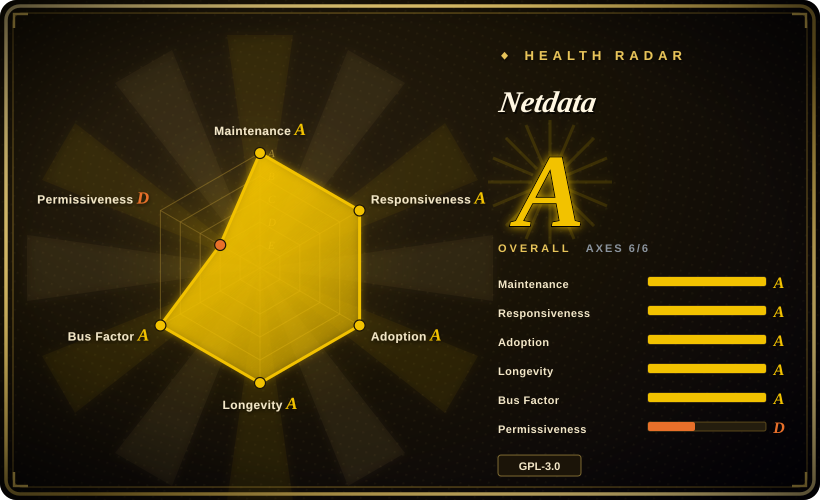
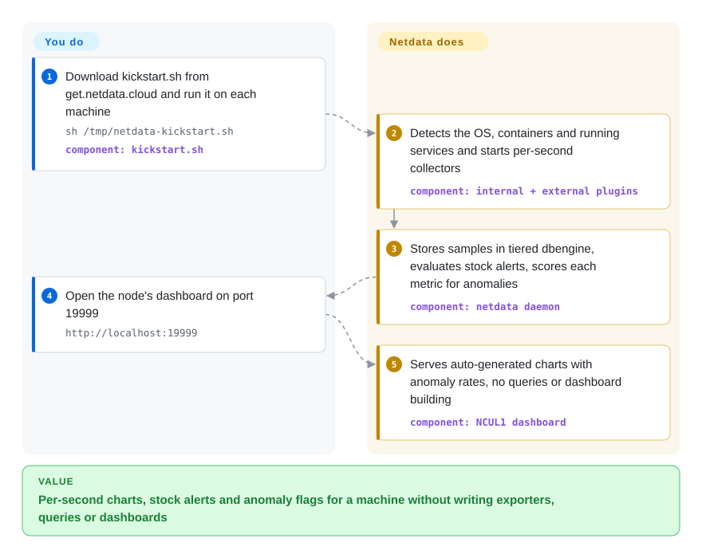
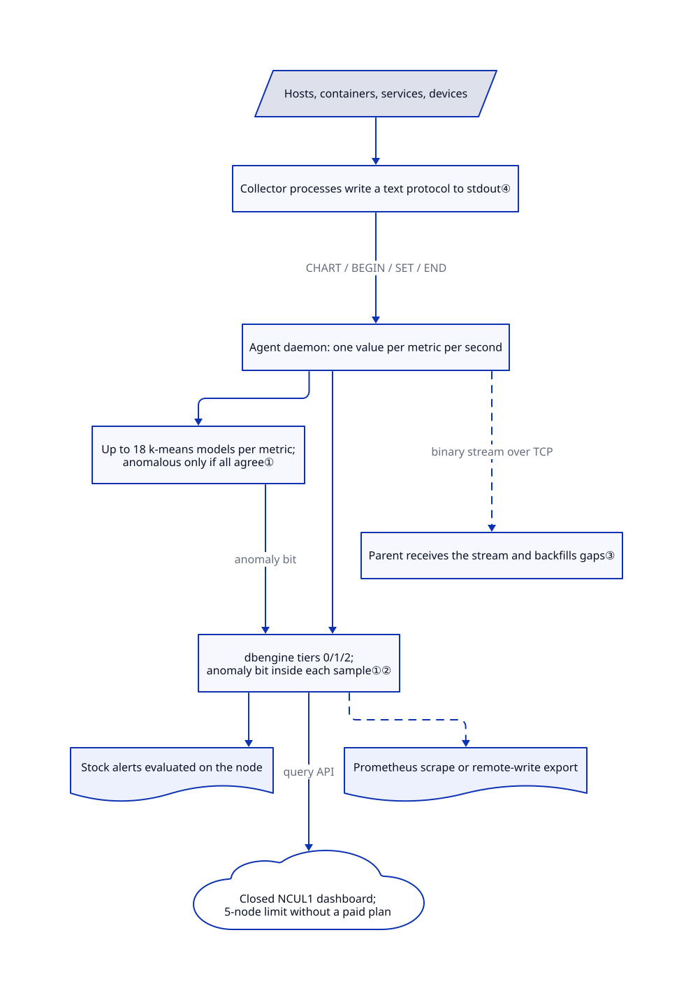

# Netdata

A server stalls for twenty seconds at 3 a.m., and the next morning your 5-minute cloud graphs show a smooth line — or that machine was never wired into monitoring at all. Netdata puts one agent on each machine that finds the running services by itself, records thousands of metrics every second, and marks which ones looked abnormal at that moment.

Source review is pinned to upstream commit `72e71a7738e1410a4baee7b2e71d2c268d83ea53` (2026-11-18). Only the agent is open source; the dashboard it serves is a separately distributed, closed-source build, which shapes most of the "When NOT to use" list below.

## When to use

You look after a few to a few dozen Linux servers — a small company's VMs, a homelab, a bare-metal database box — and the monitoring you have is either nothing or your provider's console, which shows `CPU 14%` as a 5-minute average while users report the API froze. You want to see what the disk queue, the softirq load, the PostgreSQL connections and the container CPU did *second by second* around that freeze, and you do not want to spend the week writing exporter configs, PromQL and dashboards first.

Reach for Netdata when "install it and look" is the requirement. The one-line installer brings up an agent that auto-detects the host, containers and common services, collects per second, keeps its own tiered history on local disk, ships 1,100+ preconfigured alerts and trains small anomaly models for every metric on the node itself. Pick it over a Prometheus + node_exporter + Grafana build when time-to-first-insight beats query flexibility, and over Zabbix when you want no central server and database to stand up before you see anything. The price is open core: you get the GPL agent, but the dashboard is a closed NCUL1 build that limits how many nodes you can open without a paid Netdata Cloud plan.

## When NOT to use

- **You need one free, fully open pane over more than five machines.** The documented 5-node limit applies on Netdata Cloud *and* on the local dashboard of your own Agents and Parents; nodes beyond your five preferred ones show as **Locked** until you pay. Collection and storage keep working, so either export to Prometheus and view in [Grafana](grafana.md), or build on [Prometheus](prometheus.md) + node_exporter from the start.
- **You want application SLOs, PromQL-style math, or Kubernetes-native alerting conventions.** Netdata's design is "no query language"; its charts are preshaped per collector. For per-endpoint error ratios, recording rules and the alert format the Kubernetes ecosystem assumes, use [Prometheus](prometheus.md).
- **You plan to self-host traces, OpenTelemetry logs, NetFlow or RUM and view them for free.** The agent can collect and store these, but viewing the Traces, OpenTelemetry Logs, Network Flows, SNMP Traps, topology and RUM views requires a paid plan or trial. Use [Jaeger](jaeger.md) for traces and [Loki](loki.md) for logs if the viewer must be free.
- **Your rules forbid a vendor account to see process lists or the systemd journal.** Anonymous dashboard users are blocked from the Processes, Network Connections and Systemd Journal views; they need a Netdata Cloud sign-in. For an account-free per-server web console use [Cockpit](../dev-utilities/ops-infra/cockpit.md); for a terminal view, Glances.
- **You need a fully open, centrally managed enterprise monitor with templates, inventory and agentless checks.** Zabbix keeps server, frontend and agent all under AGPL-3.0 with centralized configuration; Netdata's central management (dynamic configuration, RBAC, SSO) sits in paid Cloud tiers.
- **The target is a tiny device or you only need to ship metrics elsewhere.** The README itself budgets about 200 MB RAM on a typical server with ML on; when you just need to forward a few measurements to an existing store, use [Telegraf](../dev-utilities/ops-infra/telegraf.md) (or run Netdata's IoT profile, which disables ML).

## Comparison

| Alternative | In index | Our verdict | Tradeoff |
|---|---|---|---|
| [Prometheus](prometheus.md) | ✅ | When you need custom queries, recording rules and alerts over application metrics on Kubernetes, pick Prometheus (with node_exporter and Grafana); pick Netdata when per-second host visibility with zero dashboard work matters more. | Prometheus is fully Apache-2.0 and query-first but you assemble exporters, rules and dashboards yourself; Netdata arrives preassembled but its UI is closed and node-capped. |
| Zabbix | not indexed | When a team must centrally manage thousands of hosts and network devices under a fully open license, pick Zabbix; pick Netdata for a small fleet where per-second granularity and no central database matter more. | Zabbix's server, frontend and agent are all AGPL-3.0 with templates and inventory, at the cost of running a server plus SQL database before the first graph. Not added in this tab batch. |
| Glances | not indexed | When you want a quick terminal or web view of one machine right now, pick Glances; pick Netdata when you also need stored history, alerts and anomaly scoring. | Glances is a lightweight Python monitor with no built-in long-term store or per-metric ML; Netdata keeps days to months of tiered history but runs a heavier daemon. Not added in this tab batch. |
| [Cockpit](../dev-utilities/ops-infra/cockpit.md) | ✅ | When the goal is administering a Linux server from a browser (services, storage, logs, updates), pick Cockpit; pick Netdata when the goal is high-resolution metrics and alerting. | Cockpit gives management actions and journal access without a vendor account, but its metrics view is shallow; Netdata gives deep per-second metrics but gates log and process views behind a Cloud sign-in. |
| [Telegraf](../dev-utilities/ops-infra/telegraf.md) | ✅ | When you already run a time-series backend and only need a collector to feed it, pick Telegraf; pick Netdata when you have no backend and want storage, alerts and a UI on the node itself. | Telegraf is an MIT collector with no storage or dashboard; Netdata bundles collection, storage, alerting and ML, and can still export to Prometheus or remote-write targets. |

## Quick start

The documented path is the kickstart script: download it to `/tmp` and run it with `sh` (or use the `netdata/netdata` Docker image, which needs host PID/network and read-only mounts of `/proc`, `/sys` and `/`). Add `--disable-telemetry` if you do not want anonymous usage statistics sent, and `--claim-token` only if you choose to connect the node to Netdata Cloud — the hosted control plane, which is optional. Netdata then detects the system and running services, starts collecting every second, stores history on local disk and evaluates its stock alerts; you open `http://localhost:19999` and the charts are already there. What stays yours: firewalling or authenticating port 19999 (the HTTP API is reachable by anyone who can connect unless you restrict it), a mail transfer agent or notification target for alerts, disk size for retention, `stream.conf` if you want children to stream to a central Parent, and the decision whether to pay for the views the free tier locks.

<!-- flow-steps:begin (generated from flows/netdata.json by tools/flow_card.py — do not edit) -->

Text version of the flow

1. **You**: Download kickstart.sh from get.netdata.cloud and run it on each machine — `sh /tmp/netdata-kickstart.sh` — component: `kickstart.sh`
2. **Netdata**: Detects the OS, containers and running services and starts per-second collectors — component: `internal + external plugins`
3. **Netdata**: Stores samples in tiered dbengine, evaluates stock alerts, scores each metric for anomalies — component: `netdata daemon`
4. **You**: Open the node's dashboard on port 19999 — `http://localhost:19999`
5. **Netdata**: Serves auto-generated charts with anomaly rates, no queries or dashboard building — component: `NCUL1 dashboard`

**Value**: Per-second charts, stock alerts and anomaly flags for a machine without writing exporters, queries or dashboards

<!-- flow-steps:end -->

## Key techniques

<!-- mechanism:begin (generated from mechanisms/netdata.json by tools/mechanism_card.py; do not edit) -->

Text version of the mechanism

- Hosts, containers, services, devices
- Collector processes write a text protocol to stdout④
- Agent daemon: one value per metric per second
- Up to 18 k-means models per metric; anomalous only if all agree①
- dbengine tiers 0/1/2; anomaly bit inside each sample①②
- Stock alerts evaluated on the node
- Parent receives the stream and backfills gaps③
- Closed NCUL1 dashboard; 5-node limit without a paid plan
- Prometheus scrape or remote-write export

- Hosts, containers, services, devices → Collector processes write a text protocol to stdout④
- Collector processes write a text protocol to stdout④ → Agent daemon: one value per metric per second (CHART / BEGIN / SET / END)
- Agent daemon: one value per metric per second → Up to 18 k-means models per metric; anomalous only if all agree①
- Up to 18 k-means models per metric; anomalous only if all agree① → dbengine tiers 0/1/2; anomaly bit inside each sample①② (anomaly bit)
- Agent daemon: one value per metric per second → dbengine tiers 0/1/2; anomaly bit inside each sample①②
- dbengine tiers 0/1/2; anomaly bit inside each sample①② → Stock alerts evaluated on the node
- Agent daemon: one value per metric per second → Parent receives the stream and backfills gaps③ (binary stream over TCP) [optional/fallback]
- dbengine tiers 0/1/2; anomaly bit inside each sample①② → Closed NCUL1 dashboard; 5-node limit without a paid plan (query API)
- dbengine tiers 0/1/2; anomaly bit inside each sample①② → Prometheus scrape or remote-write export [optional/fallback]

<!-- mechanism:end -->

### 1. Score every metric with a committee of tiny models

- **Problem:** A fixed threshold for thousands of metrics either pages too often or misses odd-but-under-threshold behavior.
- **How:** Each metric gets k-means clustering models (k-means groups recent value patterns into two clusters; distance from them is the score) trained on preprocessed recent windows: by default a 6-hour window, retrained every 3 hours, keeping up to 18 models. A new sample is anomalous only if every model scores it at least 99; one dissenting model returns "normal". The verdict is stored as one bit inside the sample, so anomaly rates come back with ordinary queries.
- **Limits:** This flags "unusual for this metric's recent past", not "bad"; a slow drift becomes the new normal within the models' window. The ML README still says "last 4 hours", while the code default is 6, so trust the configuration over prose. Dimensions that stay anomalous too long are silenced, and the IoT profile turns ML off.
- **Source:** [consensus loop:1236–1271](https://github.com/netdata/netdata/blob/72e71a7738e1410a4baee7b2e71d2c268d83ea53/src/ml/ml.cc#L1236-L1271), [defaults and clamps:114–188](https://github.com/netdata/netdata/blob/72e71a7738e1410a4baee7b2e71d2c268d83ea53/src/ml/ml_config.cc#L114-L188), [anomaly bit:91–113](https://github.com/netdata/netdata/blob/72e71a7738e1410a4baee7b2e71d2c268d83ea53/src/libnetdata/storage_number/storage_number.h#L91-L113), [IoT profile:95–165](https://github.com/netdata/netdata/blob/72e71a7738e1410a4baee7b2e71d2c268d83ea53/src/daemon/config/netdata-conf-profile.c#L95-L165).

### 2. Keep per-second data affordable with fixed-step pages and aggregate tiers

- **Problem:** Storing every metric every second for weeks costs too much disk and RAM if each sample carries its own timestamp.
- **How:** dbengine (Netdata's own time-series store) keeps fixed-step pages where position implies time, packs up to 64 pages into compressed extents, and writes two higher tiers in real time: tier 1 aggregates 60 tier-0 points, tier 2 aggregates 60 tier-1 points. Each aggregate keeps sum, count, min, max and the anomaly count, so zoomed-out charts still show true peaks and anomaly rates.
- **Limits:** Old data loses resolution by design, and rotation deletes whole datafiles, so you cannot delete or fix data in the middle. Per-node retention is bounded by the disk you assign to each tier; there is no clustered or replicated store.
- **Source:** [data points and tiers:9–36](https://github.com/netdata/netdata/blob/72e71a7738e1410a4baee7b2e71d2c268d83ea53/src/database/engine/README.md#L9-L36), [extents, rotation and tiers:78–120](https://github.com/netdata/netdata/blob/72e71a7738e1410a4baee7b2e71d2c268d83ea53/src/database/engine/README.md#L78-L120).

### 3. Centralize by streaming, then backfill gaps after reconnect

- **Problem:** A central monitoring box that misses data whenever the network blips gives you holes exactly during incidents.
- **How:** Children keep collecting and storing locally; with `[stream]` enabled they push metrics to a Parent over Netdata's own binary protocol on port 19999 (TLS optional). When the connection comes back, the child replicates the missing history so the Parent's record is complete; listing several destinations gives failover.
- **Limits:** Destinations must be Netdata servers, not a generic HTTP or Prometheus endpoint. The protocol has had memory-safety advisories (two streaming slot-guard bugs published 2026-09-02), so treat the Parent port as an untrusted-input surface and keep it patched.
- **Source:** [data flow and protocol:56–86](https://github.com/netdata/netdata/blob/72e71a7738e1410a4baee7b2e71d2c268d83ea53/src/streaming/README.md#L56-L86), [replication parser](https://github.com/netdata/netdata/blob/72e71a7738e1410a4baee7b2e71d2c268d83ea53/src/plugins.d/pluginsd_replication.c), [security advisories](https://github.com/netdata/netdata/security/advisories).

### 4. Run collectors as separate processes behind a line protocol

- **Problem:** Hundreds of integrations written in different languages would destabilize the daemon if they all ran inside it.
- **How:** External plugins (the Go `go.d.plugin`, Rust OpenTelemetry/netflow/journal plugins, Bash `charts.d`) are child processes whose stdout carries text commands such as `CHART`, `DIMENSION`, `BEGIN`, `SET` and `END`. The daemon parses them and decides on restart by exit status and history: a plugin that has produced data is restarted after it exits, one that never produced data is eventually disabled, and one killed by a signal is disabled.
- **Limits:** A plugin that dies on a signal stays disabled until Netdata restarts, so a missing chart can mean a dead collector rather than a quiet service. Silent plugins are disconnected after the longer of two minutes or twice their interval.
- **Source:** [plugin lifecycle and stdout API:1–66](https://github.com/netdata/netdata/blob/72e71a7738e1410a4baee7b2e71d2c268d83ea53/src/plugins.d/README.md#L1-L66), [data commands:838–866](https://github.com/netdata/netdata/blob/72e71a7738e1410a4baee7b2e71d2c268d83ea53/src/plugins.d/README.md#L838-L866).

## Tech stack

- **Agent daemon:** C (web server, dbengine, health/alert engine, streaming, plugins.d parser), ML in C++ using dlib. GitHub's language stats rank Go first by bytes because of the `go.d.plugin` collector tree (about 4,800 files at the reviewed commit).
- **Plugins:** Go (`go.d.plugin`, including SNMP and most application collectors), Rust crates (OpenTelemetry ingestion, logs/journal indexing, netflow), C internal plugins (`proc`, `cgroups`, `apps`, `ebpf`), Python and Bash legacy orchestrators.
- **Build:** CMake with Rust (corrosion) and Go toolchains; the dashboard is not built from this repository — `NetdataDashboard.cmake` downloads a prebuilt tarball from `DASHBOARD_URL`.
- **Interfaces:** HTTP API on port 19999 (`/api/v1`–`/api/v3`), Prometheus `allmetrics` endpoint and remote-write exporter, Graphite/OpenTSDB/JSON/Kinesis/Pub/Sub exporters, OTLP ingestion, and an MCP server built into every Agent and Parent.

## Dependencies

- **Runtime:** a native package, static build or Docker image per machine; no external database. Local disk for dbengine tiers (sized per tier in `netdata.conf`) plus SQLite for metadata and ML models.
- **Dashboard:** the NCUL1-licensed UI bundled in standard packages, newer versions served from Netdata's CDN. It is free to use but closed-source; the node limit and feature gating are enforced through it and through your Netdata Cloud plan.
- **Optional services:** Netdata Cloud (SaaS or paid on-prem) for multi-node views beyond five nodes, RBAC/SSO, dynamic configuration and AI features; an MTA or notification integration for alerts; a Prometheus/Grafana stack if you export instead.
- **Privileges:** collectors need broad host access (the Docker recipe adds `SYS_PTRACE`, `SYS_ADMIN`, host PID/network and the Docker socket), and the setuid helper `ndsudo` runs selected privileged commands — the subject of local-privilege-escalation advisories in 2024 and 2026.

## Ops difficulty

**Low to get value on one node; medium for a fleet.** Install and first charts take minutes and need no configuration. Fleet work is where the effort lands: designing Parent tiers (the README sizes one Parent at about 500 nodes or 2 million metrics per second), retention disk per tier, alert tuning to cut noise from 1,100+ stock alerts, and securing port 19999 (bearer-token protection and `allow connections from` ACLs exist but are opt-in). Keep agents updated — the 2026-09-02 batch of advisories (fixed in v2.10.4) included an unauthenticated settings write and a local root path. Budget a decision on Netdata Cloud early, because the free limits shape whether you can operate more than five nodes from one screen.

## Health & viability

- **Maintenance (2026-11-18):** Very active. Monthly-ish stable releases (v2.12.0 on 2026-09-30 through v2.12.3 on 2026-11-04), nightly builds, and more than 200 commits to `master` in the 30 days before review; not archived.
- **Governance and backing:** Owned by the company Netdata Inc. (the `netdata` GitHub organization); founder Costa Tsaousis (`ktsaou`) remains the top committer, with a deep bench of staff contributors behind him. The roadmap follows the company's Cloud business. Netdata is a CNCF *member* and appears in the CNCF landscape, but it is not a CNCF-hosted project, so it has no foundation governance.
- **Age and Lindy:** Created 2013-06-17 — about 13 years old and still shipping, a strong Lindy prior for the agent. The prior covers the GPL agent, not the free-tier terms of the closed UI and Cloud: those are plan entitlements the vendor sets, not license terms, so they can change without a code release.
- **Risk flags:** Open core with a closed NCUL1 dashboard; a 5-node free view limit that also applies to self-hosted Parents; paid-only viewing for traces, OTel logs, flows, RUM and topology; anonymous telemetry on by default (opt-out). Security history includes streaming authentication bypass and command injection (2022) and seven advisories published together on 2026-09-02.
- **Adoption:** ~81.5k stars and ~6.7k forks (2026-11-18); the README claims users such as Amazon, Google and Netflix, which this page did not verify.

## Caveats (unverified)

- [Unverified: no running install] Resource figures (under 5% of one core and ~200 MB RAM with ML, ~30 MiB on a lightweight child, ~500 nodes per Parent, ~0.6 bytes per sample) are upstream README claims, not measured here.
- [Unverified: upstream marketing] The "eliminating 99% of false positives" claim for model consensus and the named enterprise users come from upstream docs with no published methodology or customer list checked here.
- [Inference: based on `api_v3_settings.c` storing preferred nodes and the limit being described as a dashboard entitlement] The 5-node lock appears to be enforced by the closed UI and Cloud plan rather than by the agent's HTTP API; whether raw API or Prometheus export access to locked nodes stays open was not tested.
- [Unverified: not read in full] The NCUL1 license text at `app.netdata.cloud/LICENSE.txt` was not reviewed clause by clause; check redistribution and modification terms before embedding the dashboard in a product.
- [Inference: from the IoT profile setting `ml_enabled = NO` and the others `AUTO`] Whether ML actually runs by default on a given standard install depends on the profile Netdata auto-detects; not reproduced.
- [Unverified: repository hygiene for contributors] The repository ships contributor skills under `.agents/skills` (exposed via `.claude/skills`); opening the clone in an AI coding agent will load them. They are developer instructions, not runtime code, and were only listed, not audited.
