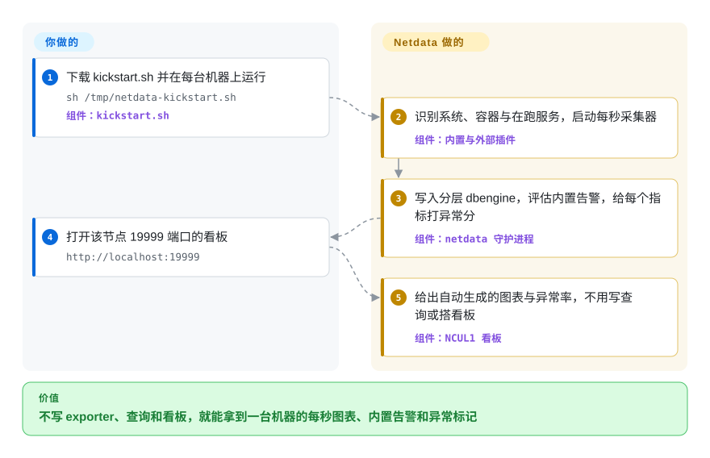
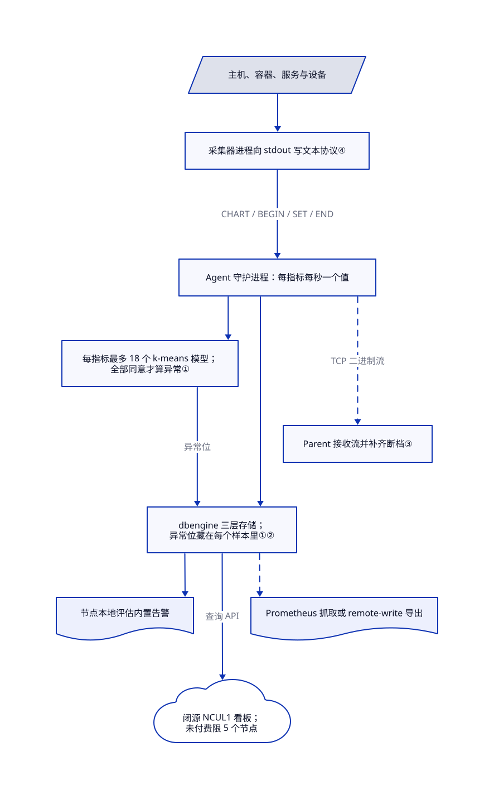

# Netdata

凌晨三点服务器卡死二十秒，第二天云厂商控制台里 5 分钟平均的曲线平平无奇；更常见的是那台机器根本没接监控。Netdata 在每台机器上装一个 agent，自己找出在跑的服务，每秒记下几千个指标，并当场标出哪些指标的走势不对劲。

源码审阅固定在上游提交 `72e71a7738e1410a4baee7b2e71d2c268d83ea53`（2026-11-18）。开源的只有 agent；它对外提供的看板是单独分发的闭源构建，下面“何时不用”的大部分条目都由此而来。

## 何时使用

你手上管着几台到几十台 Linux 服务器：小公司的虚拟机、自家 homelab、一台物理数据库机。现有监控要么没有，要么只有云厂商控制台——用户说接口卡住了，控制台却显示 `CPU 14%`，那是 5 分钟平均值。你想看卡顿前后磁盘队列、软中断、PostgreSQL 连接数、容器 CPU **逐秒**是怎么变的，又不想先花一周写 exporter 配置、PromQL 和看板。

当需求是“装上就能看”时就想到 Netdata。一行安装脚本拉起的 agent 会自动识别主机、容器和常见服务，每秒采集，在本机磁盘上保留分层历史，自带 1,100 多条预置告警，还在节点本地给每个指标训练小型异常检测模型。比起自己拼 Prometheus + node_exporter + Grafana，它的取舍是“先看到”胜过“查询灵活”；比起 Zabbix，它不需要先搭中心服务器和数据库才能看到第一张图。代价是开放核心模式：agent 是 GPL，但看板是闭源的 NCUL1 构建，不买 Netdata Cloud 付费套餐，能打开的节点数有上限。

## 何时不用

- **你要一个免费且完全开源、能同时看五台以上机器的面板。** 文档写明 5 节点限制既作用于 Netdata Cloud，也作用于你自建 Agent 和 Parent 的本地看板；超出你选定的 5 个“首选节点”的机器显示为 **Locked**，付费才能解锁。采集和存储不受影响，所以要么导出到 Prometheus 再用 [Grafana](grafana.zh.md) 看，要么一开始就用 [Prometheus](prometheus.zh.md) + node_exporter。
- **你要的是应用 SLO、PromQL 式的指标运算或 Kubernetes 惯用的告警写法。** Netdata 的设计口号是“不需要查询语言”，图表按采集器预先成形。要按接口算错误率、写 recording rule、用 Kubernetes 生态默认的告警格式，选 [Prometheus](prometheus.zh.md)。
- **你打算自托管链路、OpenTelemetry 日志、NetFlow 或 RUM，并且想免费查看。** agent 能采集和存储这些数据，但 Traces、OpenTelemetry Logs、Network Flows、SNMP Traps、拓扑和 RUM 这些视图要付费套餐或试用期才能打开。查看端必须免费的话，链路用 [Jaeger](jaeger.zh.md)，日志用 [Loki](loki.zh.md)。
- **你的规定不允许为了看进程列表或 systemd 日志去注册厂商账号。** 匿名看板用户看不到 Processes、Network Connections、Systemd Journal 这些视图，必须登录 Netdata Cloud。想要无需账号的单机网页控制台，用 [Cockpit](../dev-utilities/ops-infra/cockpit.zh.md)；想在终端里看，用 Glances。
- **你需要完全开源、集中管理的企业级监控，带模板、资产清单和无 agent 检查。** Zabbix 的服务端、前端和 agent 都是 AGPL-3.0，配置集中管理；Netdata 的集中管理能力（动态配置、RBAC、SSO）在 Cloud 付费层里。
- **目标是很小的设备，或者你只需要把指标转发到别处。** README 自己给出的预算是开启 ML 时普通服务器约 200 MB 内存；只想把少量指标送进已有存储，用 [Telegraf](../dev-utilities/ops-infra/telegraf.zh.md)（或者用 Netdata 的 IoT 配置档，它会关闭 ML）。

## 横向对比

| 替代品 | 是否收录 | 我们的评价 | 取舍 |
|---|---|---|---|
| [Prometheus](prometheus.zh.md) | ✅ | 如果你要在 Kubernetes 上对应用指标写自定义查询、recording rule 和告警，选 Prometheus（配 node_exporter 和 Grafana）；如果更看重零看板工作量的逐秒主机可见性，选 Netdata。 | Prometheus 全部是 Apache-2.0、以查询为中心，但 exporter、规则和看板都得自己拼；Netdata 开箱即成套，但界面闭源且有节点上限。 |
| Zabbix | 未收录 | 如果团队要在完全开源的许可下集中管理成千上万台主机和网络设备，选 Zabbix；如果是小规模机群、更看重逐秒粒度和不要中心数据库，选 Netdata。 | Zabbix 的服务端、前端、agent 都是 AGPL-3.0，带模板和资产清单，代价是看到第一张图之前要先运行服务端和 SQL 数据库。本批标签收录未添加。 |
| Glances | 未收录 | 如果你只想马上在终端或网页里看一台机器的现状，选 Glances；如果还需要保存历史、告警和异常打分，选 Netdata。 | Glances 是轻量的 Python 监控工具，不自带长期存储，也没有逐指标的 ML；Netdata 保留几天到几个月的分层历史，但守护进程更重。本批标签收录未添加。 |
| [Cockpit](../dev-utilities/ops-infra/cockpit.zh.md) | ✅ | 如果目标是在浏览器里管理 Linux 服务器（服务、存储、日志、更新），选 Cockpit；如果目标是高分辨率指标和告警，选 Netdata。 | Cockpit 提供管理操作和日志访问，不需要厂商账号，但指标视图很浅；Netdata 指标逐秒且深入，但日志和进程视图要登录 Cloud 才能看。 |
| [Telegraf](../dev-utilities/ops-infra/telegraf.zh.md) | ✅ | 如果你已经有时序后端、只缺一个往里送数据的采集器，选 Telegraf；如果你没有后端，想在节点上直接拿到存储、告警和界面，选 Netdata。 | Telegraf 是 MIT 许可的采集器，没有存储和看板；Netdata 把采集、存储、告警和 ML 打包在一起，也仍能导出到 Prometheus 或 remote-write 目标。 |

## 快速上手

文档给出的路径是 kickstart 脚本：下载到 `/tmp` 后用 `sh` 运行（或者用 `netdata/netdata` Docker 镜像，它需要宿主机的 PID 与网络命名空间，以及只读挂载 `/proc`、`/sys` 和 `/`）。不想上报匿名使用统计就加 `--disable-telemetry`；只有在你决定把节点接入 Netdata Cloud（可选的托管控制面）时才加 `--claim-token`。之后 Netdata 自己识别系统和在跑的服务，开始每秒采集，把历史存在本机磁盘，并评估预置告警；你打开 `http://localhost:19999`，图表已经在那里。仍归你负责的：给 19999 端口加防火墙或鉴权（不加限制时，任何能连上的人都能访问 HTTP API）、为告警配置邮件服务（MTA，负责发信的程序）或通知渠道、按保留时长分配磁盘、需要把子节点汇聚到中心 Parent 时编写 `stream.conf`，以及决定要不要为免费层锁住的视图付费。

<!-- flow-steps:begin (generated from flows/netdata.json by tools/flow_card.py — do not edit) -->

流程文字版

1. **你**：下载 kickstart.sh 并在每台机器上运行 — `sh /tmp/netdata-kickstart.sh` — 组件：`kickstart.sh`
2. **Netdata**：识别系统、容器与在跑服务，启动每秒采集器 — 组件：`内置与外部插件`
3. **Netdata**：写入分层 dbengine，评估内置告警，给每个指标打异常分 — 组件：`netdata 守护进程`
4. **你**：打开该节点 19999 端口的看板 — `http://localhost:19999`
5. **Netdata**：给出自动生成的图表与异常率，不用写查询或搭看板 — 组件：`NCUL1 看板`

**价值**：不写 exporter、查询和看板，就能拿到一台机器的每秒图表、内置告警和异常标记

<!-- flow-steps:end -->

## 技术要点

<!-- mechanism:begin (generated from mechanisms/netdata.json by tools/mechanism_card.py; do not edit) -->

机制文字版

- 主机、容器、服务与设备
- 采集器进程向 stdout 写文本协议④
- Agent 守护进程：每指标每秒一个值
- 每指标最多 18 个 k-means 模型； 全部同意才算异常①
- dbengine 三层存储； 异常位藏在每个样本里①②
- 节点本地评估内置告警
- Parent 接收流并补齐断档③
- 闭源 NCUL1 看板； 未付费限 5 个节点
- Prometheus 抓取或 remote-write 导出

- 主机、容器、服务与设备 → 采集器进程向 stdout 写文本协议④
- 采集器进程向 stdout 写文本协议④ → Agent 守护进程：每指标每秒一个值（CHART / BEGIN / SET / END）
- Agent 守护进程：每指标每秒一个值 → 每指标最多 18 个 k-means 模型； 全部同意才算异常①
- 每指标最多 18 个 k-means 模型； 全部同意才算异常① → dbengine 三层存储； 异常位藏在每个样本里①②（异常位）
- Agent 守护进程：每指标每秒一个值 → dbengine 三层存储； 异常位藏在每个样本里①②
- dbengine 三层存储； 异常位藏在每个样本里①② → 节点本地评估内置告警
- Agent 守护进程：每指标每秒一个值 → Parent 接收流并补齐断档③（TCP 二进制流）〔可选／兜底〕
- dbengine 三层存储； 异常位藏在每个样本里①② → 闭源 NCUL1 看板； 未付费限 5 个节点（查询 API）
- dbengine 三层存储； 异常位藏在每个样本里①② → Prometheus 抓取或 remote-write 导出〔可选／兜底〕

<!-- mechanism:end -->

### 1. 用一组小模型“投票”给每个指标打异常分

- **解决：** 几千个指标都靠固定阈值告警，要么吵个不停，要么漏掉“没过线但很反常”的走势。
- **做法：** 每个指标都有 k-means 聚类模型（把近期数值形态分成两簇，离簇中心越远分越高），用预处理后的近期窗口训练：默认窗口 6 小时、每 3 小时重训一次、最多保留 18 个模型。新样本只有在所有模型都打出不低于 99 分时才算异常，任何一个模型不同意就判为正常。结论作为一个比特存进样本本身，普通查询就能顺带算出异常率。
- **边界：** 它标的是“相对这个指标的近期过去不寻常”，不是“出了问题”；缓慢漂移会在模型窗口内变成新常态。ML 的 README 仍写“最近 4 小时”，代码默认值却是 6 小时，以配置为准。长时间持续异常的维度会被静默，IoT 配置档则直接关闭 ML。
- **源码：** [投票循环第 1236–1271 行](https://github.com/netdata/netdata/blob/72e71a7738e1410a4baee7b2e71d2c268d83ea53/src/ml/ml.cc#L1236-L1271)、[默认值与上下限第 114–188 行](https://github.com/netdata/netdata/blob/72e71a7738e1410a4baee7b2e71d2c268d83ea53/src/ml/ml_config.cc#L114-L188)、[异常位第 91–113 行](https://github.com/netdata/netdata/blob/72e71a7738e1410a4baee7b2e71d2c268d83ea53/src/libnetdata/storage_number/storage_number.h#L91-L113)、[IoT 配置档第 95–165 行](https://github.com/netdata/netdata/blob/72e71a7738e1410a4baee7b2e71d2c268d83ea53/src/daemon/config/netdata-conf-profile.c#L95-L165)。

### 2. 用定步长页面和聚合分层让逐秒数据存得起

- **解决：** 每个指标每秒一个点、存几周，如果每个样本都带自己的时间戳，磁盘和内存都吃不消。
- **做法：** dbengine（Netdata 自研的时序存储）用定步长页面，数组位置即时间；最多 64 个页面打包压缩成一个 extent；同时实时写入两个更高层：tier 1 聚合 60 个 tier 0 点，tier 2 聚合 60 个 tier 1 点。每个聚合点都保存总和、计数、最小值、最大值和异常计数，拉远看时峰值和异常率依然准确。
- **边界：** 旧数据按设计会降低分辨率；轮转以整个数据文件为单位删除，无法删改中间某段数据。单节点能保留多久取决于你给每层分配的磁盘，没有集群或副本存储。
- **源码：** [数据点与分层第 9–36 行](https://github.com/netdata/netdata/blob/72e71a7738e1410a4baee7b2e71d2c268d83ea53/src/database/engine/README.md#L9-L36)、[extent、轮转与分层第 78–120 行](https://github.com/netdata/netdata/blob/72e71a7738e1410a4baee7b2e71d2c268d83ea53/src/database/engine/README.md#L78-L120)。

### 3. 用流式推送做汇聚，重连后补齐断档

- **解决：** 网络一抖中心监控就丢数据，空洞恰好出现在事故期间。
- **做法：** 子节点照常在本地采集和存储；启用 `[stream]` 后，用 Netdata 自己的二进制协议经 19999 端口推送给 Parent（TLS 可选）。连接恢复时，子节点把缺失的历史复制过去，让 Parent 的记录完整；配置多个目标地址可做故障切换。
- **边界：** 目标必须是 Netdata 服务，不能是通用 HTTP 或 Prometheus 端点。该协议出过内存安全问题（2026-09-02 公布了两个流式槽位校验缺陷），应把 Parent 端口当作不可信输入面，并及时升级。
- **源码：** [数据流与协议第 56–86 行](https://github.com/netdata/netdata/blob/72e71a7738e1410a4baee7b2e71d2c268d83ea53/src/streaming/README.md#L56-L86)、[复制协议解析](https://github.com/netdata/netdata/blob/72e71a7738e1410a4baee7b2e71d2c268d83ea53/src/plugins.d/pluginsd_replication.c)、[安全公告](https://github.com/netdata/netdata/security/advisories)。

### 4. 采集器作为独立进程，通过文本行协议对接

- **解决：** 几百个用不同语言写的集成如果都跑在守护进程里，任何一个出错都会拖垮主进程。
- **做法：** 外部插件（Go 写的 `go.d.plugin`，Rust 写的 OpenTelemetry、netflow、journal 插件，Bash 写的 `charts.d`）都是子进程，通过 stdout 输出 `CHART`、`DIMENSION`、`BEGIN`、`SET`、`END` 等文本命令。守护进程解析这些命令，并按退出码和历史决定是否重启：产出过数据的插件退出后会被重启，从未产出数据的最终会被禁用，被信号杀掉的直接禁用。
- **边界：** 被信号杀掉的插件在 Netdata 重启前一直处于禁用状态，所以某张图不见了，可能是采集器挂了，而不是服务没动静。长时间没有输出的插件会在两分钟与两倍采集间隔中较长者之后被断开。
- **源码：** [插件生命周期与 stdout 接口第 1–66 行](https://github.com/netdata/netdata/blob/72e71a7738e1410a4baee7b2e71d2c268d83ea53/src/plugins.d/README.md#L1-L66)、[数据命令第 838–866 行](https://github.com/netdata/netdata/blob/72e71a7738e1410a4baee7b2e71d2c268d83ea53/src/plugins.d/README.md#L838-L866)。

## 技术栈

- **Agent 守护进程：** C（Web 服务、dbengine、健康/告警引擎、流式传输、plugins.d 解析器），ML 部分用 C++ 和 dlib。GitHub 的语言统计按字节把 Go 排第一，原因是 `go.d.plugin` 的采集器目录很大（审阅提交下约 4,800 个文件）。
- **插件：** Go（`go.d.plugin`，含 SNMP 和大部分应用采集器）、Rust crate（OpenTelemetry 接入、日志/journal 索引、netflow）、C 内置插件（`proc`、`cgroups`、`apps`、`ebpf`），以及 Python 和 Bash 的旧式编排器。
- **构建：** CMake，配合 Rust（corrosion）和 Go 工具链；看板不在本仓库里构建——`NetdataDashboard.cmake` 从 `DASHBOARD_URL` 下载预编译的 tar 包。
- **接口：** 19999 端口的 HTTP API（`/api/v1` 到 `/api/v3`）、Prometheus `allmetrics` 端点和 remote-write 导出器、Graphite／OpenTSDB／JSON／Kinesis／Pub/Sub 导出器、OTLP 接入，以及每个 Agent 和 Parent 内置的 MCP 服务。

## 依赖

- **运行时：** 每台机器装一个原生包、静态构建或 Docker 镜像；不需要外部数据库。本地磁盘存放 dbengine 各层（每层大小在 `netdata.conf` 里配置），外加存放元数据和 ML 模型的 SQLite。
- **看板：** 标准安装包里自带 NCUL1 许可的界面，新版本由 Netdata 的 CDN 提供。它免费使用但闭源；节点上限和功能门槛都通过它和你的 Netdata Cloud 套餐来执行。
- **可选服务：** Netdata Cloud（SaaS 或付费私有部署），用于超过五个节点的多节点视图、RBAC/SSO、动态配置和 AI 功能；告警需要邮件服务或通知集成；如果走导出路线，还需要 Prometheus/Grafana 体系。
- **权限：** 采集器需要较大的宿主机访问权限（Docker 方案要加 `SYS_PTRACE`、`SYS_ADMIN`、宿主 PID/网络命名空间和 Docker socket）；setuid 辅助程序 `ndsudo` 负责执行特定的特权命令，2024 年和 2026 年都出过与它相关的本地提权公告。

## 运维难度

**单节点用起来很低；机群规模为中等。** 安装加上看到第一张图只要几分钟，不需要任何配置。工作量集中在机群层面：设计 Parent 层级（README 给出单个 Parent 约承载 500 个节点或每秒 200 万个指标）、按层分配保留磁盘、调优告警以压掉 1,100 多条预置告警带来的噪音，以及保护 19999 端口（有 bearer token 保护和 `allow connections from` 访问控制，但都要手动开启）。要保持 agent 更新——2026-09-02 那批公告（v2.10.4 修复）里包括一个无需认证的设置写入和一条本地提权路径。尽早决定是否用 Netdata Cloud，因为免费层的限制直接决定你能否在一个屏幕上管理五台以上的机器。

## 健康度与可持续性

- **维护（2026-11-18）：** 非常活跃。稳定版大约每月一到两次（2026-09-30 的 v2.12.0 到 2026-11-04 的 v2.12.3），另有 nightly 构建；审阅前 30 天 `master` 上有 200 多次提交；未归档。
- **治理与背书：** 归 Netdata Inc. 公司所有（GitHub 组织 `netdata`）；创始人 Costa Tsaousis（`ktsaou`）至今仍是提交最多的人，后面有一批员工贡献者。路线图跟着公司的 Cloud 业务走。Netdata 是 CNCF 的**会员**并出现在 CNCF 全景图里，但不是 CNCF 托管项目，没有基金会治理。
- **年龄与 Lindy：** 创建于 2013-06-17，约 13 年且仍在发版，对 agent 来说是很强的 Lindy 先验。但这个先验只覆盖 GPL 的 agent，覆盖不了闭源界面和 Cloud 的免费层条款：那些是厂商设定的套餐权益，不是许可条款，可以不发新代码就改变。
- **风险信号：** 开放核心，看板为闭源 NCUL1；5 节点免费查看上限连自建 Parent 也受约束；链路、OTel 日志、流量、RUM 和拓扑只能付费查看；匿名遥测默认开启（可退出）。安全记录包括 2022 年的流式认证绕过和命令注入，以及 2026-09-02 同日公布的七个公告。
- **采用度：** 约 8.15 万 star、约 6.7 千 fork（2026-11-18）；README 宣称 Amazon、Google、Netflix 等在用，本页未核实。

## 存疑（未验证）

- [未验证：没有实际安装运行] 资源数字（开启 ML 时不到单核 5%、约 200 MB 内存，轻量子节点约 30 MiB，单个 Parent 约 500 个节点，每个样本约 0.6 字节）都是上游 README 的说法，本页未实测。
- [未验证：上游宣传] 模型投票“消除 99% 误报”的说法和列出的企业用户都来自上游文档，没有公开方法或可核对的客户名单。
- [推断：依据是 `api_v3_settings.c` 存放首选节点、文档把上限描述为看板权益] 5 节点锁定看起来由闭源界面和 Cloud 套餐执行，而不是由 agent 的 HTTP API 执行；被锁节点能否继续通过原始 API 或 Prometheus 导出访问，本页没有测试。
- [未验证：未逐条阅读] `app.netdata.cloud/LICENSE.txt` 上的 NCUL1 许可没有逐条审阅；要把看板嵌进产品前，先核对其再分发和修改条款。
- [推断：依据是 IoT 配置档设 `ml_enabled = NO`、其他配置档为 `AUTO`] 某台标准安装上 ML 是否默认运行，取决于 Netdata 自动识别出的配置档；未复现。
- [未验证：仅涉及贡献者的仓库卫生] 仓库在 `.agents/skills` 下带了贡献者技能（经 `.claude/skills` 暴露），在 AI 编程助手里打开这个克隆会加载它们。它们是开发说明，不是运行时代码，本页只列出了文件，没有逐个审阅。
