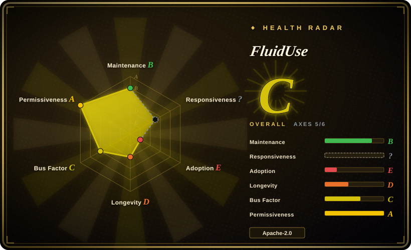
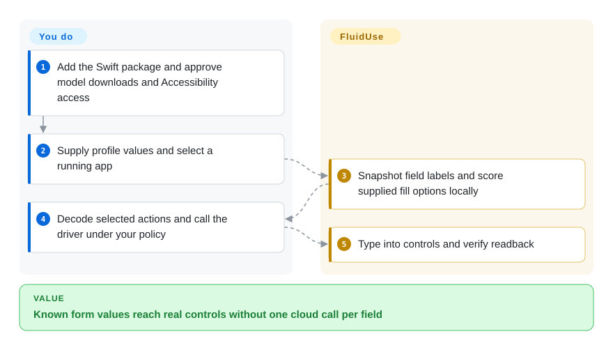
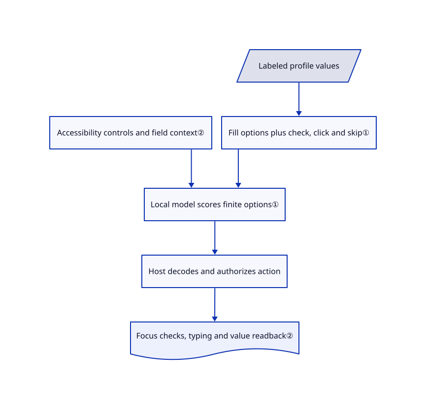

# FluidUse

Calling a large chat model for every form field adds delay and sends personal data away. FluidUse offers local Core ML decision models and a Mac accessibility driver that matches supplied values to real controls.

## When to use

You build a Swift app that must classify, route or fill known fields on Apple hardware without a hosted model call per decision. Choose FluidUse when a finite set of options and pre-converted Core ML models fit the job. Its form example connects a small classifier to native accessibility controls; current main also includes typed-decision, vision and OCR managers. It is not a universal autonomous desktop agent.

## When NOT to use

- For open-ended chat and generation inside an Apple app, compare [uzu](uzu.md), checking its OS floor and telemetry; finite-option scoring is a different task.
- For arbitrary model experimentation and fine-tuning in Python, choose [MLX / mlx-lm](mlx-mlx-lm.md), not preconverted manager APIs.
- For whole-computer workflows with isolation, choose [Cua](../../desktop-automation/cua.md). FluidUse's accessibility driver acts on your actual Mac session.
- For essays, unavailable accessibility controls or file attachments, use a human or task-specific automation. The form model selects supplied values; the accessibility driver explicitly rejects file attachment.

## Comparison

| Alternative | In index | Our verdict | Tradeoff |
|---|---|---|---|
| [uzu](uzu.md) | ✅ | Choose uzu for an app-facing chat/generation engine; choose FluidUse for typed decisions and the supplied Core ML model managers. | Broader conversational surface versus specialized choices; both depend on converted model availability. |
| [MLX / mlx-lm](mlx-mlx-lm.md) | ✅ | Choose mlx-lm to change or fine-tune models in Python; choose FluidUse to call specialized models from Swift. | Research flexibility versus model-specific application APIs. |
| [Cua](../../desktop-automation/cua.md) | ✅ | Choose Cua when a general agent needs an isolated desktop; choose FluidUse for narrow local field matching. | OS-wide orchestration and sandboxing versus direct access to real Mac controls. |

## Quick start

Add the documented Swift package dependency from version `0.3.0` and import FluidUse with FluidAudio. Supply a profile of labeled values, obtain a running application and create `AccessibilityFormDriver(application:)`. Snapshot its fields, render the candidate values and score each actionable field with the forms model; your application decodes the selected option and calls the driver. The library supplies observation and action helpers, not the complete authorization policy. Grant Accessibility only for approved applications, review values before submission and allow first-use model downloads separately from local inference.

<!-- flow-steps:begin (generated from flows/fluiduse.json by tools/flow_card.py — do not edit) -->

Text version of the flow

1. **You**: Add the Swift package and approve model downloads and Accessibility access
2. **You**: Supply profile values and select a running app
3. **FluidUse**: Snapshot field labels and score supplied fill options locally
4. **You**: Decode selected actions and call the driver under your policy
5. **FluidUse**: Type into controls and verify readback

**Value**: Known form values reach real controls without one cloud call per field

<!-- flow-steps:end -->

## Key techniques

<!-- mechanism:begin (generated from mechanisms/fluiduse.json by tools/mechanism_card.py; do not edit) -->

Text version of the mechanism

- Labeled profile values
- Accessibility controls and field context②
- Fill options plus check, click and skip①
- Local model scores finite options①
- Host decodes and authorizes action
- Focus checks, typing and value readback②

- Labeled profile values → Fill options plus check, click and skip①
- Accessibility controls and field context② → Local model scores finite options①
- Fill options plus check, click and skip① → Local model scores finite options①
- Local model scores finite options① → Host decodes and authorizes action
- Host decodes and authorizes action → Focus checks, typing and value readback②

<!-- mechanism:end -->

### 1. Score a closed set instead of generating field text

- **Problem:** Generative text can invent a value that was never in the user's profile.
- **How:** FormSchema renders each labeled value as a fill option followed by check, click and skip. A field context includes its role, label, value and hint; decoding maps an option index back to the action and supplied entity.
- **Limits:** Context strings are truncated to the training schema. Selecting from supplied values does not prove the correct field was selected, and question-style answers are separate host rules.
- **Source:** [Form schema](https://github.com/FluidInference/FluidUse/blob/cfba4d3fa4b996d0b680549416caf7aba6be770c/Sources/FluidUse/FormSchema.swift#L128-L180).

### 2. Check focus and read back real UI values

- **Problem:** Browser controls can ignore an accessibility value write or redirect it to the focused field.
- **How:** The driver uses accessibility snapshots, token-addressed controls and browser-specific keystrokes. It checks focus, can relocate rerendered controls by role/label and verifies the value after typing.
- **Limits:** Browser readback normalizes letters and digits and uses containment, not byte equality. The driver brings windows forward; it is neither background isolation nor a guarantee against a wrong target.
- **Source:** [Driver action path](https://github.com/FluidInference/FluidUse/blob/cfba4d3fa4b996d0b680549416caf7aba6be770c/Sources/FluidUse/AccessibilityFormDriver.swift#L189-L321).

## Tech stack

Swift 6 package, Core ML, AppKit and macOS Accessibility APIs; FluidAudio is a package dependency. The checked-in package declares macOS 14 minimum. Individual model managers can require newer OS versions.

## Dependencies

Apple hardware and compatible Core ML assets, Swift tooling, model-download storage and Accessibility permission for the desktop path. Some published-model bridges additionally download a pinned Hub snapshot and prepare a Python 3.12/uv environment; do not describe every manager as pure Swift or network-free setup.

## Ops difficulty

**Medium.** No inference server is mandatory, but model caches, per-model memory and sequence limits, OS support and real-UI permissions require management. Model licenses differ from the Apache-2.0 library, including tokenizer-specific terms and non-redistributed weights.

## Health & viability

- Created 2026-09-21; main last changed on 2026-10-14 and v0.3.0 released on 2026-09-25. Less than one month of history provides almost no Lindy evidence.
- FluidInference owns the repository; contributions are overwhelmingly from `Alex-Wengg`. Tests, fixtures and parity tools are present, but 521 stars are not a reliability measure.
- Apache-2.0 library license is present. The README attributes CUA-S1-FORMS to Cua under MIT and documents per-model download boundaries.
- [推断：依据是月龄项目与大量主干模型新增] Pin the reviewed commit when relying on managers beyond the release's original surface.

## Caveats (unverified)

- [未验证：禁止运行上游及控制用户桌面] No real-form, download, parity or latency benchmark was reproduced.
- [未验证：未复跑独立任务集] Published speed, probability calibration and model-conversion parity remain author-reported measurements.
- [推断：依据是月龄项目与大量主干模型新增] API and packaged model coverage can change rapidly.
