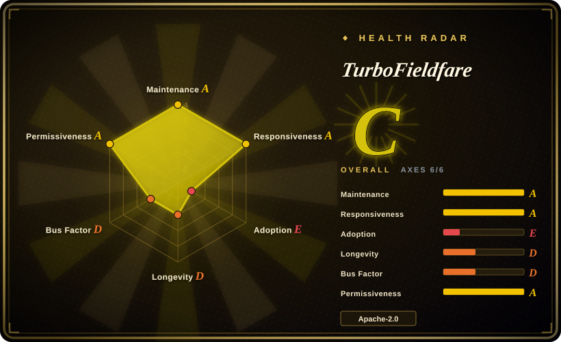
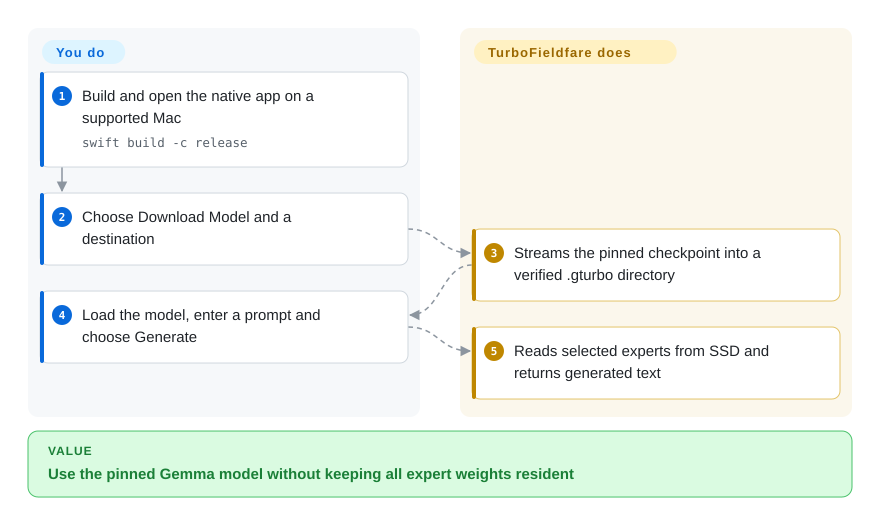
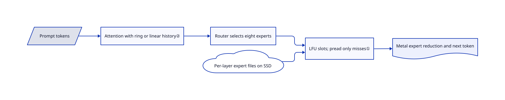

# TurboFieldfare

Your 8 GB Mac cannot hold a roughly 14 GB model beside its applications. TurboFieldfare keeps Gemma 4's common weights in memory and reads only the experts selected for the next token from SSD.

## When to use

You want to experiment with Gemma 4 26B-A4B on an 8 GB Apple-silicon laptop without turning every prompt into a swap storm. You can reserve about 15 GB of storage and accept disk-dependent generation speed. Choose this over a general model manager when fitting this particular model is more important than changing model families: its fixed-size expert buffers and custom Metal kernels target that constraint directly.

## When NOT to use

- Need Windows, Linux, Intel Macs or older macOS? Use [llama.cpp](../../llm-inference/local-runtimes/llama-cpp.md); this package requires arm64, macOS 26, Metal 4 and Swift 6.2.
- Want to try many model families or fine-tune? Use [mlx-lm](mlx-mlx-lm.md); this runtime accepts a pinned Gemma checkpoint and its own `.gturbo` format, not arbitrary MLX weights.
- Want a managed model library and a background endpoint? Use [Ollama](../../llm-inference/local-runtimes/ollama.md); TurboFieldfare's server is experimental, serializes generation and has no remote authentication or TLS.
- Need concurrent production serving? Use [vLLM](../../llm-inference/serving-engines/vllm.md) on suitable hardware; TurboFieldfare documents one model-owning process at a time, not a multi-user scheduler.

## Comparison

| Alternative | In index | Our verdict | Tradeoff |
|---|---|---|---|
| [llama.cpp](../../llm-inference/local-runtimes/llama-cpp.md) | ✅ | Choose llama.cpp for heterogeneous machines and GGUF breadth; choose TurboFieldfare for a small-memory Mac dedicated to the pinned Gemma model. | General hardware coverage versus a model-specific disk-streaming layout. No comparative speed claim is established here. |
| [mlx-lm](mlx-mlx-lm.md) | ✅ | Choose mlx-lm for Python experiments, conversion and fine-tuning; choose TurboFieldfare when the full weight set cannot remain resident. | Direct Python access and many architectures versus Swift/Metal code built around a bounded expert cache. |
| [Ollama](../../llm-inference/local-runtimes/ollama.md) | ✅ | Choose Ollama for model lifecycle management across developer machines; choose TurboFieldfare for studying or using this low-memory Gemma path. | Larger ecosystem and managed downloads versus a narrower, inspectable runtime with its own installer. |

## Quick start

Clone the repository and run `swift build -c release`, then `.build/release/TurboFieldfareMac` on a supported Mac. Choose Download Model; the installer fetches and repacks the pinned checkpoint into a `.gturbo` directory. Choose Load Model, enter a prompt and select Generate. The app manages tokenization and local generation; you supply storage, hardware and prompts, and must check important answers. Keep only one model-owning app, CLI or server running; the optional vision pack needs M2 or newer.

<!-- flow-steps:begin (generated from flows/turbo-fieldfare.json by tools/flow_card.py — do not edit) -->

Text version of the flow

1. **You**: Build and open the native app on a supported Mac — `swift build -c release`
2. **You**: Choose Download Model and a destination
3. **TurboFieldfare**: Streams the pinned checkpoint into a verified .gturbo directory
4. **You**: Load the model, enter a prompt and choose Generate
5. **TurboFieldfare**: Reads selected experts from SSD and returns generated text

**Value**: Use the pinned Gemma model without keeping all expert weights resident

<!-- flow-steps:end -->

## Key techniques

<!-- mechanism:begin (generated from mechanisms/turbo-fieldfare.json by tools/mechanism_card.py; do not edit) -->

Text version of the mechanism

- Prompt tokens
- Attention with ring or linear history②
- Router selects eight experts
- LFU slots; pread only misses①
- Per-layer expert files on SSD
- Metal expert reduction and next token

- Prompt tokens → Attention with ring or linear history②
- Attention with ring or linear history② → Router selects eight experts
- Router selects eight experts → LFU slots; pread only misses①
- Per-layer expert files on SSD → LFU slots; pread only misses①
- LFU slots; pread only misses① → Metal expert reduction and next token

<!-- mechanism:end -->

### 1. Read cache misses into GPU-visible expert slots

- **Problem:** Loading every routed expert exceeds the target machine's RAM.
- **How:** Each layer owns fixed, aligned buffers shared with Metal. Cache planning keeps hits, assigns LFU eviction slots and fills misses with parallel `pread` calls; the CPU does not create a full model tensor collection.
- **Limits:** Fewer resident experts mean more SSD reads. Slot capacity is not a promise about whole-process memory or macOS file-cache residency.
- **Source:** [Slot allocation and cache execution](https://github.com/drumih/turbo-fieldfare/blob/2e9ea50e8c35a65d9170e3bff9d1063be8931ec0/Sources/TurboFieldfare/Infrastructure/Streaming/PreadExpertStreamer.swift#L130-L303).

### 2. Bound local attention history without merging K and V

- **Problem:** Keeping every previous token in every layer makes context memory grow needlessly.
- **How:** Sliding-window layers use circular FP16 buffers; full-attention layers retain linear history. K and V remain separate because Gemma applies different normalization and position transforms even when their projection weights are shared.
- **Limits:** Full-attention history still grows with configured context. Reset's page-release advice is not a physical-memory guarantee.
- **Source:** [Cache capacity, distinct buffers and reset](https://github.com/drumih/turbo-fieldfare/blob/2e9ea50e8c35a65d9170e3bff9d1063be8931ec0/Sources/TurboFieldfare/Runtime/KVCache/KVCacheManager.swift#L26-L134), [reset limitations](https://github.com/drumih/turbo-fieldfare/blob/2e9ea50e8c35a65d9170e3bff9d1063be8931ec0/Sources/TurboFieldfare/Runtime/KVCache/KVCacheManager.swift#L244-L260).

## Tech stack

Swift 6.2, custom Metal 4 kernels, SwiftUI/AppKit UI, Swift Transformers tokenizer, SwiftNIO HTTP server and SwiftMath rendering. The runtime is not an MLX or llama.cpp wrapper.

## Dependencies

Apple-silicon Mac with macOS 26 and its SDK; Swift package build dependencies; about 14.3 GB installed text weights and optionally 1.1 GB for vision. Initial installation needs Hugging Face access. Downloaded weights retain their source terms separately from the runtime license.

## Ops difficulty

**Medium.** No database or model API bill, but you build a young native runtime, manage a large model directory and budget context/cache memory. SSD, thermal state and file-cache warmth affect interactive latency. Keep the unauthenticated experimental HTTP server on loopback.

## Health & viability

- As of 2026-10-18, release 0.9.3 was published on 2026-10-15. The repository was created on 2026-07-17: active, but only three months old.
- The contributor response names one author, `drumih`; 6,941 stars are attention, not evidence of deployment scale. The test tree covers format, runtime, installer, UI and server paths.
- [推断] The age × activity prior remains weak because the project is young and model-specific. Prefer a pinned experiment over making it your only general inference dependency.
- Apache-2.0 source and separate model/dependency notices are explicit. The main selection risks are hardware lock-in and single-maintainer continuity.

## Caveats (unverified)

- [未验证] The README's approximately 2 GB footprint and reported M2/M5 token rates were not reproduced; no upstream code or model was executed in this intake.
- [推断] Long-term continuity is uncertain: the repository is three months old and the contributor snapshot lists one author.
