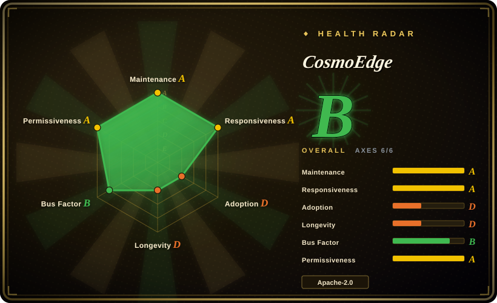
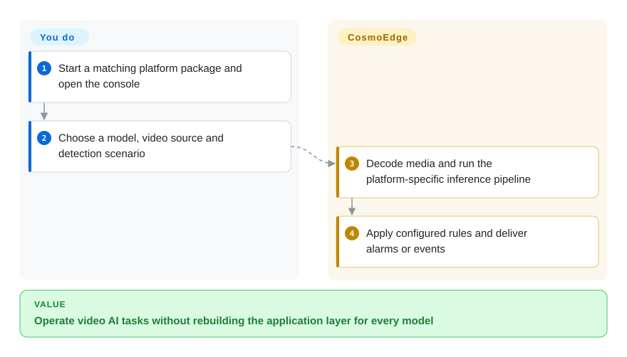
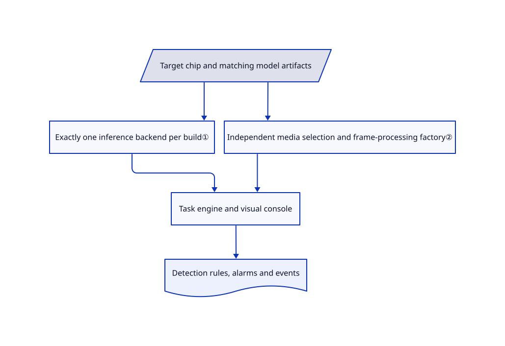

# CosmoEdge

A detector alone does not connect cameras, manage tasks or deliver alarms. CosmoEdge wraps edge inference in a visual application console with platform-specific media and model runtimes.

## When to use

You deploy video analytics on Sophon or Rockchip boxes and need operators to wire a model, region rule and alarm output without rewriting a C++ application. Choose CosmoEdge for that integrated task lifecycle and web console, rather than assembling a media framework and inference SDK yourself. An x86 path lets you try the workflow, but does not establish NPU throughput.

## When NOT to use

- For home-camera recording and object detection, compare Frigate; its NVR focus may avoid adopting an industrial workflow engine.
- For a custom embedded media graph, use [GStreamer](../media-processing/video-audio/transcoding-and-pipelines/gstreamer.md); you then own model integration and alarm logic.
- For conversion or frame extraction only, use [FFmpeg](../media-processing/video-audio/transcoding-and-pipelines/ffmpeg.md), not a persistent management service.
- Do not assume one model file runs on every chip. Use the matching vendor runtime and conversion toolchain; the macOS preview is amd64 emulation, not native accelerator validation.

## Comparison

| Alternative | In index | Our verdict | Tradeoff |
|---|---|---|---|
| [Frigate](https://github.com/blakeblackshear/frigate) | not indexed | Choose Frigate for an IP-camera NVR; choose CosmoEdge for platform-specific visual analytics tasks and event integration. | Recording-oriented product versus scene/model orchestration; not added in this tab batch. |
| [GStreamer](../media-processing/video-audio/transcoding-and-pipelines/gstreamer.md) | ✅ | Choose GStreamer to build a custom live media pipeline; choose CosmoEdge when operators need a ready-made task and alarm console. | Lower-level flexibility costs application and deployment work. |
| [FFmpeg](../media-processing/video-audio/transcoding-and-pipelines/ffmpeg.md) | ✅ | Choose FFmpeg for media transformations; choose CosmoEdge for continuously managed inference and alerts. | One-shot CLI simplicity does not include the business-task layer. |

## Quick start

For the x86 trial, clone the repository and review the supplied Compose capabilities, writable mounts and published ports described below before starting `docker-compose.x86.yml`, then open port 8080. In the console, select a matching model, supply a video source and configure a detection scenario and alarm behavior. The engine manages media, inference and task outputs; you supply model artifacts, stream credentials and business thresholds. Use a tagged release for a stable deployment, because the README's build commands target current main. Validate your real streams and accuracy before choosing channel counts; edge deployment additionally needs the matching chip package.

<!-- flow-steps:begin (generated from flows/cosmo-edge.json by tools/flow_card.py — do not edit) -->

Text version of the flow

1. **You**: Start a matching platform package and open the console
2. **You**: Choose a model, video source and detection scenario
3. **CosmoEdge**: Decode media and run the platform-specific inference pipeline
4. **CosmoEdge**: Apply configured rules and deliver alarms or events

**Value**: Operate video AI tasks without rebuilding the application layer for every model

<!-- flow-steps:end -->

## Key techniques

<!-- mechanism:begin (generated from mechanisms/cosmo-edge.json by tools/mechanism_card.py; do not edit) -->

Text version of the mechanism

- Target chip and matching model artifacts
- Exactly one inference backend per build①
- Independent media selection and frame-processing factory②
- Task engine and visual console
- Detection rules, alarms and events

- Target chip and matching model artifacts → Exactly one inference backend per build①
- Target chip and matching model artifacts → Independent media selection and frame-processing factory②
- Exactly one inference backend per build① → Task engine and visual console
- Independent media selection and frame-processing factory② → Task engine and visual console
- Task engine and visual console → Detection rules, alarms and events

<!-- mechanism:end -->

### 1. Enforce one inference backend per build

- **Problem:** A model and runtime built for one accelerator cannot be treated as universally portable.
- **How:** CMake requires exactly one of Sophon, CPU/ONNX or RKNN, sets build-wide feature definitions and separately validates target-chip identity. RKNN additionally requires an existing chip profile.
- **Limits:** Backend consistency does not convert models or prove accuracy. Stable release features and current-main features differ.
- **Source:** [Backend and chip contract](https://github.com/cosmo-wander-ai/cosmo-edge/blob/0d577e6c38cbb9bb575c1e224885f8dca4b742e7/CMakeLists.txt#L102-L171).

### 2. Separate media implementation from inference choice

- **Problem:** Decode, frame processing and overlays have different hardware dependencies from model inference.
- **How:** A separately selected media backend provides a common frame-processing factory. The CPU factory returns a software implementation without a device handle; build checks reject incompatible media combinations.
- **Limits:** Exactly one media backend is selected; a shared interface is not automatic runtime migration between platforms.
- **Source:** [Media selection](https://github.com/cosmo-wander-ai/cosmo-edge/blob/0d577e6c38cbb9bb575c1e224885f8dca4b742e7/CMakeLists.txt#L173-L220), [CPU factory](https://github.com/cosmo-wander-ai/cosmo-edge/blob/0d577e6c38cbb9bb575c1e224885f8dca4b742e7/src/media/VideoFrameProcFactoryCpu.cc).

## Tech stack

C++17/CMake engine; Vue 3, Vite, Element Plus and Vue Flow console. Runtime packages combine the engine, nginx, SRS, media libraries and chip-specific inference components. Bundled third-party C code explains why GitHub's primary-language label differs from the engine language.

## Dependencies

Docker for the documented local path; matching BMRT, RKNN/RKLLM or ONNX runtime and target model artifacts for deployment. Cameras, stream access and event consumers remain yours. Commercial protected model packages and device-bound certificates have separate terms from the Apache-licensed core.

- **x86 runtime Compose:** adds `NET_ADMIN` and the `video` group, and bind-mounts `./build_output` writable at `/build_output`, alongside persistent named data/resource volumes. It publishes TCP 8080, 1936, 1985 and 18088 plus UDP 8000 without a host-IP restriction: the file does not confine them to loopback, and effective binding follows Docker's settings. It does not request `privileged: true` or host networking, but is not a minimal-permission sandbox. Review capabilities, writable paths and listening scope before use. [Fixed x86 configuration](https://github.com/cosmo-wander-ai/cosmo-edge/blob/0d577e6c38cbb9bb575c1e224885f8dca4b742e7/docker-compose.x86.yml#L12-L33).
- **Chip-package builders, not the x86 runtime:** the Sophon and Rockchip Compose files set `network_mode: host`, bind-mount the whole repository writable at `/workspace`, and also mount writable build output. Those build-container permissions are separate from the x86 service's published-port configuration; do not assume every deployment uses host networking. [Sophon builder](https://github.com/cosmo-wander-ai/cosmo-edge/blob/0d577e6c38cbb9bb575c1e224885f8dca4b742e7/docker-compose.sophon.yml#L2-L10), [Rockchip builder](https://github.com/cosmo-wander-ai/cosmo-edge/blob/0d577e6c38cbb9bb575c1e224885f8dca4b742e7/docker-compose.rockchip.yml#L2-L10).

## Ops difficulty

**High on real devices.** Model conversion, media drivers, stream recovery, storage cleanup and alert accuracy require device-level validation. The README states that application upgrade archives are not signed; MD5 checks are not publisher authentication. Isolate management access and independently verify deployed artifacts.

## Health & viability

- On 2026-10-18, main last changed on 2026-10-16; stable v1.1.0 was released 2026-08-24. Unreleased main capabilities are explicitly separated in the README.
- Created 2026-06-09 with several active contributors under Cosmo Wander AI. Four months is little Lindy evidence despite concrete packaging and benchmark artifacts.
- Apache-2.0 core text and retained third-party license paths are present. Hardware, preset models and distribution protection are separate commercial boundaries.
- [推断：依据是年轻硬件项目及平台专用构建] Treat the published capacity as a test profile, not a substitute for your deployment acceptance run.

## Caveats (unverified)

- [未验证：无目标硬件且禁止执行上游] Model import, reboot recovery and reported 72-hour results were not reproduced.
- [推断：依据是年轻硬件项目及平台专用构建] Real camera throughput and resilience can differ from controlled local-video profiles.
