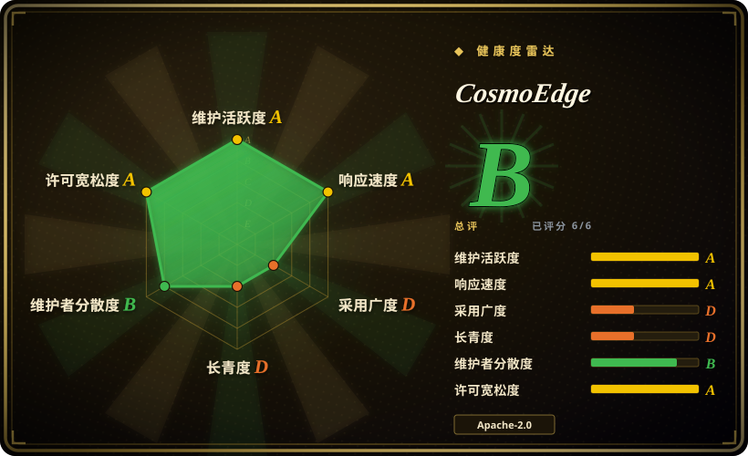
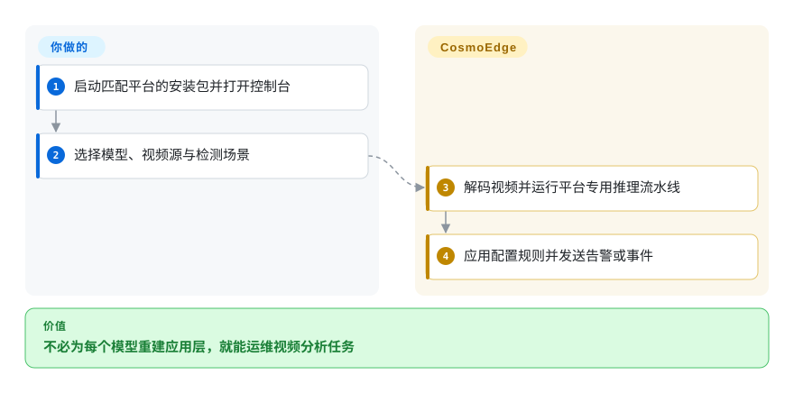
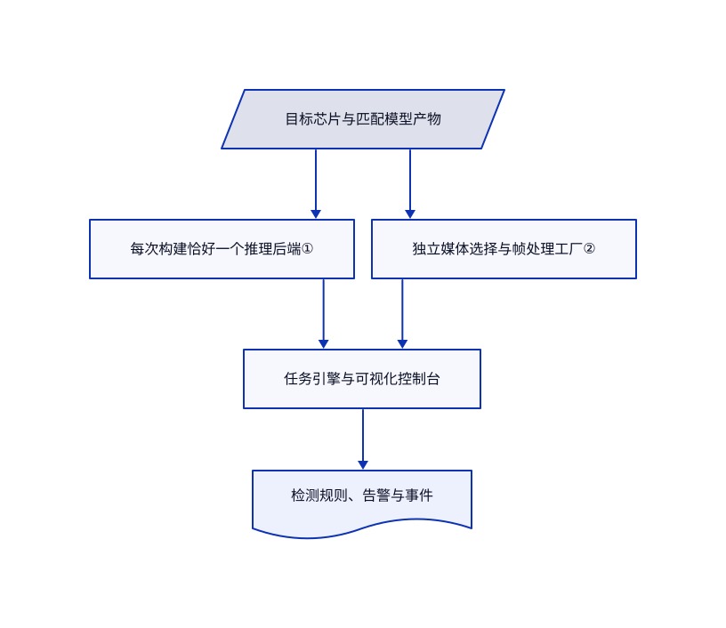

# CosmoEdge

只有检测模型，还接不了摄像头、管不了任务，也发不出告警。CosmoEdge 用可视化控制台组织边缘推理，并对接各平台的媒体与模型运行时。

## 何时使用

你在 Sophon 或 Rockchip 盒子上部署视频分析，需要操作员连接模型、区域规则和告警输出，而不是每次重写 C++ 应用。若你需要集成任务生命周期和网页控制台，选 CosmoEdge，不必自己拼装媒体框架与推理开发包。x86 路线可体验流程，但不证明 NPU 吞吐。

## 何时不用

- 家庭摄像头录像和目标检测，先比较 Frigate；它的录像产品定位可能更直接。
- 要自定义嵌入式媒体图，选 [GStreamer](../media-processing/video-audio/transcoding-and-pipelines/gstreamer.zh.md)，自己承担模型接入和告警逻辑。
- 只要转码或抽帧，选 [FFmpeg](../media-processing/video-audio/transcoding-and-pipelines/ffmpeg.zh.md)，不必运行管理服务。
- 别假定同一模型文件能跨芯片运行，应使用匹配的厂商运行时和转换链。macOS 预览是 amd64 仿真，不是原生加速器验证。

## 横向对比

| 替代品 | 是否收录 | 我们的评价 | 取舍 |
|---|---|---|---|
| [Frigate](https://github.com/blakeblackshear/frigate) | 未收录 | 网络摄像头录像选 Frigate；平台专用的可视化分析任务与事件集成选 CosmoEdge。 | 录像产品与场景模型编排定位不同；本批未收录。 |
| [GStreamer](../media-processing/video-audio/transcoding-and-pipelines/gstreamer.zh.md) | ✅ | 自建实时媒体流水线选 GStreamer；操作员要现成任务和告警控制台时选 CosmoEdge。 | 底层灵活性换来应用和部署开发工作。 |
| [FFmpeg](../media-processing/video-audio/transcoding-and-pipelines/ffmpeg.zh.md) | ✅ | 媒体转换选 FFmpeg；持续管理推理和告警选 CosmoEdge。 | 一次性命令简单，但不含业务任务管理。 |

## 快速上手

x86 试用可克隆仓库，先审查下文的 Compose 能力、可写挂载和发布端口，再按 `docker-compose.x86.yml` 启动并打开 8080 端口。在控制台选择匹配模型，提供视频源，配置检测场景和告警行为。引擎管理媒体、推理和任务输出；你负责模型产物、流凭据和业务阈值。正式部署使用带标签版本，因为 README 的构建命令针对当前主干。选择路数前，用真实视频和精度要求验收；边缘部署还需要匹配芯片的安装包。

<!-- flow-steps:begin (generated from flows/cosmo-edge.json by tools/flow_card.py — do not edit) -->

流程文字版

1. **你**：启动匹配平台的安装包并打开控制台
2. **你**：选择模型、视频源与检测场景
3. **CosmoEdge**：解码视频并运行平台专用推理流水线
4. **CosmoEdge**：应用配置规则并发送告警或事件

**价值**：不必为每个模型重建应用层，就能运维视频分析任务

<!-- flow-steps:end -->

## 技术要点

<!-- mechanism:begin (generated from mechanisms/cosmo-edge.json by tools/mechanism_card.py; do not edit) -->

机制文字版

- 目标芯片与匹配模型产物
- 每次构建恰好一个推理后端①
- 独立媒体选择与帧处理工厂②
- 任务引擎与可视化控制台
- 检测规则、告警与事件

- 目标芯片与匹配模型产物 → 每次构建恰好一个推理后端①
- 目标芯片与匹配模型产物 → 独立媒体选择与帧处理工厂②
- 每次构建恰好一个推理后端① → 任务引擎与可视化控制台
- 独立媒体选择与帧处理工厂② → 任务引擎与可视化控制台
- 任务引擎与可视化控制台 → 检测规则、告警与事件

<!-- mechanism:end -->

### 1. 每次构建强制一个推理后端

- **解决：** 为某个加速器生成的模型和运行时，不能当成通用产物。
- **做法：** CMake 要求 Sophon、CPU／ONNX 和 RKNN 三选一，设置全局特性定义，并单独校验芯片标识。RKNN 还要求目标芯片配置存在。
- **边界：** 后端一致不等于模型已转换或精度合格。稳定版和当前主干功能也不同。
- **源码：** [后端与芯片合同](https://github.com/cosmo-wander-ai/cosmo-edge/blob/0d577e6c38cbb9bb575c1e224885f8dca4b742e7/CMakeLists.txt#L102-L171)。

### 2. 将媒体实现与推理选择分开

- **解决：** 解码、帧处理和叠字的硬件依赖，不等于模型推理依赖。
- **做法：** 单独选择的媒体后端提供统一帧处理工厂。CPU 工厂不使用设备句柄，返回软件实现；构建检查拒绝不兼容的媒体组合。
- **边界：** 每次只选一个媒体后端。共同接口不代表运行时能自动跨平台迁移。
- **源码：** [媒体选择](https://github.com/cosmo-wander-ai/cosmo-edge/blob/0d577e6c38cbb9bb575c1e224885f8dca4b742e7/CMakeLists.txt#L173-L220)、[CPU 工厂](https://github.com/cosmo-wander-ai/cosmo-edge/blob/0d577e6c38cbb9bb575c1e224885f8dca4b742e7/src/media/VideoFrameProcFactoryCpu.cc)。

## 技术栈

C++17／CMake 引擎；Vue 3、Vite、Element Plus 和 Vue Flow 控制台。运行包包含引擎、nginx、SRS、媒体库和芯片推理组件。大量第三方 C 代码使 GitHub 主语言标签与引擎语言不同。

## 依赖

文档本地路线需要 Docker；部署需要匹配的 BMRT、RKNN／RKLLM 或 ONNX 运行时，以及目标模型产物。摄像头、视频访问和事件接收方由你提供。受保护商业模型及设备绑定证书，与 Apache 核心许可分开。

- **x86 运行配置：** 额外授予 `NET_ADMIN` 并加入 `video` 组，将 `./build_output` 可写绑定到 `/build_output`，另有持久数据和资源命名卷。配置发布 TCP 8080、1936、1985、18088 和 UDP 8000，未限定宿主 IP，不能视为仅回环监听；实际绑定还取决于 Docker 设置。该文件既没有 `privileged: true`，也未使用宿主网络，但并非最小权限沙箱。使用前应审查能力、可写路径和监听范围。[固定 x86 配置](https://github.com/cosmo-wander-ai/cosmo-edge/blob/0d577e6c38cbb9bb575c1e224885f8dca4b742e7/docker-compose.x86.yml#L12-L33)。
- **专芯构建容器，而非 x86 运行服务：** Sophon 和 Rockchip Compose 设置 `network_mode: host`，将整个仓库可写挂载到 `/workspace`，并挂载可写构建输出。这是构建容器权限，与 x86 服务的端口发布配置分开，不代表所有部署都使用宿主网络。[Sophon 构建配置](https://github.com/cosmo-wander-ai/cosmo-edge/blob/0d577e6c38cbb9bb575c1e224885f8dca4b742e7/docker-compose.sophon.yml#L2-L10)、[Rockchip 构建配置](https://github.com/cosmo-wander-ai/cosmo-edge/blob/0d577e6c38cbb9bb575c1e224885f8dca4b742e7/docker-compose.rockchip.yml#L2-L10)。

## 运维难度

**真实设备上较高。** 模型转换、媒体驱动、断流恢复、存储清理和告警精度都要设备验收。README 明确应用升级包不签名；MD5 校验不能证明发布者身份。隔离管理入口，并独立核验部署产物。

## 健康度与可持续性

- 截至 2026-10-18，主干最近提交为 2026-10-16；稳定版 v1.1.0 发布于 2026-08-24。README 明确区分未发布主干功能。
- 创建于 2026-06-09，由 Cosmo Wander AI 及多名贡献者维护。虽有构建与基准产物，四个月仍不足以证明持久性。
- Apache-2.0 核心实文及第三方许可路径存在。硬件、预置模型和分发保护另有商业边界。
- [推断：依据是年轻硬件项目及平台专用构建] 应将公布容量视为测试配置，不可替代部署验收。

## 存疑（未验证）

- [未验证：无目标硬件且禁止执行上游] 未复现模型导入、重启恢复和 72 小时实测。
- [推断：依据是年轻硬件项目及平台专用构建] 真实摄像头吞吐和韧性可能与本地受控视频不同。
