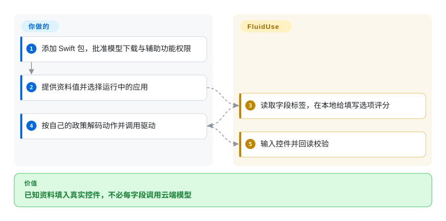
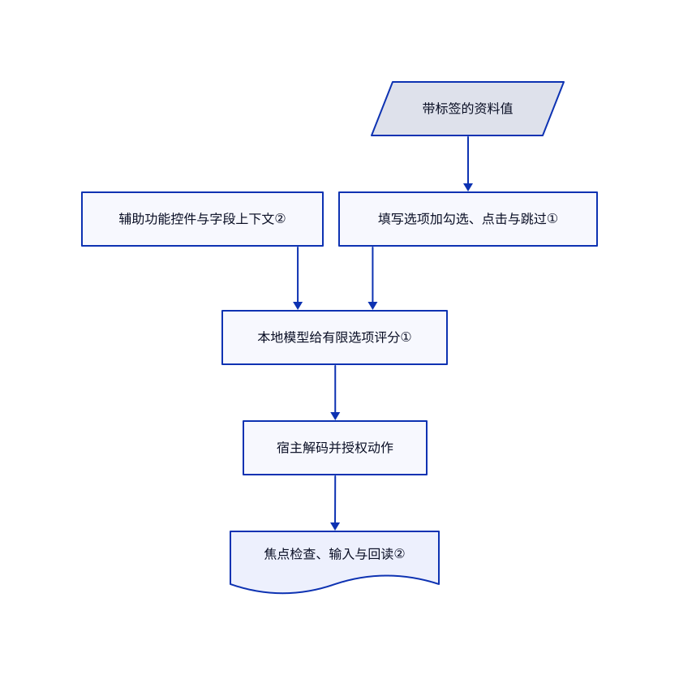

# FluidUse

每填一个表单字段都调用大模型，既慢又会外发个人资料。FluidUse 用本地 Core ML 决策模型和 Mac 辅助功能驱动，把已提供的值匹配到真实控件。

## 何时使用

你开发 Swift 应用，要在苹果硬件上分类、路由或填写已知字段，不想每次都调用托管模型。若任务可列出有限选项，并能使用预转换的 Core ML 模型，选 FluidUse。表单示例将小分类器连接到原生辅助功能控件；当前主干还包含类型化决策、视觉和 OCR 管理器。它不是通用自主桌面代理。

## 何时不用

- 要在苹果应用内开放式聊天或生成文字，比较 [uzu](uzu.zh.md)，另查系统门槛和遥测；有限选项评分是另一类任务。
- 要用 Python 试任意模型并微调，选 [MLX / mlx-lm](mlx-mlx-lm.zh.md)，不必受预转换管理器接口限制。
- 要带隔离的整机工作流，选 [Cua](../desktop-automation/cua.zh.md)。FluidUse 的辅助功能驱动直接操作真实 Mac 会话。
- 长文作答、缺失辅助功能控件或附件上传，交给人或专用自动化。表单模型只选已提供的值，辅助功能驱动明确拒绝附件上传。

## 横向对比

| 替代品 | 是否收录 | 我们的评价 | 取舍 |
|---|---|---|---|
| [uzu](uzu.zh.md) | ✅ | 应用内聊天生成选 uzu；类型化决策与专用 Core ML 管理器选 FluidUse。 | 通用对话表面与专用选项任务不同，均受模型转换覆盖限制。 |
| [MLX / mlx-lm](mlx-mlx-lm.zh.md) | ✅ | Python 改模型和微调选 mlx-lm；Swift 调专用模型选 FluidUse。 | 研究灵活性与特定模型应用接口之间取舍。 |
| [Cua](../desktop-automation/cua.zh.md) | ✅ | 通用代理需要隔离桌面时选 Cua；窄范围本地字段匹配选 FluidUse。 | 整机编排和沙箱，换成直接操作真实 Mac 控件。 |

## 快速上手

按文档添加从 `0.3.0` 开始的 Swift 包依赖，导入 FluidUse 和 FluidAudio。提供带标签的资料，取得运行中的应用，并创建 `AccessibilityFormDriver(application:)`。读取字段快照，组织候选值，使用表单模型为每个可操作字段评分；应用自行解码选项并调用驱动。库提供观察和动作助手，不提供完整授权政策。只向批准的应用授予辅助功能权限，提交前检查值，并将首次下载模型与本地推理的联网边界分开。

<!-- flow-steps:begin (generated from flows/fluiduse.json by tools/flow_card.py — do not edit) -->

流程文字版

1. **你**：添加 Swift 包，批准模型下载与辅助功能权限
2. **你**：提供资料值并选择运行中的应用
3. **FluidUse**：读取字段标签，在本地给填写选项评分
4. **你**：按自己的政策解码动作并调用驱动
5. **FluidUse**：输入控件并回读校验

**价值**：已知资料填入真实控件，不必每字段调用云端模型

<!-- flow-steps:end -->

## 技术要点

<!-- mechanism:begin (generated from mechanisms/fluiduse.json by tools/mechanism_card.py; do not edit) -->

机制文字版

- 带标签的资料值
- 辅助功能控件与字段上下文②
- 填写选项加勾选、点击与跳过①
- 本地模型给有限选项评分①
- 宿主解码并授权动作
- 焦点检查、输入与回读②

- 带标签的资料值 → 填写选项加勾选、点击与跳过①
- 辅助功能控件与字段上下文② → 本地模型给有限选项评分①
- 填写选项加勾选、点击与跳过① → 本地模型给有限选项评分①
- 本地模型给有限选项评分① → 宿主解码并授权动作
- 宿主解码并授权动作 → 焦点检查、输入与回读②

<!-- mechanism:end -->

### 1. 给封闭选项评分，不生成字段文字

- **解决：** 生成式文字可能编出资料里没有的值。
- **做法：** FormSchema 将每个带标签的值渲染成填写选项，再追加勾选、点击和跳过。上下文包含角色、标签、值和提示；解码把选项序号映射回动作和资料实体。
- **边界：** 上下文按训练格式截断。值来自资料，不证明选对了字段；问答式答案由宿主规则另行处理。
- **源码：** [表单格式](https://github.com/FluidInference/FluidUse/blob/cfba4d3fa4b996d0b680549416caf7aba6be770c/Sources/FluidUse/FormSchema.swift#L128-L180)。

### 2. 核查焦点并回读真实界面值

- **解决：** 浏览器可能忽略辅助功能写值，或把值写入当前焦点而非目标字段。
- **做法：** 驱动读取辅助功能快照，以标识寻址控件，并对浏览器发送按键。它核查焦点，可按角色和标签重新定位重绘控件，并在输入后回读校验。
- **边界：** 浏览器回读会归一化字母数字，再检查包含关系，不是字节相等。驱动会前置窗口，既非后台隔离，也不保证目标正确。
- **源码：** [驱动动作路径](https://github.com/FluidInference/FluidUse/blob/cfba4d3fa4b996d0b680549416caf7aba6be770c/Sources/FluidUse/AccessibilityFormDriver.swift#L189-L321)。

## 技术栈

Swift 6 包、Core ML、AppKit 和 macOS 辅助功能接口，依赖 FluidAudio。包清单最低为 macOS 14；个别模型管理器要求更新系统。

## 依赖

需要苹果硬件、匹配的 Core ML 产物、Swift 工具、模型存储空间，以及桌面路线的辅助功能权限。部分已发布模型桥接还会下载固定 Hub 快照并准备 Python 3.12／uv 环境；不能把所有管理器都说成纯 Swift 或安装无需联网。

## 运维难度

**中等。** 不强制推理服务器，但要管理模型缓存、内存和序列上限、系统兼容及真实界面权限。模型许可与库的 Apache-2.0 分开，其中包括分词器特殊条款和不再分发的权重。

## 健康度与可持续性

- 创建于 2026-09-21，主干最近提交为 2026-10-14，v0.3.0 发布于 2026-09-25。不足一月，几乎没有存续先验。
- 仓库属于 FluidInference，贡献主要来自 `Alex-Wengg`。虽有测试、固定样本和一致性工具，521 颗星不是可靠性证据。
- 库许可实文为 Apache-2.0。README 说明 CUA-S1-FORMS 来自 Cua、采用 MIT，并区分各模型下载边界。
- [推断：依据是月龄项目与大量主干模型新增] 使用超出早期发布面的管理器时，应固定已审查提交。

## 存疑（未验证）

- [未验证：禁止运行上游及控制用户桌面] 未复现真实表单、下载、一致性或延迟基准。
- [未验证：未复跑独立任务集] 速度、概率校准和转换一致性仍是作者实测报告。
- [推断：依据是月龄项目与大量主干模型新增] 接口及模型覆盖可能快速变化。
