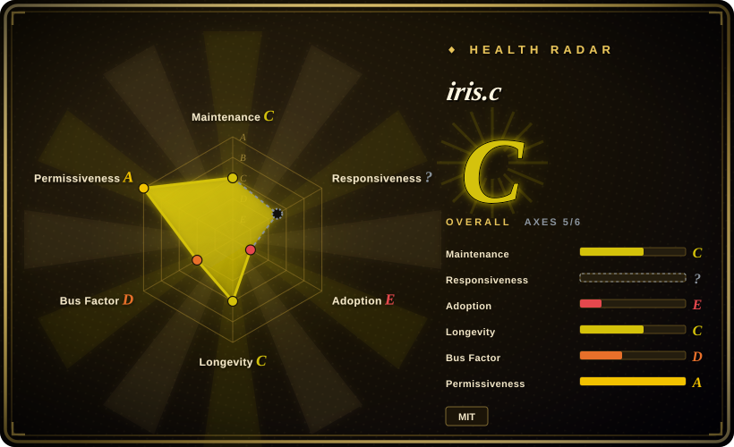
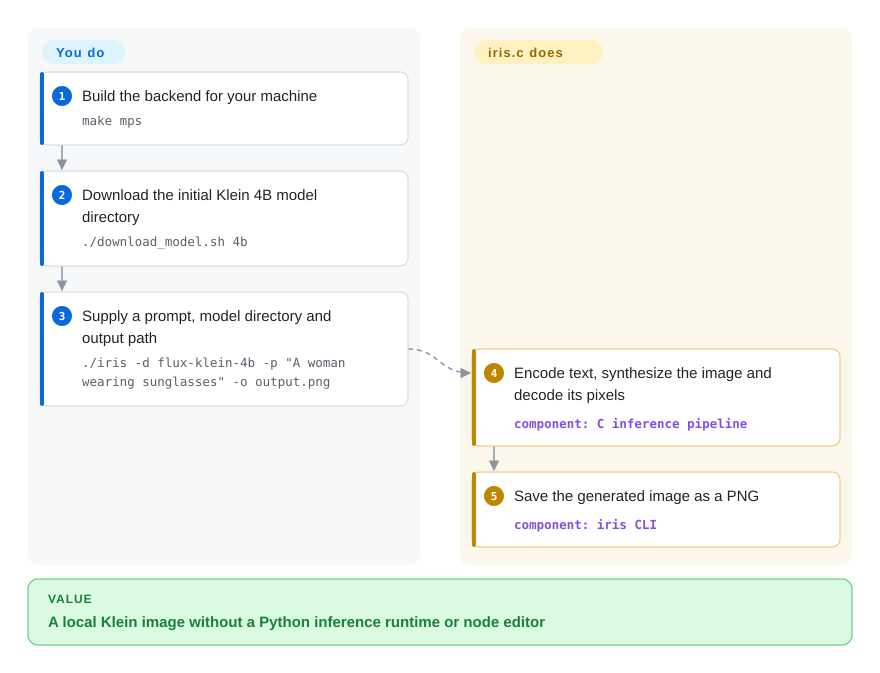
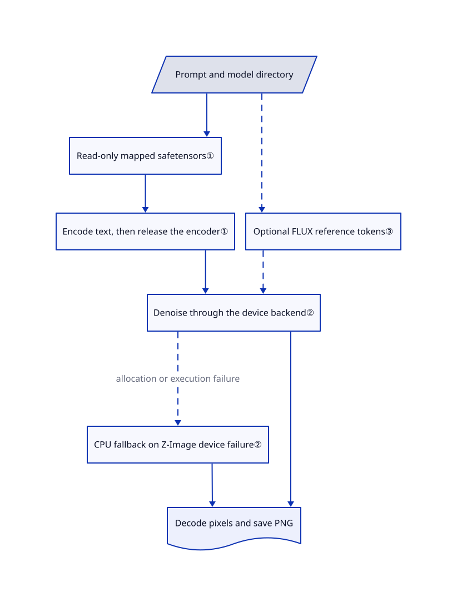

# iris.c

You want a local FLUX.2 Klein image without bundling Python, PyTorch or a node editor. iris.c turns a model directory and a prompt into a PNG through its own C inference pipeline, with optional Apple, NVIDIA and AMD GPU backends.

## When to use

You maintain a native desktop utility or a command-line asset generator. Your task is “read this prompt, generate a FLUX.2 Klein image, save `output.png`”; shipping a Python environment or maintaining a ComfyUI graph would add more machinery than the task needs. Choose iris.c when you want to inspect or embed a small, direct C implementation for its supported families: FLUX.2 Klein, Z-Image-Turbo and FLUX.3 Image Klein.

The deciding tradeoff against [stable-diffusion.cpp](stable-diffusion-cpp.md) is a narrower, self-contained implementation rather than a ggml-based model zoo with quantization. Against [ComfyUI](comfyui.md), it trades editable workflows and extensions for a CLI and C API. You still supply substantial model storage, suitable hardware and model-license clearance; “no Python at inference time” does not mean a tiny model or a GPU-free performance guarantee.

## When NOT to use

- **You need GGUF quantization, Vulkan, or a broad model catalogue.** Choose [stable-diffusion.cpp](stable-diffusion-cpp.md). iris.c implements three specific families and its build targets are generic C, BLAS, Metal, CUDA and ROCm, not a universal checkpoint loader.
- **You need a canvas, ControlNet/LoRA workflows, or video pipelines.** Choose [ComfyUI](comfyui.md); iris.c's prompt/reference-image interface is not an extensible visual workflow system. Its Z-Image path explicitly rejects image-to-image and multi-reference generation.
- **A small GPU must deliver predictable latency.** Prefer stable-diffusion.cpp's quantization/offload controls, then benchmark your chosen model. The reviewed Z-Image loader uploads all transformer layers or abandons that device path; allocation failure can select CPU computation rather than stream the remaining layers. `mmap` is not a VRAM cap.
- **You need training, arbitrary architectures, or fail-closed integration checks.** Use [Diffusers](https://github.com/huggingface/diffusers) with your own validation. In iris.c's FLUX.2 path, failure to load the text encoder logs a warning and returns zero embeddings rather than always failing generation; receiving a PNG does not prove the prompt was encoded.
- **You assume MIT grants rights to every model, or “local” means no retained prompts.** For permissive model use, select the Apache-2.0 FLUX.2 Klein 4B weights; 9B has a non-commercial license, while FLUX.3 has the conditional FLUX Kommunity License. For controlled retention, use the one-shot CLI instead of interactive mode and manage its output files: interactive mode writes `~/.iris_history` and images under `/tmp/iris-XXXXXX`, with no removal in its normal exit path.

## Comparison

| Alternative | In index | Our verdict | Tradeoff |
|---|---|---|---|
| [stable-diffusion.cpp](stable-diffusion-cpp.md) | ✅ | Choose it when deployment needs quantized weights, Vulkan or many model families; choose iris.c when a supported Klein/Z-Image model and a direct C implementation are the whole requirement. | ggml, GGUF and a larger backend/model surface buy flexibility; iris.c avoids that tensor-runtime dependency but exposes fewer model and memory-management choices. |
| [ComfyUI](comfyui.md) | ✅ | Choose ComfyUI when people must combine editing, adapters and multiple generation stages visually; choose iris.c for a scriptable prompt-to-file job without a Python server. | Saved node graphs and community extensions buy composability, at the cost of PyTorch and extension compatibility; iris.c supplies the engine, not that workbench. |
| [Diffusers](https://github.com/huggingface/diffusers) | not indexed | Choose Diffusers when you must train, modify model components or build custom Python pipelines; choose iris.c when distributing native inference matters more than architecture flexibility. | Diffusers provides modular models and schedulers but requires the Python/PyTorch stack. Not added in this tab batch. |

## Quick start

After reviewing the source, build the backend for your machine; the documented Apple Silicon path is `make mps`, with `make cuda`, `make rocm`, `make blas` and `make generic` as alternatives. Download the initial FLUX.2 Klein 4B directory with `./download_model.sh 4b`, then run `./iris -d flux-klein-4b -p "A woman wearing sunglasses" -o output.png`. You provide the prompt, model files and output location; iris.c performs text encoding, image synthesis and decoding, then saves the PNG. The shell downloader uses `curl` **and Python 3** to read shard indexes, although inference itself needs neither Python nor a hosted API. Budget storage for all model components; the README estimates roughly 16 GB for this example, not a measured download in this review. The C API is also available, but callers must explicitly enable mapped loading with `iris_set_mmap(ctx, 1)` rather than assuming the CLI's default applies to a newly loaded context.

<!-- flow-steps:begin (generated from flows/iris-c.json by tools/flow_card.py — do not edit) -->

Text version of the flow

1. **You**: Build the backend for your machine — `make mps`
2. **You**: Download the initial Klein 4B model directory — `./download_model.sh 4b`
3. **You**: Supply a prompt, model directory and output path — `./iris -d flux-klein-4b -p "A woman wearing sunglasses" -o output.png`
4. **iris.c**: Encode text, synthesize the image and decode its pixels — component: `C inference pipeline`
5. **iris.c**: Save the generated image as a PNG — component: `iris CLI`

**Value**: A local Klein image without a Python inference runtime or node editor

<!-- flow-steps:end -->

## Key techniques

<!-- mechanism:begin (generated from mechanisms/iris-c.json by tools/mechanism_card.py; do not edit) -->

Text version of the mechanism

- Prompt and model directory
- Read-only mapped safetensors①
- Encode text, then release the encoder①
- Optional FLUX reference tokens③
- Denoise through the device backend②
- CPU fallback on Z-Image device failure②
- Decode pixels and save PNG

- Prompt and model directory → Read-only mapped safetensors①
- Read-only mapped safetensors① → Encode text, then release the encoder①
- Encode text, then release the encoder① → Denoise through the device backend②
- Prompt and model directory → Optional FLUX reference tokens③ [optional/fallback]
- Optional FLUX reference tokens③ → Denoise through the device backend② [optional/fallback]
- Denoise through the device backend② → CPU fallback on Z-Image device failure② (allocation or execution failure) [optional/fallback]
- Denoise through the device backend② → Decode pixels and save PNG
- CPU fallback on Z-Image device failure② → Decode pixels and save PNG

<!-- mechanism:end -->

### 1. Separate model stages and map weights from disk

- **Problem:** Keeping the text encoder and image transformer loaded together increases peak memory.
- **How:** The loader initially loads the image decoder, then defers the encoder and transformer. Generation encodes the prompt, releases the encoder, and loads the transformer; safetensors files use read-only private memory mappings instead of reading every byte into a separate file buffer.
- **Limits:** CLI mapped loading is enabled explicitly after context creation; the C context starts zero-initialized. Device uploads and working buffers still require memory, and a persistent transformer can remain loaded across later generations. A missing FLUX.2 encoder may produce zero embeddings, so this is not a fail-closed pipeline.
- **Source:** [Stage loading:266–271 and 499–535](https://github.com/antirez/iris.c/blob/ff97831282ecc6691710828604165da84b0616f5/iris.c#L266-L535), [release and encoding fallback:586–721](https://github.com/antirez/iris.c/blob/ff97831282ecc6691710828604165da84b0616f5/iris.c#L586-L721), [generation:1180–1207](https://github.com/antirez/iris.c/blob/ff97831282ecc6691710828604165da84b0616f5/iris.c#L1180-L1207), [file mapping:208–300](https://github.com/antirez/iris.c/blob/ff97831282ecc6691710828604165da84b0616f5/iris_safetensors.c#L208-L300), [CLI switch:499–508](https://github.com/antirez/iris.c/blob/ff97831282ecc6691710828604165da84b0616f5/main.c#L499-L508).

### 2. Use a small device interface, with CPU fallback rather than a memory guarantee

- **Problem:** Apple, NVIDIA and AMD GPUs need different implementations of the same model operations.
- **How:** A common device API represents tensors as device pointers and provides upload, matrix, attention and normalization operations. Metal implements one backend; the same CUDA source builds with NVIDIA's compiler or AMD's HIP compiler. The Z-Image transformer attempts a resident GPU path and frees that device state on failed weight upload.
- **Limits:** At this commit, Z-Image does not automatically stream layers that fail to fit: execution can proceed on the CPU, and workspace failure can also trigger fallback. This preserves an execution path, not an interactive-latency promise; GPU output equivalence was not tested in this intake.
- **Source:** [Device representation:1–50](https://github.com/antirez/iris.c/blob/ff97831282ecc6691710828604165da84b0616f5/iris_dev.h#L1-L50), [CUDA/HIP/Metal build:78–133](https://github.com/antirez/iris.c/blob/ff97831282ecc6691710828604165da84b0616f5/Makefile#L78-L133), [all-layer upload:1848–1892](https://github.com/antirez/iris.c/blob/ff97831282ecc6691710828604165da84b0616f5/iris_transformer_zimage.c#L1848-L1892), [workspace failure and forward dispatch:2080–2118](https://github.com/antirez/iris.c/blob/ff97831282ecc6691710828604165da84b0616f5/iris_transformer_zimage.c#L2080-L2118).

### 3. Give FLUX reference images their own tokens

- **Problem:** An editing prompt needs the model to see the reference without treating it as the noisy output being generated.
- **How:** FLUX.2 encodes each reference into a compact image representation, labels its position separately, and lets the transformer attend to those tokens alongside a target initialized from noise. Multiple references receive different position offsets; FLUX.3 routes to its own reference preparation and generation path.
- **Limits:** Z-Image rejects these operations. FLUX.2 may shrink references to fit its attention-memory estimate, while FLUX.3 uses different padding and size rules; neither path guarantees exact preservation of a face, composition or fine detail.
- **Source:** [FLUX.2 reference preparation:1545–1604](https://github.com/antirez/iris.c/blob/ff97831282ecc6691710828604165da84b0616f5/iris.c#L1545-L1604), [reference/target conditioning:1670–1719](https://github.com/antirez/iris.c/blob/ff97831282ecc6691710828604165da84b0616f5/iris.c#L1670-L1719), [multi-reference routing:1749–1778](https://github.com/antirez/iris.c/blob/ff97831282ecc6691710828604165da84b0616f5/iris.c#L1749-L1778), [FLUX.3 preparation:900–1089](https://github.com/antirez/iris.c/blob/ff97831282ecc6691710828604165da84b0616f5/iris.c#L900-L1089).

## Tech stack

- C inference pipeline and C API; Makefile builds a CLI or `libiris.a`. Uses POSIX facilities such as memory mapping and temporary directories, so “pure C” is not a guarantee of an unmodified build on every C platform.
- Integrated Qwen3/Qwen3-VL text encoding, family-specific diffusion transformers and an image decoder that turns compressed image data into pixels. Reads safetensors plus JSON model configuration; PNG, JPEG and PPM image support is included.
- Optional Accelerate/OpenBLAS, Apple Metal, NVIDIA CUDA/cuBLAS, or AMD ROCm/hipBLAS. The accelerated builds are not standard-library-only binaries.

## Dependencies

- Build tools: C compiler and `make`; Apple GPU builds also compile Objective-C and use system frameworks. NVIDIA/AMD builds need their respective GPU toolkits; Linux BLAS builds need OpenBLAS.
- Model directories: separate text encoder, tokenizer, transformer and image-decoder files. Downloads are separate from the code and can require Hugging Face license acceptance and a token; the shell downloader resolves mutable `main` URLs rather than a pinned weight revision.
- Code uses MIT; bundled linenoise retains its BSD-style notices. [FLUX.2 Klein 4B](https://huggingface.co/black-forest-labs/FLUX.2-klein-4B/blob/e7b7dc27f91deacad38e78976d1f2b499d76a294/LICENSE.md) uses Apache-2.0. [9B](https://huggingface.co/black-forest-labs/FLUX.2-klein-9B/blob/92196c8e11f7b6cf2b7493e037d8c5345c559216/LICENSE.md) is non-commercial; [FLUX.3](https://huggingface.co/black-forest-labs/flux-3-image-klein/blob/337337621b8526e120f2275d250242f4a6bedd75/LICENSE.md) allows commercial use only subject to its qualifying-user and other terms. Review each component's license before redistribution.
- Upstream image-comparison tests additionally import NumPy and Pillow; they need downloaded models. None were executed for this page.

## Ops difficulty

**Medium for local use.** There is no database or inference-service account to operate, but you own backend builds, large weight downloads, memory sizing, model-license checks and output regression tests. Pin both the code SHA and weight revisions: the latest commit changes tokenization and therefore images, and there are no published releases or tags as of 2026-10-25. The CLI is not a multi-user service; use a separate queue, access controls and process isolation if you expose it through your own application.

Interactive mode retains local data: [directory creation](https://github.com/antirez/iris.c/blob/ff97831282ecc6691710828604165da84b0616f5/iris_cli.c#L226-L239) stores generated images in a temporary directory, and [session handling](https://github.com/antirez/iris.c/blob/ff97831282ecc6691710828604165da84b0616f5/iris_cli.c#L1128-L1184) loads and saves prompt history in the home directory. Normal exit frees the embedding cache but does not remove those files. `make clean` removes build products, not model downloads, generated images or history.

## Health & viability

- **Maintenance, 2026-10-25:** not archived; the reviewed default-branch commit is dated 2026-10-23. Recent history adds GPU backends and fixes inference correctness; no releases or tags are published, so pin a commit rather than expecting a stable release channel.
- **Governance and backing:** a personal-account project led by Salvatore Sanfilippo. The contributor list is heavily concentrated in the owner; no governance, security-policy or foundation-backing file appears in the reviewed tree. Treat maintainer availability as a dependency.
- **Age and Lindy:** created 2026-01-18, about nine months old and still changing. [推断：based on its age, concentrated contributions and unreleased status, not a durability experiment] It is a useful inspectable engine, but too young to infer long-term compatibility from current attention.
- **Adoption and risk:** public stars demonstrate attention, not measured installed use. The automated radar scores five of six axes; responsiveness remains unknown because its window produced no signal, not because silence was demonstrated. The repository includes reference images and regression scripts, but their existence is not evidence of this intake passing inference tests. Backend churn and separate weight licenses are more consequential than the MIT code license alone.

## Caveats (unverified)

- [未验证：upstream execution was prohibited for this intake] Build success, image quality, backend equivalence, peak RAM/VRAM and latency were not measured. README speed and memory figures are author reports, not reproduced results; FLUX.3 base is explicitly described there as implemented but untested.
- [未验证：model weights were not downloaded] The 4B download-size estimate is from the README. Its Z-Image size estimate differs from the shell downloader's estimate; provision against the actual artifact list rather than either number.
- [推断：based on repository age and ownership metadata, without a longitudinal study] Long-term compatibility and maintainer continuity are not established; this is the basis of the cautious Lindy verdict above.
- [未验证：source inspection only, without runtime tracing] Normal-exit retention and local inference boundaries were read from source, not verified by a filesystem or network trace. No upstream installation was performed, so this review makes no “no residue” claim.
