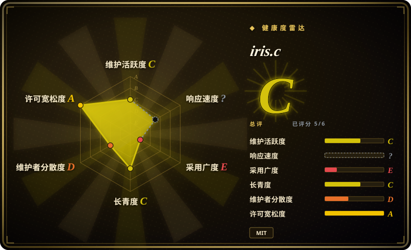
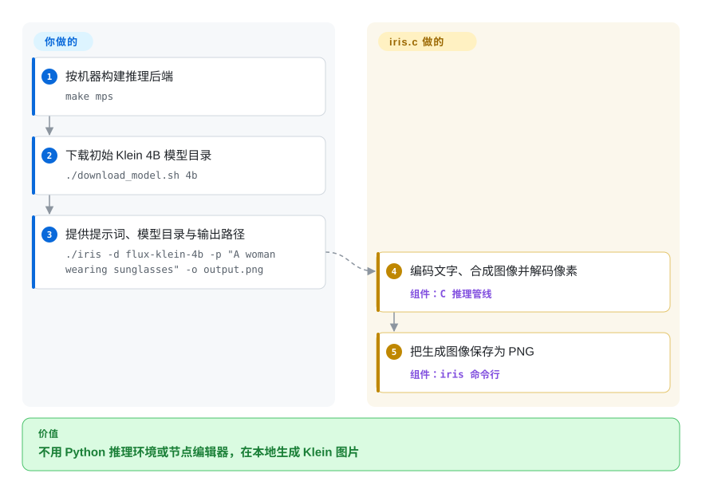
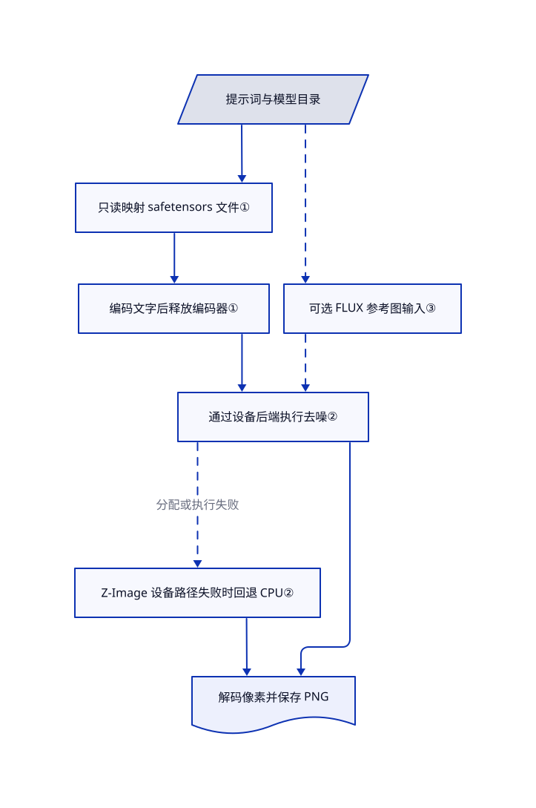

# iris.c

你只想在本机生成一张 FLUX.2 Klein 图片，却不想打包 Python、PyTorch 或节点编辑器。iris.c 用自己的 C 推理管线，把模型目录和提示词变成 PNG，并可选用苹果、英伟达或 AMD 的 GPU 加速。

## 何时使用

你在维护原生桌面工具或命令行素材生成器。任务只是“读取提示词，用 FLUX.2 Klein 出图，保存为 `output.png`”；附带 Python 环境或维护一张 ComfyUI 节点图，反而比任务本身复杂。当你需要一份能读懂、能嵌入的直接 C 实现，并且模型就在 FLUX.2 Klein、Z-Image-Turbo、FLUX.3 Image Klein 三个家族内时，考虑 iris.c。

相对 [stable-diffusion.cpp](stable-diffusion-cpp.zh.md)，决定性取舍是更窄、自包含的实现，而不是基于 ggml、带量化能力的模型大全。相对 [ComfyUI](comfyui.zh.md)，它用 CLI 和 C API 换掉可编辑工作流与扩展生态。模型存储、合适硬件和权重许可仍由你负责；“推理时不用 Python”不代表模型很小，也不保证 CPU 速度够用。

## 何时不用

- **你需要 GGUF 量化、Vulkan 或大量模型家族。** 选 [stable-diffusion.cpp](stable-diffusion-cpp.zh.md)。iris.c 实现三个特定家族，构建目标是通用 C、BLAS、Metal、CUDA、ROCm，不是通用模型文件加载器。
- **你需要画布、ControlNet／LoRA 工作流或视频管线。** 选 [ComfyUI](comfyui.zh.md)；iris.c 的提示词与参考图接口不是可扩展的视觉工作流系统。其 Z-Image 路径明确拒绝图生图和多参考图生成。
- **小显存 GPU 必须提供稳定响应时间。** 优先考虑 stable-diffusion.cpp 的量化与卸载控制，再实测所选模型。本次源码中的 Z-Image 加载器要么上传全部变换器层，要么放弃该设备路径；分配失败可能转到 CPU，而不是逐层传输剩余权重。内存映射不是显存上限。
- **你要训练、接入任意架构，或要求组件缺失就停止。** 用 [Diffusers](https://github.com/huggingface/diffusers) 并自行加校验。iris.c 的 FLUX.2 路径在文本编码器加载失败时，会警告并返回全零表示，不一定终止生成；收到 PNG 不代表提示词已正确编码。
- **你以为 MIT 覆盖所有权重，或“本地”意味着不留提示词。** 需要宽松模型许可时，选择 Apache-2.0 的 FLUX.2 Klein 4B；9B 采用非商业许可，FLUX.3 采用带条件的 FLUX Kommunity License。需要控制留存时，用单次命令代替交互模式，并自行管理输出文件；交互模式会写入 `~/.iris_history`，把图片保存在 `/tmp/iris-XXXXXX`，正常退出路径没有删除这些文件。

## 横向对比

| 替代品 | 是否收录 | 我们的评价 | 取舍 |
|---|---|---|---|
| [stable-diffusion.cpp](stable-diffusion-cpp.zh.md) | ✅ | 部署要量化权重、Vulkan 或多模型家族时选它；只需已支持的 Klein／Z-Image，并想直接读 C 实现时选 iris.c。 | ggml、GGUF 与更多后端换来灵活性；iris.c 不依赖这套张量运行时，但模型与内存控制选项更少。 |
| [ComfyUI](comfyui.zh.md) | ✅ | 要让人可视化组合编辑、适配器与多段生成时选 ComfyUI；只做脚本化提示词到文件、不要 Python 服务时选 iris.c。 | 可保存的节点图与社区扩展换来组合能力，代价是 PyTorch 和扩展兼容管理；iris.c 提供引擎，不提供这套工作台。 |
| [Diffusers](https://github.com/huggingface/diffusers) | 未收录 | 要训练、修改模型组件或写自定义 Python 管线时选 Diffusers；原生推理分发比架构灵活性更重要时选 iris.c。 | Diffusers 提供模块化模型与调度器，但要携带 Python／PyTorch 软件栈；本批标签收录不扩收此项目。 |

## 快速上手

审查源码后，按机器选择构建后端；Apple Silicon 的文档路径是 `make mps`，另有 `make cuda`、`make rocm`、`make blas`、`make generic`。用 `./download_model.sh 4b` 下载初始 FLUX.2 Klein 4B 目录，再运行 `./iris -d flux-klein-4b -p "A woman wearing sunglasses" -o output.png`。你提供提示词、模型文件和输出位置；iris.c 负责编码文字、合成图像、解码并保存 PNG。Shell 下载器用 `curl` 下载，也用 Python 3 读取分片索引；推理本身则不需要 Python 或托管 API。模型组件仍占大量存储，README 为此示例估计约 16 GB，本次没有实测下载量。也可嵌入 C API，但调用者应显式用 `iris_set_mmap(ctx, 1)` 开启映射加载，不能把 CLI 的默认行为当作新建上下文的默认值。

<!-- flow-steps:begin (generated from flows/iris-c.json by tools/flow_card.py — do not edit) -->

流程文字版

1. **你**：按机器构建推理后端 — `make mps`
2. **你**：下载初始 Klein 4B 模型目录 — `./download_model.sh 4b`
3. **你**：提供提示词、模型目录与输出路径 — `./iris -d flux-klein-4b -p "A woman wearing sunglasses" -o output.png`
4. **iris.c**：编码文字、合成图像并解码像素 — 组件：`C 推理管线`
5. **iris.c**：把生成图像保存为 PNG — 组件：`iris 命令行`

**价值**：不用 Python 推理环境或节点编辑器，在本地生成 Klein 图片

<!-- flow-steps:end -->

## 技术要点

<!-- mechanism:begin (generated from mechanisms/iris-c.json by tools/mechanism_card.py; do not edit) -->

机制文字版

- 提示词与模型目录
- 只读映射 safetensors 文件①
- 编码文字后释放编码器①
- 可选 FLUX 参考图输入③
- 通过设备后端执行去噪②
- Z-Image 设备路径失败时回退 CPU②
- 解码像素并保存 PNG

- 提示词与模型目录 → 只读映射 safetensors 文件①
- 只读映射 safetensors 文件① → 编码文字后释放编码器①
- 编码文字后释放编码器① → 通过设备后端执行去噪②
- 提示词与模型目录 → 可选 FLUX 参考图输入③〔可选／兜底〕
- 可选 FLUX 参考图输入③ → 通过设备后端执行去噪②〔可选／兜底〕
- 通过设备后端执行去噪② → Z-Image 设备路径失败时回退 CPU②（分配或执行失败）〔可选／兜底〕
- 通过设备后端执行去噪② → 解码像素并保存 PNG
- Z-Image 设备路径失败时回退 CPU② → 解码像素并保存 PNG

<!-- mechanism:end -->

### 1. 分阶段加载，并把权重映射到磁盘文件

- **解决：** 文本编码器和图像变换器同时常驻，会增加内存峰值。
- **做法：** 加载器先读取图像解码器，把文本编码器和变换器延迟到生成阶段。生成时先编码提示词，释放编码器，再加载变换器；safetensors 文件采用只读私有内存映射，不必另外建立整份文件缓冲区。
- **边界：** CLI 在创建上下文后显式开启映射，新建 C 上下文本身从零初始化。设备权重与工作缓冲区仍占内存，变换器也可能跨次生成常驻。FLUX.2 编码器缺失时可能使用全零表示，所以不是“出错必停”的管线。
- **源码：** [阶段加载第 266–535 行](https://github.com/antirez/iris.c/blob/ff97831282ecc6691710828604165da84b0616f5/iris.c#L266-L535)、[释放与编码回退第 586–721 行](https://github.com/antirez/iris.c/blob/ff97831282ecc6691710828604165da84b0616f5/iris.c#L586-L721)、[生成第 1180–1207 行](https://github.com/antirez/iris.c/blob/ff97831282ecc6691710828604165da84b0616f5/iris.c#L1180-L1207)、[文件映射第 208–300 行](https://github.com/antirez/iris.c/blob/ff97831282ecc6691710828604165da84b0616f5/iris_safetensors.c#L208-L300)、[CLI 开关第 499–508 行](https://github.com/antirez/iris.c/blob/ff97831282ecc6691710828604165da84b0616f5/main.c#L499-L508)。

### 2. 用小型设备接口统一后端，失败可回 CPU

- **解决：** 苹果、英伟达和 AMD 的 GPU，需要为同一组模型运算提供不同实现。
- **做法：** 公共设备接口用设备指针表示张量，提供上传、矩阵、注意力和归一化操作。Metal 提供一种后端，同一份 CUDA 源码则可交给英伟达编译器或 AMD 的 HIP 编译器。Z-Image 变换器先尝试 GPU 常驻路径，权重上传失败就释放该设备状态。
- **边界：** 此提交没有把放不下的 Z-Image 层自动改为流式传输，而可能在 CPU 上继续执行；工作区分配失败也可能回退。保留执行路径不等于保证交互速度，本次未测试各 GPU 输出是否一致。
- **源码：** [设备表示第 1–50 行](https://github.com/antirez/iris.c/blob/ff97831282ecc6691710828604165da84b0616f5/iris_dev.h#L1-L50)、[CUDA／HIP／Metal 构建第 78–133 行](https://github.com/antirez/iris.c/blob/ff97831282ecc6691710828604165da84b0616f5/Makefile#L78-L133)、[全层上传第 1848–1892 行](https://github.com/antirez/iris.c/blob/ff97831282ecc6691710828604165da84b0616f5/iris_transformer_zimage.c#L1848-L1892)、[工作区失败与执行分派第 2080–2118 行](https://github.com/antirez/iris.c/blob/ff97831282ecc6691710828604165da84b0616f5/iris_transformer_zimage.c#L2080-L2118)。

### 3. 把 FLUX 参考图变成独立的一组输入

- **解决：** 编辑提示词需要模型看见参考图，而不是把参考图直接当成待去噪的输出。
- **做法：** FLUX.2 把参考图编码成压缩表示，赋予独立位置标记，让变换器把它们与从噪声开始的目标图一起处理。多张参考图使用不同的位置偏移；FLUX.3 则分派到自己的参考图预处理与生成路径。
- **边界：** Z-Image 拒绝这些操作。FLUX.2 可能按注意力内存估算缩小参考图，FLUX.3 另有补边与尺寸规则；两条路径都不保证精确保留人物、构图或细节。
- **源码：** [FLUX.2 参考图预处理第 1545–1604 行](https://github.com/antirez/iris.c/blob/ff97831282ecc6691710828604165da84b0616f5/iris.c#L1545-L1604)、[参考图与目标图条件第 1670–1719 行](https://github.com/antirez/iris.c/blob/ff97831282ecc6691710828604165da84b0616f5/iris.c#L1670-L1719)、[多参考图分派第 1749–1778 行](https://github.com/antirez/iris.c/blob/ff97831282ecc6691710828604165da84b0616f5/iris.c#L1749-L1778)、[FLUX.3 预处理第 900–1089 行](https://github.com/antirez/iris.c/blob/ff97831282ecc6691710828604165da84b0616f5/iris.c#L900-L1089)。

## 技术栈

- C 推理管线与 C API；Makefile 可构建 CLI 或 `libiris.a`。代码使用内存映射、临时目录等 POSIX 能力，所以“纯 C”不保证能在所有 C 平台不改代码就编译。
- 内置 Qwen3／Qwen3-VL 文本编码、按家族实现的扩散变换器，以及把压缩图像变成像素的解码器。读取 safetensors 与 JSON 模型配置；自带 PNG、JPEG、PPM 图像支持。
- 可选 Accelerate／OpenBLAS、Apple Metal、英伟达 CUDA／cuBLAS、AMD ROCm／hipBLAS。加速构建并非只依赖 C 标准库。

## 依赖

- 构建工具为 C 编译器与 `make`；苹果 GPU 构建还会编译 Objective-C，并链接系统框架。英伟达与 AMD 构建要各自的 GPU 工具链；Linux BLAS 构建要 OpenBLAS。
- 模型目录要有文本编码器、分词器、变换器与图像解码器文件。权重与代码分开下载，部分需要在 Hugging Face 接受许可并提供令牌；Shell 下载器解析可变的 `main` 地址，没有固定权重版本。
- 代码采用 MIT；随附 linenoise 保留 BSD 风格声明。[FLUX.2 Klein 4B](https://huggingface.co/black-forest-labs/FLUX.2-klein-4B/blob/e7b7dc27f91deacad38e78976d1f2b499d76a294/LICENSE.md) 采用 Apache-2.0；[9B](https://huggingface.co/black-forest-labs/FLUX.2-klein-9B/blob/92196c8e11f7b6cf2b7493e037d8c5345c559216/LICENSE.md) 为非商业许可；[FLUX.3](https://huggingface.co/black-forest-labs/flux-3-image-klein/blob/337337621b8526e120f2275d250242f4a6bedd75/LICENSE.md) 的商业用途受合格用户资格等条款约束。分发前应核每个组件的许可。
- 上游图像对比测试另需 NumPy、Pillow 和已下载的模型。本页没有执行这些测试。

## 运维难度

**本地使用为中等。** 没有数据库或推理服务账号要运维，但后端构建、大型权重下载、内存容量、模型许可和输出回归测试都归你。应同时固定代码提交和权重版本：最新提交改了分词，因此会改变出图；截至 2026-10-25，没有发布版本或标签。CLI 不是多用户服务；若包进自己的应用对外提供能力，应另加队列、访问控制与进程隔离。

交互模式有本地留存：[目录创建](https://github.com/antirez/iris.c/blob/ff97831282ecc6691710828604165da84b0616f5/iris_cli.c#L226-L239) 把生成图片写到临时目录，[会话处理](https://github.com/antirez/iris.c/blob/ff97831282ecc6691710828604165da84b0616f5/iris_cli.c#L1128-L1184) 则从用户目录读取并保存提示词历史。正常退出会释放嵌入缓存，却不删除这些文件。`make clean` 删除构建产物，不删除模型下载、生成图片或历史文件。

## 健康度与可持续性

- **维护状态，截至 2026-10-25：** 未归档，审阅的默认分支提交日期为 2026-10-23。近期历史新增 GPU 后端并修正推理结果；没有发布版本或标签，应固定提交，而不是期待稳定发布通道。
- **治理与支持：** 个人账号项目，由 Salvatore Sanfilippo 主导。贡献列表高度集中于仓库所有者；审阅树里没有治理、安全策略或基金会支持文件。维护者的可用精力应视为一项依赖。
- **年龄与 Lindy：** 创建于 2026-01-18，约九个月，仍在变化。[推断：依据是年龄、贡献集中度与未发布状态，未做持久性实验] 它适合作为可读的推理引擎，但还太年轻，不能从当前关注度推出长期兼容性。
- **采用与风险：** 公开星数体现关注，不是实测安装量。自动雷达评到六轴中的五轴；响应速度因窗口没有信号而未知，不代表已证明维护者不回复。仓库包含参考图片与回归脚本，但文件存在不代表本次通过推理测试。后端变化与权重许可，比单看代码的 MIT 标识更影响选型。

## 存疑（未验证）

- [未验证：本批禁止执行上游] 未实测编译、图像质量、后端一致性、内存／显存峰值或耗时。README 的速度与内存数据是作者报告，并非本次复现；其中还明确注明 FLUX.3 base 已实现但未测试。
- [未验证：没有下载模型权重] 4B 下载量估计来自 README。它对 Z-Image 的大小估计与 Shell 下载器不同，应按实际文件清单准备空间，不能把任一数字当保证。
- [推断：依据仓库年龄与所有权元数据，未做长期跟踪] 长期兼容性与维护连续性尚未建立，这也是上文谨慎评价 Lindy 信号的依据。
- [未验证：只读源码，没有运行时追踪] 正常退出后的留存与本地推理边界来自源码阅读，未通过文件系统或网络追踪核验。本次没有安装上游，不能宣称“运行后无残留”。
