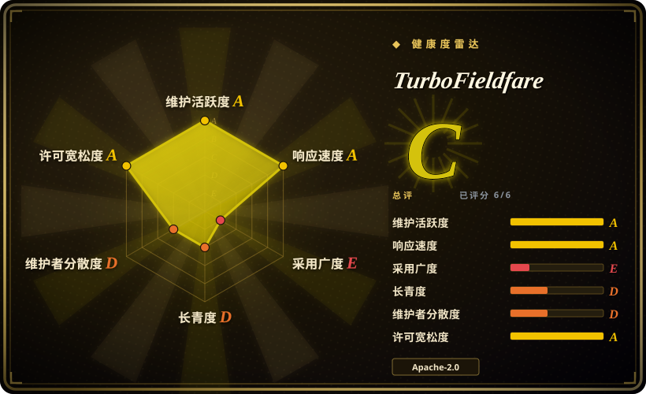
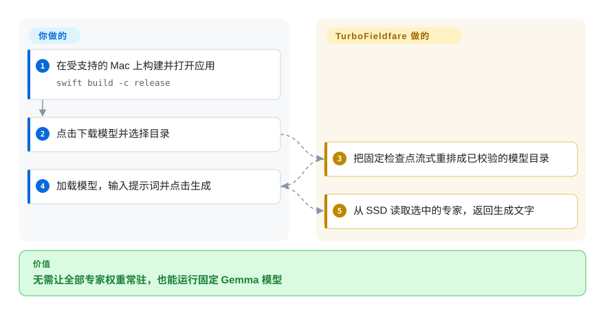
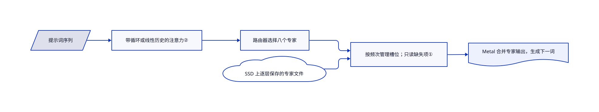

# TurboFieldfare

你的 8 GB Mac 放不下约 14 GB 的模型，还要留内存给其他应用。TurboFieldfare 只常驻 Gemma 4 的公共权重，再从 SSD 读取当前词需要的专家。

## 何时使用

你想在 8 GB 苹果芯片笔记本上试 Gemma 4 26B-A4B，却不想每次提问都让系统疯狂交换内存。你能留出约 15 GB 磁盘，也接受生成速度受磁盘影响。比起通用模型管理器，此时更重要的是让这一个模型装得下：固定专家缓冲区与专用 Metal 内核直接围绕这个约束设计。

## 何时不用

- 需要 Windows、Linux、Intel Mac 或旧版系统时，选 [llama.cpp](../llm-inference/local-runtimes/llama-cpp.zh.md)。本项目要求 arm64、macOS 26、Metal 4 和 Swift 6.2。
- 要切换模型家族或微调时，选 [mlx-lm](mlx-mlx-lm.zh.md)。这里只接受固定 Gemma 检查点及自有 `.gturbo` 格式，不接受任意 MLX 权重。
- 要模型库管理与常驻接口时，选 [Ollama](../llm-inference/local-runtimes/ollama.zh.md)。本项目服务器仍属实验功能，串行生成，没有远程认证或 TLS。
- 要多用户并发生产服务时，在合适硬件上选 [vLLM](../llm-inference/serving-engines/vllm.zh.md)。本项目要求同一时间只运行一个持有模型的进程，不提供多用户调度器。

## 横向对比

| 替代品 | 是否收录 | 我们的评价 | 取舍 |
|---|---|---|---|
| [llama.cpp](../llm-inference/local-runtimes/llama-cpp.zh.md) | ✅ | 机器种类多、需要丰富 GGUF 支持时选 llama.cpp；小内存 Mac 专跑固定 Gemma 时选 TurboFieldfare。 | 通用硬件覆盖换模型专用磁盘流式布局；这里没有验证双方速度差。 |
| [mlx-lm](mlx-mlx-lm.zh.md) | ✅ | 要 Python 实验、转换或微调时选 mlx-lm；整套权重无法常驻时选 TurboFieldfare。 | 多架构与 Python 直调，换成围绕有界专家缓存设计的 Swift／Metal 实现。 |
| [Ollama](../llm-inference/local-runtimes/ollama.zh.md) | ✅ | 要跨开发机管理模型生命周期时选 Ollama；研究或使用这条低内存 Gemma 路径时选 TurboFieldfare。 | 更大生态与模型管理，换范围更窄但可读源码的专用运行时与安装器。 |

## 快速上手

克隆仓库，在受支持的 Mac 上运行 `swift build -c release`，再运行 `.build/release/TurboFieldfareMac`。点击 Download Model，安装器会下载固定检查点，重排成 `.gturbo` 目录。点击 Load Model，输入提示词，再点击 Generate。应用负责分词和本地生成；你负责硬件、磁盘、提示词，并核对重要回答。同一时间只开一个持有模型的应用、命令行或服务器；可选视觉包要求 M2 或更新芯片。

<!-- flow-steps:begin (generated from flows/turbo-fieldfare.json by tools/flow_card.py — do not edit) -->

流程文字版

1. **你**：在受支持的 Mac 上构建并打开应用 — `swift build -c release`
2. **你**：点击下载模型并选择目录
3. **TurboFieldfare**：把固定检查点流式重排成已校验的模型目录
4. **你**：加载模型，输入提示词并点击生成
5. **TurboFieldfare**：从 SSD 读取选中的专家，返回生成文字

**价值**：无需让全部专家权重常驻，也能运行固定 Gemma 模型

<!-- flow-steps:end -->

## 技术要点

<!-- mechanism:begin (generated from mechanisms/turbo-fieldfare.json by tools/mechanism_card.py; do not edit) -->

机制文字版

- 提示词序列
- 带循环或线性历史的注意力②
- 路由器选择八个专家
- 按频次管理槽位；只读缺失项①
- SSD 上逐层保存的专家文件
- Metal 合并专家输出，生成下一词

- 提示词序列 → 带循环或线性历史的注意力②
- 带循环或线性历史的注意力② → 路由器选择八个专家
- 路由器选择八个专家 → 按频次管理槽位；只读缺失项①
- SSD 上逐层保存的专家文件 → 按频次管理槽位；只读缺失项①
- 按频次管理槽位；只读缺失项① → Metal 合并专家输出，生成下一词

<!-- mechanism:end -->

### 1. 只把缓存缺失的专家读进显卡可见槽位

- **解决：** 全量加载路由专家，会超过目标机器的内存。
- **做法：** 每层持有固定、对齐、与 Metal 共享的缓冲区。缓存规划保留命中项，按最少使用频次挑淘汰槽位，再用并发 `pread` 填充缺失项，不把完整模型变成内存张量集合。
- **边界：** 常驻专家越少，SSD 读取越多。槽位容量不等于整个进程或系统文件缓存的实际驻留量。
- **源码：** [槽位分配与缓存执行](https://github.com/drumih/turbo-fieldfare/blob/2e9ea50e8c35a65d9170e3bff9d1063be8931ec0/Sources/TurboFieldfare/Infrastructure/Streaming/PreadExpertStreamer.swift#L130-L303)。

### 2. 限制局部注意力历史，但不合并键和值

- **解决：** 每层保留所有历史词，会让上下文内存无谓增长。
- **做法：** 滑动窗口层采用半精度循环缓冲区，全注意力层保留线性历史。即使键和值共享投影权重，Gemma 后续的归一化与位置变换不同，因此仍使用独立缓冲区。
- **边界：** 全注意力历史仍随配置的上下文长度增长。重置时请求系统释放页面，不保证物理内存立即下降。
- **源码：** [容量、独立缓冲区与重置](https://github.com/drumih/turbo-fieldfare/blob/2e9ea50e8c35a65d9170e3bff9d1063be8931ec0/Sources/TurboFieldfare/Runtime/KVCache/KVCacheManager.swift#L26-L134)、[重置限制](https://github.com/drumih/turbo-fieldfare/blob/2e9ea50e8c35a65d9170e3bff9d1063be8931ec0/Sources/TurboFieldfare/Runtime/KVCache/KVCacheManager.swift#L244-L260)。

## 技术栈

Swift 6.2、自写 Metal 4 内核、SwiftUI／AppKit 界面、Swift Transformers 分词器、SwiftNIO HTTP 服务器与 SwiftMath 数学排版。运行时不是 MLX 或 llama.cpp 的包装层。

## 依赖

运行 macOS 26 的苹果芯片 Mac、对应 SDK 与 Swift 构建依赖。文本权重安装后约 14.3 GB，可选视觉包约 1.1 GB。首次安装需要访问 Hugging Face。权重沿用其来源条款，与运行时许可证分开处理。

## 运维难度

**中。** 不需要数据库或付费模型接口，但要构建年轻的原生运行时、管理大模型目录，并给上下文与缓存留内存。SSD、温度与文件缓存冷热都会影响延迟。没有认证的实验 HTTP 服务器只应监听本机。

## 健康度与可持续性

- 截至 2026-10-18，最新版本 0.9.3 发布于 2026-10-15。仓库创建于 2026-07-17，仍活跃，但只有三个月历史。
- 贡献者快照只列出作者 `drumih`。6,941 星代表关注度，不代表生产规模；测试目录覆盖格式、运行时、安装器、界面与服务器。
- [推断] 因为年轻且绑定单一模型，年龄与持续维护共同构成的长期先验仍弱。更适合固定版本实验，不宜成为唯一的通用推理依赖。
- 源码明确采用 Apache-2.0，也单列模型与依赖声明。主要风险是硬件绑定和单人持续维护。

## 存疑（未验证）

- [未验证] 未复现 README 所述约 2 GB 内存和 M2／M5 速度；本次收录没有执行上游代码或模型。
- [推断] 长期延续性仍不明确：仓库只有三个月，贡献者快照只列出一位作者。
