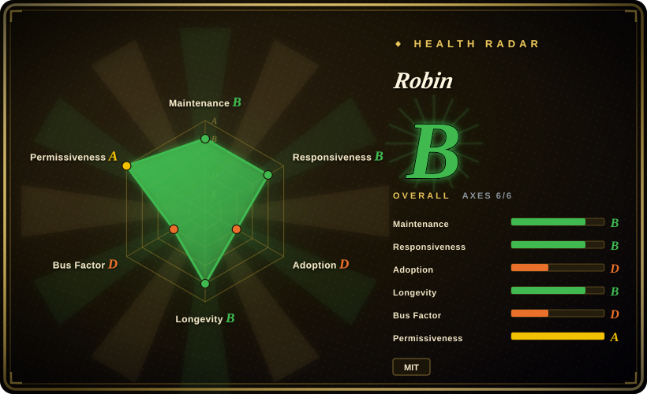
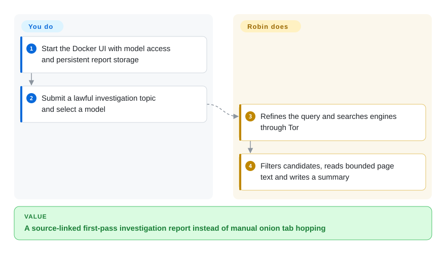
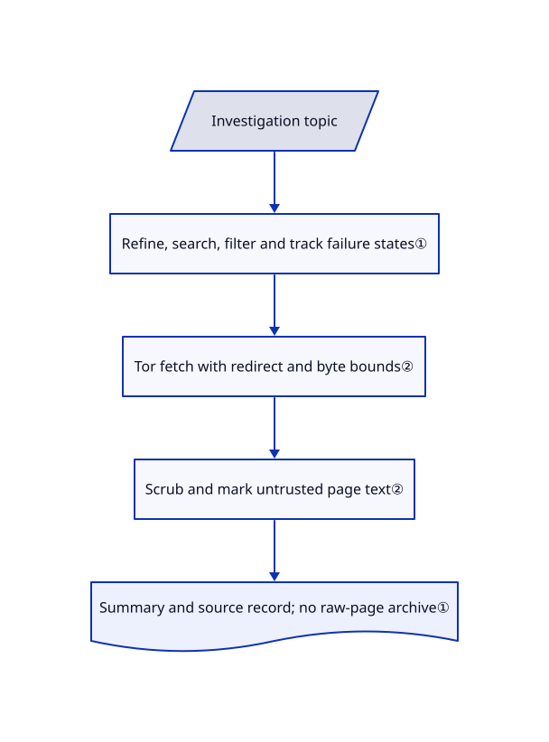

# Robin

You have a lawful investigation topic but only scattered onion-search hits, dead links and pages to read by hand. Robin refines the query, searches over Tor, filters and reads results, then writes a model-generated investigation summary.

## When to use

You are an authorized analyst investigating a topic on public dark-web pages, not trying to break into accounts. Search engines return mixed links and slow onion services, and you want one bounded search-to-report pass with follow-up questions. Choose Robin over TorBot when starting from a topic rather than a known site's crawl tree; choose Maigret when the actual input is a username. You must verify the report's evidence and keep the investigation inside legal and organizational scope.

## When NOT to use

- **Username-to-profile discovery:** choose [Maigret](maigret.md); Robin searches topics and summarizes pages rather than maintaining platform-specific account checks.
- **A known onion site's link graph:** consider [TorBot](https://github.com/DedSecInside/TorBot), whose crawler takes a seed URL and depth. It is a real repository, not added in this tab batch.
- **Ordinary web/document research:** choose [GPT Researcher](../deep-research/gpt-researcher.md) for broader search adapters and document reports instead of introducing Tor.
- **Guaranteed anonymity or court-ready evidence capture:** Tor transport is not a confidentiality or evidence-integrity guarantee. TorBot's saved crawl bundles are closer when preserved capture is central; Robin's saved investigation record excludes raw scraped text.
- **No lawful basis:** do not run either Robin or its substitutes; this intake only read source files and performed no target investigation.

## Comparison

| Alternative | In index | Our verdict | Tradeoff |
|---|---|---|---|
| [TorBot](https://github.com/DedSecInside/TorBot) | not indexed | Pick TorBot to crawl a known site's links and preserve a crawl bundle; pick Robin to start with a topic and discover search results. | TorBot is URL/depth-first and also offers local-model analysis; not added in this tab batch because comparison intake is disabled. |
| [Maigret](maigret.md) | ✅ | Pick Maigret for a username dossier; pick Robin for an onion-content investigation question. | Platform identity probes provide a different kind of evidence; Robin introduces model filtering, Tor latency and interpretation risk. |
| [GPT Researcher](../deep-research/gpt-researcher.md) | ✅ | Pick GPT Researcher for general web and document briefs; pick Robin when onion search and Tor fetching are essential. | GPT Researcher offers more report/retriever infrastructure; Robin is narrower and simpler around dark-web discovery. |

## Quick start

The README recommends the `apurvsg/robin` Docker image; its Dockerfile bundles Tor and runs as UID 1000. Create the `.env` file before mounting it, provide a model key or configure a reachable local model, and open the Streamlit interface at `http://localhost:8501`. Mount `/app/investigations` to retain saved reports, select a model and submit an authorized question. Robin runs the refinement, search, filtering and summary stages; you supply model billing, investigate failed sources and check every material conclusion. The optional MCP mode exposes the same investigation capabilities to an assistant without opening a web port; model-provider calls do not pass through Tor.

<!-- flow-steps:begin (generated from flows/robin.json by tools/flow_card.py — do not edit) -->

Text version of the flow

1. **You**: Start the Docker UI with model access and persistent report storage
2. **You**: Submit a lawful investigation topic and select a model
3. **Robin**: Refines the query and searches engines through Tor
4. **Robin**: Filters candidates, reads bounded page text and writes a summary

**Value**: A source-linked first-pass investigation report instead of manual onion tab hopping

<!-- flow-steps:end -->

## Key techniques

<!-- mechanism:begin (generated from mechanisms/robin.json by tools/mechanism_card.py; do not edit) -->

Text version of the mechanism

- Investigation topic
- Refine, search, filter and track failure states①
- Tor fetch with redirect and byte bounds②
- Scrub and mark untrusted page text②
- Summary and source record; no raw-page archive①

- Investigation topic → Refine, search, filter and track failure states①
- Refine, search, filter and track failure states① → Tor fetch with redirect and byte bounds②
- Tor fetch with redirect and byte bounds② → Scrub and mark untrusted page text②
- Scrub and mark untrusted page text② → Summary and source record; no raw-page archive①

<!-- mechanism:end -->

### 1. Distinguish “nothing found” from “nothing could be checked”

- **Problem:** Search-engine outages and unreadable pages can masquerade as evidence that a topic has no results.
- **How:** The pipeline tracks search statistics and separate states for unreachable engines, no results, irrelevant results and unreadable pages. It caps candidates before ranking, caps kept pages before scraping and stops without inventing a summary when nothing was read.
- **Limits:** A successful report still depends on model relevance judgments and truncated source input. Saved records include sources and summary, but not raw scraped text.
- **Source:** [Investigation states and persistence](https://github.com/apurvsinghgautam/robin/blob/b5d4f5f509fac39d65d3a28fd1d78b56efbeeaf4/pipeline.py#L31-L139), [bounded pipeline](https://github.com/apurvsinghgautam/robin/blob/b5d4f5f509fac39d65d3a28fd1d78b56efbeeaf4/pipeline.py#L202-L295).

### 2. Treat remote pages as untrusted input

- **Problem:** A fetched page can redirect outside the intended host policy or contain text that looks like host instructions.
- **How:** Every redirect hop receives URL-policy checks and responses are streamed with byte caps. The text scrubber removes invisible/control characters, defangs forged delimiter lookalikes and wraps content in explicit untrusted-data markers.
- **Limits:** Markers are instructions to the consuming model, not a formal prompt-injection barrier. Explicit clearweb allowance changes the host policy, and cloud model requests remain a separate egress path.
- **Source:** [URL and redirect checks](https://github.com/apurvsinghgautam/robin/blob/b5d4f5f509fac39d65d3a28fd1d78b56efbeeaf4/scrape.py#L119-L299), [scrubbing and fencing](https://github.com/apurvsinghgautam/robin/blob/b5d4f5f509fac39d65d3a28fd1d78b56efbeeaf4/scrape.py#L302-L443).

## Tech stack

Python 3.11 Docker base; Streamlit UI; requests/PySocks and Beautiful Soup; LangChain provider clients; local JSON investigation storage; stdio MCP server.

## Dependencies

Tor connectivity, Docker for the recommended path, and a cloud model key or reachable Ollama/OpenAI-compatible model server. Local inference adds its own hardware needs. Persistent report storage must be writable by container UID 1000; use a named volume when host ownership differs.

## Ops difficulty

**Medium.** One container simplifies packaging, but onion availability, Tor timeouts and search-engine changes are ongoing failure sources. Keep model credentials separate from reports, bind the UI appropriately and persist investigations. Do not expose Ollama on all interfaces merely to reach the container without also restricting network access.

## Health & viability

- **2026-10-18:** v3.1 shipped October 3 after v3.0 in September; recent work includes MCP and bounded investigation paths.
- Created April 2025, about eighteen months old and still active: useful continuity, not a long Lindy history.
- MIT text names Apurv Singh Gautam; visible commits remain author-concentrated despite several contributors. Search integrations require maintenance beyond the core code.
- Tests cover pipeline, storage, Tor, MCP and fencing paths. Static test presence does not establish live onion coverage or report accuracy.

## Caveats (unverified)

- [未验证：未获目标调查授权，且本批禁止运行上游代码] No Tor search, target fetch, model call or investigation quality test was performed.
- [推断：依据是外部文本标记与模型消费方式] Fencing improves data/instruction separation but cannot prove resistance to every prompt-injection payload.
