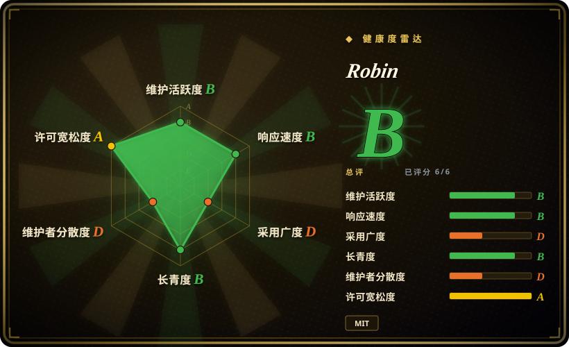
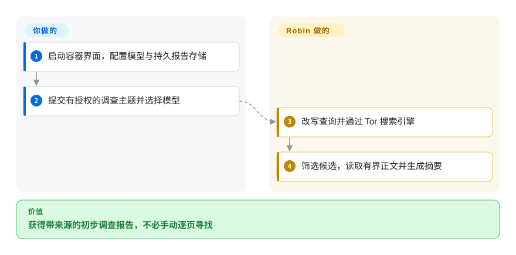
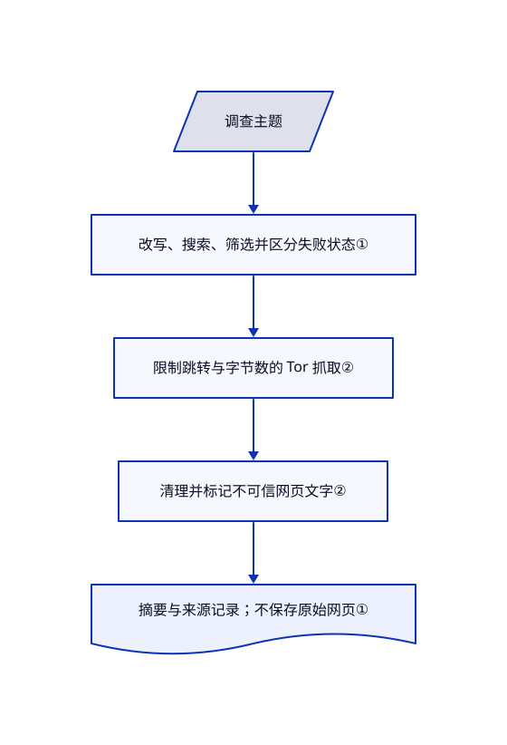

# Robin

你有一个合法调查主题，拿到的却是零散洋葱搜索结果、失效链接和待手读网页。Robin 改写问题，经 Tor 搜索和筛选页面，再生成模型调查摘要。

## 何时使用

你是有授权的分析人员，要调查公开暗网页面的某个主题，而不是入侵账号。搜索引擎混入无关链接，洋葱服务又慢，你需要一轮有边界的搜索、阅读、报告与追问。相比 TorBot，Robin 从主题出发，而不是从已知网站链接树出发；如果输入实际是用户名，则该选 Maigret。你必须核验报告证据，并遵守法律和组织授权范围。

## 何时不用

- **从用户名找账号：** 选 [Maigret](maigret.zh.md)；Robin 搜索主题并总结网页，不维护逐平台账号探测规则。
- **已知洋葱站点，要画链接图：** 看 [TorBot](https://github.com/DedSecInside/TorBot)，它按种子地址与深度爬取；本次关闭对比品扩录，因此未另写页面。
- **普通网页与文档调研：** 选 [GPT Researcher](../deep-research/gpt-researcher.zh.md)，无需为了通用报告引入 Tor。
- **必须匿名或需要法庭证据保全：** Tor 传输不保证保密与证据完整。若重点是保存抓取包，TorBot 更接近；Robin 保存的调查记录不含原始抓取正文。
- **没有合法依据：** 不运行 Robin 或替代品；本次只读取源码，没有开展目标调查。

## 横向对比

| 替代品 | 是否收录 | 我们的评价 | 取舍 |
|---|---|---|---|
| [TorBot](https://github.com/DedSecInside/TorBot) | 未收录 | 已知站点，需要链接爬取和留存抓取包，选 TorBot；从主题发现搜索结果，选 Robin。 | TorBot 从地址和深度开始，也支持本地模型分析；本次关闭对比品扩录，因此未收录。 |
| [Maigret](maigret.zh.md) | ✅ | 用户名画像选 Maigret；洋葱网页主题调查选 Robin。 | 身份平台探测提供另一类证据；Robin 增加模型筛选、Tor 延迟和解释风险。 |
| [GPT Researcher](../deep-research/gpt-researcher.zh.md) | ✅ | 普通网页与文档报告选 GPT Researcher；必须洋葱搜索和 Tor 抓取时选 Robin。 | GPT Researcher 的检索与报告基础设施更广；Robin 围绕暗网发现，范围更窄。 |

## 快速上手

README 推荐 `apurvsg/robin` Docker 镜像；Dockerfile 内置 Tor，并以 UID 1000 运行。挂载前先创建 `.env` 文件，提供模型密钥或能访问的本地模型，再打开 `http://localhost:8501` 的 Streamlit 界面。挂载 `/app/investigations` 保存报告，选择模型并提交有授权的问题。Robin 负责改写、搜索、筛选和总结；你承担模型费用、追查失败来源并核对关键结论。可选 MCP 模式把调查能力交给助手，不需开放网页端口；模型供应商请求不经过 Tor。

<!-- flow-steps:begin (generated from flows/robin.json by tools/flow_card.py — do not edit) -->

流程文字版

1. **你**：启动容器界面，配置模型与持久报告存储
2. **你**：提交有授权的调查主题并选择模型
3. **Robin**：改写查询并通过 Tor 搜索引擎
4. **Robin**：筛选候选，读取有界正文并生成摘要

**价值**：获得带来源的初步调查报告，不必手动逐页寻找

<!-- flow-steps:end -->

## 技术要点

<!-- mechanism:begin (generated from mechanisms/robin.json by tools/mechanism_card.py; do not edit) -->

机制文字版

- 调查主题
- 改写、搜索、筛选并区分失败状态①
- 限制跳转与字节数的 Tor 抓取②
- 清理并标记不可信网页文字②
- 摘要与来源记录；不保存原始网页①

- 调查主题 → 改写、搜索、筛选并区分失败状态①
- 改写、搜索、筛选并区分失败状态① → 限制跳转与字节数的 Tor 抓取②
- 限制跳转与字节数的 Tor 抓取② → 清理并标记不可信网页文字②
- 清理并标记不可信网页文字② → 摘要与来源记录；不保存原始网页①

<!-- mechanism:end -->

### 1. 区分“没找到”与“根本没查到”

- **解决：** 搜索服务故障和页面不可读，可能被误写成某个主题不存在。
- **做法：** 流水线保存搜索统计，区分引擎不可达、无结果、无相关结果和页面全不可读。排序前限制候选数，抓取前限制保留页面数；完全没读到内容就停止，不编摘要。
- **边界：** 成功报告仍依赖模型相关性判断和截断后的输入。保存记录含来源与摘要，但没有原始抓取正文。
- **源码：** [调查状态与保存结构](https://github.com/apurvsinghgautam/robin/blob/b5d4f5f509fac39d65d3a28fd1d78b56efbeeaf4/pipeline.py#L31-L139)、[有界流水线](https://github.com/apurvsinghgautam/robin/blob/b5d4f5f509fac39d65d3a28fd1d78b56efbeeaf4/pipeline.py#L202-L295)。

### 2. 始终把远程页面当作不可信输入

- **解决：** 抓取页面可能重定向越过预期主机范围，也可能伪装成宿主指令。
- **做法：** 每一跳重定向都检查地址策略，流式读取并限制字节数。正文清理隐藏与控制字符，消除伪造分隔符，再包上不可信数据标记。
- **边界：** 标记是给消费模型的指令，不是形式化的提示注入屏障。显式允许明网会改变主机策略，云模型请求也仍是独立出口。
- **源码：** [地址与重定向检查](https://github.com/apurvsinghgautam/robin/blob/b5d4f5f509fac39d65d3a28fd1d78b56efbeeaf4/scrape.py#L119-L299)、[清理与包裹](https://github.com/apurvsinghgautam/robin/blob/b5d4f5f509fac39d65d3a28fd1d78b56efbeeaf4/scrape.py#L302-L443)。

## 技术栈

Python 3.11 Docker 基础镜像；Streamlit 界面；requests、PySocks 和 Beautiful Soup；LangChain 模型客户端；本地 JSON 调查记录；标准输入输出 MCP 服务。

## 依赖

Tor 连接、推荐安装路线所需的 Docker，以及云模型密钥或可访问的 Ollama、兼容 OpenAI 的模型服务。本地推理另需硬件。报告存储要允许容器 UID 1000 写入；宿主归属不同时可用命名卷。

## 运维难度

**中。** 一个容器简化打包，但洋葱站点可用性、Tor 超时和搜索引擎变化会持续制造故障。分开保管密钥与报告，限制网页监听并持久化记录。不要为了容器访问就无防护地把 Ollama 开到所有网卡。

## 健康度与可持续性

- **2026-10-18：** v3.1 发布于 10 月 3 日，之前 9 月发布 v3.0；近期工作包含 MCP 与有界调查流程。
- 创建于 2025 年 4 月，约十八个月且仍活跃，说明有延续性，但林迪历史仍短。
- MIT 正文署名 Apurv Singh Gautam；虽有多名贡献者，可见提交仍集中在作者。搜索适配需要持续维护。
- 测试覆盖流水线、存储、Tor、MCP 与分隔符；存在测试不代表真实洋葱覆盖率或报告准确性已验证。

## 存疑（未验证）

- [未验证：未获目标调查授权，且本批禁止运行上游代码] 未进行 Tor 搜索、目标抓取、模型调用或调查质量测试。
- [推断：依据是外部文本标记与模型消费方式] 分隔符能改善数据与指令分离，但不能证明抵挡所有提示注入。
