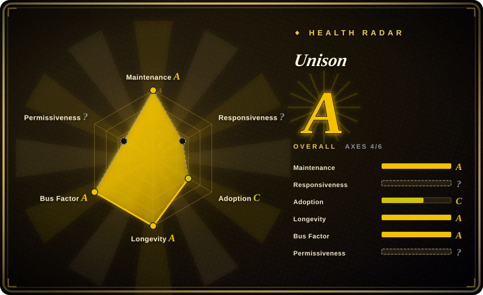
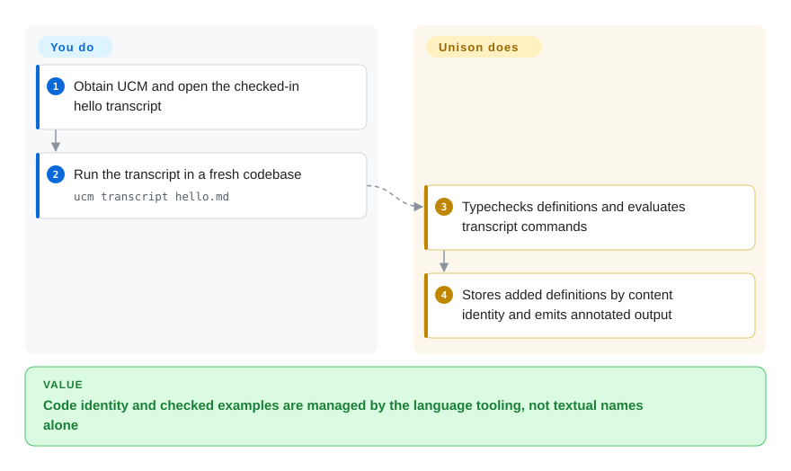
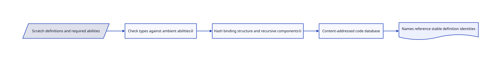

# Unison

Renaming a function should not invalidate every reference to its implementation. Unison identifies definitions by their content hashes, keeps code in a database and lets names change independently.

## When to use

You are starting a functional-language project or studying language tooling, and conventional source files make renames, dependency versions and merge conflicts part of every change. Choose Unison when you deliberately want a codebase manager rather than a conventional compiler over text files: definitions retain content identity, and explicit abilities describe which effects a function requires. This is adopting a language and workflow, not installing a build cache for an existing repository.

## When NOT to use

- Need existing Haskell libraries and the conventional Haskell toolchain? Choose GHC/Haskell; Unison's implementation language does not make it source-compatible with Haskell packages.
- Need a file-oriented ML-family language with native compilation and effect handlers? Choose OCaml; Unison replaces the ordinary file/package workflow with UCM and a code database.
- Need an established BEAM application/operations ecosystem? Choose Elixir; Unison Cloud is a separate deployment product, not a drop-in BEAM runtime or automatic distributed execution for arbitrary code.
- Need a normal git diff of the complete canonical source tree? Prefer a text-file language such as OCaml. Scratch files and exported transcripts are not the entire Unison code database; backups and semantic project operations matter.

## Comparison

| Alternative | In index | Our verdict | Tradeoff |
|---|---|---|---|
| [GHC / Haskell](https://github.com/ghc/ghc) | not indexed | Choose GHC when Haskell compatibility and its libraries decide; choose Unison when content-addressed definitions are worth changing language and tooling. | Conventional source/compiler ecosystem versus persistent definition identity. Not added in this tab batch. |
| [OCaml](https://github.com/ocaml/ocaml) | not indexed | Choose OCaml for a file-based native toolchain with effect handlers; choose Unison for a codebase manager with typed abilities and semantic code identity. | Ordinary source/package operations versus a database-centered development model. Not added in this tab batch. |
| [Elixir](https://github.com/elixir-lang/elixir) | not indexed | Choose Elixir for BEAM-centered applications; choose Unison for statically typed functional code and content-addressed tooling. | Established runtime ecosystem versus a different type/effect and code-storage model. Not added in this tab batch. |

## Quick start

Obtain UCM, the Unison Codebase Manager, from a release, or follow the repository's Stack source-build instructions. To inspect a complete checked-in example, run `ucm transcript hello.md` against the supplied hello transcript; its runner creates a fresh codebase and writes the command/typecheck output back into a companion Markdown file. In interactive use you edit scratch definitions and use commands such as `add` and `view x` to store and inspect them. UCM handles typechecking, definition storage and evaluation; you own program behavior, dependency selection and database backups. Local use does not require Unison Cloud; the built-in `ucm mcp` is an optional agent interface, not needed to learn the language.

<!-- flow-steps:begin (generated from flows/unison.json by tools/flow_card.py — do not edit) -->

Text version of the flow

1. **You**: Obtain UCM and open the checked-in hello transcript
2. **You**: Run the transcript in a fresh codebase — `ucm transcript hello.md`
3. **Unison**: Typechecks definitions and evaluates transcript commands
4. **Unison**: Stores added definitions by content identity and emits annotated output

**Value**: Code identity and checked examples are managed by the language tooling, not textual names alone

<!-- flow-steps:end -->

## Key techniques

<!-- mechanism:begin (generated from mechanisms/unison.json by tools/mechanism_card.py; do not edit) -->

Text version of the mechanism

- Scratch definitions and required abilities
- Check types against ambient abilities②
- Hash binding structure and recursive components①
- Content-addressed code database
- Names reference stable definition identities

- Scratch definitions and required abilities → Check types against ambient abilities②
- Check types against ambient abilities② → Hash binding structure and recursive components①
- Hash binding structure and recursive components① → Content-addressed code database
- Content-addressed code database → Names reference stable definition identities

<!-- mechanism:end -->

### 1. Hash binding structure and recursive components

- **Problem:** Text names, formatting and mutually recursive definitions complicate stable code identity.
- **How:** Hashing ignores annotations, represents bound variables by their position in the binding environment and groups recursive definitions into strongly connected components. Component hashes replace dependencies before later components are hashed.
- **Limits:** This is structural identity, not a proof that two different algorithms are semantically equivalent. The implementation reports an ordering warning for some structurally similar recursive cycles.
- **Source:** [Component hashing and variable indexing](https://github.com/unisonweb/unison/blob/cea754e162146df4e6fb355cf20c614809580d82/unison-hashing-v2/src/Unison/Hashing/V2/ABT.hs#L33-L174).

### 2. Track effects as required abilities

- **Problem:** A function's ordinary input/output types do not tell callers whether it performs I/O or needs another effect.
- **How:** Function types carry ability requirements. The typechecker receives the ambient ability set; handlers interpret requests and provide the abilities used inside a handled expression.
- **Limits:** This checks language-level effects, not operating-system privileges or safe behavior of an authorized I/O action. Learning handlers and effect-polymorphic types is additional adoption work.
- **Source:** [Current typechecker environment](https://github.com/unisonweb/unison/blob/cea754e162146df4e6fb355cf20c614809580d82/parser-typechecker/src/Unison/Typechecker.hs#L85-L130), [ability handler transcript](https://github.com/unisonweb/unison/blob/cea754e162146df4e6fb355cf20c614809580d82/unison-src/transcripts/idempotent/abilities.md#L9-L25), [ability model](https://github.com/unisonweb/unison/blob/cea754e162146df4e6fb355cf20c614809580d82/docs/ability-typechecking.markdown#L2-L36).

## Tech stack

Haskell compiler/typechecker, runtime and UCM, content-addressed syntax and a local code database. The repository includes language-server, local web-server and MCP integrations. MIT root license separately identifies bundled BSD-3-Clause Data.Relation code.

## Dependencies

UCM release binary for your platform and local persistent codebase storage. Building UCM requires its Haskell/Stack toolchain. Unison Share access needs network/authentication for relevant sharing operations; Unison Cloud is optional and separately operated.

## Ops difficulty

**Medium.** Local language use is lighter than operating a service, but the canonical code database changes backup, upgrade and collaboration habits. Pin UCM versions around migrations, retain backups and keep the local UI's token private. A language-level ability annotation is not a sandbox.

## Health & viability

- On 2026-10-18, stable release 1.5.0 dated to 2026-10-02 and trunk builds continued on 2026-10-17. Created 2015-05-06, this repository has over eleven years of still-active history.
- Unison Computing, a public benefit corporation, and contributors hold the MIT copyright. Several leading contributors have thousands of commits, giving more continuity evidence than a single-author prototype.
- [推断] Age × activity is a strong positive prior for continued development, but not a guarantee of ecosystem breadth or success for your team. The unusual database workflow is the main adoption decision.

## Caveats (unverified)

- [未验证] No compiler, transcript or Cloud program was run. Incremental-compilation and test-cache benefits were not benchmarked.
- [推断] Hiring, library coverage and migration cost depend on the intended application; these were not measured against competing languages.
