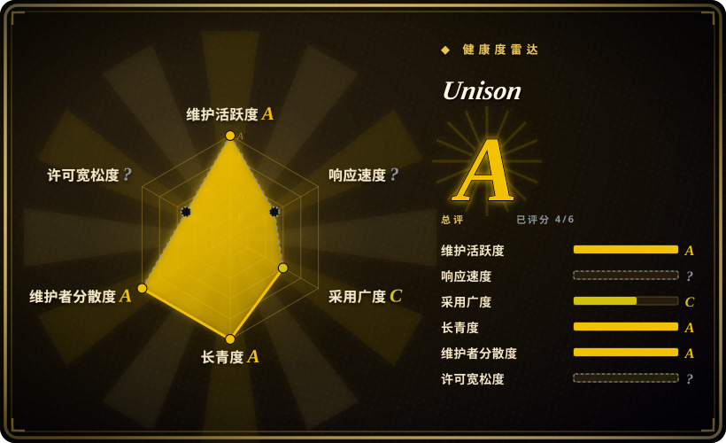
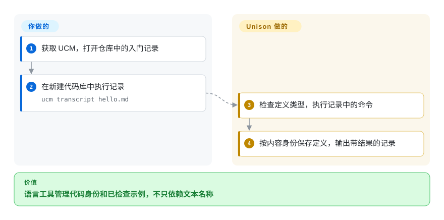

# Unison

给函数改名，不该让指向同一实现的引用全部失效。Unison 用内容哈希标识定义，把代码保存在数据库里，让名称可以独立变化。

## 何时使用

你从零做函数式项目，或研究语言工具，传统源文件却让改名、依赖版本与合并冲突占据每轮修改。若你愿意采用代码库管理器，而非普通文本文件编译器，就考虑 Unison：定义保留内容身份，显式能力说明函数需要哪些副作用。这是在选择语言和工作流，不是给现有仓库加构建缓存。

## 何时不用

- 需要现有 Haskell 库与传统工具链时，选 GHC／Haskell。实现语言是 Haskell，不等于 Unison 与其源码包兼容。
- 需要面向文件、原生编译且有作用处理器的 ML 系语言时，选 OCaml。Unison 用 UCM 和代码数据库替代普通文件／包工作流。
- 要成熟的 BEAM 应用与运维生态时，选 Elixir。Unison Cloud 是另一项部署产品，不是 BEAM 替代运行时，也不会自动把任意程序变成分布式程序。
- 要用普通 git 差异查看全部规范源代码时，优先 OCaml 等文本文件语言。草稿与导出记录不等于完整代码数据库，备份与语义项目操作很重要。

## 横向对比

| 替代品 | 是否收录 | 我们的评价 | 取舍 |
|---|---|---|---|
| [GHC／Haskell](https://github.com/ghc/ghc) | 未收录 | Haskell 兼容性与库决定选择时选 GHC；内容寻址定义值得换语言和工具时选 Unison。 | 传统源文件／编译生态，换持久的定义身份；本批标签未安排收录。 |
| [OCaml](https://github.com/ocaml/ocaml) | 未收录 | 要文本原生工具链和作用处理器时选 OCaml；要类型化能力与语义代码身份的管理器时选 Unison。 | 普通源码／包操作，换数据库中心的开发模型；本批标签未安排收录。 |
| [Elixir](https://github.com/elixir-lang/elixir) | 未收录 | BEAM 应用选 Elixir；要静态类型函数式与内容寻址工具时选 Unison。 | 成熟运行时生态，换不同的类型、副作用和代码存储模型；本批标签未安排收录。 |

## 快速上手

从发行版获取 UCM，也就是 Unison 代码库管理器，或按仓库文档用 Stack 构建。可对随仓库的完整入门记录运行 `ucm transcript hello.md`；执行器会新建代码数据库，把命令和类型检查结果写入对应 Markdown 输出。交互使用时编辑草稿定义，再用 `add` 和 `view x` 存入并查看。UCM 负责类型检查、定义存储与求值，你负责程序行为、依赖选择和数据库备份。本地使用不需要 Unison Cloud，内置 `ucm mcp` 只是可选助手接口，不是学语言的前提。

<!-- flow-steps:begin (generated from flows/unison.json by tools/flow_card.py — do not edit) -->

流程文字版

1. **你**：获取 UCM，打开仓库中的入门记录
2. **你**：在新建代码库中执行记录 — `ucm transcript hello.md`
3. **Unison**：检查定义类型，执行记录中的命令
4. **Unison**：按内容身份保存定义，输出带结果的记录

**价值**：语言工具管理代码身份和已检查示例，不只依赖文本名称

<!-- flow-steps:end -->

## 技术要点

<!-- mechanism:begin (generated from mechanisms/unison.json by tools/mechanism_card.py; do not edit) -->

机制文字版

- 草稿定义与所需能力
- 根据环境能力检查类型②
- 对绑定结构与递归组件计算哈希①
- 内容寻址的代码数据库
- 名称引用稳定的定义身份

- 草稿定义与所需能力 → 根据环境能力检查类型②
- 根据环境能力检查类型② → 对绑定结构与递归组件计算哈希①
- 对绑定结构与递归组件计算哈希① → 内容寻址的代码数据库
- 内容寻址的代码数据库 → 名称引用稳定的定义身份

<!-- mechanism:end -->

### 1. 对绑定结构与递归组件计算哈希

- **解决：** 文本名称、格式和相互递归定义，让稳定代码身份难以维护。
- **做法：** 哈希忽略注解，用绑定环境里的位置表示变量，把递归定义划成强连通组件。先用组件哈希替换依赖，再计算后续组件。
- **边界：** 这是结构身份，不证明不同算法语义等价。部分结构过于相似的递归循环仍会触发排序警告。
- **源码：** [组件哈希与变量索引](https://github.com/unisonweb/unison/blob/cea754e162146df4e6fb355cf20c614809580d82/unison-hashing-v2/src/Unison/Hashing/V2/ABT.hs#L33-L174)。

### 2. 把副作用作为所需能力跟踪

- **解决：** 普通输入输出类型无法告诉调用者，函数是否执行输入输出或需要另一种作用。
- **做法：** 函数类型携带能力要求，类型检查器接收当前环境的能力集合，处理器解释请求并提供被处理表达式所用的能力。
- **边界：** 检查的是语言级副作用，不是操作系统权限，也不保证获准的输入输出安全。采用时还要学习处理器与作用多态类型。
- **源码：** [当前类型检查环境](https://github.com/unisonweb/unison/blob/cea754e162146df4e6fb355cf20c614809580d82/parser-typechecker/src/Unison/Typechecker.hs#L85-L130)、[能力处理器记录](https://github.com/unisonweb/unison/blob/cea754e162146df4e6fb355cf20c614809580d82/unison-src/transcripts/idempotent/abilities.md#L9-L25)、[能力模型](https://github.com/unisonweb/unison/blob/cea754e162146df4e6fb355cf20c614809580d82/docs/ability-typechecking.markdown#L2-L36)。

## 技术栈

Haskell 编写的编译器、类型检查器、运行时与 UCM，内容寻址语法及本地代码数据库。仓库含语言服务、本地网页服务与 MCP 接口。MIT 根许可证另列了采用 BSD-3-Clause 的 Data.Relation。

## 依赖

对应平台的 UCM 二进制与本地持久代码库空间；构建 UCM 需要 Haskell／Stack 工具链。使用 Unison Share 的分享操作需要网络及相应认证。Unison Cloud 可选，单独运行。

## 运维难度

**中。** 本地语言使用不重，但规范代码放在数据库中，会改变备份、升级与协作习惯。跨迁移前固定 UCM 版本、保留备份，并保护本地界面令牌。语言能力注解不是沙箱。

## 健康度与可持续性

- 截至 2026-10-18，稳定版 1.5.0 发布于 2026-10-02，主干构建持续到 2026-10-17。仓库创建于 2015-05-06，已有十一年以上且仍活跃的历史。
- MIT 版权由公益公司 Unison Computing 与贡献者持有，多位主要贡献者各有数千提交，比单人原型有更强持续性信号。
- [推断] 年龄与持续活跃是长期开发的正向先验，但不保证生态广度或团队采用成功。最重要的取舍仍是非常规数据库工作流。

## 存疑（未验证）

- [未验证] 没有运行编译器、示例记录或 Cloud 程序，未测试增量编译与测试缓存收益。
- [推断] 招聘、库覆盖与迁移成本取决于应用，本次未与其他语言量化比较。
