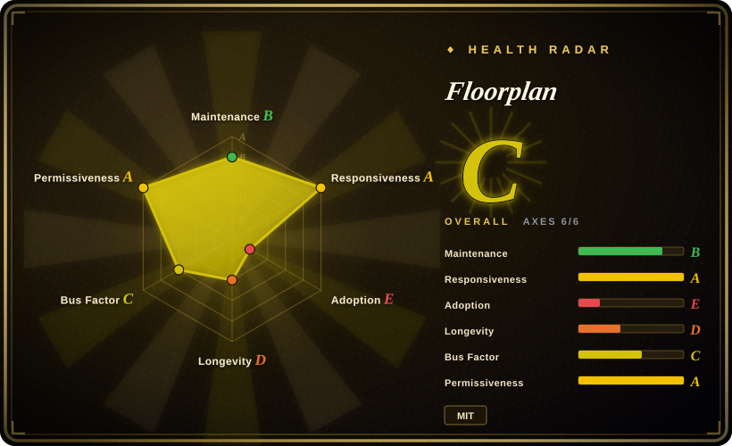
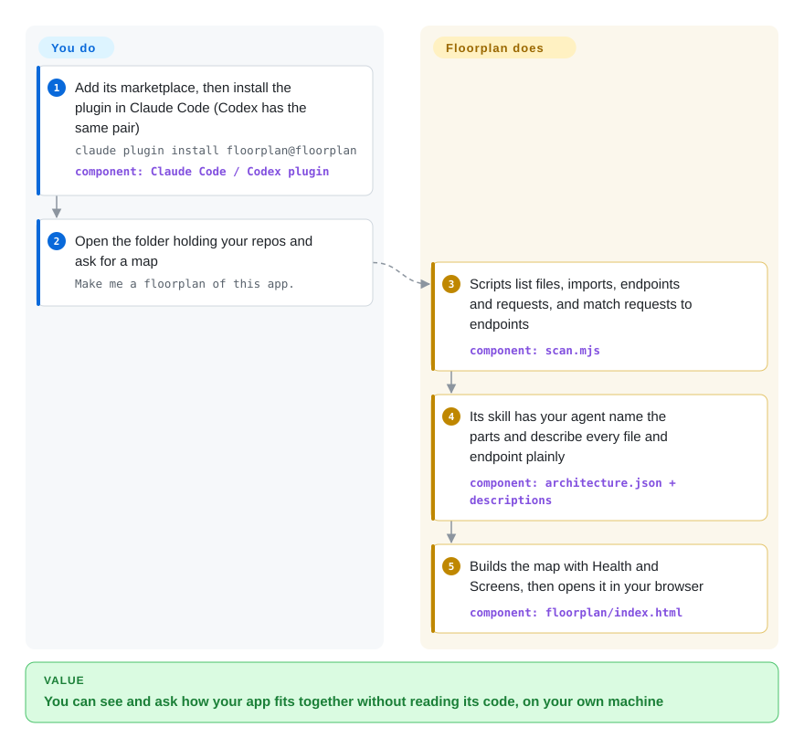
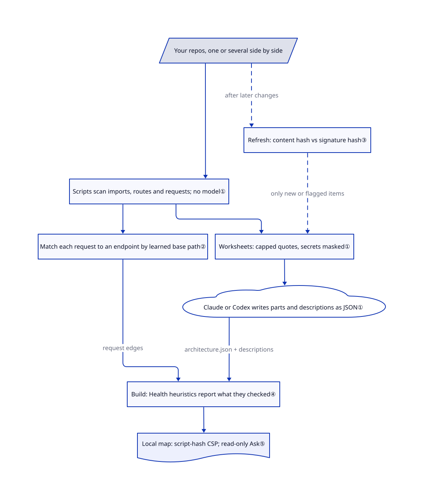

# Floorplan

You built an app with an AI agent and it works, but "what happens when someone checks out?" or "what breaks if I change the users table?" has no answer short of reading code you never wrote. Floorplan has Claude Code or Codex draw a local, zoomable map of the app — its parts, files, endpoints, screens, and which frontend request hits which server route — with every card named in plain English.

## When to use

You are a solo founder who shipped a coffee-subscription app with Claude Code: a Next.js site in one repo, an Express API in another, Stripe and SendGrid behind them. A customer reports a refund that never reached their card, and you cannot say which of the forty files between the refund button and Stripe is involved. You open the folder holding both repos, tell your agent "Make me a floorplan of this app", and a few minutes later a page opens in your browser: the site's `fetch('/api/refunds')` drawn as a line to the Express handler that answers it, that handler's line to the Stripe card, and a sentence on each card saying what it does today. The Health panel adds that one webhook route accepts unsigned Stripe events. Next week, after more agent work, "Update the floorplan" re-describes only what changed and lights up the cards the agent just touched.

You pick it over [Understand-Anything](understand-anything.md) because the deciding feature is the **cross-repo request-to-endpoint line**, written for the app's owner rather than a function-level knowledge graph written for developers; and over [archify](../../agent-skills/design/visual-artifacts/archify.md) because Floorplan is derived from the scanned code and kept current, not drawn once from a description. The price: it runs only inside Claude Code or Codex on your existing plan (no API key), the descriptions are model-written and cost tokens per file, and the project is three weeks old.

## When NOT to use

- **Your codebase has hundreds of files and you need the map today.** Every file and endpoint gets a model-written description; one user's ~750-file folder produced ~740 empty file and ~497 empty route descriptions to fill, ~290 of ~500 routes unlinked, and a 2.9 MB `index.html` ([#95](https://github.com/haydenschmitty/floorplan/issues/95), still open). For an agent-queryable graph of a big repo use [graphify](graphify.md) or [Understand-Anything](understand-anything.md); for a deterministic module dependency graph with no model cost use [dependency-cruiser](https://github.com/sverweij/dependency-cruiser) (JS/TS).
- **You need function-level call graphs or compiler-precise references.** Floorplan's unit is the file and the endpoint, matched by patterns ("pattern matching, not a compiler"); it does not trace calls between functions. Use [SCIP](scip.md)-based indexing or [Understand-Anything](understand-anything.md).
- **You want the Health panel to count as a security review.** It is a set of regex/heuristic checks the docs call "a check, not an audit"; it keeps the top 40 findings, and several "False positive: secret" reports are open (#107, #108, #110). Run [gitleaks](https://github.com/gitleaks/gitleaks) for secrets and a real SAST tool (e.g. [Semgrep](https://github.com/semgrep/semgrep)) or a human review for access control.
- **Source must not reach Anthropic or OpenAI.** The descriptions come from your agent reading the code under your account; Floorplan itself sends nothing, but the model does see the code. If that is ruled out, use [dependency-cruiser](https://github.com/sverweij/dependency-cruiser) or another fully local static grapher.
- **Your agent is Cursor, Copilot, Gemini CLI or OpenCode.** At commit `94f81b4` only Claude Code and Codex are supported; a Cursor PR (#128) was closed unmerged and a Copilot PR (#92) is open. [Understand-Anything](understand-anything.md) runs on more hosts; otherwise budget for wiring Floorplan's unattended mode (`workflow.json` + `--json`) to your own model.
- **You need a polished diagram for a doc, a talk or a design that isn't code yet.** Use [archify](../../agent-skills/design/visual-artifacts/archify.md); Floorplan's blueprint mode exists but its output is an interactive working map, not a presentation figure.
- **You cannot absorb a three-week-old, solo-led plugin that auto-updates.** v0.1→v0.11 shipped in three weeks, and a plugin update pulls whatever the newest release contains. Pin a release and compare it against its `CHECKSUMS.txt`, or wait for the surface to settle.

## Comparison

| Alternative | In index | Our verdict | Tradeoff |
|---|---|---|---|
| [Understand-Anything](understand-anything.md) | ✅ | Choose Understand-Anything when developers need to study a large codebase function by function across many agent hosts; choose Floorplan when a non-reading owner needs the app's parts, screens and frontend-to-backend requests in plain words, inside Claude Code or Codex. | Understand-Anything: finer granularity (functions, classes, layers) and broader host support; Floorplan: coarser file/endpoint map but cross-repo request matching, Health and Recent work. |
| [archify](../../agent-skills/design/visual-artifacts/archify.md) | ✅ | Choose archify to draw one clear diagram for a doc or talk from a repo or a description; choose Floorplan when the map must be derived from the actual code and stay current as the agent keeps changing it. | archify: ten diagram types and exports, nothing to maintain; Floorplan: a live, queryable map tied to the code, at the cost of per-file descriptions and a local server. |
| [graphify](graphify.md) | ✅ | Choose graphify when the consumer is a coding agent that should query code, schemas and docs as a graph instead of grepping; choose Floorplan when the consumer is a human looking at the app's architecture. | graphify optimises retrieval for agents (and inherits this category's "agents rarely call it" evidence); Floorplan optimises a human-readable picture, with only a small lookup script for agents. |
| [dependency-cruiser](https://github.com/sverweij/dependency-cruiser) | not indexed | Choose dependency-cruiser when you want a deterministic, rule-checkable JS/TS module graph in CI with no model and no code leaving the machine; choose Floorplan when you need plain-English meaning and endpoint links across repos and languages. Not added in this tab batch. | dependency-cruiser: free, reproducible, CI-enforceable, but import-level only and no explanations; Floorplan: explanations and request matching, but model-written and token-costed. |

## Quick start

Install it as a plugin: in Claude Code run `claude plugin marketplace add haydenschmitty/floorplan` then `claude plugin install floorplan@floorplan` (Codex has the matching `codex plugin` pair, or the Plugins screen); Node.js 18+ must be on the machine. Open the folder that holds your repos — a monorepo, or a plain folder with the frontend and backend side by side — and ask "Make me a floorplan of this app" (`$floorplan` in Codex). Floorplan's scripts do the mechanical part locally: list files with git, extract imports, endpoints and outgoing web requests, match requests to endpoints, then lay out the map. Your agent does the reading part — it writes `floorplan/architecture.json` (the app's parts) and a description for every file and endpoint — which spends your Claude or ChatGPT plan, not a separate API key. You get `floorplan/index.html`, served by a small local server (a program listening only on your own machine) so the map's Ask bar can question your agent read-only. You own reviewing the names, adding links the scan missed (ask for an "explicit connection"), and running "Update the floorplan" after later changes; the `floorplan/` folder is never committed.

<!-- flow-steps:begin (generated from flows/floorplan.json by tools/flow_card.py — do not edit) -->

Text version of the flow

1. **You**: Add its marketplace, then install the plugin in Claude Code (Codex has the same pair) — `claude plugin install floorplan@floorplan` — component: `Claude Code / Codex plugin`
2. **You**: Open the folder holding your repos and ask for a map — `Make me a floorplan of this app.`
3. **Floorplan**: Scripts list files, imports, endpoints and requests, and match requests to endpoints — component: `scan.mjs`
4. **Floorplan**: Its skill has your agent name the parts and describe every file and endpoint plainly — component: `architecture.json + descriptions`
5. **Floorplan**: Builds the map with Health and Screens, then opens it in your browser — component: `floorplan/index.html`

**Value**: You can see and ask how your app fits together without reading its code, on your own machine

<!-- flow-steps:end -->

## Key techniques

<!-- mechanism:begin (generated from mechanisms/floorplan.json by tools/mechanism_card.py; do not edit) -->

Text version of the mechanism

- Your repos, one or several side by side
- Scripts scan imports, routes and requests; no model①
- Match each request to an endpoint by learned base path②
- Worksheets: capped quotes, secrets masked①
- Claude or Codex writes parts and descriptions as JSON①
- Build: Health heuristics report what they checked④
- Local map: script-hash CSP; read-only Ask⑤
- Refresh: content hash vs signature hash③

- Your repos, one or several side by side → Scripts scan imports, routes and requests; no model①
- Scripts scan imports, routes and requests; no model① → Match each request to an endpoint by learned base path②
- Scripts scan imports, routes and requests; no model① → Worksheets: capped quotes, secrets masked①
- Worksheets: capped quotes, secrets masked① → Claude or Codex writes parts and descriptions as JSON①
- Claude or Codex writes parts and descriptions as JSON① → Build: Health heuristics report what they checked④ (architecture.json + descriptions)
- Match each request to an endpoint by learned base path② → Build: Health heuristics report what they checked④ (request edges)
- Build: Health heuristics report what they checked④ → Local map: script-hash CSP; read-only Ask⑤
- Your repos, one or several side by side → Refresh: content hash vs signature hash③ (after later changes) [optional/fallback]
- Refresh: content hash vs signature hash③ → Worksheets: capped quotes, secrets masked① (only new or flagged items) [optional/fallback]

<!-- mechanism:end -->

### 1. Scripts do the mechanical half; the model only writes JSON

- **Problem:** Asking a model to "diagram the codebase" spends tokens on file listing and parsing and invents structure it never checked.
- **How:** `scan.mjs`, `build.mjs` and `refresh.mjs` are dependency-free Node that never call a model; the agent's only outputs are `architecture.json`, per-part `descriptions/*.json` and `recent-work.json`. `describe.mjs` hands it a worksheet per part that quotes endpoint bodies and very short files (≤12 lines per route, ≤120 lines per worksheet), masks values that look secret and never quotes `.env`, key or credential files, so a description can say "replies OK and keeps nothing" instead of guessing from a name.
- **Limits:** Description quality is still whatever the model writes, and the workload grows with every file and endpoint — there is no automatic placeholder mode yet (#95). The masking is regex-based, not a guarantee.
- **Source:** [worksheet caps and never-quote list](https://github.com/haydenschmitty/floorplan/blob/94f81b463b7617e06d873ac71323ce71644c8399/skills/floorplan/scripts/describe.mjs#L70-L90), [model writes only three files](https://github.com/haydenschmitty/floorplan/blob/94f81b463b7617e06d873ac71323ce71644c8399/docs/unattended.md#L1-L12).

### 2. Match frontend requests to backend endpoints by a learned base path

- **Problem:** A frontend calls `/orders` while the base URL lives in settings, so a naive match either misses it or links it to the wrong `/orders` handler in another app.
- **How:** Every request is scored against every endpoint by literal and wildcard path segments. From calls only one endpoint could answer, the matcher learns each client's base prefix (per file, folder and package), then uses it to pick among ambiguous matches, defaults method-less `fetch` to GET, and drops a call that still fits more than three files.
- **Limits:** It is pattern matching, not a compiler: addresses built at run time or by packages are missed, and unmatched routes look the same as genuine leaves on the board. You add missing links by asking for an explicit connection.
- **Source:** [`matchCalls` with learned prefixes](https://github.com/haydenschmitty/floorplan/blob/94f81b463b7617e06d873ac71323ce71644c8399/skills/floorplan/scripts/lib/routes.mjs#L394-L463), [supported frameworks and limits](https://github.com/haydenschmitty/floorplan/blob/94f81b463b7617e06d873ac71323ce71644c8399/docs/how-it-works.md#L32-L55).

### 3. Two fingerprints so updates re-describe only what changed

- **Problem:** Re-describing the whole app after every agent session would cost as much as the first map.
- **How:** The scan stores two short SHA-1 hashes per code file: `h` over the exact content and `sig` over its export names, routes and doc comment. On refresh, an identical `h` (or same file name plus same `sig`) marks a rename so the description moves with it; deleted files are pruned; only files whose `sig` changed get a `review` note, so edits inside function bodies cost nothing.
- **Limits:** A behaviour change hidden inside an unchanged signature keeps its old, now-wrong description. Without git (no `.git` folder) Recent work has nothing to compare and goes blind (#95).
- **Source:** [the two hashes](https://github.com/haydenschmitty/floorplan/blob/94f81b463b7617e06d873ac71323ce71644c8399/skills/floorplan/scripts/scan.mjs#L92-L101), [rename/flag/prune logic](https://github.com/haydenschmitty/floorplan/blob/94f81b463b7617e06d873ac71323ce71644c8399/skills/floorplan/scripts/refresh.mjs#L85-L160).

### 4. A Health check that also says what it could not check

- **Problem:** A clean security panel is meaningless if the check had nothing to look at, such as Supabase tables created in the dashboard.
- **How:** Heuristics cover hard-coded secrets, secrets exposed through public env vars, Supabase/Firebase rules, unsigned Stripe webhooks, endpoints with no sign-in check, CORS, `.env` files and more, each with a ready-to-paste fix prompt. Alongside the findings, `whatWasChecked` records per check what it read or that it found nothing to read, and flags the gaps that matter.
- **Limits:** Results are sorted by severity and cut to 40; detection is pattern-based per framework, and false positives (secrets, guarded FastAPI/Flask routes) are a recurring issue theme. Rules set in a vendor console are outside its view.
- **Source:** [ordering, 40-item cap and coverage report](https://github.com/haydenschmitty/floorplan/blob/94f81b463b7617e06d873ac71323ce71644c8399/skills/floorplan/scripts/lib/health.mjs#L2198-L2253), [Stripe webhook check](https://github.com/haydenschmitty/floorplan/blob/94f81b463b7617e06d873ac71323ce71644c8399/skills/floorplan/scripts/lib/health.mjs#L1068-L1115).

### 5. A locked-down map and a read-only Ask bar

- **Problem:** A plugin that serves a page built from repository text, and runs an agent from it, is an obvious place for injected script or a stage-two download.
- **How:** Each page carries a Content-Security-Policy whose script allowlist is the SHA-256 of its own inline scripts; an exported copy may contact nothing, the local copy only its own server. The Ask bar runs `claude -p` limited to Read/Grep/Glob plus `node floorplan/query.mjs`, with an empty MCP config, or `codex exec --sandbox read-only`. A supply-chain test fails the build on any new hook, MCP server, dependency, outbound host or unlisted program.
- **Limits:** Codex has no option to drop only MCP servers, so yours load there. A plugin update still brings whatever the newest release contains; checksums let you verify, not prevent.
- **Source:** [CSP by script hash](https://github.com/haydenschmitty/floorplan/blob/94f81b463b7617e06d873ac71323ce71644c8399/skills/floorplan/assets/page-safety.mjs#L70-L84), [read-only Ask commands](https://github.com/haydenschmitty/floorplan/blob/94f81b463b7617e06d873ac71323ce71644c8399/skills/floorplan/assets/serve.mjs#L331-L366), [supply-chain tripwire](https://github.com/haydenschmitty/floorplan/blob/94f81b463b7617e06d873ac71323ce71644c8399/tests/supply-chain.test.mjs#L1-L5).

## Tech stack

- **Language:** plain JavaScript ES modules (`.mjs`) for Node.js ≥ 18 — about 13.4k lines of the author's own scripts and viewer code, with zero npm dependencies (`package.json` exists only for `node --test`).
- **Parsing:** hand-written regex/text extractors per language and framework (TypeScript/JavaScript incl. Vue/Svelte/Astro, Python, Go, Rust, Java, Kotlin, Scala, Swift, C#, PHP, Shopify Liquid), not a compiler or tree-sitter.
- **Map:** a single self-contained HTML viewer with vendored [elkjs](https://github.com/kieler/elkjs) 0.9.3 for layout and bundled Inter / JetBrains Mono fonts; a small `node:http` server bound to `127.0.0.1` for Ask, live reload and Export.
- **Packaging:** Claude Code plugin (`.claude-plugin/`), Codex plugin (`.codex-plugin/`), one skill (`skills/floorplan/SKILL.md`) plus a `workflow.json` describing the same steps as data.

## Dependencies

- **On the machine:** Node.js 18+, git (files are listed with `git ls-files`; a repo git refuses to read adds no files), and Claude Code or Codex signed in to your plan. The Claude Code CLI is recommended even with the desktop app, because the Ask bar shells out to `claude -p`.
- **Model access:** your existing Claude or ChatGPT plan pays for the descriptions and for every Ask question; no separate API key.
- **Network:** none of Floorplan's own beyond the opt-in Floorplan Cloud waitlist (only if you type an email); the agent talks to Anthropic or OpenAI as usual.
- **Written into your project:** a self-ignoring `floorplan/` folder, and in Claude Code — only if you say yes — a section in `CLAUDE.local.md` added to `.git/info/exclude`.

## Ops difficulty

**Low for a small app, medium for a large one.** Install is two plugin commands and there is no daemon beyond the map's on-demand local server. The cost is attention and tokens: reviewing model-chosen names and part boundaries, adding links the matcher missed, re-running updates after agent sessions, and on big codebases filling hundreds of descriptions (parallel helpers in Claude Code help, but #95 shows the friction). Windows works in CI (Node 18/20/22 on Linux and Windows) but users report BOM and shell-syntax friction. Removal is uninstalling the plugin and deleting `floorplan/`.

## Health & viability

- **Maintenance (2026-11-18):** very active — 253 commits since 2026-10-27, eleven minor versions in three weeks (v0.11.0 tagged 2026-11-16); 55 of 67 issues are closed, the recent ones in batches three to eight days after filing. Three weeks of history is velocity, not a cadence.
- **Governance / bus factor:** a personal account ("Hayden Smith") holds 198 commits; the next contributor has 12 and the rest single digits; releases are maintainer-only and `main` is described as protected. One person owns the roadmap.
- **Backing & longevity:** no organisation behind it; the docs announce a hosted "Floorplan Cloud" (team maps synced with GitHub) collecting a waitlist, which suggests a future commercial tier. [推断：based on the waitlist copy, no pricing or licence change announced] It fails the Lindy prior on age.
- **Adoption:** ~4.7k stars and 389 forks in 22 days is a launch-hype signal, not proof of production use; no package-registry downloads exist to cross-check because it ships as a plugin, which is why the radar's adoption axis reads E — a measurement gap, not evidence of no users.
- **Risk flags:** MIT with the author as copyright holder (LICENSE read); unusually explicit supply-chain hygiene (no hooks/MCP/dependencies, a CI tripwire, per-release checksums). The risks are youth, single-maintainer dependency, host lock-in to two agent CLIs, and an open-core path not yet defined.

## Caveats (unverified)

- [未验证：no Claude Code/Codex run was made for this page] The map's quality, accuracy of descriptions, time and token cost per map were not measured here; "a few minutes for a small app" is the README's claim.
- [未验证] The large-codebase numbers (~750 files, ~290 of ~500 routes unlinked, 2.9 MB page) come from one user's report in #95, not a reproduction.
- [推断：based on the waitlist copy in docs/privacy-and-security.md] Floorplan Cloud may become a paid hosted tier; nothing in the repo states pricing, licence plans or feature-gating.
- [未验证] The claims that `main` is protected and that `elk.bundled.js` is byte-identical to npm `elkjs@0.9.3` are from docs/is-it-safe.md; neither branch protection nor the hash was checked here.
- [未验证] The cause of ~4.7k stars in three weeks (Trendshift listing, launch video, social posts) was not investigated; treated as a popularity anomaly.
- [推断：based on CI matrix and issue #95] Windows support is tested in CI but users report BOM and POSIX-shell friction; real-world Windows robustness was not tried.
- [未验证] The dependency-cruiser, gitleaks and Semgrep mentions summarise those projects' public descriptions; their fit was not evaluated for this page.
