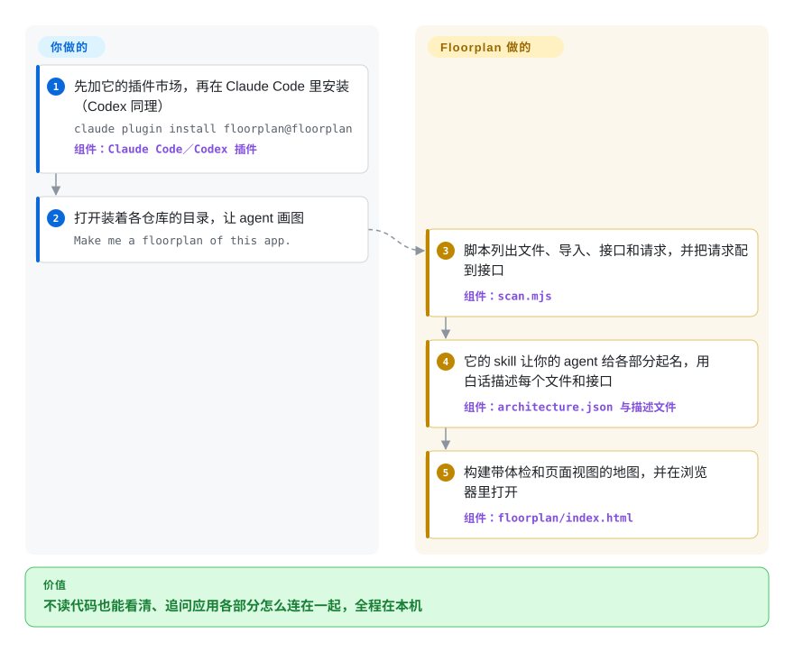
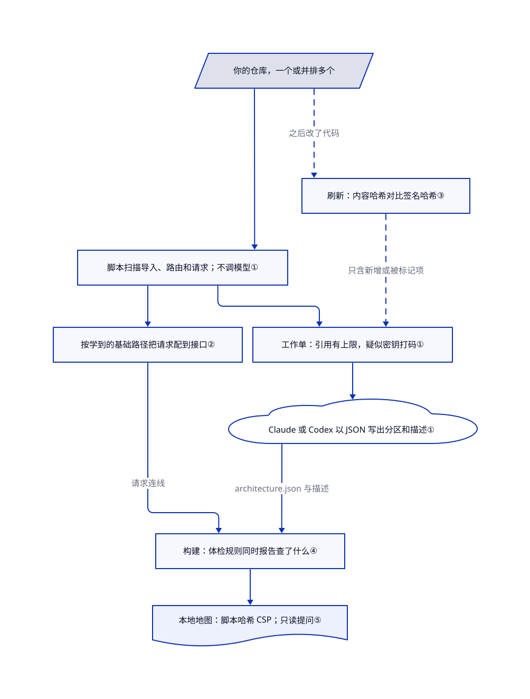

# Floorplan

应用是你和 AI agent 一起做出来的，能跑，可一旦有人问“用户下单时到底发生了什么”“改了用户表会坏哪儿”，你只能去读一堆不是自己写的代码。Floorplan 让 Claude Code 或 Codex 在本机画出一张可缩放的应用地图：有哪些部分、文件、接口和页面，前端哪个请求打到后端哪个路由，每张卡片都用白话写明它是干什么的。

## 何时使用

你是一个人做产品的创业者，用 Claude Code 做了个咖啡订阅应用：一个仓库放 Next.js 网站，另一个仓库放 Express 接口，后面接着 Stripe 和 SendGrid。有顾客说退款一直没回到卡上，而你说不清从“退款”按钮到 Stripe 之间这四十来个文件里哪些参与了。你打开同时装着两个仓库的目录，对 agent 说“Make me a floorplan of this app”，几分钟后浏览器里弹出一张图：网站里的 `fetch('/api/refunds')` 连到真正响应它的 Express 处理函数，那个函数再连到 Stripe 卡片，每张卡片上一句话写着它现在实际做什么。体检面板还顺带指出有个 webhook 路由接收未验签的 Stripe 事件。下周 agent 又改了一轮，你说“Update the floorplan”，它只重写变化的部分，并把 agent 刚动过的卡片标亮。

你选它而不是 [Understand-Anything](understand-anything.zh.md)，决定性的一点是**跨仓库把前端请求连到后端接口的那条线**，而且是写给应用主人看的，不是给开发者看的函数级知识图谱；不选 [archify](../../agent-skills/design/visual-artifacts/archify.zh.md)，是因为 Floorplan 由扫描到的真实代码推出来、能随代码持续更新，而不是根据一段描述画一次就完。代价是：它只能在 Claude Code 或 Codex 里跑，用你现有的套餐（不需要 API key），描述由模型逐文件写、每个文件都花 token，而且项目才三周大。

## 何时不用

- **代码库有几百个文件，今天就要看到地图。** 每个文件和接口都要模型写描述；有用户在约 750 个文件的目录上跑，得到约 740 条空的文件描述和约 497 条空的路由描述要填，约 500 个路由里约 290 个没连上，生成的 `index.html` 有 2.9 MB（[#95](https://github.com/haydenschmitty/floorplan/issues/95)，仍未关闭）。大仓库要给 agent 查的图，用 [graphify](graphify.zh.md) 或 [Understand-Anything](understand-anything.zh.md)；要不花模型钱、结果确定的模块依赖图，用 [dependency-cruiser](https://github.com/sverweij/dependency-cruiser)（JS/TS）。
- **你要函数级调用图或编译器级的精确引用。** Floorplan 的粒度是文件和接口，靠模式匹配（文档原话是“模式匹配，不是编译器”），不追踪函数之间的调用。改用基于 [SCIP](scip.zh.md) 的索引或 [Understand-Anything](understand-anything.zh.md)。
- **你想把体检面板当成安全审计。** 它是一组正则和启发式检查，文档自己说是“检查，不是审计”；结果只保留前 40 条，还有好几条“误报：密钥”的 issue 没关（#107、#108、#110）。密钥扫描用 [gitleaks](https://github.com/gitleaks/gitleaks)，访问控制用正经的静态分析工具（例如 [Semgrep](https://github.com/semgrep/semgrep)）或人工评审。
- **源码不允许发给 Anthropic 或 OpenAI。** 描述来自你的 agent 用你的账号读代码；Floorplan 自己不往外发东西，但模型确实看到了代码。如果这条行不通，用 [dependency-cruiser](https://github.com/sverweij/dependency-cruiser) 这类完全本地的静态依赖图工具。
- **你用的是 Cursor、Copilot、Gemini CLI 或 OpenCode。** 在提交 `94f81b4` 时只支持 Claude Code 和 Codex；Cursor 的 PR（#128）没合并就关了，Copilot 的 PR（#92）还开着。[Understand-Anything](understand-anything.zh.md) 支持的宿主更多；否则就要自己把 Floorplan 的无人值守模式（`workflow.json` 加 `--json`）接到你自己的模型上。
- **你要一张给文档、演讲用的精致图，或者画的东西还不是代码。** 用 [archify](../../agent-skills/design/visual-artifacts/archify.zh.md)；Floorplan 虽然有蓝图模式，但产出是交互式工作地图，不是展示用插图。
- **你接受不了一个三周大、主要靠一个人、还会自动更新的插件。** 三周内从 v0.1 发到 v0.11，插件更新会拉下最新版里的任何内容。要么固定一个版本并用它的 `CHECKSUMS.txt` 核对，要么等接口稳定下来再用。

## 横向对比

| 替代品 | 是否收录 | 我们的评价 | 取舍 |
|---|---|---|---|
| [Understand-Anything](understand-anything.zh.md) | ✅ | 开发者要在多种 agent 宿主里按函数级读懂一个大代码库，选 Understand-Anything；不读代码的应用主人要在 Claude Code 或 Codex 里用白话看清应用的部分、页面和前后端请求，选 Floorplan。 | Understand-Anything 粒度更细（函数、类、分层），支持的宿主更多；Floorplan 只到文件和接口这一层，但有跨仓库请求匹配、体检和“最近改动”。 |
| [archify](../../agent-skills/design/visual-artifacts/archify.zh.md) | ✅ | 要根据仓库或一段描述画一张给文档、演讲用的清楚图，选 archify；要让图由真实代码推出、并随 agent 持续改代码而保持最新，选 Floorplan。 | archify 有十种图型和导出、画完无需维护；Floorplan 是绑定代码、能提问的活地图，代价是逐文件写描述和一个本地服务。 |
| [graphify](graphify.zh.md) | ✅ | 使用者是编码 agent、要把代码、schema 和文档当图来查以代替 grep 时选 graphify；使用者是要看应用架构的人时选 Floorplan。 | graphify 为 agent 检索优化（也继承了本分类“agent 很少主动调用”的证据）；Floorplan 为人看得懂的图优化，只给 agent 留了一个小的查询脚本。 |
| [dependency-cruiser](https://github.com/sverweij/dependency-cruiser) | 未收录 | 要在 CI 里跑结果确定、可写规则校验的 JS/TS 模块依赖图，且不用模型、代码不出本机，选 dependency-cruiser；要跨仓库跨语言的白话解释和接口连线，选 Floorplan。本轮标签批次不新增。 | dependency-cruiser 免费、可复现、能在 CI 强制执行，但只到导入层、没有解释；Floorplan 有解释和请求匹配，但描述由模型写、要花 token。 |

## 快速上手

以插件方式安装：在 Claude Code 里先运行 `claude plugin marketplace add haydenschmitty/floorplan`，再运行 `claude plugin install floorplan@floorplan`（Codex 有对应的 `codex plugin` 两条命令，也可以在插件界面里装）；机器上需要 Node.js 18 以上。打开装着你各个仓库的目录（单仓多包，或前后端并排放的普通目录），说一句“Make me a floorplan of this app”（Codex 里也可以输入 `$floorplan`）。机械部分由 Floorplan 的脚本在本机完成：用 git 列文件，提取导入、接口和对外发出的请求，把请求配到接口，再排版。读代码的部分交给你的 agent：它写出 `floorplan/architecture.json`（应用分成哪几部分）以及每个文件和接口的描述，花的是你的 Claude 或 ChatGPT 套餐额度，不需要另配 API key。你会得到 `floorplan/index.html`，由一个小的本地服务（只在你本机监听的程序）提供，地图上的提问栏借它以只读方式询问你的 agent。你负责核对它起的名字、补上扫描漏掉的连线（让它加一条“显式连接”），以及之后改完代码再说一句“Update the floorplan”；`floorplan/` 目录永远不会被提交。

<!-- flow-steps:begin (generated from flows/floorplan.json by tools/flow_card.py — do not edit) -->

流程文字版

1. **你**：先加它的插件市场，再在 Claude Code 里安装（Codex 同理） — `claude plugin install floorplan@floorplan` — 组件：`Claude Code／Codex 插件`
2. **你**：打开装着各仓库的目录，让 agent 画图 — `Make me a floorplan of this app.`
3. **Floorplan**：脚本列出文件、导入、接口和请求，并把请求配到接口 — 组件：`scan.mjs`
4. **Floorplan**：它的 skill 让你的 agent 给各部分起名，用白话描述每个文件和接口 — 组件：`architecture.json 与描述文件`
5. **Floorplan**：构建带体检和页面视图的地图，并在浏览器里打开 — 组件：`floorplan/index.html`

**价值**：不读代码也能看清、追问应用各部分怎么连在一起，全程在本机

<!-- flow-steps:end -->

## 技术要点

<!-- mechanism:begin (generated from mechanisms/floorplan.json by tools/mechanism_card.py; do not edit) -->

机制文字版

- 你的仓库，一个或并排多个
- 脚本扫描导入、路由和请求；不调模型①
- 按学到的基础路径把请求配到接口②
- 工作单：引用有上限，疑似密钥打码①
- Claude 或 Codex 以 JSON 写出分区和描述①
- 构建：体检规则同时报告查了什么④
- 本地地图：脚本哈希 CSP；只读提问⑤
- 刷新：内容哈希对比签名哈希③

- 你的仓库，一个或并排多个 → 脚本扫描导入、路由和请求；不调模型①
- 脚本扫描导入、路由和请求；不调模型① → 按学到的基础路径把请求配到接口②
- 脚本扫描导入、路由和请求；不调模型① → 工作单：引用有上限，疑似密钥打码①
- 工作单：引用有上限，疑似密钥打码① → Claude 或 Codex 以 JSON 写出分区和描述①
- Claude 或 Codex 以 JSON 写出分区和描述① → 构建：体检规则同时报告查了什么④（architecture.json 与描述）
- 按学到的基础路径把请求配到接口② → 构建：体检规则同时报告查了什么④（请求连线）
- 构建：体检规则同时报告查了什么④ → 本地地图：脚本哈希 CSP；只读提问⑤
- 你的仓库，一个或并排多个 → 刷新：内容哈希对比签名哈希③（之后改了代码）〔可选／兜底〕
- 刷新：内容哈希对比签名哈希③ → 工作单：引用有上限，疑似密钥打码①（只含新增或被标记项）〔可选／兜底〕

<!-- mechanism:end -->

### 1. 机械活交给脚本，模型只写 JSON

- **解决：** 直接让模型“画出代码库结构”，会把 token 花在列文件、解析上，还会编出它没核实过的结构。
- **做法：** `scan.mjs`、`build.mjs`、`refresh.mjs` 都是不带依赖的 Node 脚本，从不调用模型；agent 只产出 `architecture.json`、按部分拆开的 `descriptions/*.json` 和 `recent-work.json`。`describe.mjs` 给每个部分生成一份工作单，引用接口函数体和很短的文件（每个路由最多 12 行，每份工作单最多 120 行），把疑似密钥的值打码，并且从不引用 `.env`、私钥和凭据文件，让描述能写出“只回 OK、什么都不存”，而不是看名字瞎猜。
- **边界：** 描述好坏仍取决于模型写得怎样，工作量随文件和接口数增长，目前还没有自动占位模式（#95）。打码靠正则，不是保证。
- **源码：** [工作单上限与不引用清单](https://github.com/haydenschmitty/floorplan/blob/94f81b463b7617e06d873ac71323ce71644c8399/skills/floorplan/scripts/describe.mjs#L70-L90)、[模型只写三类文件](https://github.com/haydenschmitty/floorplan/blob/94f81b463b7617e06d873ac71323ce71644c8399/docs/unattended.md#L1-L12)。

### 2. 用学到的基础路径把前端请求配到后端接口

- **解决：** 前端调用写的是 `/orders`，基础地址放在配置里，简单匹配要么配不上，要么连到另一个应用里同名的 `/orders` 处理函数。
- **做法：** 每个请求按路径段的字面量和通配符给所有接口打分。匹配器先从只有一个接口能接的调用里，学出每个客户端（按文件、目录、包）的基础前缀，再用它在有歧义的候选里挑选；没写方法的 `fetch` 默认按 GET 处理；仍能对上三个以上文件的调用直接放弃。
- **边界：** 这是模式匹配，不是编译器：运行时拼出来或由第三方包注册的地址会漏掉，地图上“没连上的路由”和“本来就是叶子”看起来一样。漏掉的连线要你让它补一条显式连接。
- **源码：** [带前缀学习的 `matchCalls`](https://github.com/haydenschmitty/floorplan/blob/94f81b463b7617e06d873ac71323ce71644c8399/skills/floorplan/scripts/lib/routes.mjs#L394-L463)、[支持的框架与局限](https://github.com/haydenschmitty/floorplan/blob/94f81b463b7617e06d873ac71323ce71644c8399/docs/how-it-works.md#L32-L55)。

### 3. 两个指纹，更新时只重写变了的部分

- **解决：** 每次 agent 干完活都把整个应用重新描述一遍，花费和第一次画图一样多。
- **做法：** 扫描时给每个代码文件存两个短的 SHA-1 哈希：`h` 覆盖完整内容，`sig` 只覆盖导出名、路由和文档注释。刷新时，`h` 相同（或文件名相同且 `sig` 相同）就判为改名，描述跟着搬过去；删掉的文件直接清理；只有 `sig` 变了的文件才加一条 `review` 标记，所以函数体内部的改动不花钱。
- **边界：** 签名没变、行为却变了的文件，会留着已经过时的旧描述。没有 git（没有 `.git` 目录）时，“最近改动”没有对比基准，等于失明（#95）。
- **源码：** [两个哈希](https://github.com/haydenschmitty/floorplan/blob/94f81b463b7617e06d873ac71323ce71644c8399/skills/floorplan/scripts/scan.mjs#L92-L101)、[改名、标记与清理逻辑](https://github.com/haydenschmitty/floorplan/blob/94f81b463b7617e06d873ac71323ce71644c8399/skills/floorplan/scripts/refresh.mjs#L85-L160)。

### 4. 体检同时说明哪些没查到

- **解决：** 如果检查根本没东西可看（比如 Supabase 的表是在控制台里建的），一个干干净净的安全面板毫无意义。
- **做法：** 启发式规则覆盖写死在代码里的密钥、经公开环境变量泄露的密钥、Supabase／Firebase 规则、未验签的 Stripe webhook、没有登录校验的接口、CORS、`.env` 文件等，每条都附一段可直接粘贴的修复提示。除了问题列表，`whatWasChecked` 还逐项记录这项检查读了什么、或者没找到可读的东西，并把要紧的空白标出来。
- **边界：** 结果按严重度排序后只留前 40 条；检测按框架做模式匹配，误报（密钥、已加守卫的 FastAPI／Flask 路由）是 issue 里反复出现的主题。在厂商控制台里设置的规则它看不到。
- **源码：** [排序、40 条上限与覆盖报告](https://github.com/haydenschmitty/floorplan/blob/94f81b463b7617e06d873ac71323ce71644c8399/skills/floorplan/scripts/lib/health.mjs#L2198-L2253)、[Stripe webhook 检查](https://github.com/haydenschmitty/floorplan/blob/94f81b463b7617e06d873ac71323ce71644c8399/skills/floorplan/scripts/lib/health.mjs#L1068-L1115)。

### 5. 锁死的地图页面与只读提问栏

- **解决：** 一个用仓库文字生成页面、还能从页面启动 agent 的插件，是注入脚本或“二阶段下载”的天然落点。
- **做法：** 每个页面都带内容安全策略（CSP），脚本白名单就是页面自身内联脚本的 SHA-256；导出副本不允许连接任何地址，本地副本只能连自己的本地服务。提问栏运行的 `claude -p` 只开放 Read／Grep／Glob 和 `node floorplan/query.mjs`，MCP 配置为空；或者运行 `codex exec --sandbox read-only`。一个供应链测试会在出现新的 hook、MCP 服务、依赖、外连地址或未登记的程序时让构建失败。
- **边界：** Codex 没有只关闭 MCP 服务的选项，所以你自己配的 MCP 服务在那边会被加载。插件更新仍会带来最新版里的任何内容；校验和只能让你核对，不能阻止。
- **源码：** [按脚本哈希设置 CSP](https://github.com/haydenschmitty/floorplan/blob/94f81b463b7617e06d873ac71323ce71644c8399/skills/floorplan/assets/page-safety.mjs#L70-L84)、[只读提问命令](https://github.com/haydenschmitty/floorplan/blob/94f81b463b7617e06d873ac71323ce71644c8399/skills/floorplan/assets/serve.mjs#L331-L366)、[供应链绊线测试](https://github.com/haydenschmitty/floorplan/blob/94f81b463b7617e06d873ac71323ce71644c8399/tests/supply-chain.test.mjs#L1-L5)。

## 技术栈

- **语言：** 面向 Node.js 18 以上的纯 JavaScript ES 模块（`.mjs`），作者自己写的脚本和查看器代码约 1.34 万行，npm 依赖为零（`package.json` 只为跑 `node --test` 而存在）。
- **解析：** 按语言和框架手写的正则／文本提取器（TypeScript／JavaScript 含 Vue、Svelte、Astro，Python、Go、Rust、Java、Kotlin、Scala、Swift、C#、PHP、Shopify Liquid），不是编译器，也不是 tree-sitter。
- **地图：** 单个自包含的 HTML 查看器，内置 [elkjs](https://github.com/kieler/elkjs) 0.9.3 负责排版，并打包 Inter 和 JetBrains Mono 字体；一个绑定在 `127.0.0.1` 上的小型 `node:http` 服务负责提问、实时刷新和导出。
- **打包：** Claude Code 插件（`.claude-plugin/`）、Codex 插件（`.codex-plugin/`）、一个 skill（`skills/floorplan/SKILL.md`），外加用数据描述同样步骤的 `workflow.json`。

## 依赖

- **本机：** Node.js 18 以上、git（文件用 `git ls-files` 列出，git 拒绝读取的仓库一个文件也进不了地图），以及已登录套餐的 Claude Code 或 Codex。即使用桌面版也建议装 Claude Code 命令行，因为提问栏要调用 `claude -p`。
- **模型额度：** 描述和每次提问都花你现有的 Claude 或 ChatGPT 套餐，不需要单独的 API key。
- **网络：** Floorplan 自己只有一个可选的 Floorplan Cloud 候补名单请求（你填了邮箱才发）；agent 照常连 Anthropic 或 OpenAI。
- **写进项目的东西：** 一个自带忽略规则的 `floorplan/` 目录；在 Claude Code 里且你同意时，再往 `CLAUDE.local.md` 加一段，并把它登记到 `.git/info/exclude`。

## 运维难度

**小应用低，大应用中等。** 安装就是两条插件命令，除了按需启动的地图本地服务没有常驻进程。成本在注意力和 token 上：核对模型起的名字和分区边界，补上匹配器漏掉的连线，每轮 agent 干完活再更新一次；代码库大时还要填几百条描述（Claude Code 的并行助手有帮助，但 #95 显示摩擦不小）。Windows 在 CI 里有测试（Linux 和 Windows 上跑 Node 18／20／22），但用户反馈过 BOM 和 shell 语法方面的摩擦。卸载就是删插件加删 `floorplan/` 目录。

## 健康度与可持续性

- **维护（2026-11-18）：** 非常活跃，2026-10-27 以来共 253 个提交，三周内发了十一个小版本（v0.11.0 于 2026-11-16 打 tag）；67 个 issue 已关 55 个，近期的是在提出后三到八天内成批关闭。三周的历史只说明速度，还谈不上节奏。
- **治理与巴士系数：** 一个个人账号（Hayden Smith）有 198 个提交，第二名 12 个，其余都是个位数；发版只由维护者做，文档称 `main` 分支受保护。路线图由一个人说了算。
- **背书与存续：** 背后没有组织；文档在收集托管版 Floorplan Cloud（团队共享地图、与 GitHub 同步）的候补名单，预示可能会有商业版。[推断：依据候补名单文案，未见定价或许可变更公告] 按 Lindy 先验，它太年轻。
- **采用度：** 22 天约 4.7k star、389 个 fork，是发布热度信号，不能证明有生产使用；它以插件形式分发，没有包仓库下载量可以交叉核对，所以雷达的采用度轴是 E，这是测量缺口，不代表没人用。
- **风险信号：** MIT 许可，版权人是作者本人（已读 LICENSE 文件）；供应链卫生做得少见地明确（无 hook、无 MCP、无依赖，有 CI 绊线测试和每版校验和）。风险在于年轻、依赖单一维护者、只绑定两个 agent 命令行，以及尚未说清的开源与商业版边界。

## 存疑（未验证）

- [未验证：本页编写时未实际在 Claude Code／Codex 中运行] 地图质量、描述准确度、每张地图的耗时和 token 成本都没有在这里测过；“小应用几分钟”是 README 的说法。
- [未验证] 大代码库的数字（约 750 个文件、约 500 个路由里约 290 个没连上、页面 2.9 MB）来自 #95 里一位用户的报告，没有复现。
- [推断：依据 docs/privacy-and-security.md 的候补名单文案] Floorplan Cloud 可能成为付费托管版；仓库里没有任何关于定价、许可计划或功能分级的说明。
- [未验证] `main` 受保护、`elk.bundled.js` 与 npm 上的 `elkjs@0.9.3` 逐字节一致，这两点出自 docs/is-it-safe.md；分支保护和哈希都没有在这里核对。
- [未验证] 三周约 4.7k star 的原因（Trendshift 榜单、发布视频、社交传播）没有调查，按热度异常处理。
- [推断：依据 CI 矩阵和 #95] Windows 在 CI 中有测试，但用户反馈 BOM 和 POSIX shell 方面的摩擦；实际 Windows 稳健性没有试过。
- [未验证] dependency-cruiser、gitleaks、Semgrep 的相关表述只概括了这些项目的公开描述，本页没有评估它们的适配度。
