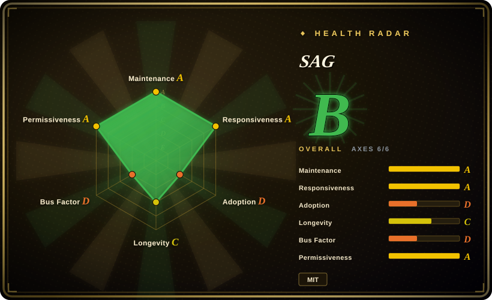
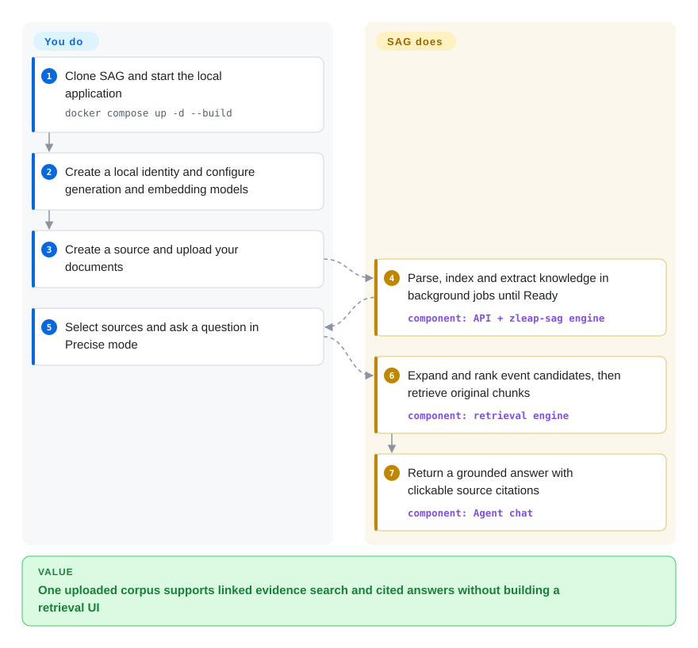
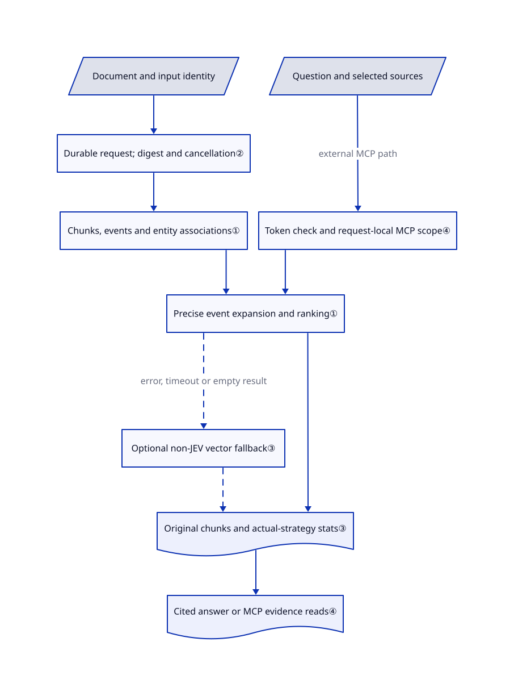

# SAG

Your document search finds one relevant paragraph but misses the other document that explains it. SAG connects extracted facts through shared entities, then returns the original passages in a local knowledge workspace.

## When to use

You maintain a personal research library or an internal prototype over manuals, reports and notes. A question such as “Which supplier changed this component, and why?” needs evidence from several files, but ordinary similarity search returns only the component description. You want to try event/entity retrieval without assembling a graph database, upload UI and citation viewer yourself. SAG supplies the application, local SQLite/LanceDB storage, search, cited chat and a knowledge MCP server — a standard tool interface other agents can call.

Choose it over PageIndex when the links between documents matter more than navigating one document's chapter tree. Choose it over LightRAG when you want this event/entity representation and a packaged personal workspace rather than a materialized entity/relation graph. The tradeoff is model-powered extraction, a separately versioned engine dependency, and single-user application boundaries. The default fast vector strategy does not exercise the full event-expansion path; select Precise when evaluating that benefit.

## When NOT to use

- **Unrelated users must have isolated knowledge.** Choose [Dify](../../agent-frameworks/workflow-builders/dify.md) for a workspace-oriented platform and check its edition, access controls and license. SAG explicitly targets single-user use: its HTTP MCP wrapper validates a token, then loads all sources unless `source_id` is supplied. That parameter narrows a query; it is not per-user authorization. Never expose the default name-only login to an untrusted network.
- **A few long PDFs have strong chapter structure, and you want no embedding index.** Choose [PageIndex](pageindex.md) for document-tree navigation. SAG instead pays for embeddings and event/entity extraction and maintains those indexes, even if the source already has an excellent table of contents.
- **Your application needs a persistent, editable entity/relation knowledge graph.** Evaluate [LightRAG](https://github.com/HKUDS/LightRAG), whose graph is a stored retrieval object. SAG's event/entity associations serve evidence retrieval; its graph viewer and query-local expansion are not a general graph-database administration surface.

## Comparison

| Alternative | In index | Our verdict | Tradeoff |
|---|---|---|---|
| [LightRAG](https://github.com/HKUDS/LightRAG) | not indexed | Pick SAG for a personal evidence workspace built around events; pick LightRAG when an explicit entity/relation graph and graph/vector backend choices are central to your application. | SAG starts with SQLite/LanceDB and ships a desktop/Web product; LightRAG maintains graph, vector, key/value and document-status stores. LightRAG was not added in this tab batch. |
| [PageIndex](pageindex.md) | ✅ | Pick PageIndex for reasoning down a long document's section tree without embeddings; pick SAG when cross-document entity links and a shared searchable workspace matter more. | PageIndex's open local library centers on document trees; SAG includes ingestion, source inspection and MCP but needs embedding and extraction models. |
| [Dify](../../agent-frameworks/workflow-builders/dify.md) | ✅ | Pick Dify when a team must build and publish several AI workflows; pick SAG when the deliverable is one personal knowledge base with inspectable evidence. | Dify brings workflow design and a larger service stack under a custom license; SAG is MIT and local-first, but its default application is not a tenant-isolated platform. |

## Quick start

Clone the repository, enter `SAG`, and run `docker compose up -d --build` with Docker Compose v2. Open `http://localhost:3000`, create a local identity, and configure generation and embedding connections under Settings → Models. You provide documents, model credentials and the inference budget; SAG parses, indexes and extracts their knowledge in background jobs. Create a source, upload a document, and wait for **Ready** rather than treating upload acceptance as indexing success. Ask within selected sources and open citations to check the original text; switch to Precise to evaluate event/entity expansion. Back up the `sagdata` volume, keep the default loopback binding, and use password mode plus HTTPS and a strong secret before enabling remote access.

<!-- flow-steps:begin (generated from flows/sag.json by tools/flow_card.py — do not edit) -->

Text version of the flow

1. **You**: Clone SAG and start the local application — `docker compose up -d --build`
2. **You**: Create a local identity and configure generation and embedding models
3. **You**: Create a source and upload your documents
4. **SAG**: Parse, index and extract knowledge in background jobs until Ready — component: `API + zleap-sag engine`
5. **You**: Select sources and ask a question in Precise mode
6. **SAG**: Expand and rank event candidates, then retrieve original chunks — component: `retrieval engine`
7. **SAG**: Return a grounded answer with clickable source citations — component: `Agent chat`

**Value**: One uploaded corpus supports linked evidence search and cited answers without building a retrieval UI

<!-- flow-steps:end -->

## Key techniques

<!-- mechanism:begin (generated from mechanisms/sag.json by tools/mechanism_card.py; do not edit) -->

Text version of the mechanism

- Document and input identity
- Durable request; digest and cancellation②
- Chunks, events and entity associations①
- Question and selected sources
- Token check and request-local MCP scope④
- Precise event expansion and ranking①
- Optional non-JEV vector fallback③
- Original chunks and actual-strategy stats③
- Cited answer or MCP evidence reads④

- Document and input identity → Durable request; digest and cancellation②
- Durable request; digest and cancellation② → Chunks, events and entity associations①
- Question and selected sources → Token check and request-local MCP scope④ (external MCP path)
- Token check and request-local MCP scope④ → Precise event expansion and ranking①
- Chunks, events and entity associations① → Precise event expansion and ranking①
- Precise event expansion and ranking① → Optional non-JEV vector fallback③ (error, timeout or empty result) [optional/fallback]
- Precise event expansion and ranking① → Original chunks and actual-strategy stats③
- Optional non-JEV vector fallback③ → Original chunks and actual-strategy stats③ [optional/fallback]
- Original chunks and actual-strategy stats③ → Cited answer or MCP evidence reads④

<!-- mechanism:end -->

### 1. Expand event candidates, then return their original passages

- **Problem:** Semantically similar chunks can omit the connection needed to answer a multi-document question.
- **How:** The app maps Precise (`multi`) to the engine's `full_expand`. Published engine 0.15.0 recalls events and entities, expands through vector-scored event/entity associations, ranks events, then resolves them to original chunks; direct-query chunks can fill remaining result slots.
- **Limits:** This shipping production executor is not simply the README's paper-level “SQL joins” description. Expansion has thresholds and candidate quotas, while the default vector strategy skips that machinery; an event path does not prove the resulting answer is correct.
- **Source:** [Application strategy mapping](https://github.com/Zleap-AI/SAG/blob/d3c882e676a01f59b64b639880b2bfceaa504da6/apps/api/sag_api/sag/engine_manager.py#L311-L373); [published 0.15.0 source archive](https://files.pythonhosted.org/packages/2c/2d/672e64596fc17053e14354b3d218fc6638cbb30e6629a56eb1ae98e4b109/zleap_sag-0.15.0.tar.gz), `src/zleap/sag/modules/search/production.py:59–127,239–339` and `graph.py:239–289`.

### 2. Bind document work to a durable input identity

- **Problem:** Retrying a long import must not confuse one document revision with another or lose processing progress.
- **How:** The adapter builds a durable processing request with an input ID, original-file hash and request digest. The engine owns the operation result; the app observes parsing, chunking, indexing and extraction stages and passes a cancellation token when the user pauses.
- **Limits:** Cancellation and persistence are engine contracts, not a claim that every failure resumes automatically. The app allows up to 20 events per chunk and caps entities and concurrency; “one event per chunk” is not a hard invariant of this application.
- **Source:** [Extraction limits and durable request](https://github.com/Zleap-AI/SAG/blob/d3c882e676a01f59b64b639880b2bfceaa504da6/apps/api/sag_api/sag/incremental_processor.py#L89-L169), [progress and cancellation](https://github.com/Zleap-AI/SAG/blob/d3c882e676a01f59b64b639880b2bfceaa504da6/apps/api/sag_api/sag/incremental_processor.py#L171-L230).

### 3. Expose the retrieval path that actually ran

- **Problem:** A successful response can hide that precise retrieval timed out or that some sources failed.
- **How:** Non-JEV precise search can fall back to vector search on errors, timeout or empty results. It returns requested/effective strategy and fallback state. Multi-source search uses bounded concurrency and deduplicates by source plus chunk ID; JEV, an optional external evidence scorer, instead cancels sibling searches when a source fails.
- **Limits:** Non-JEV source failures can be logged and omitted, so an aggregate response need not cover every requested source. Global search also caps candidate sources; explicitly select sources when completeness matters. Disabling vector fallback changes error behavior, not retrieval accuracy.
- **Source:** [Single-source fallback](https://github.com/Zleap-AI/SAG/blob/d3c882e676a01f59b64b639880b2bfceaa504da6/apps/api/sag_api/sag/search_reader.py#L145-L236), [bounded fan-out and result merge](https://github.com/Zleap-AI/SAG/blob/d3c882e676a01f59b64b639880b2bfceaa504da6/apps/api/sag_api/sag/search_reader.py#L238-L393).

### 4. Give agents evidence-reading tools, not only an answer endpoint

- **Problem:** An external agent needs to inspect a cited passage and its surroundings rather than trust an opaque generated answer.
- **How:** Eight read-only MCP tools list sources/documents, search, inspect entities, navigate outlines, match literal text, read lines and fetch chunks. Search includes chunk IDs; subsequent reads resolve within the request's selected sources. HTTP calls require a bearer token and bind source scope to request-local context.
- **Limits:** Read-only annotations describe these knowledge tools, not the entire Agent runtime or its other integrations. Source scope is not tenant isolation. Several lookup paths turn backend exceptions into empty results, so “not found” is not always evidence that the corpus lacks the fact.
- **Source:** [Tools and evidence IDs](https://github.com/Zleap-AI/SAG/blob/d3c882e676a01f59b64b639880b2bfceaa504da6/apps/api/sag_api/mcp/server.py#L37-L169), [search and reads](https://github.com/Zleap-AI/SAG/blob/d3c882e676a01f59b64b639880b2bfceaa504da6/apps/api/sag_api/mcp/server.py#L203-L455), [HTTP authentication and scope](https://github.com/Zleap-AI/SAG/blob/d3c882e676a01f59b64b639880b2bfceaa504da6/apps/api/sag_api/mcp/mount.py#L61-L87).

## Tech stack

- Python 3.11+ backend: FastAPI, SQLAlchemy, Pydantic, LiteLLM and MCP 1.x; `zleap-sag==0.15.0` supplies the indexing/retrieval engine.
- TypeScript frontend: Next.js 15.5.20, React 19, Tailwind and Three.js; Electron packages the same application for desktop.
- Local storage: application SQLite plus engine SQLite/LanceDB. The optional Compose override uses PostgreSQL/pgvector; other engine backends require their respective package extras.
- Document normalization: MarkItDown by default, optional MinerU OCR/document parsing and AnyDoc local conversion. See [backend dependencies](https://github.com/Zleap-AI/SAG/blob/d3c882e676a01f59b64b639880b2bfceaa504da6/apps/api/pyproject.toml#L1-L51) and [frontend manifest](https://github.com/Zleap-AI/SAG/blob/d3c882e676a01f59b64b639880b2bfceaa504da6/apps/web/package.json).

## Dependencies

- Docker plus Compose v2 for the documented self-hosted path; source development instead needs Python 3.11+ and Node 20+. Default Compose runs API and Web, without an external database service.
- Working embedding and language-model endpoints for useful indexing, extraction and generated answers. Starting the UI without credentials does not make those features model-free. Documents or queries go to the configured providers; local storage does not imply offline inference.
- Optional MinerU and JEV services add their own endpoints and credentials. JEV supports LanceDB/Elasticsearch but not pgvector in this version.
- Persistent `sagdata` storage holds metadata, knowledge indexes and uploads. Switching embedding models requires rebuilding the affected indexes; do not reinterpret old vectors under a new model. Defaults and egress settings are visible in [Compose](https://github.com/Zleap-AI/SAG/blob/d3c882e676a01f59b64b639880b2bfceaa504da6/compose.yaml).

## Ops difficulty

**Medium.** A personal instance has only two Compose services and local databases, but imports run asynchronously and incur model calls. Monitor job state, extraction concurrency, model limits and disk growth; preserve database/index/upload backups together. Saved model settings override initial environment values unless deployment locking is enabled, and a changed browser API address requires rebuilding Web. Incompatible legacy workspaces require explicit backup and a fresh workspace with re-upload, not transparent migration. For remote use, configure password authentication, a strong secret and network protection; do not treat changing the bind address as sufficient security. [Operations and upgrade boundaries](https://github.com/Zleap-AI/SAG/blob/d3c882e676a01f59b64b639880b2bfceaa504da6/README.md), [legacy workspace change](https://github.com/Zleap-AI/SAG/blob/d3c882e676a01f59b64b639880b2bfceaa504da6/CHANGELOG.md#L36-L41).

## Health & viability

- **Maintenance, 2026-10-21:** not archived; application v1.9.1 shipped on October 19, also the reviewed main commit's date. Repository-wide push activity was October 21; it is not the main commit date. The engine has its own pinned 0.15.0 version. Treat application and engine upgrades as separate compatibility decisions.
- **Automated signals, 2026-10-21:** the radar aggregates to B with all six axes measured. Responsiveness is A, with a 24-hour median first response across 31 qualifying issues; adoption and governance are D. Active maintenance does not erase concentrated ownership or establish widespread use.
- **Governance:** Zleap-AI owns the project; CODEOWNERS assigns all public changes to `Zleap-Admin`. The leading contributor has 176 recorded commits versus 38 for that account in the contributors response. This is concentrated vendor stewardship, not neutral foundation governance. [Ownership file](https://github.com/Zleap-AI/SAG/blob/d3c882e676a01f59b64b639880b2bfceaa504da6/.github/CODEOWNERS).
- **Age and durability:** created November 7, 2025, so it is not yet one year old. [推断：based on repository age, active releases and recent rebuild requirements] Suitable for a reversible personal pilot; its short history does not establish durable storage compatibility or a strong Lindy prior.
- **Adoption and risk:** 2,613 stars are attention, not proof of production use. The MIT application and MIT engine source distribution are inspectable, but the package and app are published separately. [Issue #239](https://github.com/Zleap-AI/SAG/issues/239) reports fnOS file-descriptor exhaustion; [subsequent work](https://github.com/Zleap-AI/SAG/pull/245) describes cleanup fixes and testing, not a guarantee for every long-running workload.

## Caveats (unverified)

- [未验证：upstream execution was excluded from this intake] Docker startup, model/provider interoperability, citations and pause/resume were source-reviewed, not run end to end here.
- [未验证：no independent benchmark reproduction] The README's “SOTA” and reported multi-hop benchmark gains are author claims, not this index's measured selection result; they do not establish accuracy on your corpus.
- [推断：repository age is under one year and the changelog documents workspace rebuilds] Long-term compatibility and operational durability remain unproven; use a recoverable pilot before entrusting irreplaceable knowledge data.
