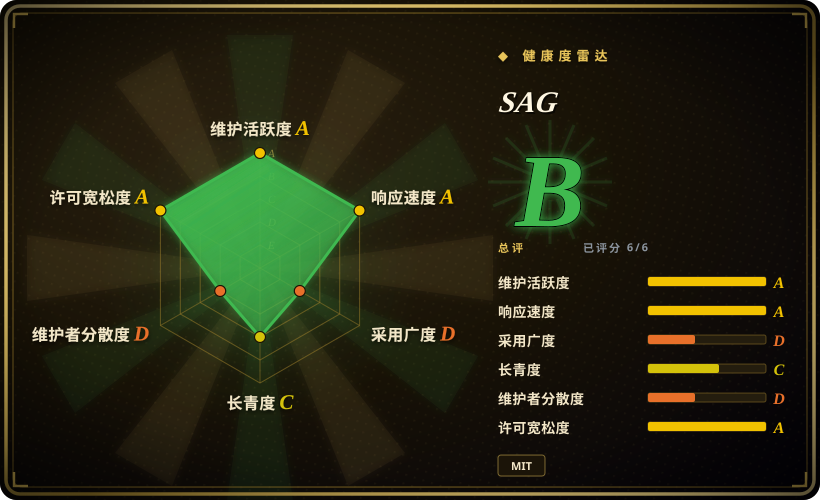
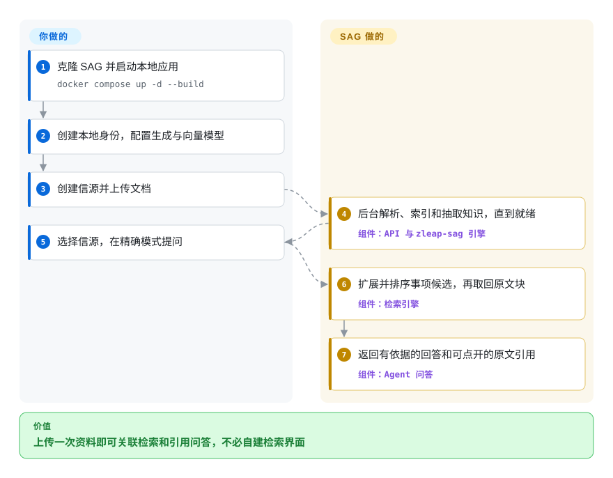
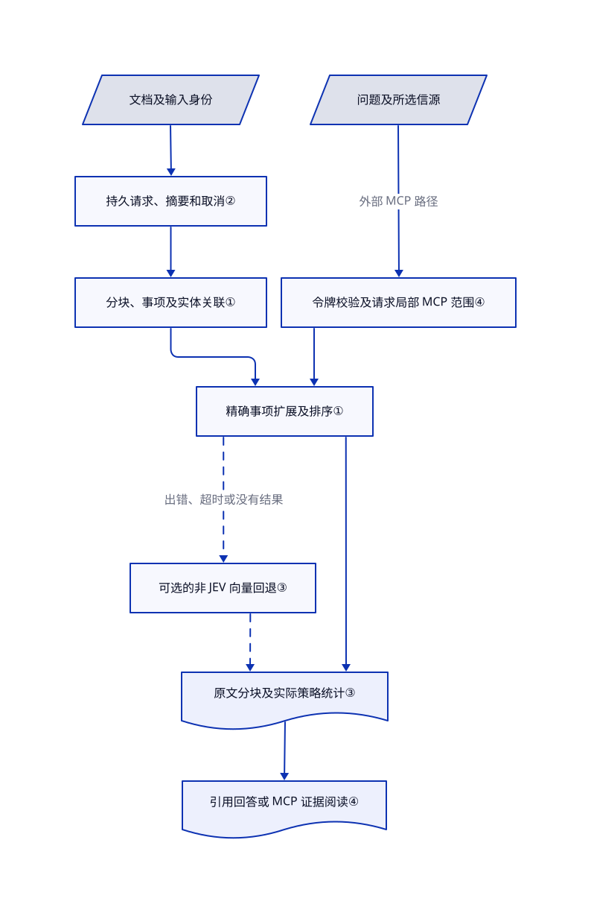

# SAG

搜索找到了相关段落，却漏掉另一份文档里的解释。SAG 用共同实体连接抽取出的知识，再把原文证据交回本地知识库界面。

## 何时使用

你在维护个人研究资料库，或给团队做内部原型。资料里有手册、报告和笔记。问“哪家供应商换了这个部件，为什么”，答案需要拼接几份文档；普通相似度检索却只返回部件说明。你想尝试按事项和实体找关联，又不想自己拼图数据库、上传界面和引用查看器。SAG 提供完整应用、本地 SQLite／LanceDB 存储、搜索、带引用问答，以及供其他 agent 调用的标准工具接口 MCP。

当跨文档关联比单篇目录导航更重要时，可以选它而不是 PageIndex。当你想要事项／实体表示和完整个人工作台，而不是预先建好的实体关系图时，可以选它而不是 LightRAG。代价是模型抽取、独立版本的引擎依赖，以及单用户应用边界。默认快速向量策略不会走完整的事项扩展路径；评估这项价值时，要明确选择“精确”模式。

## 何时不用

- **不同用户必须隔离知识。** 选面向工作区的 [Dify](../../agent-frameworks/workflow-builders/dify.zh.md)，同时核对版本、权限能力和许可证。SAG 明确面向单用户；HTTP MCP 包装层校验令牌后，默认加载全部信源，除非指定 `source_id`。这个参数缩小查询范围，不代表逐用户授权。默认只填名字的登录方式不能暴露给不可信网络。
- **只有少量目录清晰的长 PDF，而且不想维护向量索引。** 选沿文档树导航的 [PageIndex](pageindex.zh.md)。SAG 即使面对结构很好的文档，仍要承担向量生成、事项／实体抽取，以及索引维护成本。
- **应用需要可长期保存、编辑的实体关系知识图谱。** 评估把图谱作为持久检索对象的 [LightRAG](https://github.com/HKUDS/LightRAG)。SAG 的事项／实体关联服务于证据检索；图谱查看器和查询时局部扩展，不等于通用图数据库管理界面。

## 横向对比

| 替代品 | 是否收录 | 我们的评价 | 取舍 |
|---|---|---|---|
| [LightRAG](https://github.com/HKUDS/LightRAG) | 未收录 | 个人证据工作台想围绕事项组织资料，选 SAG；应用更重视显式实体关系图和图／向量后端选择，选 LightRAG。 | SAG 用 SQLite／LanceDB 起步，并带桌面和网页产品；LightRAG 维护图、向量、键值及文档状态存储。该项目本轮标签批次不新增（not added in this tab batch）。 |
| [PageIndex](pageindex.zh.md) | ✅ | 沿长文档章节推理、不要向量索引，选 PageIndex；更看重跨文档实体关联和共享检索工作台，选 SAG。 | PageIndex 的本地开源库围绕文档树；SAG 带导入、原文核对和 MCP，但需要向量与抽取模型。 |
| [Dify](../../agent-frameworks/workflow-builders/dify.zh.md) | ✅ | 团队要搭建和发布多个 AI 工作流，选 Dify；交付物是一个可核对证据的个人知识库，选 SAG。 | Dify 用更大的服务栈和定制许可证换取工作流设计；SAG 采用 MIT、本地优先，但默认应用不是租户隔离平台。 |

## 快速上手

克隆仓库并进入 `SAG`，用 Docker Compose v2 执行 `docker compose up -d --build`。打开 `http://localhost:3000`，创建本地身份，在“设置 → 模型”配置生成和向量模型连接。你负责文档、模型凭据和推理费用；SAG 在后台解析、建立索引并抽取知识。创建信源后上传文档，等状态变成“就绪”，不要把上传受理当作索引成功。限定信源提问，并点开引用核对原文；评估事项／实体扩展时切到“精确”模式。备份 `sagdata` 卷并保留默认本机绑定；开放远程访问前，要配置密码模式、HTTPS 和强密钥。

<!-- flow-steps:begin (generated from flows/sag.json by tools/flow_card.py — do not edit) -->

流程文字版

1. **你**：克隆 SAG 并启动本地应用 — `docker compose up -d --build`
2. **你**：创建本地身份，配置生成与向量模型
3. **你**：创建信源并上传文档
4. **SAG**：后台解析、索引和抽取知识，直到就绪 — 组件：`API 与 zleap-sag 引擎`
5. **你**：选择信源，在精确模式提问
6. **SAG**：扩展并排序事项候选，再取回原文块 — 组件：`检索引擎`
7. **SAG**：返回有依据的回答和可点开的原文引用 — 组件：`Agent 问答`

**价值**：上传一次资料即可关联检索和引用问答，不必自建检索界面

<!-- flow-steps:end -->

## 技术要点

<!-- mechanism:begin (generated from mechanisms/sag.json by tools/mechanism_card.py; do not edit) -->

机制文字版

- 文档及输入身份
- 持久请求、摘要和取消②
- 分块、事项及实体关联①
- 问题及所选信源
- 令牌校验及请求局部 MCP 范围④
- 精确事项扩展及排序①
- 可选的非 JEV 向量回退③
- 原文分块及实际策略统计③
- 引用回答或 MCP 证据阅读④

- 文档及输入身份 → 持久请求、摘要和取消②
- 持久请求、摘要和取消② → 分块、事项及实体关联①
- 问题及所选信源 → 令牌校验及请求局部 MCP 范围④（外部 MCP 路径）
- 令牌校验及请求局部 MCP 范围④ → 精确事项扩展及排序①
- 分块、事项及实体关联① → 精确事项扩展及排序①
- 精确事项扩展及排序① → 可选的非 JEV 向量回退③（出错、超时或没有结果）〔可选／兜底〕
- 精确事项扩展及排序① → 原文分块及实际策略统计③
- 可选的非 JEV 向量回退③ → 原文分块及实际策略统计③〔可选／兜底〕
- 原文分块及实际策略统计③ → 引用回答或 MCP 证据阅读④

<!-- mechanism:end -->

### 1. 先扩展事项候选，再返回对应原文

- **解决：** 含义相近的分块，可能漏掉回答跨文档问题所需的关联。
- **做法：** 应用把“精确”策略 `multi` 映射成引擎的 `full_expand`。公开发布的 0.15.0 引擎先召回事项和实体，沿带向量评分的事项／实体关联扩展，再排序事项、取回对应原文块；结果不足时可用直接查询的分块补齐。
- **边界：** 当前生产执行器不等于 README 对论文的“SQL 连接”简述。扩展受阈值和候选配额限制；默认向量策略会跳过它。找到事项路径也不保证回答正确。
- **源码：** [应用策略映射](https://github.com/Zleap-AI/SAG/blob/d3c882e676a01f59b64b639880b2bfceaa504da6/apps/api/sag_api/sag/engine_manager.py#L311-L373)；[0.15.0 已发布源码包](https://files.pythonhosted.org/packages/2c/2d/672e64596fc17053e14354b3d218fc6638cbb30e6629a56eb1ae98e4b109/zleap_sag-0.15.0.tar.gz) 内的 `src/zleap/sag/modules/search/production.py:59–127,239–339` 和 `graph.py:239–289`。

### 2. 用持久输入身份绑定文档处理

- **解决：** 长导入任务重试时，不能混淆文档版本或丢失处理进度。
- **做法：** 适配层用输入标识、原文件哈希和请求摘要构建持久处理请求。引擎拥有操作结果；应用观察解析、切块、索引和抽取阶段，并在用户暂停时传入取消令牌。
- **边界：** 取消和持久化由引擎合同负责，不表示所有失败都会自动续跑。应用允许每块最多 20 个事项，并限制实体数和并发；“每块一个事项”不是这个应用的硬约束。
- **源码：** [抽取限制和持久请求](https://github.com/Zleap-AI/SAG/blob/d3c882e676a01f59b64b639880b2bfceaa504da6/apps/api/sag_api/sag/incremental_processor.py#L89-L169)、[进度和取消](https://github.com/Zleap-AI/SAG/blob/d3c882e676a01f59b64b639880b2bfceaa504da6/apps/api/sag_api/sag/incremental_processor.py#L171-L230)。

### 3. 告诉调用方实际走了哪条检索路径

- **解决：** 请求成功，仍可能掩盖精确检索超时或部分信源失败。
- **做法：** 非 JEV 精确检索出错、超时或没有结果时，可回退向量检索，同时返回请求策略、实际策略和降级状态。多源检索限制并发，按信源和分块标识去重；JEV 是可选的外部证据评分服务，任一信源失败会取消其他搜索。
- **边界：** 非 JEV 路径可以记录并跳过失败信源，所以聚合结果不一定覆盖所有请求信源。全局检索也限制候选信源数；重视完整性时，要明确选择信源。关闭向量回退只改变错误行为，不保证检索准确。
- **源码：** [单信源回退](https://github.com/Zleap-AI/SAG/blob/d3c882e676a01f59b64b639880b2bfceaa504da6/apps/api/sag_api/sag/search_reader.py#L145-L236)、[有界并发和合并](https://github.com/Zleap-AI/SAG/blob/d3c882e676a01f59b64b639880b2bfceaa504da6/apps/api/sag_api/sag/search_reader.py#L238-L393)。

### 4. 给 agent 证据阅读工具，而不只有问答接口

- **解决：** 外部 agent 需要核对引用及上下文，不能只相信一个不透明的生成答案。
- **做法：** 八个只读 MCP 工具支持列信源和文档、搜索、查实体、看目录、精确匹配、按行读原文及取分块。搜索附带分块标识，后续读取限定在请求所选信源内。HTTP 调用要求持有令牌，并用请求局部上下文绑定信源范围。
- **边界：** 只读注解仅描述这些知识工具，不代表整个 Agent 运行时或其他集成只读。信源范围不等于租户隔离。部分查询会把后端异常转为空结果，因此“没找到”不总能证明资料里没有这条事实。
- **源码：** [工具与证据标识](https://github.com/Zleap-AI/SAG/blob/d3c882e676a01f59b64b639880b2bfceaa504da6/apps/api/sag_api/mcp/server.py#L37-L169)、[检索与读取](https://github.com/Zleap-AI/SAG/blob/d3c882e676a01f59b64b639880b2bfceaa504da6/apps/api/sag_api/mcp/server.py#L203-L455)、[HTTP 认证及范围](https://github.com/Zleap-AI/SAG/blob/d3c882e676a01f59b64b639880b2bfceaa504da6/apps/api/sag_api/mcp/mount.py#L61-L87)。

## 技术栈

- Python 3.11+ 后端，使用 FastAPI、SQLAlchemy、Pydantic、LiteLLM 和 MCP 1.x；`zleap-sag==0.15.0` 提供索引和检索引擎。
- TypeScript 前端，使用 Next.js 15.5.20、React 19、Tailwind 和 Three.js；Electron 把同一应用打包成桌面客户端。
- 本地存储是应用 SQLite，加引擎 SQLite／LanceDB。可选 Compose 覆盖配置使用 PostgreSQL／pgvector；其他引擎后端需安装对应扩展依赖。
- 文档默认用 MarkItDown 归一化；可选 MinerU 文字识别和文档解析，以及 AnyDoc 本地转换。见[后端依赖](https://github.com/Zleap-AI/SAG/blob/d3c882e676a01f59b64b639880b2bfceaa504da6/apps/api/pyproject.toml#L1-L51)和[前端清单](https://github.com/Zleap-AI/SAG/blob/d3c882e676a01f59b64b639880b2bfceaa504da6/apps/web/package.json)。

## 依赖

- 自托管文档路径需要 Docker 和 Compose v2；源码开发需要 Python 3.11+、Node 20+。默认 Compose 仅运行 API 和网页服务，不需要外部数据库。
- 索引、抽取和生成回答，需要可用的向量及语言模型服务。界面能在没凭据时启动，不代表核心功能无需模型。文档或查询会发送给配置的服务商；本地存储不等于离线推理。
- 可选 MinerU 和 JEV 各有服务地址及凭据。当前 JEV 支持 LanceDB／Elasticsearch，不支持 pgvector。
- `sagdata` 持久卷保存元数据、知识索引和上传文件。切换向量模型需要重建受影响索引，不能用新模型解释旧向量。默认值和外发配置见 [Compose](https://github.com/Zleap-AI/SAG/blob/d3c882e676a01f59b64b639880b2bfceaa504da6/compose.yaml)。

## 运维难度

**中等。** 个人实例只有两个 Compose 服务及本地数据库，但导入异步运行且消耗模型调用。要监控任务状态、抽取并发、模型限流及磁盘增长，并一起备份数据库、索引和上传文件。持久化模型设置优先于初始环境变量，除非开启部署锁定；修改浏览器 API 地址需要重建网页服务。不兼容的旧工作区需要明确备份、重建和重新上传，不是透明迁移。远程使用还要配置密码认证、强密钥及网络保护，不能只改监听地址。见[运维与升级说明](https://github.com/Zleap-AI/SAG/blob/d3c882e676a01f59b64b639880b2bfceaa504da6/README.md)及[旧工作区变更](https://github.com/Zleap-AI/SAG/blob/d3c882e676a01f59b64b639880b2bfceaa504da6/CHANGELOG.md#L36-L41)。

## 健康度与可持续性

- **维护，截至 2026-10-21：** 未归档，应用 v1.9.1 于 10 月 19 日发布，所读主分支提交也在当天。仓库整体推送活动发生于 10 月 21 日，不代表主分支提交日期。引擎独立锁定 0.15.0；应用与引擎升级应分别检查兼容性。
- **自动信号，2026-10-21：** 雷达综合为 B，六个轴均已测量。响应为 A，31 个有效问题的首次响应中位数为 24 小时；采用和治理均为 D。维护活跃不能消除治理集中风险，也不能证明广泛采用。
- **治理：** 项目归 Zleap-AI 所有；CODEOWNERS 将全部公开改动交给 `Zleap-Admin`。贡献者接口中，第一贡献者有 176 次记录，管理账号有 38 次。属于贡献集中的厂商维护，不是中立基金会治理。见[维护责任文件](https://github.com/Zleap-AI/SAG/blob/d3c882e676a01f59b64b639880b2bfceaa504da6/.github/CODEOWNERS)。
- **年龄与持续性：** 仓库创建于 2025 年 11 月 7 日，尚不满一年。[推断：依据是仓库年龄、活跃发布和近期工作区重建要求] 适合可回退的个人试用；这段历史还不足以证明存储长期兼容，也不能给出强 Lindy 判断。
- **采用与风险：** 2,613 颗星代表关注，不证明生产采用。应用和引擎源码包均为 MIT、可以检查，但两者独立发布。[问题 #239](https://github.com/Zleap-AI/SAG/issues/239) 报告 fnOS 文件句柄耗尽；[后续工作](https://github.com/Zleap-AI/SAG/pull/245) 记录了清理修复及测试，不保证所有长期负载都已稳定。

## 存疑（未验证）

- [未验证：本次收录禁止执行上游代码] Docker 启动、模型服务兼容性、引用及暂停续跑只做源码核对，没有端到端运行。
- [未验证：没有独立复跑基准] README 的“SOTA”及多跳基准收益属于作者报告，不是本索引测得的选型结果，也不能证明你的资料库准确率。
- [推断：仓库未满一年，且变更记录包含工作区重建] 长期兼容性和运行持续性仍未建立；不可替代的知识数据应先通过可恢复试用再托付。
