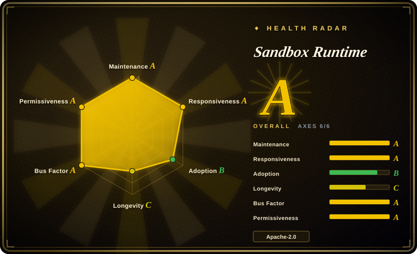
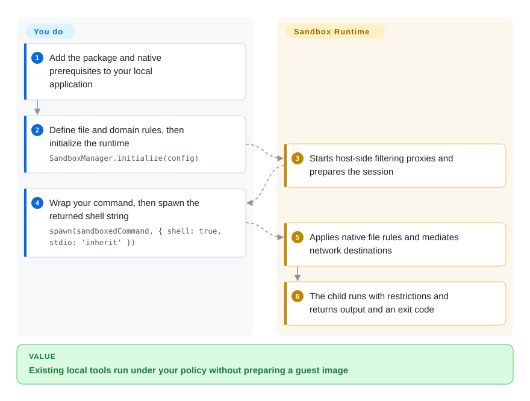
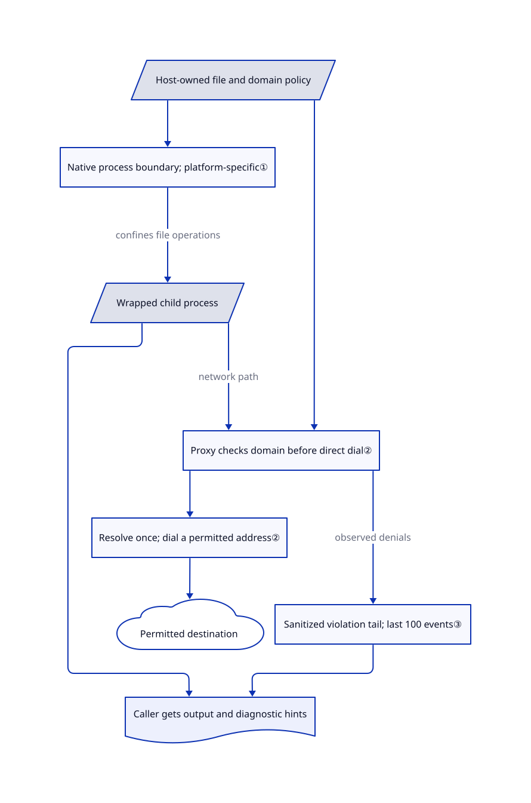

# Sandbox Runtime

Your local agent can run a build, but the same command can also read your home directory or contact an unrelated server. Sandbox Runtime wraps that process in native file-access rules and a filtered network path, without preparing a VM image.

## When to use

You are adding shell execution or a local MCP server, a tool server an agent can call, to a developer application. The tool needs to modify one checkout and fetch from approved hosts, not inherit unrestricted access to your workstation. You want to keep existing executables and local files rather than upload the job into a remote sandbox. Supply filesystem and domain rules, then let SRT construct the platform-specific wrapper and proxy plumbing.

Choose it over a sandbox service when the valuable input is already on the developer's machine and you need a CLI or TypeScript integration, not a fleet API. Choose it over a VM primitive when you accept host-OS confinement and do not need a separate guest kernel. The [reviewed README](https://github.com/anthropics/sandbox-runtime/blob/98a4016d27609ed34dd1fb43d23ed6efb6eeeb77/README.md#L117-L130) is explicit: reads are open by default; protecting secrets requires your own read-deny policy.

## When NOT to use

- **Hostile tenants must not share your host kernel or local identity state.** Prefer [Firecracker](firecracker.md) with an independently hardened platform, or [gVisor](gvisor.md) for container workloads without KVM. SRT is not a separate kernel, and Windows alpha explicitly documents anonymous-token and derived-token network bypasses, SMB/service-mediated traffic gaps, and shared-account read exposure. See [Windows limits](https://github.com/anthropics/sandbox-runtime/blob/98a4016d27609ed34dd1fb43d23ed6efb6eeeb77/README.md#L1000-L1010).
- **You want an execution service with remote environments and lifecycle APIs.** Choose [E2B](e2b.md). SRT wraps local processes; scheduling, job deadlines, resource budgeting and durable output collection remain your integration work.
- **A deny glob must cover secrets created after launch, with identical semantics on every OS.** Use a narrowly populated [Firecracker](firecracker.md) guest filesystem instead. Linux read globs expand against paths present when wrapping; write globs are unsupported, and skipped read patterns hide nothing. Windows expands globs at session initialization. Prefer explicit paths and review [pattern limits](https://github.com/anthropics/sandbox-runtime/blob/98a4016d27609ed34dd1fb43d23ed6efb6eeeb77/README.md#L558-L586).
- **You need a complete, durable execution audit rather than troubleshooting hints.** Use [E2B](e2b.md) as the execution surface with separately protected logging, or retain your own host-side recorder. SRT's violation store holds the last 100 events in memory; it is neither a record of all successful operations nor an independent proof of completion.
- **The workload requires the very escape hatches you intend to constrain.** Consider [gVisor](gvisor.md) after compatibility testing, rather than quietly weakening SRT. Linux nested user namespaces can defeat write-deny mounts; macOS Apple Events can launch applications outside the boundary. Windows Schannel-based HTTPS clients do not work under the restricted token. These are [documented tradeoffs](https://github.com/anthropics/sandbox-runtime/blob/98a4016d27609ed34dd1fb43d23ed6efb6eeeb77/README.md#L588-L602), not permission errors to suppress automatically.

## Comparison

| Alternative | In index | Our verdict | Tradeoff |
|---|---|---|---|
| [gVisor](gvisor.md) | ✅ | Choose gVisor for untrusted Linux containers whose system calls should be handled by a userspace kernel; choose SRT for local commands that must keep direct access to selected workstation files. | gVisor adds a container runtime and syscall-compatibility work; SRT integrates as a wrapper but keeps the host kernel as its enforcement base. |
| [Firecracker](firecracker.md) | ✅ | Choose Firecracker when the boundary must be a separate guest kernel; choose SRT when preparing guest images and a VM lifecycle is disproportionate to restricting a local build. | Firecracker requires KVM-capable Linux, guest images and orchestration; SRT uses native host primitives and cannot offer that hardware boundary. |
| [E2B](e2b.md) | ✅ | Choose E2B when your application needs an API to create disposable remote execution environments; choose SRT when code and approved files should stay on the workstation. | E2B moves execution into a hosted or self-operated platform; SRT avoids that platform but leaves process supervision, policy and evidence retention to you. |

## Quick start

For the CLI, the documented install is `npm install -g @anthropic-ai/sandbox-runtime`; supply a settings file with `srt --settings /path/to/srt-settings.json npm install` rather than assuming its defaults protect your home directory. For the library path shown below, add the same package to your Node application, import `SandboxManager`, and provide `network.allowedDomains`, `filesystem.denyRead`, `allowWrite` and `denyWrite` as in the [real usage example](https://github.com/anthropics/sandbox-runtime/blob/98a4016d27609ed34dd1fb43d23ed6efb6eeeb77/README.md#L261-L300). Call `initialize(config)`, await `wrapWithSandbox` for your command, and execute the returned shell string with Node's `spawn`; SRT prepares restrictions but does not execute that string for you. You receive normal child-process output and an exit code; your application owns timeouts, cancellation, input quoting and output storage. Wait for children to end before `reset()` releases session resources; long-lived Linux embedders should also use the documented `cleanupAfterCommand()` after each finished command, while Windows retained grants require explicit removal when no longer wanted.

<!-- flow-steps:begin (generated from flows/sandbox-runtime.json by tools/flow_card.py — do not edit) -->

Text version of the flow

1. **You**: Add the package and native prerequisites to your local application
2. **You**: Define file and domain rules, then initialize the runtime — `SandboxManager.initialize(config)`
3. **Sandbox Runtime**: Starts host-side filtering proxies and prepares the session
4. **You**: Wrap your command, then spawn the returned shell string — `spawn(sandboxedCommand, { shell: true, stdio: 'inherit' })`
5. **Sandbox Runtime**: Applies native file rules and mediates network destinations
6. **Sandbox Runtime**: The child runs with restrictions and returns output and an exit code

**Value**: Existing local tools run under your policy without preparing a guest image

<!-- flow-steps:end -->

## Key techniques

<!-- mechanism:begin (generated from mechanisms/sandbox-runtime.json by tools/mechanism_card.py; do not edit) -->

Text version of the mechanism

- Host-owned file and domain policy
- Native process boundary; platform-specific①
- Wrapped child process
- Proxy checks domain before direct dial②
- Resolve once; dial a permitted address②
- Permitted destination
- Sanitized violation tail; last 100 events③
- Caller gets output and diagnostic hints

- Host-owned file and domain policy → Native process boundary; platform-specific①
- Native process boundary; platform-specific① → Wrapped child process (confines file operations)
- Wrapped child process → Proxy checks domain before direct dial② (network path)
- Host-owned file and domain policy → Proxy checks domain before direct dial②
- Proxy checks domain before direct dial② → Resolve once; dial a permitted address②
- Resolve once; dial a permitted address② → Permitted destination
- Proxy checks domain before direct dial② → Sanitized violation tail; last 100 events③ (observed denials)
- Sanitized violation tail; last 100 events③ → Caller gets output and diagnostic hints
- Wrapped child process → Caller gets output and diagnostic hints

<!-- mechanism:end -->

### 1. Compile one policy into native process restrictions

- **Problem:** A proxy environment variable alone does not stop a program from opening a direct socket or modifying another directory.
- **How:** macOS generates a Seatbelt profile starting with default deny, then emits read/write and proxy-port rules. Linux builds a read-only root with writable bind mounts for allowed paths, isolates network and process namespaces, and bridges proxy sockets into the sandbox.
- **Limits:** Read policy still starts permissive unless configured. Linux Unix-socket filtering depends on the seccomp helper; missing helpers warn and reduce protection. Native rules differ across OSes, and inherited socket descriptors are not removed by blocking new socket creation.
- **Source:** [macOS profile](https://github.com/anthropics/sandbox-runtime/blob/98a4016d27609ed34dd1fb43d23ed6efb6eeeb77/src/sandbox/macos-sandbox-utils.ts#L1047-L1093), [proxy-port rules](https://github.com/anthropics/sandbox-runtime/blob/98a4016d27609ed34dd1fb43d23ed6efb6eeeb77/src/sandbox/macos-sandbox-utils.ts#L1255-L1365), [Linux mounts](https://github.com/anthropics/sandbox-runtime/blob/98a4016d27609ed34dd1fb43d23ed6efb6eeeb77/src/sandbox/linux-sandbox-utils.ts#L2433-L2501), [helper limits and namespaces](https://github.com/anthropics/sandbox-runtime/blob/98a4016d27609ed34dd1fb43d23ed6efb6eeeb77/src/sandbox/linux-sandbox-utils.ts#L3500-L3824).

### 2. Check both destination names and the addresses actually dialed

- **Problem:** An allowed hostname can resolve to the host's loopback address or a cloud metadata endpoint.
- **How:** The manager checks denied domains before allowed domains. For direct hostname connections, the address guard resolves once, removes forbidden results, and returns the surviving address to the connection's lookup callback, avoiding a second lookup between checking and dialing.
- **Limits:** Explicitly allowed IP literals are deliberate exceptions; private address space is not blocked by default. Parent and MITM proxies own their own DNS policy. Opening local binding can create a path that bypasses this proxy check.
- **Source:** [name-policy ordering](https://github.com/anthropics/sandbox-runtime/blob/98a4016d27609ed34dd1fb43d23ed6efb6eeeb77/src/sandbox/sandbox-manager.ts#L750-L837), [guard scope and exclusions](https://github.com/anthropics/sandbox-runtime/blob/98a4016d27609ed34dd1fb43d23ed6efb6eeeb77/src/sandbox/resolved-address-guard.ts#L1-L76), [filtered lookup](https://github.com/anthropics/sandbox-runtime/blob/98a4016d27609ed34dd1fb43d23ed6efb6eeeb77/src/sandbox/resolved-address-guard.ts#L199-L308).

### 3. Return bounded, sanitized violation hints to the caller

- **Problem:** A failed command gives an agent little explanation, while raw filenames and denial reasons can inject misleading markup into its feedback.
- **How:** The violation store removes control characters and angle brackets from event lines, keeps a 100-event tail, and lets the caller retrieve events associated with a command key. The library supports an explicit per-invocation command identifier to avoid conflating repeated command text.
- **Limits:** This is bounded diagnostic memory, not durable audit storage. Attribution keys use their first 100 characters, and client-carried identities are not a security boundary between concurrent invocations. Persist trustworthy records separately.
- **Source:** [store and sanitization](https://github.com/anthropics/sandbox-runtime/blob/98a4016d27609ed34dd1fb43d23ed6efb6eeeb77/src/sandbox/sandbox-violation-store.ts#L8-L74), [text cleanup](https://github.com/anthropics/sandbox-runtime/blob/98a4016d27609ed34dd1fb43d23ed6efb6eeeb77/src/sandbox/sandbox-violation-store.ts#L112-L149), [attribution contract](https://github.com/anthropics/sandbox-runtime/blob/98a4016d27609ed34dd1fb43d23ed6efb6eeeb77/README.md#L302-L383).

## Tech stack

- TypeScript ESM library and Commander CLI; Node.js `>=22.12.0` in the reviewed manifest.
- Runtime dependencies: `@pondwader/socks5-server`, `commander`, `node-forge` and `zod`. Native helpers include Linux C/seccomp code, a Java proxy agent, and a Rust Windows helper.
- The repository includes platform integration tests and property tests; reading them does not establish that they pass on your machine.

## Dependencies

- macOS: the system `sandbox-exec` facility and ripgrep for deny-path discovery. Linux: bubblewrap, socat, ripgrep and usable user namespaces; host AppArmor restrictions may require an administrator-approved profile.
- The npm distribution bundles x64/ARM64 Linux seccomp helpers and Windows helpers. Source builds of those components need their own native toolchains; ordinary library use does not require building them.
- Windows alpha needs an elevated machine-wide install. It creates an account, network filters and persistent state; profile read grants can expose feed-token configuration and shared project roots. Read the install and removal contract before authorizing it.
- No model, API key, database or hosted SRT service is required. Any model or tool server you wrap remains a separate dependency.

## Ops difficulty

**Medium for a single-user macOS/Linux integration; high for Windows or shared hosts.** Installing the wrapper is easier than maintaining images, but the security policy is yours: enumerate readable secrets, approve domains, handle proxy-incompatible tools, and surface degraded-protection warnings. The reviewed [release notes](https://github.com/anthropics/sandbox-runtime/releases/tag/v0.0.81) require a Windows reinstall and describe fixes to sandbox escape paths. Linux hard kills can leave mount-point placeholders; Windows `reset()` intentionally retains project write grants, and uninstall leaves CA material under ProgramData. Cleanup is an operational procedure, not simply dropping a library reference.

## Health & viability

- **Maintenance, 2026-10-27:** active and not archived; the latest sampled release is v0.0.81 from 2026-10-20, following releases on October 16 and October 7. The reviewed manifest still declares 0.0.81; a reviewed default-branch SHA is not a guarantee that npm has published every change on it.
- **Governance and backing, 2026-10-27:** Anthropic organization-owned, with multiple contributors in the API sample. The fixed tree has no dedicated GOVERNANCE, CONTRIBUTING, SECURITY or CODEOWNERS file. Treat the roadmap as vendor-led, not as a foundation guarantee.
- **Age and judgment, 2026-10-27:** created 2025-10-20, about one year old and still changing. [推断：based on age, release cadence and the explicit preview notice] It is a useful integration candidate, but its short Lindy record and evolving policy APIs argue for pinned versions and regression cases for your own boundaries.
- **Adoption and risk, 2026-10-27:** the README says it was developed for Claude Code; that is upstream-reported use, not an independent deployment audit. Apache-2.0 text names Anthropic; the AWS test vectors retain a provenance README and Amazon NOTICE. Recent [issue/PR samples](https://github.com/anthropics/sandbox-runtime/issues/779) include proxy latency reports and pending fixes, so neither vendor backing nor stars establishes isolation correctness.
- **Score review:** the automatic overall A is a project-health score, not a security certification. The scorer retains `needs_human_review: true`: its dependency-graph count is zero while npm monthly downloads are 2,073,209. This signal disagreement needs manual interpretation; downloads are not a deployment count.

## Caveats (unverified)

- [未验证：upstream execution and dependency installation were prohibited for this intake] The installation, sample commands, isolation and cleanup behavior were reviewed from fixed source, not executed. No escape-resistance, throughput or latency benchmark is claimed.
- [推断：based on native boundary design and the indexed alternatives' opened pages] Comparison verdicts are architectural selection judgments, not head-to-head measurements.
- [未验证：no independent deployment or governance audit was available] Claude Code usage is the upstream statement; future vendor support, deployment scale and maintainer continuity are not guaranteed.
