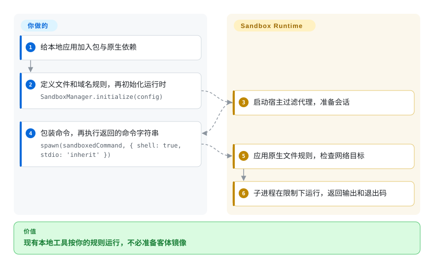
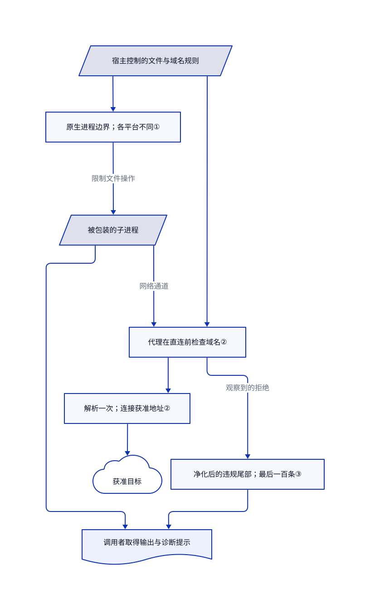

# Sandbox Runtime

你让本地助手跑一次构建，它却也能读取家目录、连接无关服务器。Sandbox Runtime 给这个进程套上系统原生的文件规则和受过滤的网络通道，不必先制作虚拟机镜像。

## 何时使用

你正在给开发工具接入命令执行，或接入 MCP 服务，也就是供助手调用的工具服务。工具需要修改一个工作目录、访问获准主机，却不该拿到整台工作站的权限。你希望沿用本机可执行文件和现有文件，而不是把任务上传到远程沙箱。提供文件规则和域名规则后，SRT 负责构造各平台的执行包装和代理通道。

当重要输入已经在开发者机器上，你需要命令行或 TypeScript 集成，而非机群接口时，优先考虑它而非沙箱服务。当你接受宿主系统级限制、不要求独立客体内核时，它也比虚拟机原语少一层镜像准备。[核验过的说明](https://github.com/anthropics/sandbox-runtime/blob/98a4016d27609ed34dd1fb43d23ed6efb6eeeb77/README.md#L117-L130) 明说默认允许读取文件；保护秘密仍需你制定拒读规则。

## 何时不用

- **恶意租户不能共享宿主内核或本机身份状态。** 优先选择配合独立加固平台的 [Firecracker](firecracker.zh.md)，或在没有 KVM 的容器场景选 [gVisor](gvisor.zh.md)。SRT 没有独立内核。Windows 测试版还明列匿名令牌、派生令牌绕过网络限制的路径，以及 SMB、系统服务代发流量和共享账号的读取暴露。见 [Windows 限制](https://github.com/anthropics/sandbox-runtime/blob/98a4016d27609ed34dd1fb43d23ed6efb6eeeb77/README.md#L1000-L1010)。
- **你要的是远程执行环境和生命周期接口。** 选 [E2B](e2b.zh.md)。SRT 包装本地进程；调度、任务超时、资源预算和输出持久化仍由接入方负责。
- **拒读通配符必须覆盖启动后新建的秘密，且各系统语义完全一致。** 改用仅放入必要文件的 [Firecracker](firecracker.zh.md) 客体文件系统。Linux 在包装命令时展开已有路径的读取通配符，不支持写入通配符；被跳过的拒读模式不隐藏任何文件。Windows 在会话初始化时展开通配符。优先使用明确路径，并阅读 [模式边界](https://github.com/anthropics/sandbox-runtime/blob/98a4016d27609ed34dd1fb43d23ed6efb6eeeb77/README.md#L558-L586)。
- **你需要完整、持久的执行审计，而非排错提示。** 用 [E2B](e2b.zh.md) 承接执行并另接受保护的日志，或自行保留宿主侧记录器。SRT 的违规存储只保留内存中最后一百条事件，既不记录全部成功操作，也不是独立的完成证明。
- **负载必须打开你原本要限制的逃生口。** 兼容性验证后可考虑 [gVisor](gvisor.zh.md)，不要静默放宽 SRT。Linux 的嵌套用户命名空间会削弱拒写挂载；macOS 的 Apple Events 能启动边界外的应用。Windows 受限令牌无法运行依赖 Schannel 的 HTTPS 客户端。这些都是 [明示取舍](https://github.com/anthropics/sandbox-runtime/blob/98a4016d27609ed34dd1fb43d23ed6efb6eeeb77/README.md#L588-L602)，不是应自动忽略的权限错误。

## 横向对比

| 替代品 | 是否收录 | 我们的评价 | 取舍 |
|---|---|---|---|
| [gVisor](gvisor.zh.md) | 已收录 | 不可信 Linux 容器需要由用户态内核处理系统调用时，选 gVisor；本地命令必须直接访问部分工作站文件时，选 SRT。 | gVisor 增加容器运行时和系统调用兼容性工作；SRT 以包装器接入，但执行边界仍依赖宿主内核。 |
| [Firecracker](firecracker.zh.md) | 已收录 | 边界必须包含独立客体内核时，选 Firecracker；只限制本地构建、不值得准备镜像和虚拟机生命周期时，选 SRT。 | Firecracker 要求支持 KVM 的 Linux、客体镜像和编排；SRT 使用原生宿主机制，无法提供同样的硬件边界。 |
| [E2B](e2b.zh.md) | 已收录 | 应用需要通过接口创建一次性远程执行环境时，选 E2B；代码和获准文件应留在工作站时，选 SRT。 | E2B 把执行移入托管或自营平台；SRT 省去该平台，但进程监管、规则和证据保留归你。 |

## 快速上手

命令行的文档安装方式是 `npm install -g @anthropic-ai/sandbox-runtime`；使用 `srt --settings /path/to/srt-settings.json npm install` 提供配置，不要假设默认设置保护家目录。下图走库接入路径：把同一包加入 Node 应用，导入 `SandboxManager`，按 [真实示例](https://github.com/anthropics/sandbox-runtime/blob/98a4016d27609ed34dd1fb43d23ed6efb6eeeb77/README.md#L261-L300) 提供允许访问的域名、拒读路径、可写路径和拒写路径。先调用 `initialize(config)`，再等待 `wrapWithSandbox` 返回命令字符串，最后用 Node 的 `spawn` 执行；SRT 负责准备限制，不替你执行字符串。结果是普通子进程输出和退出码，超时、取消、输入转义和输出保存仍由应用负责。等子进程结束后再调用 `reset()` 释放会话资源；长期运行的 Linux 接入方还应在每条命令结束后调用文档中的 `cleanupAfterCommand()`，Windows 的保留授权则需在不再使用时显式撤销。

<!-- flow-steps:begin (generated from flows/sandbox-runtime.json by tools/flow_card.py — do not edit) -->

流程文字版

1. **你**：给本地应用加入包与原生依赖
2. **你**：定义文件和域名规则，再初始化运行时 — `SandboxManager.initialize(config)`
3. **Sandbox Runtime**：启动宿主过滤代理，准备会话
4. **你**：包装命令，再执行返回的命令字符串 — `spawn(sandboxedCommand, { shell: true, stdio: 'inherit' })`
5. **Sandbox Runtime**：应用原生文件规则，检查网络目标
6. **Sandbox Runtime**：子进程在限制下运行，返回输出和退出码

**价值**：现有本地工具按你的规则运行，不必准备客体镜像

<!-- flow-steps:end -->

## 技术要点

<!-- mechanism:begin (generated from mechanisms/sandbox-runtime.json by tools/mechanism_card.py; do not edit) -->

机制文字版

- 宿主控制的文件与域名规则
- 原生进程边界；各平台不同①
- 被包装的子进程
- 代理在直连前检查域名②
- 解析一次；连接获准地址②
- 获准目标
- 净化后的违规尾部；最后一百条③
- 调用者取得输出与诊断提示

- 宿主控制的文件与域名规则 → 原生进程边界；各平台不同①
- 原生进程边界；各平台不同① → 被包装的子进程（限制文件操作）
- 被包装的子进程 → 代理在直连前检查域名②（网络通道）
- 宿主控制的文件与域名规则 → 代理在直连前检查域名②
- 代理在直连前检查域名② → 解析一次；连接获准地址②
- 解析一次；连接获准地址② → 获准目标
- 代理在直连前检查域名② → 净化后的违规尾部；最后一百条③（观察到的拒绝）
- 净化后的违规尾部；最后一百条③ → 调用者取得输出与诊断提示
- 被包装的子进程 → 调用者取得输出与诊断提示

<!-- mechanism:end -->

### 1. 把同一套规则编译为原生进程限制

- **解决：** 只设置代理环境变量，挡不住程序直接打开网络连接或修改别的目录。
- **做法：** macOS 先生成默认拒绝的 Seatbelt 规则，再加入读写和代理端口规则。Linux 从只读根目录开始，为允许路径加入可写挂载，并隔离网络和进程命名空间，再把代理套接字桥接进沙箱。
- **边界：** 未配置时仍默认允许读取。Linux 的本地套接字过滤依赖 seccomp 辅助程序，缺失时会告警并降低保护。各系统规则不同，禁止新建套接字也不会撤销已继承的套接字描述符。
- **源码：** [macOS 规则](https://github.com/anthropics/sandbox-runtime/blob/98a4016d27609ed34dd1fb43d23ed6efb6eeeb77/src/sandbox/macos-sandbox-utils.ts#L1047-L1093)、[代理端口规则](https://github.com/anthropics/sandbox-runtime/blob/98a4016d27609ed34dd1fb43d23ed6efb6eeeb77/src/sandbox/macos-sandbox-utils.ts#L1255-L1365)、[Linux 挂载](https://github.com/anthropics/sandbox-runtime/blob/98a4016d27609ed34dd1fb43d23ed6efb6eeeb77/src/sandbox/linux-sandbox-utils.ts#L2433-L2501)、[辅助程序边界和命名空间](https://github.com/anthropics/sandbox-runtime/blob/98a4016d27609ed34dd1fb43d23ed6efb6eeeb77/src/sandbox/linux-sandbox-utils.ts#L3500-L3824)。

### 2. 同时检查目标域名和实际连接地址

- **解决：** 获准域名可能解析到宿主回环地址或云元数据接口。
- **做法：** 管理器先检查拒绝域名，再检查允许域名。直接连接主机名时，地址检查器只解析一次，剔除不允许的结果，再把存活地址交给连接的解析回调，避免检查后重新解析。
- **边界：** 显式允许的 IP 是有意放行；默认不拒绝全部私网。上级代理和中间人代理自行负责解析规则。开放本地绑定还可能产生绕过代理检查的路径。
- **源码：** [域名规则顺序](https://github.com/anthropics/sandbox-runtime/blob/98a4016d27609ed34dd1fb43d23ed6efb6eeeb77/src/sandbox/sandbox-manager.ts#L750-L837)、[地址检查范围](https://github.com/anthropics/sandbox-runtime/blob/98a4016d27609ed34dd1fb43d23ed6efb6eeeb77/src/sandbox/resolved-address-guard.ts#L1-L76)、[过滤解析结果](https://github.com/anthropics/sandbox-runtime/blob/98a4016d27609ed34dd1fb43d23ed6efb6eeeb77/src/sandbox/resolved-address-guard.ts#L199-L308)。

### 3. 把有界、净化后的违规提示交回调用者

- **解决：** 命令失败时助手缺少解释，而原始文件名和拒绝原因又可能向反馈中注入误导标记。
- **做法：** 违规存储移除事件行中的控制字符和尖括号，保留最后一百条事件，并允许调用者按命令键取回记录。库支持为每次调用指定独立命令标识，避免把重复命令文本混在一起。
- **边界：** 这是有界诊断内存，不是持久审计存储。归因键只取前一百个字符，客户端携带的身份也不是并发调用之间的安全边界。可信记录需另外持久化。
- **源码：** [存储和净化](https://github.com/anthropics/sandbox-runtime/blob/98a4016d27609ed34dd1fb43d23ed6efb6eeeb77/src/sandbox/sandbox-violation-store.ts#L8-L74)、[文本清理](https://github.com/anthropics/sandbox-runtime/blob/98a4016d27609ed34dd1fb43d23ed6efb6eeeb77/src/sandbox/sandbox-violation-store.ts#L112-L149)、[归因契约](https://github.com/anthropics/sandbox-runtime/blob/98a4016d27609ed34dd1fb43d23ed6efb6eeeb77/README.md#L302-L383)。

## 技术栈

- TypeScript ESM 库和 Commander 命令行；核验的清单要求 Node.js `>=22.12.0`。
- 运行依赖包括 `@pondwader/socks5-server`、`commander`、`node-forge` 和 `zod`。原生辅助组件包含 Linux C／seccomp 代码、Java 代理组件及 Rust Windows 程序。
- 仓库包含平台集成测试和性质测试；读过测试不等于证明它们能在你的机器上通过。

## 依赖

- macOS 需要系统自带的 `sandbox-exec`，以及发现拒绝路径所需的 ripgrep。Linux 需要 bubblewrap、socat、ripgrep 和可用的用户命名空间；宿主 AppArmor 限制可能需要管理员批准的专用规则。
- npm 分发包包含 x64／ARM64 的 Linux seccomp 辅助程序和 Windows 辅助程序。自行编译这些组件才需要各自的原生工具链，普通库调用不要求重编译。
- Windows 测试版需要提权执行全机器安装。安装会创建账号、网络过滤器和持久状态；用户目录读取授权可能暴露包源令牌配置及共享项目目录。授权前先读安装和撤销契约。
- SRT 不要求模型、API 密钥、数据库或托管服务。被包装的模型或工具服务仍是独立依赖。

## 运维难度

**单用户 macOS／Linux 集成为中等；Windows 或共享宿主为高。** 安装包装器比维护镜像简单，但安全规则仍归你：列出不可读秘密、批准域名、处理不兼容代理的工具，并展示保护降级告警。核验的 [发布说明](https://github.com/anthropics/sandbox-runtime/releases/tag/v0.0.81) 要求 Windows 重装，还描述了沙箱逃逸路径的修复。Linux 强杀可能留下挂载占位文件；Windows 的 `reset()` 有意保留项目写入授权，卸载仍留下 ProgramData 中的证书材料。清理是一套操作流程，不是丢掉库引用就结束。

## 健康度与可持续性

- **维护，2026-10-27：** 活跃且未归档。抽样最新发布为 2026-10-20 的 v0.0.81，此前两次为十月十六日和十月七日。核验清单仍写 0.0.81；核验默认分支提交不表示其中每项改动已发到 npm。
- **治理与支持，2026-10-27：** 归 Anthropic 组织所有，贡献者接口样本包含多人。固定源码树没有专门的治理、贡献、安全政策或代码负责人文件。应按厂商主导的路线图评估，不当作基金会承诺。
- **年龄与判断，2026-10-27：** 2025-10-20 创建，约一年，仍持续变化。[推断：依据是年龄、发布节奏和明确的预览声明] 它值得作为接入候选，但长期记录较短、规则接口仍演化，应固定版本，并为自己的边界准备回归案例。
- **采用与风险，2026-10-27：** README 声明它为 Claude Code 开发，这是上游自述，不是独立部署审计。Apache-2.0 正文署名 Anthropic；AWS 测试向量保留来源说明和 Amazon 通知。近期 [问题与修改样本](https://github.com/anthropics/sandbox-runtime/issues/779) 包含代理延迟报告和待合入修复；厂商支持及星数均不能证明隔离正确。
- **评分复核：** 自动综合 A 是项目健康评分，不是安全认证。评分器保留 `needs_human_review: true`，因为依赖图计数为零，而 npm 月下载量为 2,073,209。信号分歧仍需人工解释，下载量不能当作部署数。

## 存疑（未验证）

- [未验证：本轮禁止执行上游或安装依赖] 安装、示例命令、隔离和清理行为仅依据固定源码核验，未实际执行。不声称逃逸抵抗能力、吞吐或延迟基准。
- [推断：依据是原生边界设计及实际打开的替代品页面] 对比结论是架构选型判断，不是同机对测。
- [未验证：没有独立部署及治理审计材料] Claude Code 使用情况来自上游声明，未来厂商支持、部署规模和维护者连续性不作保证。
