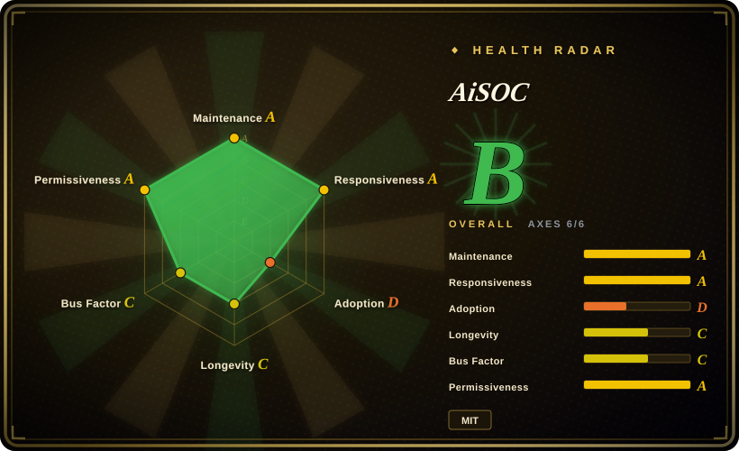
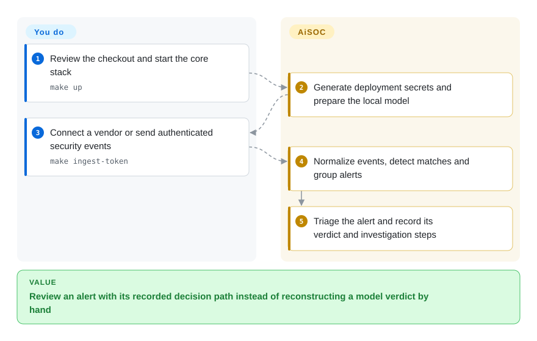
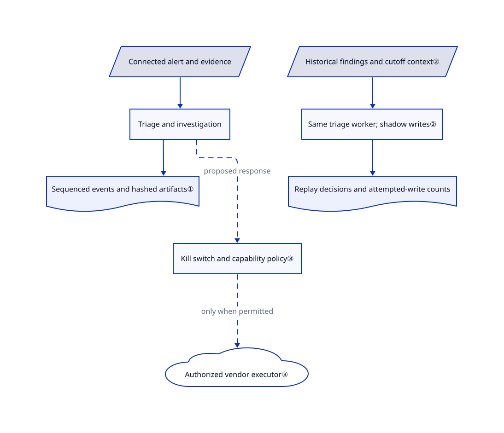

# AiSOC

Your queue contains repeated security alerts, but nobody can reconstruct why an AI dismissed one. AiSOC groups alerts, investigates them, and stores the model's steps beside the verdict.

Source review is pinned to `bd3313b9a2e6c2dcf2567f5e6d15c57d3faf0279`, not the moving default branch. The machine-generated upstream snapshot observes a later default-branch state; its newer source was not reviewed here. Health scores are separately measured repository signals, not security certification.

## When to use

You run a security operations team with alerts arriving from identity, endpoint and cloud tools. An analyst keeps copying the same host and user into several consoles, then has to explain a model's verdict without its original evidence. You want a self-hosted investigation layer that combines incoming events, records agent steps and lets you replay historical analyst decisions before trusting automation.

Choose AiSOC over a workflow-only orchestrator when the bundled detection, triage, investigation ledger and local-model path matter together. You accept a multi-service deployment and human review rather than treating an AI verdict as proof. Keep your existing collection and retention systems: AiSOC's own README explicitly rejects the drop-in SIEM-replacement claim.

## When NOT to use

- **Your first problem is collecting endpoint evidence or file-integrity monitoring.** Start with [Wazuh](https://github.com/wazuh/wazuh), whose endpoint agent and manager do that job. AiSOC cannot investigate telemetry you never connected.
- **You already have detections and only need explicit integration workflows.** Prefer [Shuffle](https://github.com/Shuffle/Shuffle) for its workflow editor and security apps; AiSOC adds a detection/model/data-store stack you must maintain.
- **You need analyst-led case collaboration, not model-led triage.** Prefer [DFIR-IRIS](https://github.com/dfir-iris/iris-web), pinning its stable line rather than its v3 beta. AiSOC's ledger helps inspect an agent; it does not establish that the agent reached a correct conclusion.
- **You require proven high-volume intake without per-connector qualification.** Retain your existing SIEM or Wazuh intake while testing AiSOC in parallel. At the reviewed commit, `push_events` sends the supplied list as one request, while ingest rejects an oversized batch; [issue 1635](https://github.com/beenuar/AiSOC/issues/1635) reports the resulting collector failure, and PR 1640 was still open on 2026-11-02.
- **You require a uniformly MIT, air-gapped, audited appliance.** Prefer an approved Wazuh deployment or your existing platform until you review every data path and dependency. AiSOC's source MIT license does not license Llama weights or imported rules; local model inference does not remove image/model downloads, the default CISA feed or configured vendor requests.

## Comparison

| Alternative | In index | Our verdict | Tradeoff |
|---|---|---|---|
| [Wazuh](https://github.com/wazuh/wazuh) | not indexed | Choose Wazuh for endpoint collection, integrity checks and rule-based monitoring; choose AiSOC when the missing layer is recorded AI investigation over connected alerts. | Wazuh supplies endpoint agents and a manager; AiSOC supplies a model/ledger workflow but does not replace collection or compliance retention. Not added in this tab batch. |
| [Shuffle](https://github.com/Shuffle/Shuffle) | not indexed | Choose Shuffle when analysts want to wire deterministic security workflows; choose AiSOC when detection, model triage and replay must arrive as one stack. | Workflow-first integration avoids adopting AiSOC's investigation architecture; Shuffle's backend is AGPLv3, with separately licensed modular content. Not added in this tab batch. |
| [DFIR-IRIS](https://github.com/dfir-iris/iris-web) | not indexed | Choose IRIS for sharing case evidence among responders; choose AiSOC when reconstructing and evaluating the agent's decisions is central. | IRIS is case-collaboration-first; its current master documents a v3 beta and recommends stable v2.4.29 for production. Not added in this tab batch. |

## Quick start

The documented source-checkout path is `make up` after cloning; review the checkout and installer before running anything, rather than piping a remote installer into a shell. Provide Docker Compose v2, Python 3.9+, Bash, and the README's stated Docker-VM budget of 8 GB RAM and 20 GB free disk. The startup path generates deployment secrets and an administrator password, then pulls a local Ollama model; you sign in at the printed address and supply a vendor connector or post events with the token from `make ingest-token`. AiSOC normalizes the events, creates alerts and produces triage results with an investigation record; you still own connector permissions, model selection, TLS, backups, retention and approval policy. `make smoke` is the upstream's pipeline check, not a test executed for this page. Optional MCP integration currently requires building `services/mcp` from source: its README says the npm package is unpublished, so do not assume `npx @aisoc/mcp` works.

<!-- flow-steps:begin (generated from flows/aisoc.json by tools/flow_card.py — do not edit) -->

Text version of the flow

1. **You**: Review the checkout and start the core stack — `make up`
2. **AiSOC**: Generate deployment secrets and prepare the local model
3. **You**: Connect a vendor or send authenticated security events — `make ingest-token`
4. **AiSOC**: Normalize events, detect matches and group alerts
5. **AiSOC**: Triage the alert and record its verdict and investigation steps

**Value**: Review an alert with its recorded decision path instead of reconstructing a model verdict by hand

<!-- flow-steps:end -->

## Key techniques

<!-- mechanism:begin (generated from mechanisms/aisoc.json by tools/mechanism_card.py; do not edit) -->

Text version of the mechanism

- Connected alert and evidence
- Triage and investigation
- Sequenced events and hashed artifacts①
- Historical findings and cutoff context②
- Same triage worker; shadow writes②
- Replay decisions and attempted-write counts
- Kill switch and capability policy③
- Authorized vendor executor③

- Connected alert and evidence → Triage and investigation
- Triage and investigation → Sequenced events and hashed artifacts①
- Historical findings and cutoff context② → Same triage worker; shadow writes②
- Same triage worker; shadow writes② → Replay decisions and attempted-write counts
- Triage and investigation → Kill switch and capability policy③ (proposed response) [optional/fallback]
- Kill switch and capability policy③ → Authorized vendor executor③ (only when permitted) [optional/fallback]

<!-- mechanism:end -->

### 1. Store investigation steps separately from large artifacts

- **Problem:** A final explanation cannot show which prompt, tool result or intermediate decision produced it.
- **How:** The investigation orchestrator assigns a run id and monotonic event sequence, writes new audit entries while streaming, and stores reports as artifacts. PostgreSQL enforces a unique run/sequence pair and an update/delete-blocking trigger on event rows; artifact content gets a SHA-256 digest.
- **Limits:** These are recorded execution steps, not access to a model's hidden reasoning. The reviewed persistence helpers can log an error and return `None`; the streaming caller does not require every event write to succeed, so a visible result is not proof of a complete durable ledger. Event immutability is not a guarantee against a database administrator.
- **Source:** [Streaming caller:389–469](https://github.com/beenuar/AiSOC/blob/bd3313b9a2e6c2dcf2567f5e6d15c57d3faf0279/services/agents/app/investigator/orchestrator.py#L389-L469), [event/artifact writes:227–336](https://github.com/beenuar/AiSOC/blob/bd3313b9a2e6c2dcf2567f5e6d15c57d3faf0279/services/agents/app/investigator/ledger.py#L227-L336), [schema/trigger:47–110](https://github.com/beenuar/AiSOC/blob/bd3313b9a2e6c2dcf2567f5e6d15c57d3faf0279/services/api/migrations/008_investigation_ledger.sql#L47-L110).

### 2. Replay through the production worker with substituted read/write ports

- **Problem:** An evaluation-specific triage implementation can drift from production, or learn from answers created during its own replay.
- **How:** Replay constructs the same fused-alert worker with a frozen context reader and a shadow writer. Findings are split by close time; the writer counts attempted persistence instead of performing it and disables escalation, playbooks and the live dedup cache.
- **Limits:** Replay still calls the configured model and can consume compute or paid inference. Undated organization-memory statements cannot be time-checked and are counted separately; candidate skills under test are an explicit exception to the historical cutoff. This is not proof against knowledge already learned by the model.
- **Source:** [Worker substitution:326–398](https://github.com/beenuar/AiSOC/blob/bd3313b9a2e6c2dcf2567f5e6d15c57d3faf0279/services/agents/app/replay/runner.py#L326-L398), [shadow controls:133–196](https://github.com/beenuar/AiSOC/blob/bd3313b9a2e6c2dcf2567f5e6d15c57d3faf0279/services/agents/app/replay/shadow.py#L133-L196), [freeze limitations:54–87](https://github.com/beenuar/AiSOC/blob/bd3313b9a2e6c2dcf2567f5e6d15c57d3faf0279/services/agents/app/replay/shadow.py#L54-L87).

### 3. Govern response at dispatch rather than trusting the proposed plan

- **Problem:** Approving a workflow should not silently authorize every vendor operation inside it.
- **How:** The live-action dispatcher checks the operator kill switch before resolving an executor, then applies tenant autonomy and capability contracts to would-be real executions. A decision may block, queue approval or downgrade to preview; eligible successful actions then receive an effect-verification probe.
- **Limits:** Vendor credentials and permitted policy can cause real changes. Dry-run is not a general isolation boundary, and capabilities without a registered probe are explicitly returned as unverified. The MCP action tool requests only the dry-run route; it is not a substitute for console/API response authorization.
- **Source:** [Dispatch and verification:489–635](https://github.com/beenuar/AiSOC/blob/bd3313b9a2e6c2dcf2567f5e6d15c57d3faf0279/services/actions/app/live_actions/dispatcher.py#L489-L635), [MCP preview implementation](https://github.com/beenuar/AiSOC/blob/bd3313b9a2e6c2dcf2567f5e6d15c57d3faf0279/services/mcp/src/tools/actions.ts).

## Tech stack

- Python services use FastAPI, asyncpg/SQLAlchemy, LangChain and LangGraph; Go implements ingest and enrichment.
- The console manifest pins Next.js 16.4.2 and React 19.3.1, despite its older description string saying Next.js 14. TypeScript also implements MCP and realtime services.
- Compose wires PostgreSQL, Redis, Kafka/ZooKeeper, Qdrant, Ollama and a LiteLLM gateway; the full profile adds stores including ClickHouse, OpenSearch and Neo4j.

## Dependencies

- **Local runtime:** Docker Compose and enough VM disk/RAM; the README's sizing is upstream guidance, not a capacity measurement performed here. The default model is `llama3.2:3b-instruct-q4_K_M`; a GPU is optional, not mandatory.
- **Connected estate:** Supply least-privilege accounts/tokens for your actual cloud, identity or security tools. Hosted model providers are optional and separately billed; their availability and retention agreements are not covered by this repository's license.
- **License scope:** The actual root [MIT license](https://github.com/beenuar/AiSOC/blob/bd3313b9a2e6c2dcf2567f5e6d15c57d3faf0279/LICENSE) covers project code. The [attribution registry](https://github.com/beenuar/AiSOC/blob/bd3313b9a2e6c2dcf2567f5e6d15c57d3faf0279/.github/LICENSES.md) identifies imported Sigma DRL-1.1 and Apache-2.0 corpora. Llama weights use the separate [Llama 3.2 Community License](https://github.com/meta-llama/llama-models/blob/main/models/llama3_2/LICENSE), not MIT; trademarks and vendor services are also separate.
- **Network boundary:** Initial image/model downloads, the enabled CISA feed and configured connectors still use the network. The project's [data-handling document](https://github.com/beenuar/AiSOC/blob/bd3313b9a2e6c2dcf2567f5e6d15c57d3faf0279/docs/security/data-handling.md) distinguishes local, hosted-model, air-gapped and managed modes. Do not apply one mode's claim to all four.

## Ops difficulty

**High for production; medium for a contained evaluation.** A local model removes the need for a funded inference key, not responsibility for multiple databases, schema migrations, Kafka lag, secrets and model latency. The documented Compose network uses plaintext between services and expects you to supply browser-facing TLS. Back up both investigation evidence and credentials, qualify connector batch sizes, keep response permissions narrow, and test retention/restore before feeding sensitive production events. Hosted-model deployments need a call-path review: the LangChain wrapper pseudonymizes messages, but the reviewed raw HTTP helper validates and posts without that same privacy session.

## Health & viability

- **Maintenance, 2026-11-02:** The repository was created on 2026-05-02, is not archived, and released v21.0.0 on 2026-11-01 after several late-October releases. Active iteration is visible; fast version increments are not evidence of long operational history.
- **Governance and backing:** The scorer counts 22 active contributors in its `active_maintainers_12mo` metric, with a top-author share of 0.731; that measures commits, not merge authority. [MAINTAINERS.md](https://github.com/beenuar/AiSOC/blob/bd3313b9a2e6c2dcf2567f5e6d15c57d3faf0279/MAINTAINERS.md) lists one active maintainer. README/CREDITS name Cyble-funded engineering; the [governance document](https://github.com/beenuar/AiSOC/blob/bd3313b9a2e6c2dcf2567f5e6d15c57d3faf0279/GOVERNANCE.md) describes DCO and a future neutral foundation, not current foundation ownership.
- **Adoption and Lindy judgment:** [Inference: repository age, maintenance concentration and public evidence, not a deployment survey] Treat this roughly six-month-old system as an evaluation candidate, not a proven durable SOC dependency. Stars and forks show attention but do not establish production deployments or detection accuracy.
- **Risk and response:** SECURITY.md credits past prompt-injection and tenant-isolation reports and defines private reporting. The open batch-size issue shows why the named vendor integration must be qualified independently; the project's own synthetic/replay scores cannot certify live attack detection. This page reviewed fixed source, not running services or upstream CI results.

## Caveats (unverified)

- [Unverified: upstream execution was outside this static-only review] Startup success, resource sizing, latency, detection accuracy, isolation and restore behavior were not reproduced. Upstream test files and claims are evidence of intent, not a passing test run here.
- [Inference: repository age and single-maintainer governance, without a production-deployment survey] Long-term durability and operational support remain unproven despite active releases and visible interest; the funding statement is the project's own disclosure.
- [Unverified: no full transitive rights audit] The root MIT text and declared imported-rule licenses were read; complete notification retention for every rule, bundled wheel, image and model distribution was not certified.
- [Unverified: no hosted-provider execution authorized] Uniform pseudonymization is not established. `safe_ainvoke` opens an egress-privacy session, but `safe_chat_completions_request` in [contract.py:271–321](https://github.com/beenuar/AiSOC/blob/bd3313b9a2e6c2dcf2567f5e6d15c57d3faf0279/services/agents/app/llm/contract.py#L271-L321) does not; review the actual call site before sending sensitive evidence.
