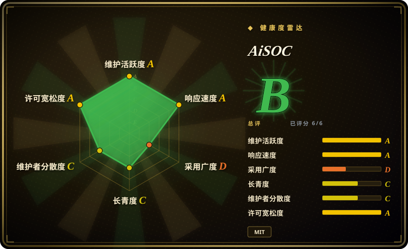
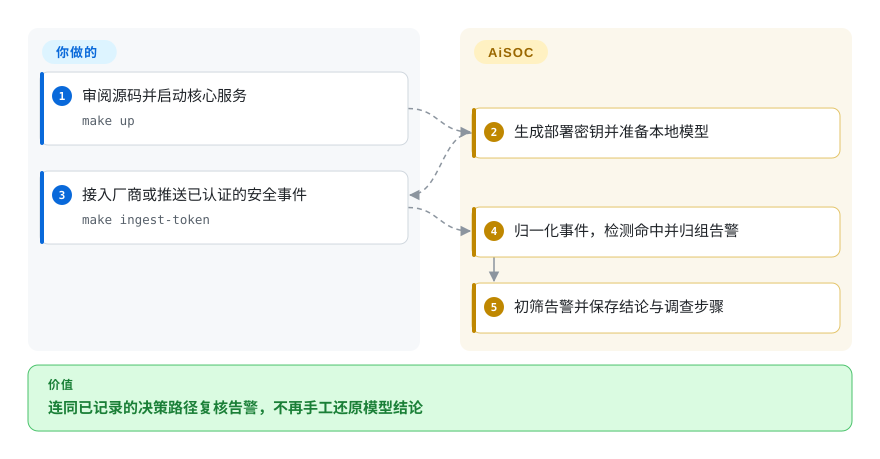
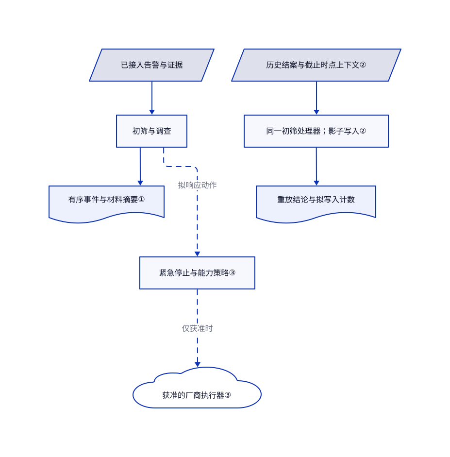

# AiSOC

告警队列里反复出现同一台主机，你却说不清 AI 为什么放过某条告警。AiSOC 把相关告警归组，让模型调查，并把执行步骤和结论一起保存。

源码研究固定于 `bd3313b9a2e6c2dcf2567f5e6d15c57d3faf0279`，不代表持续变化的主分支。机器上游快照另行观察了较晚的默认分支状态，本文未审阅其新增源码。健康分是另行测得的仓库信号，不是安全认证。

## 何时使用

你负责安全运营，身份、终端和云平台不断送来告警。分析员反复把同一主机与用户复制到几个控制台，还要在缺少原始证据时解释模型的结论。你需要自托管的调查层，把事件关联起来，保存 agent 的步骤，并用历史人工结案结果重放评估，再决定是否允许自动化。

如果你同时需要检测、模型初筛、调查账本和本地模型，AiSOC 比单纯的工作流编排器更接近完整起点。代价是多服务部署和持续人工复核，不能把模型结论当作事实证明。保留原有采集与留存系统，上游 README 也明确否认它能直接替代完整安全日志平台。

## 何时不用

- **首先缺的是终端证据采集或文件完整性监控。** 先选 [Wazuh](https://github.com/wazuh/wazuh)，它提供终端代理和管理端。AiSOC 无法调查你没有接入的遥测。
- **已有检测体系，只缺明确的集成工作流。** 优先用 [Shuffle](https://github.com/Shuffle/Shuffle) 的工作流编辑器与安全应用。AiSOC 会额外引入模型、检测和多种数据存储。
- **需要分析员协作办案，不需要模型主导初筛。** 优先看 [DFIR-IRIS](https://github.com/dfir-iris/iris-web)，生产选稳定版本，不用当前 v3 测试版。AiSOC 的账本能帮助检查 agent，但不能证明结论正确。
- **大批量摄取必须无需逐连接器验证就可靠运行。** 先保留原有日志平台或 Wazuh，旁路评估 AiSOC。固定提交中，`push_events` 把整个列表一次发送，摄取端却拒绝超限批次；[问题 1635](https://github.com/beenuar/AiSOC/issues/1635) 报告了此链路故障，2026-11-02 时 PR 1640 仍未合并。
- **需要全套 MIT、严格断网且已审计的设备。** 在逐项审完数据路径和依赖前，继续使用已批准的 Wazuh 部署或现有平台。AiSOC 的源码许可不覆盖 Llama 权重和导入规则；本地推理也不代表没有镜像下载、默认 CISA 情报请求和已配置的厂商调用。

## 横向对比

| 替代品 | 是否收录 | 我们的评价 | 取舍 |
|---|---|---|---|
| [Wazuh](https://github.com/wazuh/wazuh) | 未收录 | 需要终端采集、完整性检查和规则监控时选 Wazuh；缺的是可追溯 AI 调查层时再选 AiSOC。 | Wazuh 提供终端代理与管理端；AiSOC 提供模型与账本工作流，不替代采集及合规留存。本批标签页未追加收录。 |
| [Shuffle](https://github.com/Shuffle/Shuffle) | 未收录 | 分析员要明确编排安全流程时选 Shuffle；要检测、模型初筛和重放一体交付时再选 AiSOC。 | 工作流优先可避免采用整套调查架构；Shuffle 后端采用 AGPLv3，模块内容另有许可。本批标签页未追加收录。 |
| [DFIR-IRIS](https://github.com/dfir-iris/iris-web) | 未收录 | 调查员要共享案件证据时选 IRIS；重点是还原与评估 agent 的决策时选 AiSOC。 | IRIS 以案件协作为中心；当前主分支是 v3 测试版，文档建议生产使用稳定 v2.4.29。本批标签页未追加收录。 |

## 快速上手

文档给出的源码路径是克隆后执行 `make up`；先审阅检出内容与安装器，不要直接把远程脚本交给 shell。你需要 Docker Compose v2、Python 3.9+、Bash，以及 README 声明的 Docker 虚拟机内存 8 GB、空闲磁盘 20 GB。启动流程生成部署密钥和管理员密码，再拉取本地 Ollama 模型；你按终端地址登录，配置厂商连接器，或使用 `make ingest-token` 生成的令牌推送事件。AiSOC 负责归一化、生成告警、初筛并保存调查记录；连接器权限、模型选择、TLS、备份、留存和审批策略仍由你负责。`make smoke` 是上游提供的链路检查，不是本文实际执行过的测试。可选 MCP 接入目前要从 `services/mcp` 源码构建，其 README 明说 npm 包尚未发布，不能假设 `npx @aisoc/mcp` 可用。

<!-- flow-steps:begin (generated from flows/aisoc.json by tools/flow_card.py — do not edit) -->

流程文字版

1. **你**：审阅源码并启动核心服务 — `make up`
2. **AiSOC**：生成部署密钥并准备本地模型
3. **你**：接入厂商或推送已认证的安全事件 — `make ingest-token`
4. **AiSOC**：归一化事件，检测命中并归组告警
5. **AiSOC**：初筛告警并保存结论与调查步骤

**价值**：连同已记录的决策路径复核告警，不再手工还原模型结论

<!-- flow-steps:end -->

## 技术要点

<!-- mechanism:begin (generated from mechanisms/aisoc.json by tools/mechanism_card.py; do not edit) -->

机制文字版

- 已接入告警与证据
- 初筛与调查
- 有序事件与材料摘要①
- 历史结案与截止时点上下文②
- 同一初筛处理器；影子写入②
- 重放结论与拟写入计数
- 紧急停止与能力策略③
- 获准的厂商执行器③

- 已接入告警与证据 → 初筛与调查
- 初筛与调查 → 有序事件与材料摘要①
- 历史结案与截止时点上下文② → 同一初筛处理器；影子写入②
- 同一初筛处理器；影子写入② → 重放结论与拟写入计数
- 初筛与调查 → 紧急停止与能力策略③（拟响应动作）〔可选／兜底〕
- 紧急停止与能力策略③ → 获准的厂商执行器③（仅获准时）〔可选／兜底〕

<!-- mechanism:end -->

### 1. 把调查事件与大体积材料分开存储

- **解决：** 只有最终解释，无法知道哪个提示词、工具结果或中间判断产生了它。
- **做法：** 调查编排器分配运行编号与递增事件序号，流式输出时写入新增审计事件，报告另存为材料。PostgreSQL 用运行编号与序号联合唯一约束去重，用触发器禁止修改或删除事件，并给材料内容计算 SHA-256 摘要。
- **边界：** 这里保存的是执行步骤，不是模型隐藏思维。所读持久化辅助函数可能记录错误后返回 `None`，流式调用方没有要求每次事件写入都成功；看到结果不代表账本完整落盘。事件不可变也不能约束数据库管理员。
- **源码：** [流式调用第 389–469 行](https://github.com/beenuar/AiSOC/blob/bd3313b9a2e6c2dcf2567f5e6d15c57d3faf0279/services/agents/app/investigator/orchestrator.py#L389-L469)、[事件与材料写入第 227–336 行](https://github.com/beenuar/AiSOC/blob/bd3313b9a2e6c2dcf2567f5e6d15c57d3faf0279/services/agents/app/investigator/ledger.py#L227-L336)、[表结构与触发器第 47–110 行](https://github.com/beenuar/AiSOC/blob/bd3313b9a2e6c2dcf2567f5e6d15c57d3faf0279/services/api/migrations/008_investigation_ledger.sql#L47-L110)。

### 2. 替换读写端口，复用生产初筛做重放

- **解决：** 评测专用实现容易偏离生产，也可能读到本轮重放刚生成的答案。
- **做法：** 重放创建同一个告警处理器，但注入冻结上下文读取器和影子写入器。历史记录按结案时间切分，写入器只统计持久化调用，不实际写入，并关闭升级调查、剧本和生产去重缓存。
- **边界：** 重放仍调用配置的模型，会消耗算力或付费推理。没有时间戳的组织记忆无法检查时点，单独计数；待测技能是明确披露的历史截止时间例外。这也不能证明模型训练时没学过相关知识。
- **源码：** [处理器替换第 326–398 行](https://github.com/beenuar/AiSOC/blob/bd3313b9a2e6c2dcf2567f5e6d15c57d3faf0279/services/agents/app/replay/runner.py#L326-L398)、[影子控制第 133–196 行](https://github.com/beenuar/AiSOC/blob/bd3313b9a2e6c2dcf2567f5e6d15c57d3faf0279/services/agents/app/replay/shadow.py#L133-L196)、[冻结限制第 54–87 行](https://github.com/beenuar/AiSOC/blob/bd3313b9a2e6c2dcf2567f5e6d15c57d3faf0279/services/agents/app/replay/shadow.py#L54-L87)。

### 3. 在动作分发时检查权限，而非相信计划

- **解决：** 审批一个工作流，不应默默授权其内部所有厂商操作。
- **做法：** 实际动作分发器先检查人工紧急停止开关，再寻找执行器，对拟真实执行的操作应用租户自主策略和能力合同。结果可以是阻断、待审批或降级预览；符合条件的成功操作随后调用效果验证探针。
- **边界：** 配置厂商凭据并放行策略后，会产生真实改动。预览不是通用隔离边界，没有注册探针的能力会明确返回未验证。MCP 动作工具只请求预览接口，不能代替控制台或 API 的响应授权。
- **源码：** [分发与效果验证第 489–635 行](https://github.com/beenuar/AiSOC/blob/bd3313b9a2e6c2dcf2567f5e6d15c57d3faf0279/services/actions/app/live_actions/dispatcher.py#L489-L635)、[MCP 预览实现](https://github.com/beenuar/AiSOC/blob/bd3313b9a2e6c2dcf2567f5e6d15c57d3faf0279/services/mcp/src/tools/actions.ts)。

## 技术栈

- Python 服务使用 FastAPI、asyncpg／SQLAlchemy、LangChain 和 LangGraph；Go 实现摄取与情报增强。
- 控制台清单固定 Next.js 16.4.2 与 React 19.3.1，虽然旧描述字符串仍写 Next.js 14。MCP 和实时服务也使用 TypeScript。
- Compose 连接 PostgreSQL、Redis、Kafka／ZooKeeper、Qdrant、Ollama 与 LiteLLM 网关；完整配置另加 ClickHouse、OpenSearch 和 Neo4j 等存储。

## 依赖

- **本地运行时：** Docker Compose 与足够的虚拟机磁盘和内存；README 的容量是上游建议，不是本文实测。默认模型为 `llama3.2:3b-instruct-q4_K_M`，GPU 可选。
- **已接入环境：** 为云、身份和安全工具提供最小权限账号或令牌。托管模型提供方可选且独立计费，其可用性与数据留存协议不由本仓库许可覆盖。
- **许可范围：** 实际根 [MIT 文件](https://github.com/beenuar/AiSOC/blob/bd3313b9a2e6c2dcf2567f5e6d15c57d3faf0279/LICENSE) 覆盖项目代码。[归属登记](https://github.com/beenuar/AiSOC/blob/bd3313b9a2e6c2dcf2567f5e6d15c57d3faf0279/.github/LICENSES.md) 列出导入的 Sigma DRL-1.1 和 Apache-2.0 规则。Llama 权重使用独立的 [Llama 3.2 Community License](https://github.com/meta-llama/llama-models/blob/main/models/llama3_2/LICENSE)，不是 MIT；商标与厂商服务也另算。
- **网络边界：** 首次镜像与模型下载、默认开启的 CISA 情报和已配置连接器仍使用网络。项目的[数据处理文档](https://github.com/beenuar/AiSOC/blob/bd3313b9a2e6c2dcf2567f5e6d15c57d3faf0279/docs/security/data-handling.md) 区分本地、托管模型、断网与托管运维模式，不能混用各模式承诺。

## 运维难度

**生产高，隔离评估中等。** 本地模型免去付费推理密钥，不免除数据库、迁移、Kafka 积压、密钥和模型延迟的维护。文档说明 Compose 服务间默认明文通信，浏览器侧 TLS 要自行提供。接入敏感生产事件前，备份调查证据与凭据，验证连接器批次大小，收紧响应权限，并演练留存和恢复。托管模型部署还要逐调用路径审阅：LangChain 包装器做假名化，但所读原始 HTTP 辅助函数没有同样的隐私会话。

## 健康度与可持续性

- **维护，2026-11-02：** 仓库创建于 2026-05-02，未归档，2026-11-01 发布 v21.0.0，此前十月底连续发布多个版本。迭代活跃，但版本增长快不代表运行历史长。
- **治理与支持：** 评分器的 `active_maintainers_12mo` 指标统计到 22 名活跃贡献者，头号作者提交占比 0.731；这是提交指标，不是合并权限人数。[维护者名单](https://github.com/beenuar/AiSOC/blob/bd3313b9a2e6c2dcf2567f5e6d15c57d3faf0279/MAINTAINERS.md) 只有一名在任维护者。README 与致谢声明 Cyble 资助工程时间。[治理文件](https://github.com/beenuar/AiSOC/blob/bd3313b9a2e6c2dcf2567f5e6d15c57d3faf0279/GOVERNANCE.md) 规定 DCO，并把中立基金会列为未来目标，不是现有归属。
- **采用与长期判断：** [推断：依据仓龄、维护集中度和公开证据，未做生产部署调查] 这个约六个月的系统适合作为评估候选，尚不适合仅凭热度押注长期核心依赖。星标和分叉代表关注，不能证明生产采用或检测准确率。
- **风险与响应：** SECURITY.md 记录过提示注入和租户隔离报告，并给出私密报告渠道。未解决的批量大小问题说明厂商接入必须逐项验证；合成与重放分数不能认证真实攻击检测。本文只审固定源码，没有运行服务或验证上游 CI 结果。

## 存疑（未验证）

- [未验证：本次仅获准静态研究，未执行上游] 没有复现启动、资源占用、延迟、检测准确率、隔离或恢复。上游测试文件和声明只能证明设计意图，不是本文跑出的通过结果。
- [推断：依据仓龄与单维护者治理，缺少生产部署调查] 活跃发布和公开关注尚不能证明长期可持续性与运营支持，资助信息来自项目自身披露。
- [未验证：未做完整传递性权利审计] 已读根 MIT 正文及导入规则的许可声明，但没有认证每条规则、内置 wheel、镜像和模型分发的通知保留完整性。
- [未验证：未获准执行托管模型调用] 尚不能确认全路径假名化。`safe_ainvoke` 创建隐私会话，而 [contract.py 第 271–321 行](https://github.com/beenuar/AiSOC/blob/bd3313b9a2e6c2dcf2567f5e6d15c57d3faf0279/services/agents/app/llm/contract.py#L271-L321) 的 `safe_chat_completions_request` 没有；发送敏感证据前要核对实际调用点。
