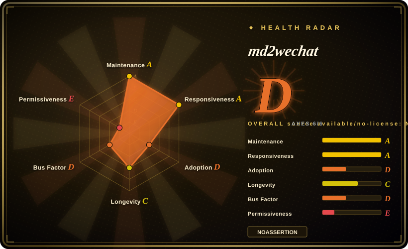
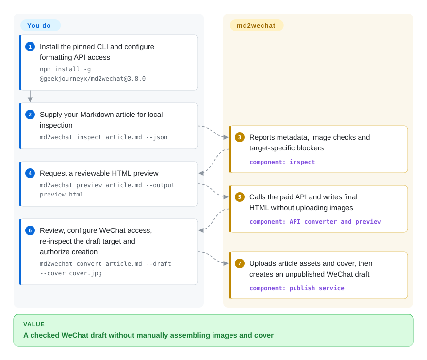
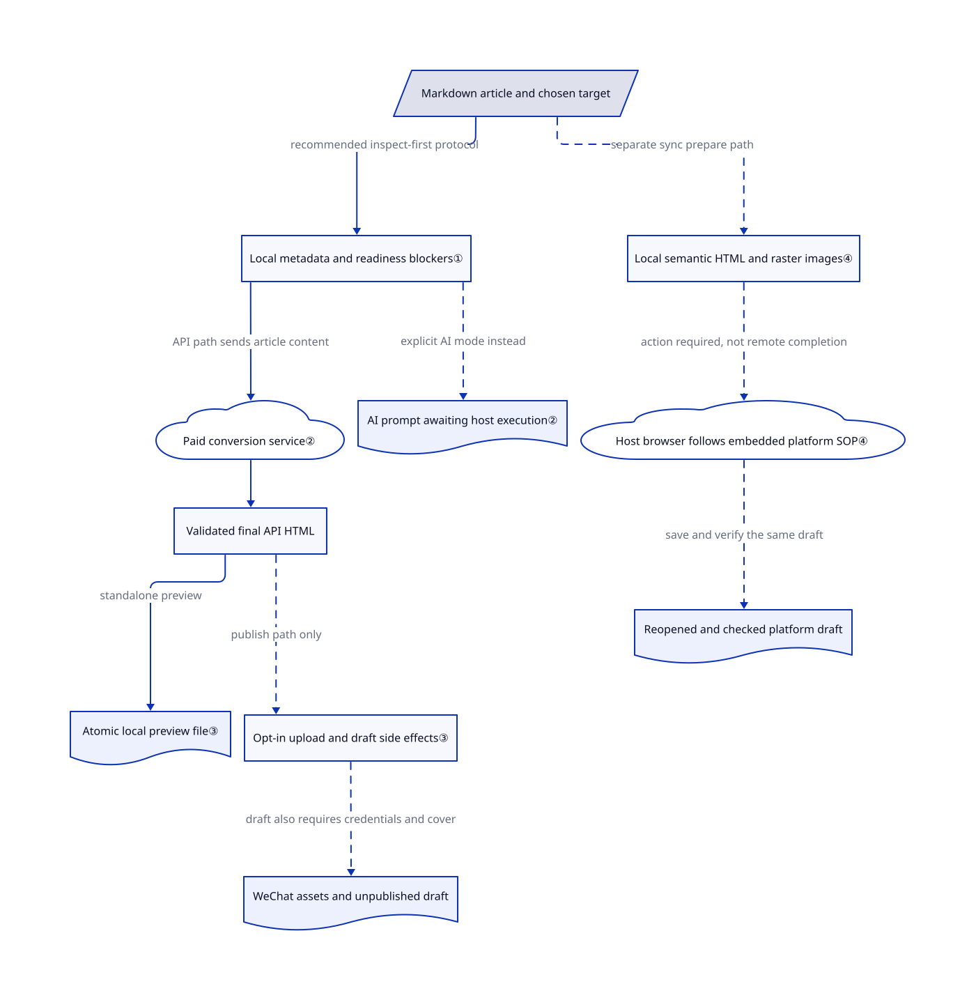

# md2wechat

Your Markdown article is ready, but its images, cover and WeChat draft still require separate manual steps. md2wechat exposes those steps as inspectable commands, then creates a draft only when explicitly requested.

**Source-available, not unrestricted open source.** Its current license restricts commercial use, including revenue-related internal company work. Buying the formatting API does not automatically grant a commercial license.

## When to use

You maintain a WeChat Official Account and write Markdown through a coding agent. Desktop output looks acceptable, but the draft may lack a cover, reference local images or exceed a metadata limit. You want the agent to inspect the intended target, produce reviewable HTML, and create the draft after approval. Choose md2wechat over a browser-first editor when structured command output and explicit publishing steps matter more than visual editing. You accept the paid formatting service, and your use fits the license or has separate authorization.

Despite the repository name, this is a Go CLI with bundled operating instructions, not just a prompt pack. It also prepares ordinary Markdown for drafts on Zhihu, CSDN, Toutiao and Tencent Cloud Developer Community; the host agent, not the CLI, must operate and verify the browser.

## When NOT to use

- **You need freely reusable commercial formatting code or assets.** Evaluate [doocs/md](https://github.com/doocs/md) or the MIT-licensed [Baoyu Skills](../agent-skills/ai-writing/content-production/baoyu-skills.md). md2wechat's license covers code, themes, prompts, skills and documentation; company revenue-related work and paid client delivery require written authorization. Its 2030-01-01 change date is not current Apache-2.0 permission.
- **You cannot send articles to this vendor.** Use a self-hosted doocs/md editor and audit optional integrations. The default API path posts Markdown to `www.md2wechat.cn`; changing its URL does not supply a self-hostable professional renderer. AI mode returns an external-model prompt, not local finished HTML.
- **You only need interactive styling.** Choose doocs/md for editor-based theme/CSS adjustment. API configuration, WeChat credentials and draft checks can outweigh their value for a manual copy-and-paste routine.
- **Translation or broader visual artifacts drive the task.** Choose Baoyu Skills for writing/translation workflows, or [HTML Anything](../ai-design-generation/html-anything.md) for generated HTML designs and manual WeChat export. md2wechat centers article preparation and draft creation, not general design or translation.
- **You expect an independent cross-platform publishing daemon.** Use each platform's own editor when you cannot supply an authorized browser-capable host. `sync prepare` stops at local preparation; success does not establish that a remote draft exists or an article was published.

## Comparison

| Alternative | In index | Our verdict | Tradeoff |
|---|---|---|---|
| [doocs/md](https://github.com/doocs/md) | not indexed | Choose doocs/md when a human wants to adjust Markdown styling in an editor; choose md2wechat when an agent needs structured checks and an explicit WeChat draft step. | doocs/md offers an editor, custom CSS, image-host integrations and self-hosting; md2wechat adds a CLI publishing workflow but its main formatting path uses a paid API. Real repository; not added in this tab batch. |
| [Baoyu Skills](../agent-skills/ai-writing/content-production/baoyu-skills.md) | ✅ | Choose Baoyu Skills when translation and reusable writing/image skills drive the job; choose md2wechat when the central contract is inspect → preview → WeChat draft. | Baoyu is a broader MIT skill collection; md2wechat supplies a typed Go command interface and bundled SOP, with commercial restrictions and a separate formatting service. |
| [HTML Anything](../ai-design-generation/html-anything.md) | ✅ | Choose HTML Anything to generate and visually review designed HTML; choose md2wechat when account-specific checks and draft creation matter more than an interactive design surface. | HTML Anything drives an existing coding-agent CLI and offers manual WeChat export; md2wechat supplies publishing-oriented commands but needs its API for final HTML in the main path. Neither guarantees correct output. |

## Quick start

The documented npm path is `npm install -g @geekjourneyx/md2wechat@3.8.0`; its install hook downloads the matching platform binary and checks its release checksum. Initialize with `md2wechat config init --json`, then provide the paid formatting key through configuration or `MD2WECHAT_API_KEY`. Run `md2wechat inspect article.md --json`, then `md2wechat preview article.md --output preview.html`; the tool checks local inputs and obtains formatted HTML, while you review the article. Only after authorization, configure WeChat credentials and the IP whitelist, inspect with the same account/draft/cover options, then run `md2wechat convert article.md --draft --cover cover.jpg`. The result is an unpublished draft, not a public post; permissions, service charges, commercial licensing and final WeChat review remain yours. These instructions were checked against sources, not executed during this intake.

<!-- flow-steps:begin (generated from flows/md2wechat-skill.json by tools/flow_card.py — do not edit) -->

Text version of the flow

1. **You**: Install the pinned CLI and configure formatting API access — `npm install -g @geekjourneyx/md2wechat@3.8.0`
2. **You**: Supply your Markdown article for local inspection — `md2wechat inspect article.md --json`
3. **md2wechat**: Reports metadata, image checks and target-specific blockers — component: `inspect`
4. **You**: Request a reviewable HTML preview — `md2wechat preview article.md --output preview.html`
5. **md2wechat**: Calls the paid API and writes final HTML without uploading images — component: `API converter and preview`
6. **You**: Review, configure WeChat access, re-inspect the draft target and authorize creation — `md2wechat convert article.md --draft --cover cover.jpg`
7. **md2wechat**: Uploads article assets and cover, then creates an unpublished WeChat draft — component: `publish service`

**Value**: A checked WeChat draft without manually assembling images and cover

<!-- flow-steps:end -->

## Key techniques

<!-- mechanism:begin (generated from mechanisms/md2wechat-skill.json by tools/mechanism_card.py; do not edit) -->

Text version of the mechanism

- Markdown article and chosen target
- Local metadata and readiness blockers①
- Paid conversion service②
- AI prompt awaiting host execution②
- Validated final API HTML
- Atomic local preview file③
- Opt-in upload and draft side effects③
- WeChat assets and unpublished draft
- Local semantic HTML and raster images④
- Host browser follows embedded platform SOP④
- Reopened and checked platform draft

- Markdown article and chosen target → Local metadata and readiness blockers① (recommended inspect-first protocol)
- Local metadata and readiness blockers① → Paid conversion service② (API path sends article content)
- Local metadata and readiness blockers① → AI prompt awaiting host execution② (explicit AI mode instead) [optional/fallback]
- Paid conversion service② → Validated final API HTML
- Validated final API HTML → Atomic local preview file③ (standalone preview)
- Validated final API HTML → Opt-in upload and draft side effects③ (publish path only) [optional/fallback]
- Opt-in upload and draft side effects③ → WeChat assets and unpublished draft (draft also requires credentials and cover) [optional/fallback]
- Markdown article and chosen target → Local semantic HTML and raster images④ (separate sync prepare path) [optional/fallback]
- Local semantic HTML and raster images④ → Host browser follows embedded platform SOP④ (action required, not remote completion) [optional/fallback]
- Host browser follows embedded platform SOP④ → Reopened and checked platform draft (save and verify the same draft) [optional/fallback]

<!-- mechanism:end -->

### 1. Report readiness separately for each operation

- **Problem:** A renderable article may still lack credentials, local images or a draft cover.
- **How:** `inspect` resolves metadata with its source and maps checks into target-specific `readiness.targets` and `blockers`. The bundled SOP asks the agent to inspect the same flags and account it will execute.
- **Limits:** Readiness assesses local inputs/configuration, not live authentication or rendering success. Inspect-first is an agent instruction; `convert` has its own preflight rather than requiring a previous inspection token.
- **Source:** [Readiness calculation:151–207](https://github.com/geekjourneyx/md2wechat-skill/blob/a8e2900033e5c9ee152a629e108fe57228ba31e6/internal/inspect/inspect.go#L151-L207), [target blockers:604–703](https://github.com/geekjourneyx/md2wechat-skill/blob/a8e2900033e5c9ee152a629e108fe57228ba31e6/internal/inspect/inspect.go#L604-L703), [SOP:113–123](https://github.com/geekjourneyx/md2wechat-skill/blob/a8e2900033e5c9ee152a629e108fe57228ba31e6/skills/md2wechat/SKILL.md#L113-L123).

### 2. Distinguish final API HTML from an unfinished AI request

- **Problem:** A prompt response can be mistaken for a completed conversion.
- **How:** API mode posts Markdown and theme settings to a conversion service, validates response fields, and extracts final HTML. AI mode builds a theme prompt and returns `action_required` for host execution.
- **Limits:** API mode discloses article content to that service and requires its key. AI mode neither invokes a model nor renders advanced layout modules; it is not equivalent failover after an API error.
- **Source:** [API conversion:74–140](https://github.com/geekjourneyx/md2wechat-skill/blob/a8e2900033e5c9ee152a629e108fe57228ba31e6/internal/converter/api.go#L74-L140), [response checks:193–254](https://github.com/geekjourneyx/md2wechat-skill/blob/a8e2900033e5c9ee152a629e108fe57228ba31e6/internal/converter/api.go#L193-L254), [AI request:42–85](https://github.com/geekjourneyx/md2wechat-skill/blob/a8e2900033e5c9ee152a629e108fe57228ba31e6/internal/converter/ai.go#L42-L85), [mode boundary:173–179](https://github.com/geekjourneyx/md2wechat-skill/blob/a8e2900033e5c9ee152a629e108fe57228ba31e6/skills/md2wechat/SKILL.md#L173-L179).

### 3. Separate preview files from publishing effects

- **Problem:** Previewing should not silently upload images or create drafts.
- **How:** Standalone `preview` atomically writes only nonempty final converter HTML. The publishing service processes assets only for upload/draft intent and creates drafts only for explicit draft intent with a cover; the CLI prepares WeChat authorization before effects.
- **Limits:** Failed/AI previews leave existing output untouched, so it may be stale. Flags establish command intent, not human authorization; the caller must obtain that authorization. Desktop HTML does not prove mobile WeChat fidelity.
- **Source:** [Preview write:136–168](https://github.com/geekjourneyx/md2wechat-skill/blob/a8e2900033e5c9ee152a629e108fe57228ba31e6/cmd/md2wechat/preview.go#L136-L168), [effect branches:110–173](https://github.com/geekjourneyx/md2wechat-skill/blob/a8e2900033e5c9ee152a629e108fe57228ba31e6/internal/publish/service.go#L110-L173), [preflight:185–192](https://github.com/geekjourneyx/md2wechat-skill/blob/a8e2900033e5c9ee152a629e108fe57228ba31e6/cmd/md2wechat/convert.go#L185-L192).

### 4. Prepare other-platform content locally, then hand off execution

- **Problem:** Different publishing sites need different editor and recovery procedures.
- **How:** `sync prepare` validates ordinary Markdown and local raster images, emits semantic `body.html`, and identifies `host_agent` as execution owner. Embedded instructions require normal editor use and reopening the same draft to verify content and unpublished state.
- **Limits:** Preparation rejects raw HTML, advanced `:::` blocks, unresolved Obsidian/image-generation syntax and remote images. The CLI supplies no browser session or automatic remote completion; the host needs authorized browser tools.
- **Source:** [Preparation:41–190](https://github.com/geekjourneyx/md2wechat-skill/blob/a8e2900033e5c9ee152a629e108fe57228ba31e6/internal/syncprepare/prepare.go#L41-L190), [local images:287–319](https://github.com/geekjourneyx/md2wechat-skill/blob/a8e2900033e5c9ee152a629e108fe57228ba31e6/internal/syncprepare/prepare.go#L287-L319), [host verification:37–43](https://github.com/geekjourneyx/md2wechat-skill/blob/a8e2900033e5c9ee152a629e108fe57228ba31e6/skills/md2wechat/references/sync/workflow.md#L37-L43).

## Tech stack

- Go 1.26.1 module; Cobra commands, Zap logging and YAML configuration.
- Goldmark for Markdown/local preparation; `silenceper/wechat/v2` for WeChat; imaging and image codecs for assets.
- npm is a Node.js 18+ installer/launcher, not the converter. Markdown SOPs are embedded for version-matched `skills read` discovery.
- [Go dependencies](https://github.com/geekjourneyx/md2wechat-skill/blob/a8e2900033e5c9ee152a629e108fe57228ba31e6/go.mod) and [npm package](https://github.com/geekjourneyx/md2wechat-skill/blob/a8e2900033e5c9ee152a629e108fe57228ba31e6/package.json).

## Dependencies

- A supported release binary; npm installation needs Node.js 18+, source builds need the manifest's Go version. The documented local CLI path requires no application database.
- Default final-HTML conversion/preview needs network access and a paid md2wechat key. This repository supplies the client, not the professional renderer service.
- WeChat upload/drafts need account API permissions, AppID/Secret and IP whitelist setup. Named-account/proxy paths also require the md2wechat key; inspected and executed account selection must match.
- Direct image generation uses separately configured, chargeable providers; plan-only mode returns a host prompt instead. Other-platform drafts need an authorized browser-capable host and logged-in target accounts.

## Ops difficulty

**Medium.** Installing a binary is simple; managing two credential domains, account permissions, IP whitelists and chargeable services is not. Pin the binary and read its embedded SOP rather than assuming a checkout matches it. Source-available licensing and the separate renderer make commercial deployment a procurement decision as well as a technical one. Other-platform browser compatibility and recovery remain host responsibilities.

## Health & viability

- **Maintenance, 2026-10-22:** v3.8.0 was released on 2026-09-24, after v3.7.0 on 09-23 and v3.6.0 on 09-12. Main was last pushed on 10-14 and is not archived. The reviewed tree has 153 Go files, including 73 test files; their presence is not an executed-test result.
- **Governance/backing:** User-owned. GitHub's contributor list attributes 294 commits to geekjourneyx versus 15 combined for the other three accounts, including `web-flow`. API sales and commercial licensing are documented funding channels, not foundation governance.
- **Age/adoption:** Created 2026-01-11, roughly nine months old, with 3717 stars and 416 forks at verification. [推断：based on creation date, recent releases and concentrated authorship] Active but too young for a strong longevity prior; use for present workflow value and preserve a substitute formatting path.
- **License risk:** [LICENSE](https://github.com/geekjourneyx/md2wechat-skill/blob/a8e2900033e5c9ee152a629e108fe57228ba31e6/LICENSE) is a custom BUSL-derived source-available license with a 2030-01-01 Apache-2.0 change provision. It preserves historical MIT releases, not MIT rights to current assets; the [changelog](https://github.com/geekjourneyx/md2wechat-skill/blob/a8e2900033e5c9ee152a629e108fe57228ba31e6/CHANGELOG.md#L317-L323) records the change. The automated D aggregate is license-capped, not a rendering-quality verdict; its `relicense_36mo: false` missed that documented transition.
- **External evidence:** [Issue #9](https://github.com/geekjourneyx/md2wechat-skill/issues/9) reported historical mobile-only empty bullets and was closed without a visible fix explanation. Desktop preview/issue closure does not prove current mobile fidelity. [Issue #29](https://github.com/geekjourneyx/md2wechat-skill/issues/29) is a pending purchase-flow plan, not shipped automatic payment/key delivery.

## Caveats (unverified)

- [未验证：authorization allowed static reading only, without business credentials or upstream execution] Paid rendering, image generation, real WeChat drafts and host-browser platform workflows were not exercised; mobile fidelity and the latest advanced modules remain untested here.
- [推断：based on creation date, recent releases and concentrated authorship] The young, active project has current automation value but no established long-term maintainer/service continuity; stars do not establish durability.
