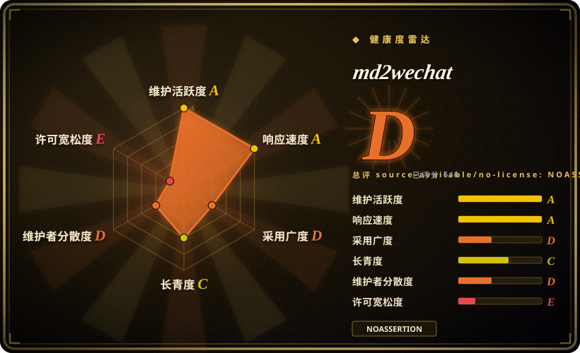
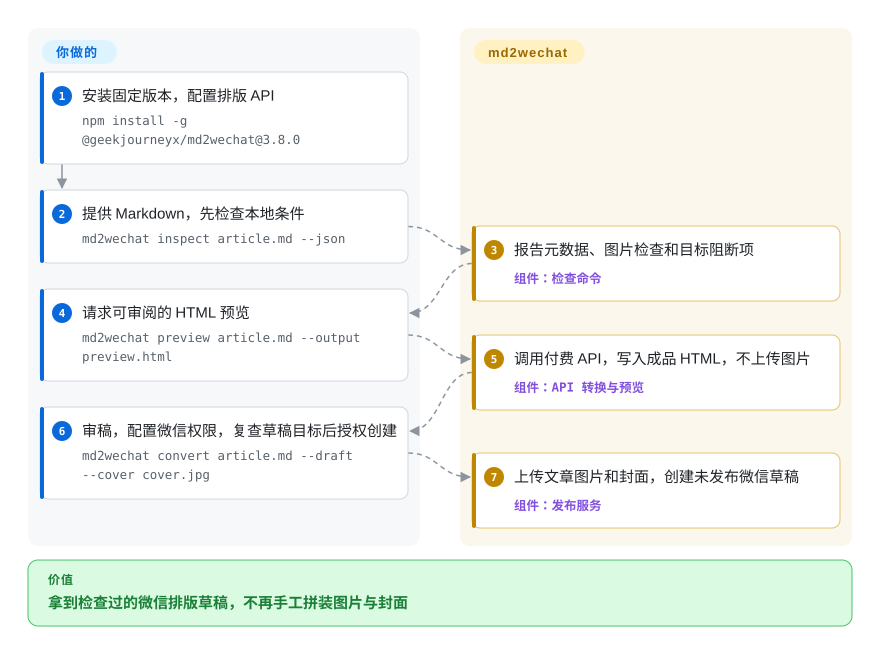
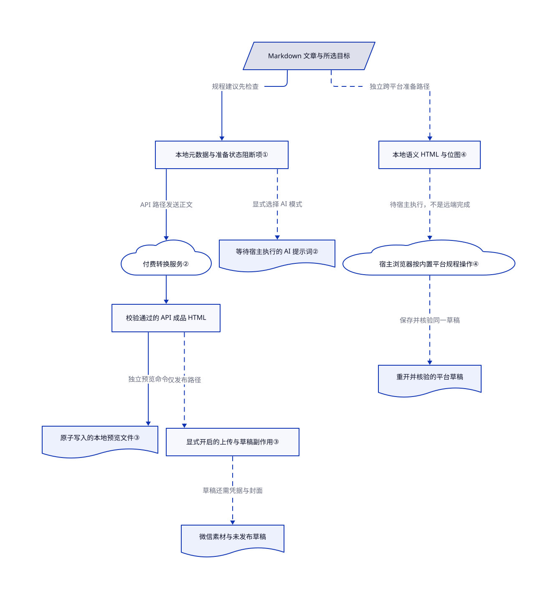

# md2wechat

Markdown 已写完，本地图片、封面和微信草稿还得分头处理。md2wechat 把这些步骤变成可检查的命令，只有明确请求才创建草稿。

**当前是源码可见许可，不是无限制开源。** 许可限制商业用途，包括营利组织内部与收入相关的工作。购买排版 API 不自动取得商业授权。

## 何时使用

你运营微信公众号，已经通过编码助手用 Markdown 写文章。桌面看着正常，草稿却可能缺封面、引用本地图片，或超过元数据长度限制。你希望助手先按实际目标检查文章，生成可审阅的 HTML，再在你批准后创建草稿。相比浏览器编辑器，你更看重机器可读的命令输出和显式发布步骤，而不是可视化编辑。你愿意使用付费排版服务，且用途符合许可或已获单独授权。

别被仓库名误导：它已是带内置操作规程的 Go CLI，不只是提示词包。它还能为知乎、CSDN、头条和腾讯云开发者社区准备普通 Markdown 草稿内容；浏览器操作和核验由宿主助手完成，不是 CLI 自动完成。

## 何时不用

- **你需要可自由商用的排版代码或资产。** 先评估 [doocs/md](https://github.com/doocs/md) 或 MIT 许可的 [Baoyu Skills](../agent-skills/ai-writing/content-production/baoyu-skills.zh.md)。本项目许可覆盖代码、主题、提示词、技能和文档；企业内部营收相关工作、付费客户交付都需书面授权。2030-01-01 是变更日期，不是现在就取得 Apache-2.0 权利。
- **文章不能交给这家服务商。** 用自托管 doocs/md 编辑器，并审查可选集成。默认 API 路径向 `www.md2wechat.cn` 发送 Markdown；允许换地址，不等于附带可自托管的专业渲染器。AI 模式只返回交给外部模型的提示词，不是本地成品 HTML。
- **你只想交互式调样式。** 选带主题和 CSS 控制的 doocs/md。对手动复制粘贴流程，API 配置、微信凭据和草稿检查可能得不偿失。
- **翻译或更多视觉产物主导任务。** 写作翻译优先时选 Baoyu Skills；生成 HTML 设计稿并手动导出微信时，选 [HTML Anything](../ai-design-generation/html-anything.zh.md)。本项目围绕文章准备和创建草稿组织，不是通用设计或翻译工具。
- **你期待独立跨平台发布守护进程。** 不能提供已授权、能操作浏览器的宿主时，改用目标平台自带编辑器。`sync prepare` 只准备本地内容；成功不代表远端已有草稿，更不代表文章已发布。

## 横向对比

| 替代品 | 是否收录 | 我们的评价 | 取舍 |
|---|---|---|---|
| [doocs/md](https://github.com/doocs/md) | 未收录 | 人需要在编辑器里调整 Markdown 样式时，选 doocs/md；助手需要结构化检查和显式微信草稿步骤时，选 md2wechat。 | doocs/md 提供编辑器、自定义 CSS、图床集成和自托管；本项目增加 CLI 发布流程，但主要排版路径依赖付费 API。真实仓库；not added in this tab batch。 |
| [Baoyu Skills](../agent-skills/ai-writing/content-production/baoyu-skills.zh.md) | 已收录 | 翻译及可复用写作、配图技能主导任务时，选 Baoyu Skills；核心契约是检查→预览→微信草稿时，选 md2wechat。 | Baoyu 是范围更广的 MIT 技能集；本项目提供带类型的 Go 命令接口和内置操作规程，但有商用限制及独立排版服务。 |
| [HTML Anything](../ai-design-generation/html-anything.zh.md) | 已收录 | 要生成并目测设计好的 HTML 时，选 HTML Anything；账号相关检查和创建草稿比交互设计界面更重要时，选 md2wechat。 | HTML Anything 驱动已有编码助手，支持手动导出微信；本项目提供发布命令，但主路径的最终 HTML 需要 API。两者都不保证输出正确。 |

## 快速上手

文档的 npm 安装命令是 `npm install -g @geekjourneyx/md2wechat@3.8.0`；安装钩子下载匹配平台的二进制，并校验发布摘要。用 `md2wechat config init --json` 初始化，再通过配置项或 `MD2WECHAT_API_KEY` 提供付费排版密钥。先运行 `md2wechat inspect article.md --json`，再运行 `md2wechat preview article.md --output preview.html`；工具检查本地输入并获取排版 HTML，你负责审稿。只有取得授权后，才配置微信凭据和 IP 白名单，按同一账号、草稿参数和封面检查，再运行 `md2wechat convert article.md --draft --cover cover.jpg`。结果是未发布草稿，不是公开文章；权限、服务费用、商业授权和最终微信端核验仍由你负责。以上指令已核对来源，本次收录没有执行。

<!-- flow-steps:begin (generated from flows/md2wechat-skill.json by tools/flow_card.py — do not edit) -->

流程文字版

1. **你**：安装固定版本，配置排版 API — `npm install -g @geekjourneyx/md2wechat@3.8.0`
2. **你**：提供 Markdown，先检查本地条件 — `md2wechat inspect article.md --json`
3. **md2wechat**：报告元数据、图片检查和目标阻断项 — 组件：`检查命令`
4. **你**：请求可审阅的 HTML 预览 — `md2wechat preview article.md --output preview.html`
5. **md2wechat**：调用付费 API，写入成品 HTML，不上传图片 — 组件：`API 转换与预览`
6. **你**：审稿，配置微信权限，复查草稿目标后授权创建 — `md2wechat convert article.md --draft --cover cover.jpg`
7. **md2wechat**：上传文章图片和封面，创建未发布微信草稿 — 组件：`发布服务`

**价值**：拿到检查过的微信排版草稿，不再手工拼装图片与封面

<!-- flow-steps:end -->

## 技术要点

<!-- mechanism:begin (generated from mechanisms/md2wechat-skill.json by tools/mechanism_card.py; do not edit) -->

机制文字版

- Markdown 文章与所选目标
- 本地元数据与准备状态阻断项①
- 付费转换服务②
- 等待宿主执行的 AI 提示词②
- 校验通过的 API 成品 HTML
- 原子写入的本地预览文件③
- 显式开启的上传与草稿副作用③
- 微信素材与未发布草稿
- 本地语义 HTML 与位图④
- 宿主浏览器按内置平台规程操作④
- 重开并核验的平台草稿

- Markdown 文章与所选目标 → 本地元数据与准备状态阻断项①（规程建议先检查）
- 本地元数据与准备状态阻断项① → 付费转换服务②（API 路径发送正文）
- 本地元数据与准备状态阻断项① → 等待宿主执行的 AI 提示词②（显式选择 AI 模式）〔可选／兜底〕
- 付费转换服务② → 校验通过的 API 成品 HTML
- 校验通过的 API 成品 HTML → 原子写入的本地预览文件③（独立预览命令）
- 校验通过的 API 成品 HTML → 显式开启的上传与草稿副作用③（仅发布路径）〔可选／兜底〕
- 显式开启的上传与草稿副作用③ → 微信素材与未发布草稿（草稿还需凭据与封面）〔可选／兜底〕
- Markdown 文章与所选目标 → 本地语义 HTML 与位图④（独立跨平台准备路径）〔可选／兜底〕
- 本地语义 HTML 与位图④ → 宿主浏览器按内置平台规程操作④（待宿主执行，不是远端完成）〔可选／兜底〕
- 宿主浏览器按内置平台规程操作④ → 重开并核验的平台草稿（保存并核验同一草稿）〔可选／兜底〕

<!-- mechanism:end -->

### 1. 按操作分别报告准备状态

- **解决：** 文章能渲染，不代表凭据、本地图片和草稿封面都已就绪。
- **做法：** `inspect` 解析元数据及其来源，把检查结果映射到各目标的 `readiness.targets` 和 `blockers`。内置规程要求助手检查与实际执行相同的参数和账号。
- **边界：** 这里只判断本地输入和配置，不在线验证身份或渲染成功。先检查是助手指令；`convert` 有自己的前置检查，不要求前一次检查令牌。
- **源码：** [准备状态计算第 151–207 行](https://github.com/geekjourneyx/md2wechat-skill/blob/a8e2900033e5c9ee152a629e108fe57228ba31e6/internal/inspect/inspect.go#L151-L207)、[目标阻断第 604–703 行](https://github.com/geekjourneyx/md2wechat-skill/blob/a8e2900033e5c9ee152a629e108fe57228ba31e6/internal/inspect/inspect.go#L604-L703)、[规程第 113–123 行](https://github.com/geekjourneyx/md2wechat-skill/blob/a8e2900033e5c9ee152a629e108fe57228ba31e6/skills/md2wechat/SKILL.md#L113-L123)。

### 2. 区分 API 成品与待执行的 AI 请求

- **解决：** 命令返回提示词，容易被误报成已经完成转换。
- **做法：** API 模式把 Markdown 和主题参数发给转换服务，校验响应字段后提取最终 HTML。AI 模式只构建主题提示词，返回 `action_required`，由宿主继续执行。
- **边界：** API 模式会把正文交给该服务，并需要密钥。AI 模式不调用模型，也不渲染高级模块；API 出错后切过去不是等价兜底。
- **源码：** [API 转换第 74–140 行](https://github.com/geekjourneyx/md2wechat-skill/blob/a8e2900033e5c9ee152a629e108fe57228ba31e6/internal/converter/api.go#L74-L140)、[响应校验第 193–254 行](https://github.com/geekjourneyx/md2wechat-skill/blob/a8e2900033e5c9ee152a629e108fe57228ba31e6/internal/converter/api.go#L193-L254)、[AI 请求第 42–85 行](https://github.com/geekjourneyx/md2wechat-skill/blob/a8e2900033e5c9ee152a629e108fe57228ba31e6/internal/converter/ai.go#L42-L85)、[模式边界第 173–179 行](https://github.com/geekjourneyx/md2wechat-skill/blob/a8e2900033e5c9ee152a629e108fe57228ba31e6/skills/md2wechat/SKILL.md#L173-L179)。

### 3. 分开预览文件与发布副作用

- **解决：** 看一次预览，不应该悄悄上传图片或创建草稿。
- **做法：** 独立 `preview` 只原子写入非空的最终转换 HTML。发布服务仅在上传或草稿意图存在时处理图片，仅在明确草稿意图且有封面时创建草稿；CLI 在副作用前准备微信授权。
- **边界：** 失败或 AI 预览保留已有输出，原文件可能陈旧。参数代表命令意图，不证明本人已授权；调用方必须取得授权。桌面 HTML 不证明微信手机端保真度。
- **源码：** [预览写入第 136–168 行](https://github.com/geekjourneyx/md2wechat-skill/blob/a8e2900033e5c9ee152a629e108fe57228ba31e6/cmd/md2wechat/preview.go#L136-L168)、[副作用分支第 110–173 行](https://github.com/geekjourneyx/md2wechat-skill/blob/a8e2900033e5c9ee152a629e108fe57228ba31e6/internal/publish/service.go#L110-L173)、[前置检查第 185–192 行](https://github.com/geekjourneyx/md2wechat-skill/blob/a8e2900033e5c9ee152a629e108fe57228ba31e6/cmd/md2wechat/convert.go#L185-L192)。

### 4. 本地准备其他平台内容，再交接执行

- **解决：** 不同平台需要不同的编辑器操作和恢复步骤。
- **做法：** `sync prepare` 校验普通 Markdown 和本地位图，生成语义 HTML 文件 `body.html`，把执行方标为 `host_agent`。内置指令要求使用正常编辑器，并重开同一草稿核验内容及未发布状态。
- **边界：** 准备阶段拒绝原始 HTML、高级 `:::` 模块、未展开的 Obsidian 或生图语法，以及远程图片。CLI 不提供浏览器会话或自动完成远端任务；宿主需要已授权的浏览器工具。
- **源码：** [本地准备第 41–190 行](https://github.com/geekjourneyx/md2wechat-skill/blob/a8e2900033e5c9ee152a629e108fe57228ba31e6/internal/syncprepare/prepare.go#L41-L190)、[本地图片第 287–319 行](https://github.com/geekjourneyx/md2wechat-skill/blob/a8e2900033e5c9ee152a629e108fe57228ba31e6/internal/syncprepare/prepare.go#L287-L319)、[宿主核验第 37–43 行](https://github.com/geekjourneyx/md2wechat-skill/blob/a8e2900033e5c9ee152a629e108fe57228ba31e6/skills/md2wechat/references/sync/workflow.md#L37-L43)。

## 技术栈

- Go 1.26.1 模块；Cobra 处理命令，Zap 记录日志，YAML 保存配置。
- Goldmark 解析 Markdown 和准备本地内容；`silenceper/wechat/v2` 对接微信；图像库和编解码器处理素材。
- npm 是需要 Node.js 18+ 的安装器和启动器，不是转换引擎。内置 Markdown 规程通过 `skills read` 与二进制版本同步提供。
- [Go 依赖](https://github.com/geekjourneyx/md2wechat-skill/blob/a8e2900033e5c9ee152a629e108fe57228ba31e6/go.mod)与 [npm 包](https://github.com/geekjourneyx/md2wechat-skill/blob/a8e2900033e5c9ee152a629e108fe57228ba31e6/package.json)。

## 依赖

- 受支持平台的发布二进制；npm 安装需要 Node.js 18+，源码构建需要清单指定的 Go 版本。文档中的本地 CLI 路径不要求应用数据库。
- 默认最终 HTML 转换和预览需要联网及付费 md2wechat 密钥。仓库提供客户端，不提供专业渲染服务。
- 微信上传和草稿需要账号 API 权限、AppID、Secret 及 IP 白名单。命名账号或代理路径还需要 md2wechat 密钥；检查与执行的账号必须相同。
- 直接生图需要另配付费服务商；仅计划模式返回宿主提示词。其他平台草稿需要已授权、能操作浏览器的宿主和目标账号登录态。

## 运维难度

**中。** 安装二进制简单，管理两类凭据、账号权限、IP 白名单和付费服务并不简单。固定二进制版本，读取它内置的规程，不要默认源码与它一致。源码可见许可和独立渲染器，让商业部署同时成为采购问题。其他平台的浏览器兼容和恢复仍由宿主负责。

## 健康度与可持续性

- **维护，2026-10-22：** v3.8.0 发布于 2026-09-24，之前有 09-23 的 v3.7.0 和 09-12 的 v3.6.0。主分支最后推送于 10-14，未归档。所读源码树含 153 个 Go 文件，其中 73 个测试文件；存在测试不等于本次运行过测试。
- **治理与支持：** 仓库归个人账号所有。GitHub 贡献者列表中，geekjourneyx 有 294 次提交，其他三个账号合计 15 次，包含 `web-flow`。文档提供 API 销售和商业授权，不是基金会治理。
- **年龄与采用：** 创建于 2026-01-11，核验时约九个月，3717 星、416 个分叉。[推断：依据为创建时间、近期发布与单作者集中度] 活跃但尚无强寿命先验；为当前流程价值采用，同时保留替代排版路径。
- **许可风险：** [LICENSE](https://github.com/geekjourneyx/md2wechat-skill/blob/a8e2900033e5c9ee152a629e108fe57228ba31e6/LICENSE) 是基于 BUSL 的自定义源码可见许可，约定 2030-01-01 转为 Apache-2.0。它保留历史 MIT 版本权利，不代表当前资产仍有 MIT 授权；[变更记录](https://github.com/geekjourneyx/md2wechat-skill/blob/a8e2900033e5c9ee152a629e108fe57228ba31e6/CHANGELOG.md#L317-L323)明确记载改许可。自动总评 D 是许可封顶，不是渲染质量评价；评分器的 `relicense_36mo: false` 漏掉了已记录的许可变更。
- **外部证据：** [问题 #9](https://github.com/geekjourneyx/md2wechat-skill/issues/9) 曾报告仅手机端出现空圆点，已关闭但没有可见修复说明。桌面预览或关闭问题不证明当前手机端保真度。[问题 #29](https://github.com/geekjourneyx/md2wechat-skill/issues/29) 是待启动的购买流程计划，不是已交付的自动付款及密钥交付能力。

## 存疑（未验证）

- [未验证：本次授权仅允许静态阅读，未使用业务凭据或运行上游程序] 未实测付费排版、生图、真实微信草稿及宿主浏览器平台流程；手机端保真度和最新高级模块仍未验证。
- [推断：依据为创建时间、近期发布与单作者集中度] 项目年轻且活跃，有当前自动化价值，但尚无长期维护者或服务连续性记录；星数不能证明持久性。
