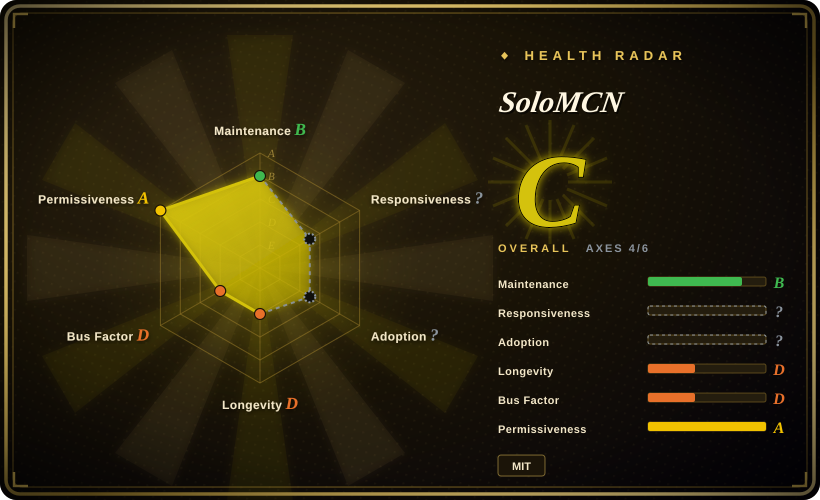
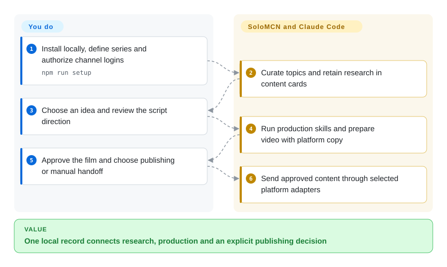
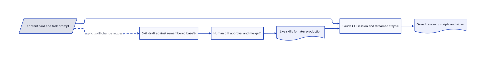

# SoloMCN

Your short-video research, scripts, renders and publishing notes are scattered across agent chats. SoloMCN stores them in one local workbench, runs Claude Code for production steps and leaves publishing decisions to you.

## When to use

You operate several video series from a Mac and already use Claude Code. An idea moves through trends, research, script, render and platform copy, but a new chat loses the series style. Choose SoloMCN for persistent creator state, editable production skills and browser publishing to Douyin, Xiaohongshu, Bilibili, YouTube and X. You accept a trusted personal-machine deployment rather than task-scoped agent isolation.

Animation skills such as huashu-art-motion can supply a production craft; they do not replace the workbench's channel/publishing state. Skill changes use a separate draft/review process, not automatic learning after every video.

## When NOT to use

- **You need provider neutrality.** Evaluate [Easel](easel.md), with configurable model endpoints. SoloMCN's worker is Claude Code; an OpenAI image key does not replace it.
- **You only need topic-to-video output.** Use [MoneyPrinterTurbo](../video-production/creation-workflows/moneyprinter-turbo.md) rather than running channels, browser profiles and agent sessions.
- **An existing agent only lacks Xiaohongshu tools.** Use [xiaohongshu-mcp](xiaohongshu-mcp.md); a complete series/video workspace is unnecessary.
- **Tasks need isolated credentials and minimal tools.** Use separately sandboxed agents or a narrow publisher. Tool-enabled runs receive broad file/command/web tools and configured credentials; workflow approval is not a process sandbox.
- **X ingestion must comply with platform terms.** Use an authorized API source or omit X ingestion. The README explicitly says cookie-pool searching violates X's terms and risks restrictions or bans. Publishing can stay manual.
- **You need a shared team service.** Choose a team scheduler rather than exposing a personal CLI-and-browser workbench. Mac-first setup and nine days of public history do not establish multi-tenant operation.

## Comparison

| Alternative | In index | Our verdict | Tradeoff |
|---|---|---|---|
| [Easel](easel.md) | ✅ | Pick Easel for an OpenClaw-based Chinese-platform workbench with configurable model endpoints; pick SoloMCN when your investment is in Claude Code and video craft. | Different runtimes/account models; SoloMCN also ships YouTube/X adapters, still requiring real-account verification. |
| [MoneyPrinterTurbo](../video-production/creation-workflows/moneyprinter-turbo.md) | ✅ | Pick MoneyPrinterTurbo for repeatable narrated shorts without an autonomous coding workplace; pick SoloMCN for research, custom craft and publishing handoff. | Simpler generation appliance versus greater agent capability and machine/account exposure. |
| [xiaohongshu-mcp](xiaohongshu-mcp.md) | ✅ | Pick xiaohongshu-mcp for one-platform tools in an existing agent; pick SoloMCN for channel state, series style and video production together. | Narrow integration versus complete local workbench; both inherit browser/platform change risk. |

## Quick start

Use the manual README path: clone, inspect setup scripts, then run `npm run setup` and `npm start` on a compatible Mac. Provide Node 22.9+, Python 3.11+, FFmpeg, Chrome, Git and logged-in Claude Code; setup installs production dependencies and the HyperFrames skill. Open `http://127.0.0.1:5178`, replace sample channels, define series and authorize only the accounts you need. The workbench invokes skills and stores research, scripts, video and platform copy; you choose ideas, review output and confirm publishing or select manual/fill-only modes where supported. Fill-only still uploads the video and any supplied cover to the platform, pausing only before final publishing; if uploads are forbidden, use manual handoff and do not run the automated adapters ([mode routing](https://github.com/ymybxx/SoloMCN/blob/444fd420a6690a9bc21f95c76b78db5209f8c6e6/server/publish/index.js#L288-L335), [uploads](https://github.com/ymybxx/SoloMCN/blob/444fd420a6690a9bc21f95c76b78db5209f8c6e6/server/publish/yt.js#L47-L73), [final handoff](https://github.com/ymybxx/SoloMCN/blob/444fd420a6690a9bc21f95c76b78db5209f8c6e6/server/publish/yt.js#L121-L127)). Keep local data private, inspect skill diffs and budget the Claude subscription plus optional media/data services.

<!-- flow-steps:begin (generated from flows/solomcn.json by tools/flow_card.py — do not edit) -->

Text version of the flow

1. **You**: Install locally, define series and authorize channel logins — `npm run setup`
2. **SoloMCN**: Curate topics and retain research in content cards
3. **You**: Choose an idea and review the script direction
4. **SoloMCN**: Run production skills and prepare video with platform copy
5. **You**: Approve the film and choose publishing or manual handoff
6. **SoloMCN**: Send approved content through selected platform adapters

**Value**: One local record connects research, production and an explicit publishing decision

<!-- flow-steps:end -->

## Key techniques

<!-- mechanism:begin (generated from mechanisms/solomcn.json by tools/mechanism_card.py; do not edit) -->

Text version of the mechanism

- Content card and task prompt
- Claude CLI session and streamed steps①
- Saved research, scripts and video
- Skill draft against remembered base②
- Human diff approval and merge②
- Live skills for later production

- Content card and task prompt → Claude CLI session and streamed steps①
- Claude CLI session and streamed steps① → Saved research, scripts and video
- Content card and task prompt → Skill draft against remembered base② (explicit skill-change request) [optional/fallback]
- Skill draft against remembered base② → Human diff approval and merge②
- Human diff approval and merge② → Live skills for later production
- Live skills for later production → Claude CLI session and streamed steps①

<!-- mechanism:end -->

### 1. Run production as resumable CLI sessions

- **Problem:** A dashboard needs actual production progress, not one opaque generated answer.
- **How:** The launcher runs `claude -p` with task prompts, selected model/effort and turn limits. Streamed JSON becomes live steps; a saved session identifier supports later feedback. Tool tasks share an allowlist and configured credential environment.
- **Limits:** `dontAsk` and broadly allowed tools are not least privilege. Prompts restricting file searches are not filesystem enforcement. Model-provider and CLI compatibility remain dependencies.
- **Source:** [Tools](https://github.com/ymybxx/SoloMCN/blob/444fd420a6690a9bc21f95c76b78db5209f8c6e6/server/agent.js#L20-L26), [launch/streaming](https://github.com/ymybxx/SoloMCN/blob/444fd420a6690a9bc21f95c76b78db5209f8c6e6/server/agent.js#L470-L564), [credentials](https://github.com/ymybxx/SoloMCN/blob/444fd420a6690a9bc21f95c76b78db5209f8c6e6/server/credentials.js#L20-L49).

### 2. Separate skill defaults, live copies and reviewed drafts

- **Problem:** Updating shipped skills can overwrite local production knowledge.
- **How:** The manager keeps defaults, a remembered base and live files; before/after records support diffs and reversals. Diverged text uses Git three-way merging. Agent drafts require approval; conflicts stop the planned application.
- **Limits:** Conflict-free factory updates default to automatic application unless confirmation is selected. Preflight conflict checks precede sequential writes, not a crash-atomic multi-file transaction. Broad agent filesystem tools remain a separate boundary.
- **Source:** [Layout/policy](https://github.com/ymybxx/SoloMCN/blob/444fd420a6690a9bc21f95c76b78db5209f8c6e6/server/skills.js#L1-L56), [merge/apply/revert](https://github.com/ymybxx/SoloMCN/blob/444fd420a6690a9bc21f95c76b78db5209f8c6e6/server/skills.js#L106-L284).

## Tech stack

Node.js ESM server, plain HTML/CSS/JavaScript frontend, WebSocket progress and MCP tools. Playwright Core drives installed Chrome. A Python trends service uses its own environment/persistence; FFmpeg and external rendering skills produce media.

## Dependencies

- Mac-first documented setup; Node 22.9+, Python 3.11+, FFmpeg, Chrome, Git and Claude Code login. Linux/Windows parity was not tested.
- Local data/video directories and sensitive browser sessions, source cookies and keys.
- Optional YouTube Data API key, image endpoint, hosted voice or DashScope. System-voice fallback is macOS-specific. Configured credentials are exposed to tool-enabled workers.

## Ops difficulty

**Medium to high.** Maintain CLI compatibility, browser automation, dependency/model downloads, local secrets and platform rules. Interrupted publishing is marked for platform-side confirmation instead of blindly retried; that reduces duplicate-post risk but is not exactly-once delivery. Run locally on a trusted machine, not as an unreviewed public service.

## Health & viability

- **2026-10-18 — fast single-author iteration.** Created 2026-10-09; v0.6.0 released October 15. The contributor snapshot contains one author with 154 contributions, not a support team.
- **Age and Lindy.** Nine days supplies almost no longevity evidence. Pin releases and independently retain media/skill history.
- **License.** Root MIT names `ymybxx`; dependencies and optional installed media/animation assets retain their own terms. This is substantial application source, not a closed-product landing page.
- **Risk and scope.** Broad credential/tool access, browser fragility and acknowledged X terms violations matter. Scheduled production and automatic analytics remain roadmap items, not a proven unattended loop.

## Caveats (unverified)

- [未验证] No upstream application or real account was used, so publishing, subscription operation and video quality were not reproduced; demos are first-party reports.
- [推断] Based on one contributor and nine days of public history, rapid releases do not establish long-term CLI/platform maintenance.
- [未验证] No complete security audit was performed. Source inspection identifies broad access, not proof that all secret storage and web boundaries are secure.
