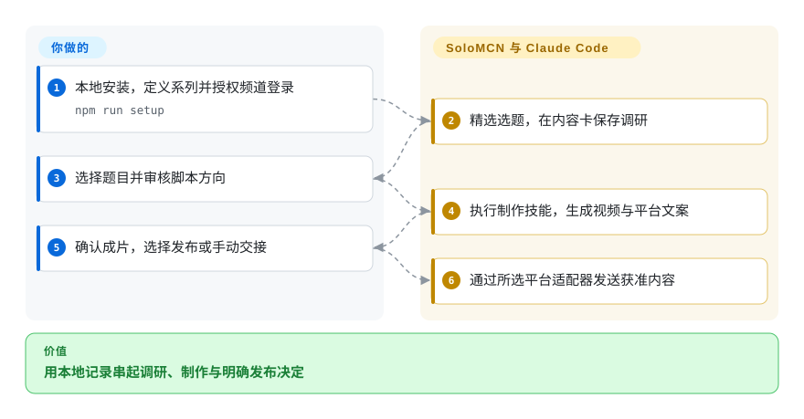

# SoloMCN

短视频调研、脚本、成片和发布说明散落在多个助手会话里。SoloMCN 用本地工作台保存状态，逐步调用 Claude Code 制作，把发布决定交给你。

## 何时使用

你用 Mac 运营多个视频系列，本来就使用 Claude Code。选题依次经过热点、调研、脚本、成片和平台文案，但换会话就丢系列风格。需要持久创作状态、可编辑技能，以及抖音、小红书、B站、YouTube、X 浏览器发布入口时，考虑 SoloMCN。前提是接受可信个人电脑部署，而不是逐任务权限隔离。

huashu-art-motion 等动画技能可提供制作工艺，但不替代工作台账号和发布状态。技能调整走独立草稿评审，不是每做完视频就自动学习。

## 何时不用

- **需要模型厂商中立。** 评估可配置模型接口的 [Easel](easel.zh.md)。SoloMCN 执行者是 Claude Code，OpenAI 生图密钥不能替代它。
- **只要从主题生成视频。** 用 [MoneyPrinterTurbo](../video-production/moneyprinter-turbo.zh.md)，不必管理频道、浏览器档案和助手会话。
- **既有助手只缺小红书工具。** 用 [xiaohongshu-mcp](xiaohongshu-mcp.zh.md)，无需完整系列与视频工作空间。
- **任务必须隔离凭据并最小化工具。** 使用独立沙箱助手或窄发布器。工具任务共享广泛文件、命令、网页工具和已配置凭据，流程审批不是进程沙箱。
- **X 采集必须符合平台条款。** 使用授权 API 来源或关闭采集。README 明确承认 Cookie 账号池搜索违反 X 条款，会有受限、封号风险；发布可继续手动。
- **需要多人生产服务。** 选专门团队排期工具，不要暴露个人命令行与浏览器工作台。Mac 优先、公开九天，不足以证明多租户能力。

## 横向对比

| 替代品 | 是否收录 | 我们的评价 | 取舍 |
|---|---|---|---|
| [Easel](easel.zh.md) | ✅ | 要 OpenClaw 与可配置模型接口的中文平台工作台选 Easel；主要投入 Claude Code 和视频工艺时选 SoloMCN。 | 运行时与账号模型不同；SoloMCN 另有 YouTube、X 适配，仍需实账号验证。 |
| [MoneyPrinterTurbo](../video-production/moneyprinter-turbo.zh.md) | ✅ | 重复口播短片、不想运行自主编码空间时选前者；调研、自定义工艺和发布衔接选 SoloMCN。 | 简单生成设备，或以更大机器、账号暴露换取助手能力。 |
| [xiaohongshu-mcp](xiaohongshu-mcp.zh.md) | ✅ | 既有助手要单平台工具选前者；频道状态、系列风格和制作要集中管理时选 SoloMCN。 | 窄集成或完整工作台，两者都受浏览器和平台变化影响。 |

## 快速上手

按 README 手动路线克隆，先检查设置脚本，再运行 `npm run setup`、`npm start`。准备兼容 Mac、Node 22.9+、Python 3.11+、FFmpeg、Chrome、Git 和已登录 Claude Code；设置还会安装制作依赖与 HyperFrames 技能。打开 `http://127.0.0.1:5178`，替换示例频道、定义系列，只授权必要账号。工作台执行技能并保存调研、脚本、视频和平台文案，你选题、审片、确认发布，或选择受支持的手动、仅填表模式。“仅填表”仍会向平台上传视频和所提供的封面，只停在最终发布前；不允许上传时，应使用手动交接，且不要运行自动适配器（[模式分流](https://github.com/ymybxx/SoloMCN/blob/444fd420a6690a9bc21f95c76b78db5209f8c6e6/server/publish/index.js#L288-L335)、[上传步骤](https://github.com/ymybxx/SoloMCN/blob/444fd420a6690a9bc21f95c76b78db5209f8c6e6/server/publish/yt.js#L47-L73)、[最终交接](https://github.com/ymybxx/SoloMCN/blob/444fd420a6690a9bc21f95c76b78db5209f8c6e6/server/publish/yt.js#L121-L127)）。保持本地数据私有，检查技能差异，并预算 Claude 订阅和可选媒体、数据服务。

<!-- flow-steps:begin (generated from flows/solomcn.json by tools/flow_card.py — do not edit) -->

流程文字版

1. **你**：本地安装，定义系列并授权频道登录 — `npm run setup`
2. **SoloMCN**：精选选题，在内容卡保存调研
3. **你**：选择题目并审核脚本方向
4. **SoloMCN**：执行制作技能，生成视频与平台文案
5. **你**：确认成片，选择发布或手动交接
6. **SoloMCN**：通过所选平台适配器发送获准内容

**价值**：用本地记录串起调研、制作与明确发布决定

<!-- flow-steps:end -->

## 技术要点

<!-- mechanism:begin (generated from mechanisms/solomcn.json by tools/mechanism_card.py; do not edit) -->

机制文字版

- 内容卡与任务提示
- Claude 命令行会话与流式步骤①
- 保存的调研、脚本与视频
- 对照既有基线的技能草稿②
- 人工批准差异并合并②
- 后续制作使用的技能

- 内容卡与任务提示 → Claude 命令行会话与流式步骤①
- Claude 命令行会话与流式步骤① → 保存的调研、脚本与视频
- 内容卡与任务提示 → 对照既有基线的技能草稿②（明确要求修改技能）〔可选／兜底〕
- 对照既有基线的技能草稿② → 人工批准差异并合并②
- 人工批准差异并合并② → 后续制作使用的技能
- 后续制作使用的技能 → Claude 命令行会话与流式步骤①

<!-- mechanism:end -->

### 1. 制作步骤采用可续接命令行会话

- **解决：** 工作台要显示真实制作进度，而不是一次黑盒生成结果。
- **做法：** 启动器用任务提示、模型、思考强度和轮数限制运行 `claude -p`，把流式 JSON 转成实时步骤，保存会话标识以续接反馈。工具任务共享允许列表与已配置凭据环境。
- **边界：** `dontAsk` 与广泛允许工具不是最小权限。限制搜索范围的提示不是文件系统强制隔离，模型和命令行兼容性仍需维护。
- **源码：** [工具范围](https://github.com/ymybxx/SoloMCN/blob/444fd420a6690a9bc21f95c76b78db5209f8c6e6/server/agent.js#L20-L26)、[启动与流式处理](https://github.com/ymybxx/SoloMCN/blob/444fd420a6690a9bc21f95c76b78db5209f8c6e6/server/agent.js#L470-L564)、[凭据导出](https://github.com/ymybxx/SoloMCN/blob/444fd420a6690a9bc21f95c76b78db5209f8c6e6/server/credentials.js#L20-L49)。

### 2. 出厂技能、使用版与评审草稿分离

- **解决：** 更新默认技能可能覆盖本地制作经验。
- **做法：** 管理器分别保存默认版、记忆基线与使用版，记录前后文件以展示差异、逆向撤回；文本分叉调用 Git 三方合并。助手草稿等待批准，冲突阻断应用计划。
- **边界：** 无冲突出厂更新默认自动应用，须主动改确认策略。冲突预检后逐文件写入，不是崩溃原子多文件事务；助手广泛文件权限仍是另一层边界。
- **源码：** [目录与策略](https://github.com/ymybxx/SoloMCN/blob/444fd420a6690a9bc21f95c76b78db5209f8c6e6/server/skills.js#L1-L56)、[合并、应用与撤回](https://github.com/ymybxx/SoloMCN/blob/444fd420a6690a9bc21f95c76b78db5209f8c6e6/server/skills.js#L106-L284)。

## 技术栈

Node.js 模块服务，普通 HTML、CSS、JavaScript 前端，WebSocket 进度和 MCP 工具。Playwright Core 驱动已安装 Chrome。Python 热点服务使用独立环境与持久化，FFmpeg 和外部渲染技能生成媒体。

## 依赖

- 文档路线优先 Mac，Node 22.9+、Python 3.11+、FFmpeg、Chrome、Git 和 Claude Code 登录。未测试 Linux、Windows 等价能力。
- 本地数据、视频目录，以及敏感浏览器会话、来源 Cookie 和密钥。
- 可选 YouTube Data API、生图端点、托管语音或 DashScope。系统语音回退限 macOS，已配置凭据暴露给工具任务。

## 运维难度

**中到高。** 需要维护命令行、浏览器自动化、依赖模型下载、本地凭据与平台规则。中断发布先要求到平台后台确认，不盲目重试；能降低重复发帖风险，不等于恰好一次交付。应放在可信本地电脑，不应未经评审暴露为公共服务。

## 健康度与可持续性

- **2026-10-18：单人快速迭代。** 创建于 2026-10-09，v0.6.0 发布于十月十五日。快照只有一位作者，贡献数为 154，不代表支持团队。
- **年龄与林迪判断。** 公开九天，几乎无长期证据。固定版本，独立保留媒体与技能历史。
- **许可。** 根 MIT 署名 `ymybxx`，依赖和可选安装媒体、动画素材保留自身条款。仓库有实质应用源码，不是封闭产品落地页。
- **风险与范围。** 工具、凭据范围宽，浏览器易变，X 条款风险明确。定时制作和自动分析采集仍在路线图，不是已证明的无人值守闭环。

## 存疑（未验证）

- [未验证：未运行上游或使用账号] 未复现发布、订阅运行与视频质量，示范叙事属于第一方报告。
- [推断：依据是单作者与九天公开记录] 迭代快不能证明长期命令行与平台维护。
- [未验证：未做完整安全审计] 源码检查确认权限范围宽，不代表全部凭据存储和网页边界安全。
