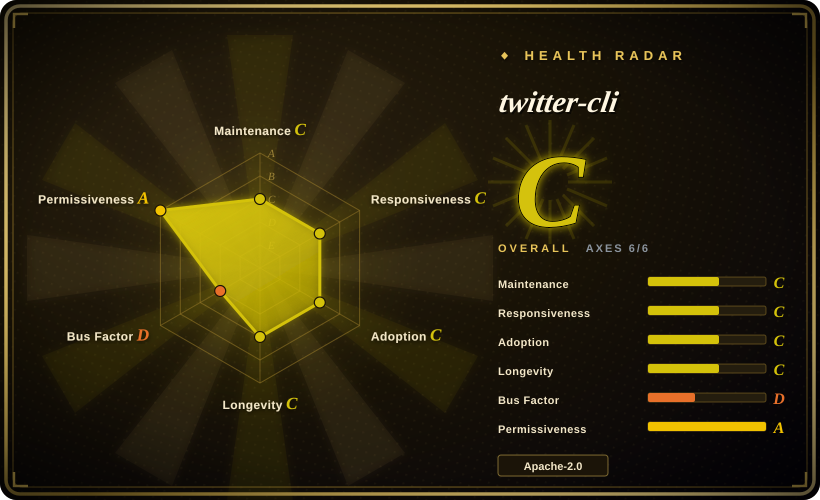
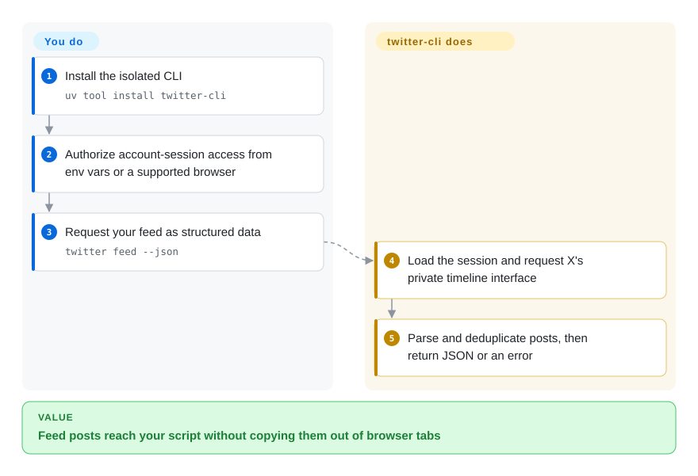
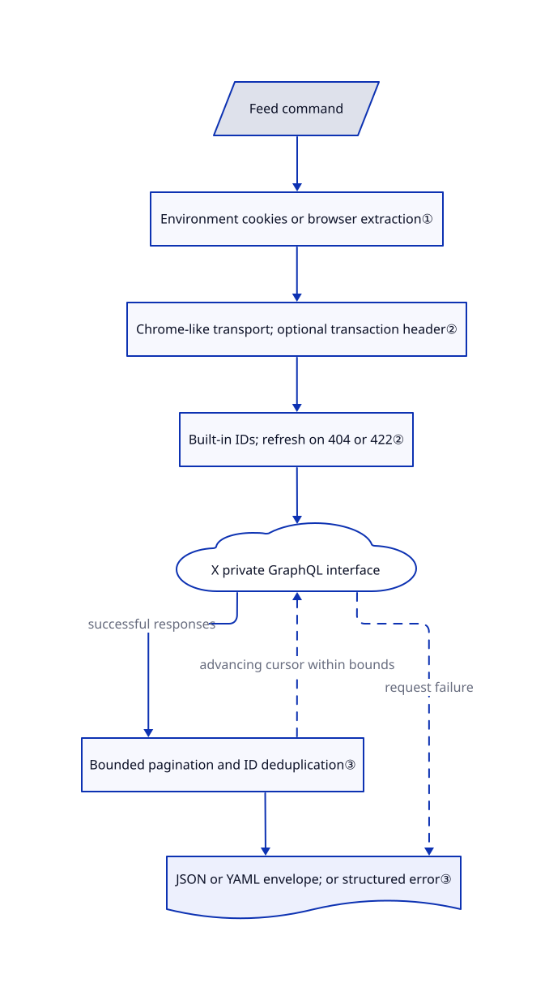

# twitter-cli

Your X bookmarks and feed are trapped in browser tabs; twitter-cli reads them through your account session and returns JSON or YAML to scripts.

## When to use

You are building a personal reading assistant and keep copying saved X posts into a script by hand. You want a terminal command for your own bookmarks, feed, user posts or an Article, without setting up a developer application. twitter-cli supplies those commands and structured output; unlike OpenCLI, it sends HTTP requests itself rather than keeping a Chrome extension and browser bridge running. You accept giving this process account-session credentials and maintaining an unofficial integration.

Treat it as a low-volume, repairable personal tool, not a dependable data feed. On 2026-10-21, [issue #88](https://github.com/public-clis/twitter-cli/issues/88) still reports search HTTP 404 errors, and [PR #99](https://github.com/public-clis/twitter-cli/pull/99) proposes an unmerged transaction-header fix. Those reports establish a current compatibility risk, not proof that every account or command fails.

## When NOT to use

- **A business integration needs documented authorization and predictable access.** Use [Tweepy against the official X API](https://docs.tweepy.org/en/stable/client.html), with approved credentials and the required endpoint access. This CLI reuses website session cookies; TLS impersonation is not platform approval. The [official API](https://docs.x.com/x-api/getting-started/about-x-api) requires an app and uses usage-based billing.
- **The main account cannot tolerate automation exposure.** Use the X website manually. [Issue #72](https://github.com/public-clis/twitter-cli/issues/72) contains a user's bot-flag report; it is not a measured suspension rate. Random delays and browser-like headers do not establish account safety.
- **Search must work unattended today.** Prefer the official X API through Tweepy after checking endpoint access. The unresolved bootstrap reports above mean that refreshing a query ID alone is not a demonstrated fix; do not build a scheduler around the README's suggestion to retry.
- **You need video publishing or an explicit review before posting.** Use the X website. The inspected client accepts only JPEG, PNG, GIF and WebP images, at most 5 MB each; the CLI limits posts to four images. Posting has no approval prompt; [deletion does ask for confirmation](https://github.com/public-clis/twitter-cli/blob/7c634e0d396b1e7af9f63315b414925fe4f29ae7/twitter_cli/cli.py#L1357-L1364). [Video support PR #96](https://github.com/public-clis/twitter-cli/pull/96) remains open.
- **The same agent must operate many logged-in websites.** Choose [OpenCLI](../web-automation/agent-browser-tools/opencli.md) for its browser bridge and site adapters, rather than treating this X-only command surface as general browser automation. OpenCLI still needs separate account-risk evaluation.

## Comparison

| Alternative | In index | Our verdict | Tradeoff |
|---|---|---|---|
| [OpenCLI](../web-automation/agent-browser-tools/opencli.md) | ✅ | Choose OpenCLI when a personal agent must operate several logged-in websites; choose twitter-cli for direct X commands without an extension or browser daemon. | Browser-mediated adapters broaden coverage but add a browser bridge; twitter-cli instead places session cookies in its own HTTP process and inherits private-endpoint churn. |
| [Tweepy](https://github.com/tweepy/tweepy) | not indexed | Choose Tweepy when the application should use documented X API endpoints and developer credentials; choose twitter-cli only when session-based personal access is an acceptable tradeoff. | A Python library rather than this ready-made CLI; you supply application code, authorized access and API budget. not added in this tab batch. |
| [X website](https://x.com/) | not a repo | Choose the X website for occasional reading or reviewed publishing when exporting credentials and maintaining automation would cost more than the manual work. | Hosted proprietary service, not a repository; keeps the human in the workflow but does not deliver this CLI's script-friendly output. |

## Quick start

The README installs the executable with `uv tool install twitter-cli` or `pipx install twitter-cli`. Before any account command, explicitly authorize credential access: supply `TWITTER_AUTH_TOKEN` and `TWITTER_CT0`, or permit extraction from a supported browser where you already signed in. Run `twitter feed --json` to receive a machine-readable result; you handle downstream storage, account permissions and any publishing approval. These commands are documented, not live-tested here: PyPI still serves 0.8.5 while the inspected main branch declares 0.8.6, so a package upgrade does not include all main-branch changes. [Install and usage source](https://github.com/public-clis/twitter-cli/blob/7c634e0d396b1e7af9f63315b414925fe4f29ae7/README.md#L55-L109).

<!-- flow-steps:begin (generated from flows/twitter-cli.json by tools/flow_card.py — do not edit) -->

Text version of the flow

1. **You**: Install the isolated CLI — `uv tool install twitter-cli`
2. **You**: Authorize account-session access from env vars or a supported browser
3. **You**: Request your feed as structured data — `twitter feed --json`
4. **twitter-cli**: Load the session and request X's private timeline interface
5. **twitter-cli**: Parse and deduplicate posts, then return JSON or an error

**Value**: Feed posts reach your script without copying them out of browser tabs

<!-- flow-steps:end -->

## Key techniques

<!-- mechanism:begin (generated from mechanisms/twitter-cli.json by tools/mechanism_card.py; do not edit) -->

Text version of the mechanism

- Feed command
- Environment cookies or browser extraction①
- Chrome-like transport; optional transaction header②
- Built-in IDs; refresh on 404 or 422②
- X private GraphQL interface
- Bounded pagination and ID deduplication③
- JSON or YAML envelope; or structured error③

- Feed command → Environment cookies or browser extraction①
- Environment cookies or browser extraction① → Chrome-like transport; optional transaction header②
- Chrome-like transport; optional transaction header② → Built-in IDs; refresh on 404 or 422②
- Built-in IDs; refresh on 404 or 422② → X private GraphQL interface
- X private GraphQL interface → Bounded pagination and ID deduplication③ (successful responses)
- Bounded pagination and ID deduplication③ → X private GraphQL interface (advancing cursor within bounds) [optional/fallback]
- Bounded pagination and ID deduplication③ → JSON or YAML envelope; or structured error③
- X private GraphQL interface → JSON or YAML envelope; or structured error③ (request failure) [optional/fallback]

<!-- mechanism:end -->

### 1. Session credentials replace developer API keys

- **Problem:** Personal feed and bookmark reads need the signed-in user's identity without a separate developer application.
- **How:** Authentication tries the two environment variables first, then extracts X/Twitter-domain cookies from supported browser profiles. The client forwards either the full cookie header or the two-cookie pair to X. Browser extraction first runs in-process, then tries a subprocess fallback.
- **Limits:** Cookie possession grants account authority, not a scoped read-only token. Even invalid environment credentials can trigger browser re-extraction; choosing a preferred browser does not disable fallback to others. Verification tolerates non-authentication endpoint failures, so successful credential loading does not prove the requested command works.
- **Source:** [Credential selection and re-extraction](https://github.com/public-clis/twitter-cli/blob/7c634e0d396b1e7af9f63315b414925fe4f29ae7/twitter_cli/auth.py#L563-L634), [domain filtering and profile order](https://github.com/public-clis/twitter-cli/blob/7c634e0d396b1e7af9f63315b414925fe4f29ae7/twitter_cli/auth.py#L166-L269), [verification policy](https://github.com/public-clis/twitter-cli/blob/7c634e0d396b1e7af9f63315b414925fe4f29ae7/twitter_cli/auth.py#L100-L163).

### 2. Repair query identifiers, but not every website change

- **Problem:** X changes the operation identifiers used by its private GraphQL interface, producing 404 or 422 errors.
- **How:** Requests start with cached or built-in identifiers. A qualifying failure retries with identifiers from a community GitHub file, then attempts to scan X JavaScript bundles. Separately, curl_cffi imitates a Chrome transport and the client derives a transaction header from homepage assets, cached for one hour.
- **Limits:** Updating an identifier cannot fix a missing transaction header. The inspected bootstrap fetches the root homepage without the account cookie, logs initialization failures, then continues without the header; the bundle scanner only recognizes an older asset URL layout. Open PRs propose changes, but those patches are absent from the reviewed commit.
- **Source:** [Identifier resolution and bundle scan](https://github.com/public-clis/twitter-cli/blob/7c634e0d396b1e7af9f63315b414925fe4f29ae7/twitter_cli/graphql.py#L108-L227), [404/422 retry](https://github.com/public-clis/twitter-cli/blob/7c634e0d396b1e7af9f63315b414925fe4f29ae7/twitter_cli/client.py#L899-L940), [transaction bootstrap](https://github.com/public-clis/twitter-cli/blob/7c634e0d396b1e7af9f63315b414925fe4f29ae7/twitter_cli/client.py#L1032-L1172), [unmerged repair proposal](https://github.com/public-clis/twitter-cli/pull/93).

### 3. Bound collection and separate machine output from tables

- **Problem:** One requested feed can span several pages, repeat posts and otherwise require scripts to scrape terminal tables.
- **How:** The timeline collector follows cursors, deduplicates tweet IDs and stops at a request-count bound, a missing cursor or a non-advancing cursor. It applies randomized inter-page delays. Structured output wraps data with `ok` and `schema_version`; non-terminal stdout defaults to YAML, while explicit flags select JSON or YAML.
- **Limits:** The default configured cap is 200 items and the absolute ceiling is 500 per fetch; the attempt bound can stop before the requested count. Only relevant timeline commands expose a continuation cursor. This is not a complete archive or a guarantee that all matching posts were collected; compact output and saved tweet files have their own serialization paths.
- **Source:** [Collection bounds](https://github.com/public-clis/twitter-cli/blob/7c634e0d396b1e7af9f63315b414925fe4f29ae7/twitter_cli/client.py#L139-L148), [timeline loop](https://github.com/public-clis/twitter-cli/blob/7c634e0d396b1e7af9f63315b414925fe4f29ae7/twitter_cli/client.py#L752-L825), [output policy and envelope](https://github.com/public-clis/twitter-cli/blob/7c634e0d396b1e7af9f63315b414925fe4f29ae7/twitter_cli/output.py#L38-L122), [serialization branches](https://github.com/public-clis/twitter-cli/blob/7c634e0d396b1e7af9f63315b414925fe4f29ae7/twitter_cli/cli.py#L308-L359).

## Tech stack

- Python ≥ 3.10, Click commands and Rich terminal tables.
- curl_cffi HTTP transport; browser-cookie3 credential extraction; xclienttransaction and Beautiful Soup for transaction-header initialization.
- PyYAML and JSON serialization; local configuration and cache files, not a database service. [Manifest](https://github.com/public-clis/twitter-cli/blob/7c634e0d396b1e7af9f63315b414925fe4f29ae7/pyproject.toml#L5-L30).

## Dependencies

- A signed-in X account and authorized access to its session credentials. Browser extraction supports Arc, Chrome, Edge, Firefox and Brave; operating-system keyring permissions can be required.
- Reachability to X and its assets; identifier refresh can additionally contact the public community file on GitHub. No developer API key is required by this private-interface path.
- Optional proxy via `TWITTER_PROXY`; a working-directory `config.yaml` controls counts, filters and delays. The client stores transaction bootstrap data under `~/.twitter-cli/transaction_cache.json`.

## Ops difficulty

**Medium for personal use; unsuitable as an unqualified production dependency.** There is no server or database to operate, but session expiry, keyring access and private-interface changes require intervention. Keep credentials out of prompts and logs, cap reads, and place an external approval boundary around all writes. On 2026-10-21, compare the installed package version with main before assuming an upstream fix shipped; a unit-test pass would not establish live X compatibility.

## Health & viability

- **Maintenance, 2026-10-21:** not archived, but the default branch last changed on 2026-05-07. PyPI's latest artifact is 0.8.5 from 2026-03-17; GitHub lists tags but no releases. Main's 0.8.6 manifest is not a published 0.8.6 package.
- **Governance:** the canonical owner is the public-clis organization; the old jackwener URL redirects to the same repository. Of 135 listed contributions across nine contributors, jackwener has 124. The [license](https://github.com/public-clis/twitter-cli/blob/7c634e0d396b1e7af9f63315b414925fe4f29ae7/LICENSE#L179-L191) names jackwener; organization ownership alone does not establish institutional backing.
- **Age and durability:** created 2026-03-05, only about seven months old at review. [推断：based on creation date, last commit and unmerged fixes] A short history plus stalled default-branch fixes is a weak durability signal; use it only where you can tolerate repair or replacement.
- **Adoption and risk:** GitHub reports 3000 stars and 293 forks, which do not demonstrate production reliability. Thirteen test modules include fixture tests and opt-in account-backed smoke tests; none were executed for this intake. Apache-2.0 permits code reuse, not unrestricted use of X data or immunity from platform enforcement.

## Caveats (unverified)

- [未验证：credential access and upstream execution were not authorized] No authenticated read, write, package installation or upstream test was run. Current behavior is established from source and dated issue reports, not a reproduced account session.
- [未验证：public reports were not independently reproduced] The bot flag in #72 and live-fix claims in open PRs are reports, not independently established causality or success rates. No proxy or fingerprint option is proven safe here.
- [推断：based on creation date, last commit and unmerged fixes] The personal-tool-only durability recommendation is a selection judgment, not proof of abandonment or a prediction of the maintainer's plans.
