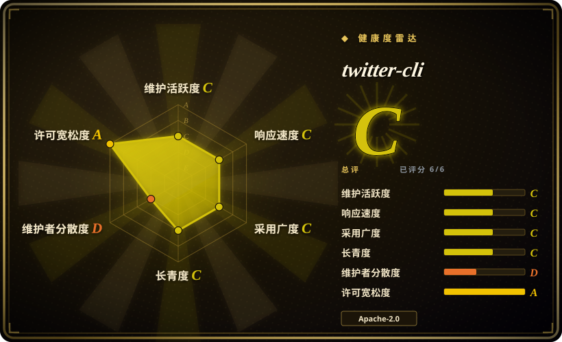
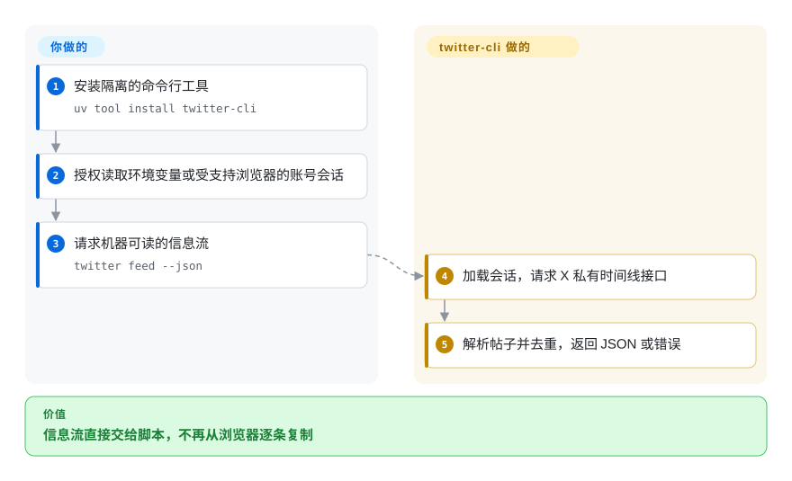
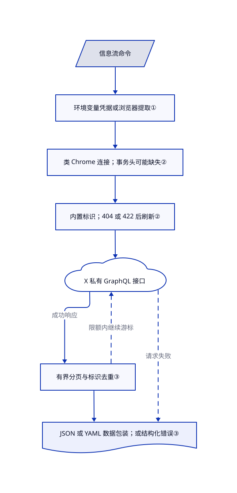

# twitter-cli

你总要从 X 书签和信息流手抄帖子给脚本。twitter-cli 借用账号登录态，把这些内容变成 JSON 或 YAML。

## 何时使用

你在做个人阅读助手，总要把 X 收藏帖子逐条复制给脚本。你想直接读取自己的书签、信息流、用户帖子或长文，却不想先注册开发者应用。twitter-cli 提供对应命令和结构化输出。与 OpenCLI 不同，它自己发送 HTTP 请求，不需要常驻 Chrome 扩展和浏览器桥接服务。代价是让该进程持有账号登录凭据，并接受非官方接口的维护成本。

把它当成低频、允许修补的个人工具，不要当稳定数据源。截至 2026-10-21，[问题 #88](https://github.com/public-clis/twitter-cli/issues/88) 仍报告搜索返回 HTTP 404，[修复提案 #99](https://github.com/public-clis/twitter-cli/pull/99) 尚未合并。这些记录证明当前存在兼容风险，不代表每个账号、每条命令都失效。

## 何时不用

- **业务集成需要文档化授权和可预期访问。** 用 [Tweepy 调用官方 X API](https://docs.tweepy.org/en/stable/client.html)，配置获批凭据和对应接口权限。本项目借用网站会话，模仿浏览器连接特征不等于平台授权。[官方 API](https://docs.x.com/x-api/getting-started/about-x-api) 要创建应用，并按用量计费。
- **主账号不能承受自动化风险。** 手动使用 X 网站。[问题 #72](https://github.com/public-clis/twitter-cli/issues/72) 有用户被标记为机器人的自报，但不是封号率测量。随机延迟和浏览器式请求头不能证明账号安全。
- **搜索今天就必须无人值守运行。** 确认接口权限后，优先用 Tweepy 接官方 X API。上面的初始化问题尚未解决，刷新查询标识并不是已经证实的修复，不能照 README 的重试建议直接搭定时任务。
- **要发视频，或要求发布前人工确认。** 用 X 网站。所读客户端只接受 JPEG、PNG、GIF、WebP 图片，每张最多 5 MB，命令行每帖最多四张。发帖没有审批提示；[删帖会要求确认](https://github.com/public-clis/twitter-cli/blob/7c634e0d396b1e7af9f63315b414925fe4f29ae7/twitter_cli/cli.py#L1357-L1364)。[视频支持提案 #96](https://github.com/public-clis/twitter-cli/pull/96) 仍未合并。
- **同一个助手要操作多个已登录网站。** 选 [OpenCLI](../web-automation/agent-browser-tools/opencli.zh.md) 的浏览器桥接和站点适配器，不要把 X 专用命令当通用浏览器自动化。OpenCLI 的账号风险仍需另行评估。

## 横向对比

| 替代品 | 是否收录 | 我们的评价 | 取舍 |
|---|---|---|---|
| [OpenCLI](../web-automation/agent-browser-tools/opencli.zh.md) | ✅ | 个人助手要操作多个已登录网站时选 OpenCLI；只要直接调用 X 命令、不想装扩展和常驻桥接时，才选 twitter-cli。 | 浏览器适配器覆盖面更广，但增加桥接组件；twitter-cli 则让自己的 HTTP 进程持有会话凭据，并承受私有接口变化。 |
| [Tweepy](https://github.com/tweepy/tweepy) | 未收录 | 应用要走文档化 X API 和开发者凭据时选 Tweepy；能接受个人会话访问的取舍时才选 twitter-cli。 | Tweepy 是 Python 库，不是本页这种现成命令；应用代码、授权权限和 API 预算由你负责。本批未新增，not added in this tab batch。 |
| [X 网站](https://x.com/) | 非仓库 | 偶尔阅读或需要逐条确认发布时选 X 网站，省去导出凭据和维护自动化的成本。 | 托管的专有服务，不是仓库；保留人工操作，但不提供本工具可直接交给脚本的输出。 |

## 快速上手

README 用 `uv tool install twitter-cli` 或 `pipx install twitter-cli` 安装命令。执行账号命令前，先明确授权凭据访问：提供 `TWITTER_AUTH_TOKEN` 和 `TWITTER_CT0`，或允许从已登录的受支持浏览器提取。运行 `twitter feed --json` 获取机器可读结果；后续存储、账号权限和发布审批仍由你负责。这些命令已核对文档，本次没有实跑：PyPI 仍是 0.8.5，所读主分支声明 0.8.6，更新安装包不等于拿到了主分支全部修复。[安装与用法来源](https://github.com/public-clis/twitter-cli/blob/7c634e0d396b1e7af9f63315b414925fe4f29ae7/README.md#L55-L109)。

<!-- flow-steps:begin (generated from flows/twitter-cli.json by tools/flow_card.py — do not edit) -->

流程文字版

1. **你**：安装隔离的命令行工具 — `uv tool install twitter-cli`
2. **你**：授权读取环境变量或受支持浏览器的账号会话
3. **你**：请求机器可读的信息流 — `twitter feed --json`
4. **twitter-cli**：加载会话，请求 X 私有时间线接口
5. **twitter-cli**：解析帖子并去重，返回 JSON 或错误

**价值**：信息流直接交给脚本，不再从浏览器逐条复制

<!-- flow-steps:end -->

## 技术要点

<!-- mechanism:begin (generated from mechanisms/twitter-cli.json by tools/mechanism_card.py; do not edit) -->

机制文字版

- 信息流命令
- 环境变量凭据或浏览器提取①
- 类 Chrome 连接；事务头可能缺失②
- 内置标识；404 或 422 后刷新②
- X 私有 GraphQL 接口
- 有界分页与标识去重③
- JSON 或 YAML 数据包装；或结构化错误③

- 信息流命令 → 环境变量凭据或浏览器提取①
- 环境变量凭据或浏览器提取① → 类 Chrome 连接；事务头可能缺失②
- 类 Chrome 连接；事务头可能缺失② → 内置标识；404 或 422 后刷新②
- 内置标识；404 或 422 后刷新② → X 私有 GraphQL 接口
- X 私有 GraphQL 接口 → 有界分页与标识去重③（成功响应）
- 有界分页与标识去重③ → X 私有 GraphQL 接口（限额内继续游标）〔可选／兜底〕
- 有界分页与标识去重③ → JSON 或 YAML 数据包装；或结构化错误③
- X 私有 GraphQL 接口 → JSON 或 YAML 数据包装；或结构化错误③（请求失败）〔可选／兜底〕

<!-- mechanism:end -->

### 1. 用账号会话替代开发者密钥

- **解决：** 个人信息流和书签需要用户身份，但你不想另建开发者应用。
- **做法：** 先读两个环境变量，再尝试从受支持浏览器配置中提取 X／Twitter 域的 cookie。客户端向 X 转发完整 cookie 请求头或最小双 cookie。浏览器提取先在当前进程执行，再尝试子进程兜底。
- **边界：** cookie 代表账号权限，不是受限的只读令牌。环境变量凭据无效时，仍可能转向浏览器重提取；指定优先浏览器也不会禁用其他浏览器兜底。验证会放行非鉴权类接口失败，因此加载凭据成功不等于目标命令可用。
- **源码：** [凭据选择与重提取](https://github.com/public-clis/twitter-cli/blob/7c634e0d396b1e7af9f63315b414925fe4f29ae7/twitter_cli/auth.py#L563-L634)、[域过滤和配置顺序](https://github.com/public-clis/twitter-cli/blob/7c634e0d396b1e7af9f63315b414925fe4f29ae7/twitter_cli/auth.py#L166-L269)、[验证放行策略](https://github.com/public-clis/twitter-cli/blob/7c634e0d396b1e7af9f63315b414925fe4f29ae7/twitter_cli/auth.py#L100-L163)。

### 2. 修复查询标识，不等于修复全部网站变化

- **解决：** X 私有 GraphQL 接口的操作标识变化后，请求会返回 404 或 422。
- **做法：** 先用缓存或内置标识。符合条件的失败触发重试，从社区 GitHub 文件取新标识，再尝试扫描 X 的 JavaScript 包。另一条路径用 curl_cffi 模仿 Chrome 连接特征，并从主页素材生成事务请求头，缓存一小时。
- **边界：** 更新操作标识不能补回缺失的事务头。所读初始化代码没有给根主页请求附账号 cookie，失败只记警告，后续请求仍不带事务头；脚本扫描器也只识别旧素材地址布局。公开修复提案尚未进入所读提交。
- **源码：** [标识解析和脚本扫描](https://github.com/public-clis/twitter-cli/blob/7c634e0d396b1e7af9f63315b414925fe4f29ae7/twitter_cli/graphql.py#L108-L227)、[404／422 重试](https://github.com/public-clis/twitter-cli/blob/7c634e0d396b1e7af9f63315b414925fe4f29ae7/twitter_cli/client.py#L899-L940)、[事务初始化](https://github.com/public-clis/twitter-cli/blob/7c634e0d396b1e7af9f63315b414925fe4f29ae7/twitter_cli/client.py#L1032-L1172)、[未合并修复提案](https://github.com/public-clis/twitter-cli/pull/93)。

### 3. 有界抓取，并把机器输出与表格分开

- **解决：** 一次信息流读取会跨页、重复帖子，脚本还可能被迫解析终端表格。
- **做法：** 收集器跟随游标，按帖子标识去重；请求次数到上限、游标缺失或游标不前进时停止。跨页请求加入随机延迟。结构化输出用 `ok` 和 `schema_version` 包装数据；标准输出不是终端时默认 YAML，显式参数可选 JSON 或 YAML。
- **边界：** 配置默认每次最多 200 条，绝对上限 500 条；请求次数限制也可能让结果少于所要数量。只有相关时间线命令暴露续读游标。这不是完整归档，不能保证收全匹配帖子；紧凑输出和保存文件另走序列化路径。
- **源码：** [数量边界](https://github.com/public-clis/twitter-cli/blob/7c634e0d396b1e7af9f63315b414925fe4f29ae7/twitter_cli/client.py#L139-L148)、[时间线循环](https://github.com/public-clis/twitter-cli/blob/7c634e0d396b1e7af9f63315b414925fe4f29ae7/twitter_cli/client.py#L752-L825)、[输出选择与统一包装](https://github.com/public-clis/twitter-cli/blob/7c634e0d396b1e7af9f63315b414925fe4f29ae7/twitter_cli/output.py#L38-L122)、[序列化分支](https://github.com/public-clis/twitter-cli/blob/7c634e0d396b1e7af9f63315b414925fe4f29ae7/twitter_cli/cli.py#L308-L359)。

## 技术栈

- Python ≥ 3.10；Click 命令和 Rich 终端表格。
- curl_cffi 发 HTTP 请求；browser-cookie3 提取凭据；xclienttransaction 与 Beautiful Soup 初始化事务请求头。
- PyYAML 和 JSON 序列化；使用本地配置、缓存文件，不依赖数据库服务。[依赖清单](https://github.com/public-clis/twitter-cli/blob/7c634e0d396b1e7af9f63315b414925fe4f29ae7/pyproject.toml#L5-L30)。

## 依赖

- 已登录的 X 账号，以及对其会话凭据的明确访问授权。支持 Arc、Chrome、Edge、Firefox、Brave 提取；可能需要操作系统钥匙串权限。
- 能访问 X 及其素材；刷新标识时还可能访问 GitHub 社区文件。私有接口路径不需要开发者 API key。
- 可用 `TWITTER_PROXY` 配代理；工作目录的 `config.yaml` 控制数量、过滤和延迟。事务初始化数据存于 `~/.twitter-cli/transaction_cache.json`。

## 运维难度

**个人使用中等，不应直接作为生产承重依赖。** 无需运行服务或数据库，但会话过期、钥匙串权限和私有接口变化需要干预。不要把凭据放进提示词或日志；限制读取量，所有写操作外置审批。核验日为 2026-10-21，要对照安装包和主分支版本，不能假定修复已发布；即使单测通过，也不能证明实时 X 接口可用。

## 健康度与可持续性

- **维护，截至 2026-10-21：** 未归档，但默认分支最后更新于 2026-05-07。PyPI 最新包是 2026-03-17 的 0.8.5；GitHub 有标签，没有 release。主分支清单里的 0.8.6 不代表已有同版本发布包。
- **治理：** 当前规范归属为 public-clis 组织，旧 jackwener 地址重定向到同一仓库。九名贡献者的 135 次贡献中，jackwener 占 124 次。[许可证](https://github.com/public-clis/twitter-cli/blob/7c634e0d396b1e7af9f63315b414925fe4f29ae7/LICENSE#L179-L191) 署名 jackwener；组织持有仓库不等于有机构支持。
- **年龄和持续性：** 创建于 2026-03-05，核验时仅约七个月。[推断：依据是创建日期、末次提交和修复仍未合并] 历史短，默认分支修复停滞，长期可持续信号弱；只用于能接受修补或替换的任务。
- **采用和风险：** GitHub 显示 3000 stars、293 forks，不能据此证明生产可靠。十三个测试模块包含固定样本测试和需账号的可选实时冒烟测试，本次均未执行。Apache-2.0 允许复用代码，不等于允许任意使用 X 数据，也不免除平台风控。

## 存疑（未验证）

- [未验证：本次授权禁止读取登录凭据或执行上游] 未运行登录态读写、包安装或上游测试。当前行为来自源码和带日期的问题记录，不是账号实测。
- [未验证：公开 issue 是用户自报，无法独立复现] #72 的机器人标记，以及公开修复提案中的成功声明，都不是独立验证的因果关系或成功率。没有证据证明某种代理或指纹选项安全。
- [推断：依据是创建日期、末次提交和修复仍未合并] 建议仅用于个人可修补任务，是选型判断；不证明项目已放弃，也不预测维护者后续计划。
