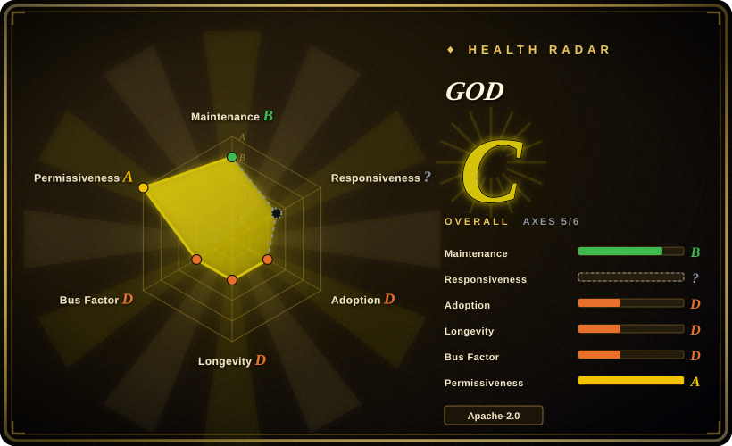
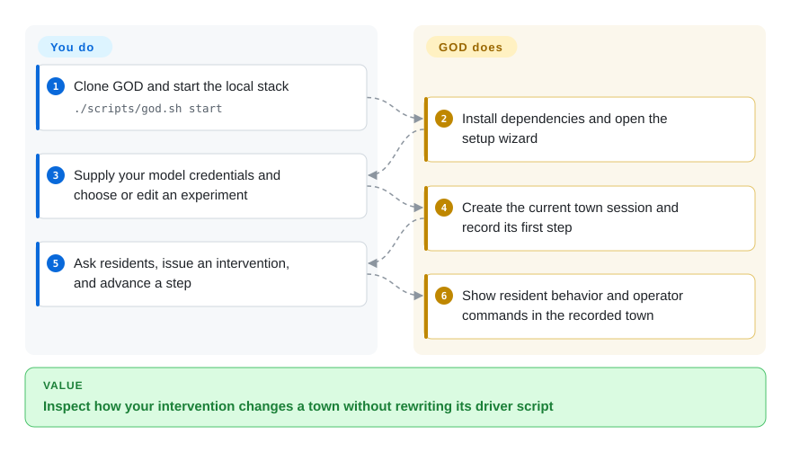
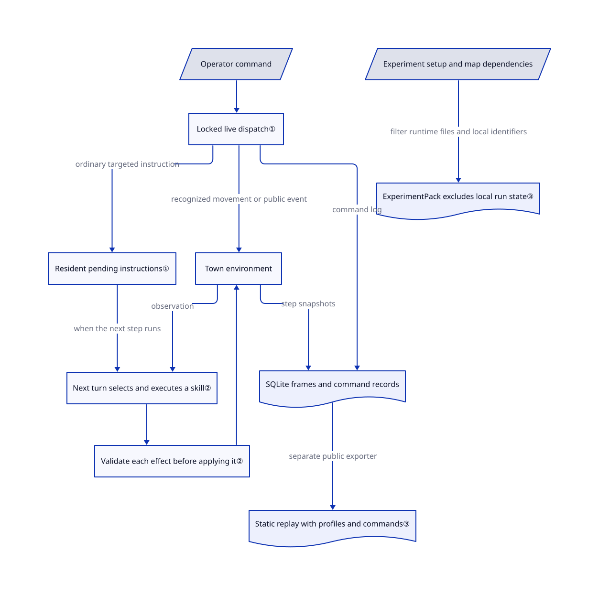

# GOD

Your simulated residents keep talking, but a finished transcript cannot show what happens after you interrupt them. GOD lets you question residents, issue interventions, advance their town one step, and inspect the recorded result on the same map.

## When to use

You are prototyping a language-agent society for a classroom, an interaction study, or a scenario rehearsal. Ten residents walk and exchange messages, and you want to pause, ask one resident what they know, announce a disruption, then inspect the next step without writing a new driver script. Choose GOD for its local operator console, editable residents/maps, and portable experiment folders, rather than assembling that surface on AgentSociety yourself.

Its primary value is **intervening in a visible small society**, not forecasting real people or coordinating coding agents. It integrates trimmed AgentSociety and JiuwenClaw checkouts with a map-first React interface and a local live API. The public website serves recorded replays without a key; steering a live run requires your own installation and model endpoint. See the [scope and roadmap](https://github.com/XiaoLuoLYG/GOD/blob/753f0679758765d002f9dd9581ee37239b4be908/README.md#L157-L245).

## When NOT to use

- **You need parallel control groups, repeated trials, or cross-run intervention metrics.** Choose [AgentSociety](agentsociety.md) as a programmable experiment base and build your evaluation protocol there. GOD's launcher selects one current experiment; multi-experiment orchestration, cross-run evaluation, and large-scale execution remain roadmap items, not inherited guarantees from its bundled engine.
- **You need Twitter/Reddit feeds and recommendation dynamics.** Choose [OASIS](oasis.md). GOD centers on residents, locations, conversations, and operator actions in a pixel town, not feed-algorithm experiments.
- **You want a document-in, report-out application.** Choose [MiroFish](mirofish.md), accepting its AGPL and external-memory tradeoffs. GOD expects you to author or select a society and inspect its behavior; it does not turn a seed document into a validated forecast. For claims about real populations, substitute surveys or observational studies, not another simulated town: GOD explicitly disclaims social realism.
- **You need a hardened shared service or untrusted-plugin isolation.** Prefer an isolated, code-owned [AgentSociety](agentsociety.md) deployment with separately designed access controls. GOD's launcher is local-first; custom Python discovery executes imports and skills run local subprocesses. A working-directory boundary and an environment-variable allowlist are not an operating-system sandbox.
- **You need blanket clearance to redistribute all bundled art.** Start with an [AgentSociety](agentsociety.md) environment using assets you own. GOD's code is Apache-2.0, but The Ville attribution points to third-party Generative Agents art; attribution alone does not establish downstream commercial rights.

## Comparison

| Alternative | In index | Our verdict | Tradeoff |
| --- | --- | --- | --- |
| [AgentSociety](agentsociety.md) | ✅ | Choose GOD when an operator must ask and steer residents on a map now; choose AgentSociety when programmable experiments and research infrastructure outweigh a ready control room. | GOD bundles a modified runtime and supplies the interaction surface; adopting it also means tracking that integration rather than assuming upstream package parity. |
| [OASIS](oasis.md) | ✅ | Choose OASIS for social-media action spaces and feed dynamics; choose GOD for location-based towns with a human issuing step-level commands. | OASIS gives you a code-first platform simulation; GOD gives you a browser workflow but no comparable large-scale guarantee. |
| [MiroFish](mirofish.md) | ✅ | Choose MiroFish when seed material must become a browsable simulation and report; choose GOD when the operator's live interventions are the experiment. | GOD keeps its replay store local and uses your chosen model endpoint; you supply the scenario and analysis instead of receiving an upload-to-report pipeline. |

## Quick start

Clone the repository and, on macOS/Linux, run `./scripts/god.sh start` from its root; first startup installs Python and Node dependencies and opens a setup wizard. Supply an OpenAI-compatible model address, model name, and API key, then select GOD Town or create and edit an experiment. The launcher starts the local services, creates a session, and runs the first step; you then use `/ask`, `/intervene`, and Run Step to inspect the society. GOD supplies the town, controls, and recorded frames; you pay model costs, review generated profiles, and decide what counts as meaningful behavior. Keys are stored in local `.env` with redacted setup responses, not in an encrypted secret store; the public replay site is an alternative for viewing only, not live steering. This usage path is documented in [Quickstart](https://github.com/XiaoLuoLYG/GOD/blob/753f0679758765d002f9dd9581ee37239b4be908/QUICKSTART.md#L9-L91); it was read, not executed for this entry.

<!-- flow-steps:begin (generated from flows/god.json by tools/flow_card.py — do not edit) -->

Text version of the flow

1. **You**: Clone GOD and start the local stack — `./scripts/god.sh start`
2. **GOD**: Install dependencies and open the setup wizard
3. **You**: Supply your model credentials and choose or edit an experiment
4. **GOD**: Create the current town session and record its first step
5. **You**: Ask residents, issue an intervention, and advance a step
6. **GOD**: Show resident behavior and operator commands in the recorded town

**Value**: Inspect how your intervention changes a town without rewriting its driver script

<!-- flow-steps:end -->

## Key techniques

<!-- mechanism:begin (generated from mechanisms/god.json by tools/mechanism_card.py; do not edit) -->

Text version of the mechanism

- Operator command
- Locked live dispatch①
- Resident pending instructions①
- Town environment
- Next turn selects and executes a skill②
- Validate each effect before applying it②
- SQLite frames and command records
- Static replay with profiles and commands③
- Experiment setup and map dependencies
- ExperimentPack excludes local run state③

- Operator command → Locked live dispatch①
- Locked live dispatch① → Resident pending instructions① (ordinary targeted instruction)
- Locked live dispatch① → Town environment (recognized movement or public event)
- Resident pending instructions① → Next turn selects and executes a skill② (when the next step runs)
- Town environment → Next turn selects and executes a skill② (observation)
- Next turn selects and executes a skill② → Validate each effect before applying it②
- Validate each effect before applying it② → Town environment
- Town environment → SQLite frames and command records (step snapshots)
- Locked live dispatch① → SQLite frames and command records (command log)
- SQLite frames and command records → Static replay with profiles and commands③ (separate public exporter)
- Experiment setup and map dependencies → ExperimentPack excludes local run state③ (filter runtime files and local identifiers)

<!-- mechanism:end -->

### 1. Separate command acceptance from the step that applies it

- **Problem:** Clicking an intervention can look like changing the world even when no simulation turn has advanced.
- **How:** The live session serializes steps and interactions with a lock, records operator commands, and broadcasts completion events. Ordinary targeted instructions enter the resident's pending list, which the next skill-selection turn consumes; recognized movement calls environment pathfinding directly, while society events can be published directly.
- **Limits:** Acceptance is not behavioral compliance. Movement and public-event fast paths differ from queued prompts; manual mode still needs Run Step to advance time. Pause requests stop the automatic loop between steps, not an already-running model request.
- **Source:** [Live dispatch and movement](https://github.com/XiaoLuoLYG/GOD/blob/753f0679758765d002f9dd9581ee37239b4be908/agentsociety/packages/agentsociety2/agentsociety2/backend/routers/live_experiments.py#L745-L991), [command recording and pause](https://github.com/XiaoLuoLYG/GOD/blob/753f0679758765d002f9dd9581ee37239b4be908/agentsociety/packages/agentsociety2/agentsociety2/backend/routers/live_experiments.py#L1020-L1284), [pending-list consumption](https://github.com/XiaoLuoLYG/GOD/blob/753f0679758765d002f9dd9581ee37239b4be908/agentsociety/custom/agents/jiuwenclaw_agent.py#L426-L461).

### 2. Select executable skills, then validate individual effects

- **Problem:** A resident can describe an action that never changes its location, messages, or stored state.
- **How:** Each turn combines observation and pending instructions, asks the JiuwenClaw bridge to choose a mounted skill, executes it, and parses structured results. The adapter checks effect permissions, destination IDs, and interaction locations before applying world, speech, and memory effects and logging the result.
- **Limits:** Validation is per effect, not an atomic transaction: permitted effects can apply while other fields produce errors. Skills execute Python locally with a restricted environment; neither those checks nor the chosen working directory confine malicious code or establish psychological realism.
- **Source:** [Skill selection and execution](https://github.com/XiaoLuoLYG/GOD/blob/753f0679758765d002f9dd9581ee37239b4be908/agentsociety/custom/agents/jiuwenclaw_agent.py#L481-L636), [effect checks and application](https://github.com/XiaoLuoLYG/GOD/blob/753f0679758765d002f9dd9581ee37239b4be908/agentsociety/custom/agents/jiuwenclaw_agent.py#L870-L1043), [local subprocess execution](https://github.com/XiaoLuoLYG/GOD/blob/753f0679758765d002f9dd9581ee37239b4be908/agentsociety/packages/agentsociety2/agentsociety2/agent/skills/__init__.py#L534-L633).

### 3. Share an experiment setup separately from its recorded run

- **Problem:** Sharing a scenario can accidentally share local sessions and logs, or mislead a recipient into treating a recording as a runnable experiment.
- **How:** ExperimentPack validates initialization and step files, embeds map/agent dependencies, excludes run directories, databases, logs, and `.env`, and strips session IDs and trusted directories from initialization data. Import previews distinguish installable packages from static replay archives; a separate exporter converts SQLite frames, profiles, and operator commands into browser-readable JSON.
- **Limits:** These filters are not a general privacy scrubber: public replay export includes profiles and command text. A replay is not a portable complete runtime checkpoint; live resume restores supported environment state or reruns steps, not a guarantee of identical model history. Inspect packs and custom Python before trusting them.
- **Source:** [Pack filtering and sanitization](https://github.com/XiaoLuoLYG/GOD/blob/753f0679758765d002f9dd9581ee37239b4be908/agentsociety/packages/agentsociety2/agentsociety2/backend/services/experiment_packs.py#L83-L297), [replay rejection during import](https://github.com/XiaoLuoLYG/GOD/blob/753f0679758765d002f9dd9581ee37239b4be908/agentsociety/packages/agentsociety2/agentsociety2/backend/services/package_imports.py#L34-L79), [static export](https://github.com/XiaoLuoLYG/GOD/blob/753f0679758765d002f9dd9581ee37239b4be908/agentsociety/packages/agentsociety2/agentsociety2/backend/services/public_replay_export.py#L81-L134), [live restoration](https://github.com/XiaoLuoLYG/GOD/blob/753f0679758765d002f9dd9581ee37239b4be908/agentsociety/packages/agentsociety2/agentsociety2/backend/routers/live_experiments.py#L369-L419).

## Tech stack

- React 18, TypeScript, Vite 6, Ant Design, and Phaser in the frontend; Python, FastAPI, WebSocket updates, and SQLite replay storage in the backend.
- Integrated AgentSociety workspace and JiuwenClaw runtime, not a standalone replacement for either. The checked manifest still names `agentsociety2` 2.2.0 and `jiuwenclaw` 0.1.11; do not replace them with the latest upstream packages and assume compatibility.
- Sources: [frontend manifest](https://github.com/XiaoLuoLYG/GOD/blob/753f0679758765d002f9dd9581ee37239b4be908/agentsociety/frontend/package.json), [AgentSociety manifest](https://github.com/XiaoLuoLYG/GOD/blob/753f0679758765d002f9dd9581ee37239b4be908/agentsociety/packages/agentsociety2/pyproject.toml), [JiuwenClaw manifest](https://github.com/XiaoLuoLYG/GOD/blob/753f0679758765d002f9dd9581ee37239b4be908/jiuwenclaw/pyproject.toml).

## Dependencies

- Python 3.11–3.13 per both runtime manifests; Node/npm and `uv`. The macOS/Linux quickstart also lists `screen`; Windows uses PowerShell and `winget`.
- A compatible model endpoint and credentials for live simulation. Optional image-generation settings support artwork creation; viewing exported static replays needs no model credentials.
- The bundled dependency graph is substantial: AgentSociety lists Torch, Transformers, MinerU, database clients, and analysis packages; JiuwenClaw includes an `openjiuwen` Git dependency on `develop`. The launcher runs `uv sync` for both workspaces and installs frontend packages. Local-first does not mean a small, offline installation.

## Ops difficulty

**Medium to high.** The wizard removes manual configuration work, not the cost of maintaining several Python/Node services and their dependencies. Keep the launcher on its loopback defaults; its local setup, file-import, and custom-module surfaces are not a turnkey multi-user deployment. Custom module scanning [executes Python imports](https://github.com/XiaoLuoLYG/GOD/blob/753f0679758765d002f9dd9581ee37239b4be908/agentsociety/packages/agentsociety2/agentsociety2/backend/services/custom/scanner.py#L242-L251), so imported code is trusted local code, not inert scenario data.

Use `./scripts/god.sh stop` to stop the stack; stopping does not erase credentials or exported data. `restart` preserves the run, whereas `new-run` stops services, deletes the current experiment's `run` directory, and starts again. Back up wanted replays first; this is deletion, not undoing a single intervention. Exported public replays can contain resident profiles, messages, and operator prompts, so review them before publishing. See [reset implementation](https://github.com/XiaoLuoLYG/GOD/blob/753f0679758765d002f9dd9581ee37239b4be908/scripts/god.sh#L1199-L1215) and [security guidance](https://github.com/XiaoLuoLYG/GOD/blob/753f0679758765d002f9dd9581ee37239b4be908/SECURITY.md).

## Health & viability

- **2026-10-26 verdict:** suitable as an inspectable prototype, not a long-term experimental standard. Created 2026-05-11, it is under six months old; the default branch remains maintained, but that short history provides little Lindy evidence. This is a selection judgment based on dated metadata, not a durability forecast.
- **Maintenance:** latest versioned release is v0.2.0, published 2026-06-11; repository push activity reaches 2026-10-23. Recent [setup/replay fixes](https://github.com/XiaoLuoLYG/GOD/pull/106) and [open setup issues](https://github.com/XiaoLuoLYG/GOD/issues/105) make startup robustness a practical check before adoption.
- **Governance and adoption:** user-owned repository; the fetched contributor list attributes 56 of 60 contributions to XiaoLuoLYG. Its 1,238 stars and 136 forks are interest signals, not proof of production adoption or institutional maintenance funding.
- **License and integration:** root Apache-2.0 names the GOD authors; the integrated AgentSociety license and JiuwenClaw license/notice are present. The Ville [attribution](https://github.com/XiaoLuoLYG/GOD/blob/753f0679758765d002f9dd9581ee37239b4be908/agentsociety/custom/maps/the_ville/ATTRIBUTION.md) identifies copied third-party artwork; PKU attribution describes generated art. Do not infer blanket asset clearance from the code license.

## Caveats (unverified)

- [Unverified: no upstream installation or model connection was performed] First-start success, model compatibility, per-step cost, latency, and safe shutdown under load were not reproduced. Upstream release test claims are not this entry's measurements.
- [Unverified: attribution files do not establish complete downstream rights] Commercial redistribution rights for all map tiles and sprites were not established by the bundled attribution files. No complete license audit was performed.
- [Unverified: metadata lacks maintenance commitments or deployment acceptance evidence] Production deployments, institutional funding, and long-term maintenance commitments were not verified; stars and the paper-demo framing do not establish them.
