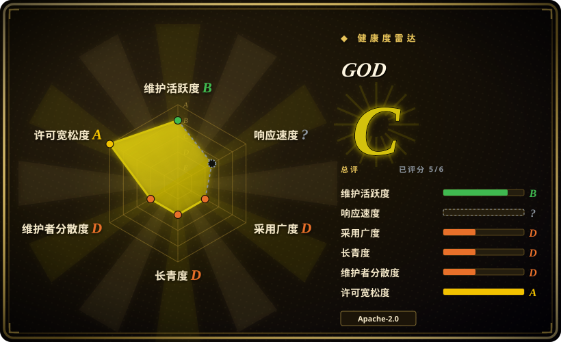
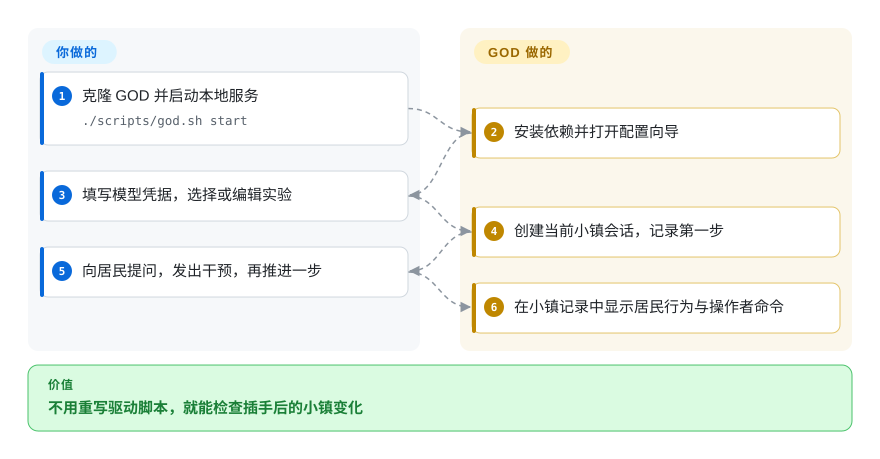
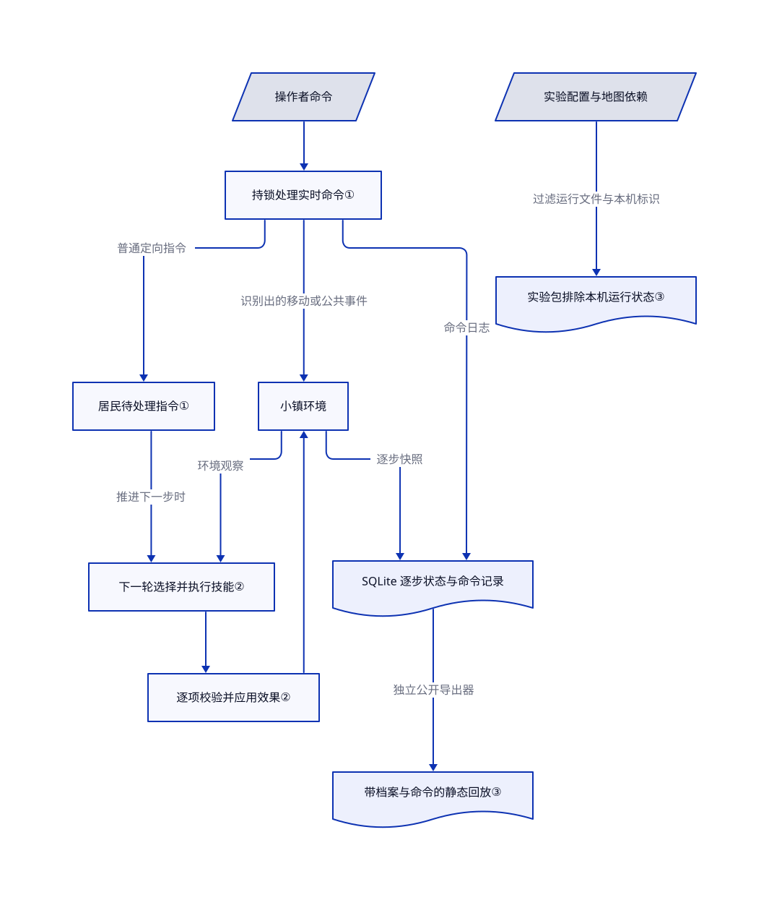

# GOD

虚拟居民一直在聊天，跑完的文字记录却看不出插手后会怎样。GOD 让你在同一张地图上提问、发出干预、推进一步，再看记录下来的变化。

## 何时使用

你在做课堂演示、交互研究或情景排练。十个语言模型驱动的居民走动、发消息，你想暂停，问某个人知道什么，宣布突发事件，再检查下一步，而不是每次重写驱动脚本。需要本地操作台、可编辑居民与地图、可分享的实验目录时，选 GOD；不必自己给 AgentSociety 拼这套操作界面。

它的价值是**由人插手可见的小社会**，不是预测真人，也不是调度编程助手。项目把裁剪后的 AgentSociety、JiuwenClaw、本地实时接口与 React 地图界面接起来。公开网站无需密钥，只供看录好的回放；现场干预要自己安装并提供模型服务。范围见[功能与路线图](https://github.com/XiaoLuoLYG/GOD/blob/753f0679758765d002f9dd9581ee37239b4be908/README.md#L157-L245)。

## 何时不用

- **需要并排对照组、重复试验或跨运行干预指标。** 选 [AgentSociety](agentsociety.zh.md) 作为可编程实验底座，再自行设计评估协议。GOD 启动器只选一个当前实验；多实验编排、跨运行评估和大规模运行仍在路线图，不能从内置引擎推导出成品已有这些能力。
- **研究对象是社交媒体信息流与推荐机制。** 选 [OASIS](oasis.zh.md)。GOD 关注像素小镇中的居民、地点、对话和人工操作，不是信息流算法实验。
- **想上传文档就拿到报告。** 选 [MiroFish](mirofish.zh.md)，同时接受其 AGPL 与外部记忆依赖。GOD 要你选择或编写社会情景，再自己分析行为，不把材料直接变成经验证的预测。若要对真人群体下结论，应改用问卷或观察研究，而不是换个模拟小镇；GOD 明确不声称社会拟真。
- **需要加固的共享服务或不可信插件隔离。** 优先自行隔离部署 [AgentSociety](agentsociety.zh.md)，并另行设计访问控制。GOD 启动器面向本地；发现自定义 Python 模块会执行导入，技能会启动本机子进程。工作目录限制和环境变量白名单不是操作系统沙箱。
- **要求所有内置美术都能直接再分发。** 从 [AgentSociety](agentsociety.zh.md) 配合自有素材开始。GOD 代码采用 Apache-2.0，但 The Ville 归属文件指向 Generative Agents 的第三方美术；署名不等于已确认下游商用权。

## 横向对比

| 替代品 | 是否收录 | 我们的评价 | 取舍 |
| --- | --- | --- | --- |
| [AgentSociety](agentsociety.zh.md) | 已收录 | 要让操作者马上在地图上问人、改下一步，选 GOD；可编程实验和科研基础设施比现成操作台重要时，选 AgentSociety。 | GOD 内置修改过的运行时并补齐操作界面；采用它也要跟踪集成版本，不能假设与上游包等价。 |
| [OASIS](oasis.zh.md) | 已收录 | 要社交媒体动作与信息流机制，选 OASIS；要按地点活动的小镇和人工逐步下指令，选 GOD。 | OASIS 给代码驱动的平台模拟；GOD 给浏览器工作流，但没有同等级的大规模运行保证。 |
| [MiroFish](mirofish.zh.md) | 已收录 | 要把材料变成可浏览的模拟和报告，选 MiroFish；人工实时干预本身就是实验时，选 GOD。 | GOD 的回放存储留在本地，模型地址由你选择；代价是你要提供情景与分析，不会获得上传到报告的流水线。 |

## 快速上手

克隆仓库后，在根目录执行 `./scripts/god.sh start`；macOS/Linux 首次启动会安装 Python 与 Node 依赖，并打开配置向导。你填写兼容 OpenAI 接口的模型地址、模型名和密钥，再选 GOD Town，或创建并编辑自己的实验。启动器拉起本地服务、创建会话并执行第一步；之后用 `/ask`、`/intervene` 和 Run Step 查看社会行为。GOD 提供小镇、控件和逐步记录；模型费用、生成档案检查、行为是否有研究意义都由你负责。密钥存在本机 `.env`，配置接口只返回遮盖值，并不是加密密钥库；公开回放站只供观看，不能现场干预。路径依据[快速上手文档](https://github.com/XiaoLuoLYG/GOD/blob/753f0679758765d002f9dd9581ee37239b4be908/QUICKSTART.md#L9-L91)，本页只读核验，未执行。

<!-- flow-steps:begin (generated from flows/god.json by tools/flow_card.py — do not edit) -->

流程文字版

1. **你**：克隆 GOD 并启动本地服务 — `./scripts/god.sh start`
2. **GOD**：安装依赖并打开配置向导
3. **你**：填写模型凭据，选择或编辑实验
4. **GOD**：创建当前小镇会话，记录第一步
5. **你**：向居民提问，发出干预，再推进一步
6. **GOD**：在小镇记录中显示居民行为与操作者命令

**价值**：不用重写驱动脚本，就能检查插手后的小镇变化

<!-- flow-steps:end -->

## 技术要点

<!-- mechanism:begin (generated from mechanisms/god.json by tools/mechanism_card.py; do not edit) -->

机制文字版

- 操作者命令
- 持锁处理实时命令①
- 居民待处理指令①
- 小镇环境
- 下一轮选择并执行技能②
- 逐项校验并应用效果②
- SQLite 逐步状态与命令记录
- 带档案与命令的静态回放③
- 实验配置与地图依赖
- 实验包排除本机运行状态③

- 操作者命令 → 持锁处理实时命令①
- 持锁处理实时命令① → 居民待处理指令①（普通定向指令）
- 持锁处理实时命令① → 小镇环境（识别出的移动或公共事件）
- 居民待处理指令① → 下一轮选择并执行技能②（推进下一步时）
- 小镇环境 → 下一轮选择并执行技能②（环境观察）
- 下一轮选择并执行技能② → 逐项校验并应用效果②
- 逐项校验并应用效果② → 小镇环境
- 小镇环境 → SQLite 逐步状态与命令记录（逐步快照）
- 持锁处理实时命令① → SQLite 逐步状态与命令记录（命令日志）
- SQLite 逐步状态与命令记录 → 带档案与命令的静态回放③（独立公开导出器）
- 实验配置与地图依赖 → 实验包排除本机运行状态③（过滤运行文件与本机标识）

<!-- mechanism:end -->

### 1. 分开记录指令接收与下一步生效

- **解决：** 点了干预，容易误以为世界已经改变，实际模拟轮次还没推进。
- **做法：** 实时会话用锁串行处理步骤与交互，记录操作者命令，再广播完成事件。普通定向指令进入居民待处理列表，在下一轮技能选择时消费；识别出的移动直接调用环境寻路，社会事件也可直接发布。
- **边界：** 接收不等于居民遵从。移动和公共事件有别于提示词排队路径；手动模式仍要点 Run Step 才推进时间。暂停只要求自动循环在步骤间停下，不会立即中断已发出的模型请求。
- **源码：** [干预分派与移动](https://github.com/XiaoLuoLYG/GOD/blob/753f0679758765d002f9dd9581ee37239b4be908/agentsociety/packages/agentsociety2/agentsociety2/backend/routers/live_experiments.py#L745-L991)、[命令记录与暂停](https://github.com/XiaoLuoLYG/GOD/blob/753f0679758765d002f9dd9581ee37239b4be908/agentsociety/packages/agentsociety2/agentsociety2/backend/routers/live_experiments.py#L1020-L1284)、[消费待处理列表](https://github.com/XiaoLuoLYG/GOD/blob/753f0679758765d002f9dd9581ee37239b4be908/agentsociety/custom/agents/jiuwenclaw_agent.py#L426-L461)。

### 2. 先选可执行技能，再逐项校验效果

- **解决：** 居民说自己做了事，不代表地点、消息或存储状态真的改变。
- **做法：** 每轮合并环境观察与待处理指令，经 JiuwenClaw 桥接选择一个已挂载技能，执行后解析结构化结果。适配器检查效果权限、目的地编号与交互地点，再应用世界、发言和记忆效果，并记录结果。
- **边界：** 校验按效果进行，不是原子事务；部分字段报错时，其余获准效果仍可能生效。技能通过受限环境变量启动本机 Python；这些检查与工作目录都不能约束恶意代码，更不能证明心理行为拟真。
- **源码：** [技能选择与执行](https://github.com/XiaoLuoLYG/GOD/blob/753f0679758765d002f9dd9581ee37239b4be908/agentsociety/custom/agents/jiuwenclaw_agent.py#L481-L636)、[效果校验与应用](https://github.com/XiaoLuoLYG/GOD/blob/753f0679758765d002f9dd9581ee37239b4be908/agentsociety/custom/agents/jiuwenclaw_agent.py#L870-L1043)、[本机子进程执行](https://github.com/XiaoLuoLYG/GOD/blob/753f0679758765d002f9dd9581ee37239b4be908/agentsociety/packages/agentsociety2/agentsociety2/agent/skills/__init__.py#L534-L633)。

### 3. 把实验配置与跑过的记录分开分享

- **解决：** 分享情景时，容易夹带本地会话和日志，或让接收者把录像误当成能继续跑的实验。
- **做法：** ExperimentPack 校验初始化与步骤文件，附带地图、角色依赖，排除运行目录、数据库、日志和 `.env`，再从初始化数据剔除会话编号与信任目录。导入预览会区分可安装包与静态回放；另一个导出器把 SQLite 中的逐步状态、档案和操作者命令转为浏览器可读 JSON。
- **边界：** 这些过滤不是通用隐私清洗；公开回放会包含档案与命令正文。回放也不是完整可移植检查点；实时恢复加载受支持的环境状态，或重跑步骤，并不保证模型历史完全一致。信任包之前仍要检查内容与自定义 Python。
- **源码：** [包过滤与清理](https://github.com/XiaoLuoLYG/GOD/blob/753f0679758765d002f9dd9581ee37239b4be908/agentsociety/packages/agentsociety2/agentsociety2/backend/services/experiment_packs.py#L83-L297)、[导入时拒绝回放包](https://github.com/XiaoLuoLYG/GOD/blob/753f0679758765d002f9dd9581ee37239b4be908/agentsociety/packages/agentsociety2/agentsociety2/backend/services/package_imports.py#L34-L79)、[静态导出](https://github.com/XiaoLuoLYG/GOD/blob/753f0679758765d002f9dd9581ee37239b4be908/agentsociety/packages/agentsociety2/agentsociety2/backend/services/public_replay_export.py#L81-L134)、[实时恢复](https://github.com/XiaoLuoLYG/GOD/blob/753f0679758765d002f9dd9581ee37239b4be908/agentsociety/packages/agentsociety2/agentsociety2/backend/routers/live_experiments.py#L369-L419)。

## 技术栈

- 前端是 React 18、TypeScript、Vite 6、Ant Design 与 Phaser；后端是 Python、FastAPI、WebSocket 更新与 SQLite 回放存储。
- 集成 AgentSociety 工作区和 JiuwenClaw 运行时，不是两者的独立替代品。所核清单仍写 `agentsociety2` 2.2.0 与 `jiuwenclaw` 0.1.11；不能直接换上游最新版并假设兼容。
- 依据：[前端清单](https://github.com/XiaoLuoLYG/GOD/blob/753f0679758765d002f9dd9581ee37239b4be908/agentsociety/frontend/package.json)、[AgentSociety 清单](https://github.com/XiaoLuoLYG/GOD/blob/753f0679758765d002f9dd9581ee37239b4be908/agentsociety/packages/agentsociety2/pyproject.toml)、[JiuwenClaw 清单](https://github.com/XiaoLuoLYG/GOD/blob/753f0679758765d002f9dd9581ee37239b4be908/jiuwenclaw/pyproject.toml)。

## 依赖

- 两份运行时清单要求 Python 3.11–3.13；还需 Node/npm 与 `uv`。macOS/Linux 快速上手另列 `screen`；Windows 使用 PowerShell 与 `winget`。
- 实时模拟需要兼容模型服务与凭据。可选图像生成设置服务于美术创作；看导出的静态回放不需要模型凭据。
- 内置依赖较重：AgentSociety 列出 Torch、Transformers、MinerU、数据库客户端与分析包；JiuwenClaw 包含跟踪 `develop` 的 `openjiuwen` Git 依赖。启动器会为两套工作区执行 `uv sync` 并安装前端包。本地优先不等于安装轻量或无需联网。

## 运维难度

**中到高。** 向导省去手改配置，不会省去多套 Python/Node 服务及依赖的维护成本。保留启动器的回环地址默认值；本地配置、文件导入与自定义模块接口不是现成的多人服务。自定义模块扫描会[执行 Python 导入](https://github.com/XiaoLuoLYG/GOD/blob/753f0679758765d002f9dd9581ee37239b4be908/agentsociety/packages/agentsociety2/agentsociety2/backend/services/custom/scanner.py#L242-L251)，因此导入代码属于本机可信代码，不是静态情景数据。

`./scripts/god.sh stop` 用于停止服务，不会抹掉凭据或已导出数据。`restart` 保留运行记录；`new-run` 则停止服务、删除当前实验的 `run` 目录再启动。先备份想保留的回放；这不是撤销单条干预。公开回放可能含居民档案、消息和操作者提示词，发布前必须检查。依据：[重置实现](https://github.com/XiaoLuoLYG/GOD/blob/753f0679758765d002f9dd9581ee37239b4be908/scripts/god.sh#L1199-L1215)、[安全说明](https://github.com/XiaoLuoLYG/GOD/blob/753f0679758765d002f9dd9581ee37239b4be908/SECURITY.md)。

## 健康度与可持续性

- **2026-10-26 判断：** 可作能检查内部过程的原型，不宜当长期实验标准。仓库创建于 2026-05-11，尚不足半年；默认分支仍在维护，但历史太短，Lindy 信号有限。这是基于带日期元数据的选型判断，不是寿命预测。
- **维护：** 最新版本发布为 2026-06-11 的 v0.2.0，仓库推送活动到 2026-10-23。近期[配置与回放修复](https://github.com/XiaoLuoLYG/GOD/pull/106)以及[尚未关闭的配置问题](https://github.com/XiaoLuoLYG/GOD/issues/105)，说明采用前应实际验证首次启动。
- **治理与采用：** 仓库属于个人账号；抓取的贡献列表中，60 次贡献有 56 次来自 XiaoLuoLYG。1,238 个星标和 136 个 fork 说明有人关注，不证明生产采用或机构维护经费。
- **许可与集成：** 根 Apache-2.0 署名 GOD 作者；集成的 AgentSociety 许可证及 JiuwenClaw 许可证、通知文件存在。The Ville 的[归属文件](https://github.com/XiaoLuoLYG/GOD/blob/753f0679758765d002f9dd9581ee37239b4be908/agentsociety/custom/maps/the_ville/ATTRIBUTION.md)标明复制的第三方美术；PKU 归属文件称其为生成美术。代码许可不能推导出全部素材已获授权。

## 存疑（未验证）

- [未验证：未安装或接入模型] 未复现首次启动、模型兼容性、单步费用、时延及负载下安全停机。上游发布说明里的测试数字不是本页实测。
- [未验证：归属说明不是完整授权链] 内置归属文件不足以确认所有地图瓦片与角色精灵的商业再分发权；未做完整许可证审计。
- [未验证：元数据没有维护承诺或用户验收] 未核实生产部署、机构资助与长期维护承诺；星标和论文演示定位不能证明这些。
