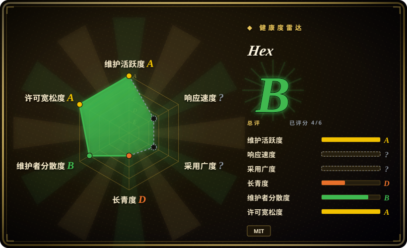
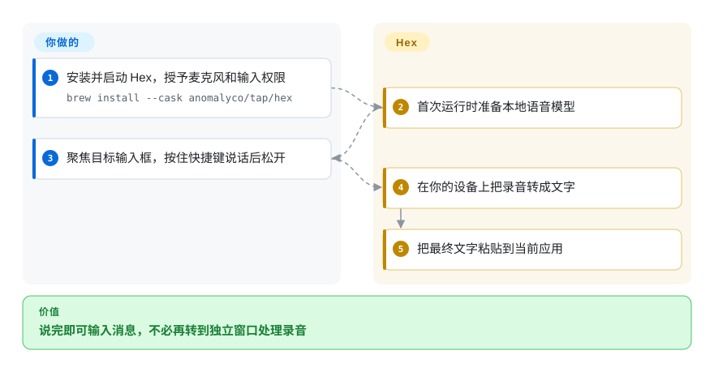
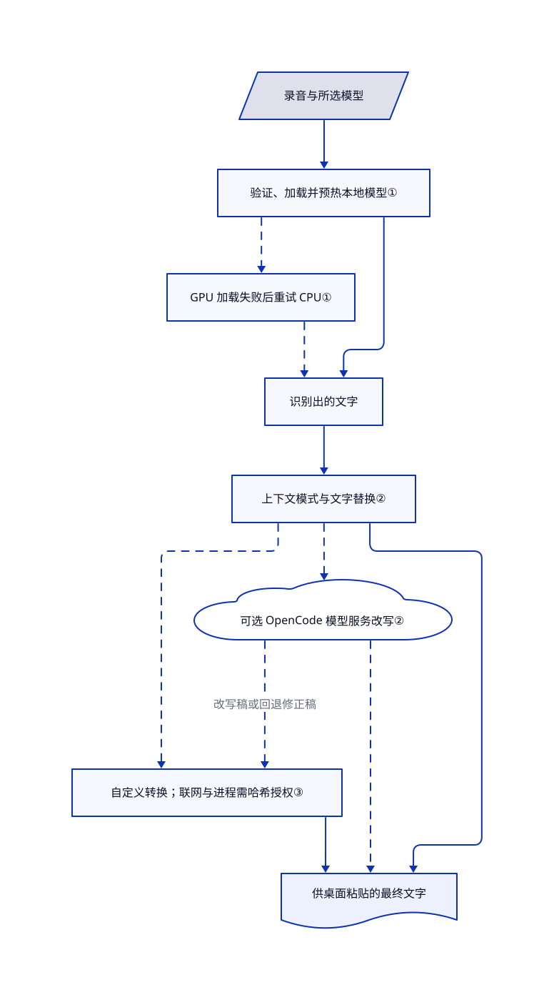

# Hex

你在编辑器、聊天框和浏览器之间切换，总要敲下长段解释。Hex 让你按住快捷键说话，在本机转成文字，再粘贴到当前输入框。

## 何时使用

你要跨桌面应用写问题描述、消息和编程提示词，又不想每次都把录音上传到语音接口。你需要松开快捷键后，文字已经出现在输入框，而不是先得到音频文件，再打开转写窗口。选择 Hex，是为了现成的桌面输入链路、本地模型选择和按应用区分的文字处理模式，不用自己连接识别库、麦克风、快捷键和粘贴。

关键取舍是原生 Rust 听写应用，而非 Python 语音制作环境。基础识别不需要付费语音账号。可选的 OpenCode 改写和自定义转换能扩展用途，但要另行决定联网、模型费用和代码信任。Windows 与 Linux 各有测试版要求，不能当成与 macOS 功能完全相同。

## 何时不用

- **要把整批访谈生成字幕文件。** 选 [OpenAI Whisper](../../media-processing/video-audio/speech-and-subtitles/whisper.zh.md) 的文件转写与字幕输出。Hex 的快捷键到粘贴链路，不能替代这类批处理。
- **要让助手用克隆声音回答。** 选 [Voicebox](../voicebox.zh.md)，同时连接听写、语音合成和助手发声。Hex 的核心收益是文字输入，不是声音克隆工作室。
- **要做视频配音和有声书制作。** 选 [VoiceStudio](../voicestudio.zh.md)，接受更重的引擎环境及独立的代码和权重许可，不要把听写工具硬扩成制作工作台。
- **不能授予桌面输入权限，或不满足 Linux 图形要求。** 用 Whisper 的文件命令行，避开 Hex 的全局快捷键与粘贴路径。Linux 构建需要 glibc 2.39+，x86_64 需要 AVX2；即使推理走 CPU，窗口仍需 Vulkan，Wayland 粘贴还依赖合成器和门户支持。
- **要仅装 npm 就得到完整录音组件。** 若现在就要这种集成边界，可在自有服务后使用 Whisper。Hex 的 TypeScript SDK 需要显式提供原生辅助程序；嵌入模式的录音和麦克风同意由宿主负责，复用桌面录音目前仅支持 macOS。

## 横向对比

| 替代品 | 是否收录 | 我们的评价 | 取舍 |
|---|---|---|---|
| [OpenAI Whisper](../../media-processing/video-audio/speech-and-subtitles/whisper.zh.md) | 已收录 | 录音要生成文字和字幕文件时选 Whisper；说完就要输入当前应用时选 Hex。 | Whisper 提供参考模型与 Python、命令行管线；Hex 补齐桌面录音、模型选择和粘贴，但不替代批量输出流程。 |
| [Voicebox](../voicebox.zh.md) | 已收录 | 同一本地流程还要合成助手回答时选 Voicebox；实际只缺语音输入时选 Hex。 | Voicebox 增加克隆和 Python 语音服务；Hex 把桌面输入路径集中在 Rust 应用，而非维护完整语音工作室。 |
| [VoiceStudio](../voicestudio.zh.md) | 已收录 | 配音和有声书编排选 VoiceStudio；日常口述消息、不想组装制作环境时选 Hex。 | VoiceStudio 带来编辑与多引擎，代码受 AGPL 约束，模型另有条款；Hex 自有代码是 MIT，下载的模型仍有独立许可。 |

## 快速上手

在 Apple 芯片 Mac 上，README 给出 `brew install --cask anomalyco/tap/hex`；其他支持的桌面有下载链接。启动后，授予所需的麦克风与输入控制权限，让首次设置准备语音模型。选择语言与快捷键，聚焦目标输入框，再按住、说话、松开；Hex 负责录音、本地识别和粘贴。你负责麦克风、兼容硬件，以及检查粘贴结果中的人名和数字。开发者也可在可信的 Node.js 20.3+ 宿主中使用 `@kitlangton/hex`，显式指定 `service --embedded` 原生命令；这条路径返回转写结果，不替宿主录音或粘贴。SDK 尚未提供完整原生分发包，可选的模型服务改写也独立于本地识别。

<!-- flow-steps:begin (generated from flows/hex.json by tools/flow_card.py — do not edit) -->

流程文字版

1. **你**：安装并启动 Hex，授予麦克风和输入权限 — `brew install --cask anomalyco/tap/hex`
2. **Hex**：首次运行时准备本地语音模型
3. **你**：聚焦目标输入框，按住快捷键说话后松开
4. **Hex**：在你的设备上把录音转成文字
5. **Hex**：把最终文字粘贴到当前应用

**价值**：说完即可输入消息，不必再转到独立窗口处理录音

<!-- flow-steps:end -->

## 技术要点

<!-- mechanism:begin (generated from mechanisms/hex.json by tools/mechanism_card.py; do not edit) -->

机制文字版

- 录音与所选模型
- 验证、加载并预热本地模型①
- GPU 加载失败后重试 CPU①
- 识别出的文字
- 上下文模式与文字替换②
- 可选 OpenCode 模型服务改写②
- 自定义转换；联网与进程需哈希授权③
- 供桌面粘贴的最终文字

- 录音与所选模型 → 验证、加载并预热本地模型①
- 验证、加载并预热本地模型① → GPU 加载失败后重试 CPU①〔可选／兜底〕
- 验证、加载并预热本地模型① → 识别出的文字
- GPU 加载失败后重试 CPU① → 识别出的文字〔可选／兜底〕
- 识别出的文字 → 上下文模式与文字替换②
- 上下文模式与文字替换② → 可选 OpenCode 模型服务改写②〔可选／兜底〕
- 可选 OpenCode 模型服务改写② → 自定义转换；联网与进程需哈希授权③（改写稿或回退修正稿）〔可选／兜底〕
- 上下文模式与文字替换② → 自定义转换；联网与进程需哈希授权③〔可选／兜底〕
- 上下文模式与文字替换② → 供桌面粘贴的最终文字
- 可选 OpenCode 模型服务改写② → 供桌面粘贴的最终文字〔可选／兜底〕
- 自定义转换；联网与进程需哈希授权③ → 供桌面粘贴的最终文字

<!-- mechanism:end -->

### 1. 选择本地模型，并从 GPU 故障恢复

- **解决：** 模型虽然支持目标语言，却可能无法在某个 GPU 或驱动上加载。
- **做法：** 加载器验证所选模型，通过 transcribe.cpp 加载，检查架构与语言能力，再用静音预热。设备选择参考已记录的 GPU 健康状态；GPU 加载失败后，用同一模型重试 CPU。
- **边界：** CPU 恢复不保证交互速度。流式识别取决于模型能力和设备；不支持或失败时走整段识别，不能承诺任意模型都能实时字幕。
- **源码：** [模型加载与回退](https://github.com/anomalyco/hex/blob/974b18818c3d9077ffe41814113771d9b43e2648/src/transcription/local_transcriber.rs#L228-L383)、[流式识别合同](https://github.com/anomalyco/hex/blob/974b18818c3d9077ffe41814113771d9b43e2648/docs/features/dictation.md#L646-L710)。

### 2. 按上下文选模式，改写失败仍保留转写

- **解决：** 邮件与编程提示词需要不同措辞，但改写失败不应丢掉已经说出的内容。
- **做法：** 处理器先匹配浏览器站点模式，再匹配应用模式，最后用默认模式。先应用全局和模式替换，再按需调用 OpenCode 改写；改写失败时返回修正后的原稿，并记录回退日志。
- **边界：** 这里保住的是文字可用性，不保证含义或数字准确。改写可以调用外部模型服务；选择本地语音模型，不等于后续处理也都在本地。
- **源码：** [模式选择、修正与改写路径](https://github.com/anomalyco/hex/blob/974b18818c3d9077ffe41814113771d9b43e2648/src/dictation/processor.rs#L269-L385)。

### 3. 把自定义命令授权绑定到已加载配置

- **解决：** 配置一变，原本的文字转换可能变成网络请求或本地程序调用。
- **做法：** Hex 对加载模块的名称与内容求哈希，把授权存到配置目录之外；开放网络和进程能力前，比较已批准哈希。信任提示列出代码中写死的主机和程序，动态拼接的值会标记为清单不完整。
- **边界：** 这是同意记录，不是系统沙箱或目标白名单。获准的处理器和 npm 依赖以普通用户权限执行；网络函数可访问 HTTP、HTTPS 地址，命令可以执行程序。
- **源码：** [内容哈希与能力摘要](https://github.com/anomalyco/hex/blob/974b18818c3d9077ffe41814113771d9b43e2648/src/personal_commands/trust.rs#L21-L154)、[授权比对](https://github.com/anomalyco/hex/blob/974b18818c3d9077ffe41814113771d9b43e2648/src/personal_commands.rs#L654-L668)、[安全边界](https://github.com/anomalyco/hex/blob/974b18818c3d9077ffe41814113771d9b43e2648/SECURITY.md)。

## 技术栈

- Rust 2024 桌面应用；Rune、rune-kit 原生界面配合 wgpu，连接各系统的音频和输入接口，并使用 CPAL 音频支持。
- transcribe.cpp 的 GGUF 语音推理，固定 Anomaly 分支提交；macOS 使用 Metal，Linux 与 Windows x64 使用 Vulkan，并有 CPU 路径。项目管理 Parakeet、Whisper、Qwen3-ASR 等模型，不负责训练这些模型。
- 嵌入式 QuickJS 与 TypeScript 解析支持转换脚本；可选 OpenCode 改写；ESM 格式的 TypeScript SDK 提供 Promise 和可选 Effect 接口。

## 依赖

- 麦克风与桌面权限。macOS 下载面向 Apple 芯片；Windows 提供 x64、ARM64 包；Linux 提供 x86_64、ARM64 包。已审清单中的 Windows ARM64 推理仅走 CPU。
- 初次模型下载与本地空间：固定文件示例从 252,684,608 字节的 SenseVoice 到 2,410,655,232 字节的 Cohere。模型决定语言覆盖与内存用量；文件兼容不等于任意导入模型都准确。
- Linux 发布包需要 glibc 2.39+、兼容 ALSA 的音频、供界面使用的 Vulkan 驱动，以及匹配的 Wayland 或 X11 输入和粘贴设施。x86_64 Linux、Windows 需要 AVX2。
- 基础听写不依赖云端语音服务。下载与更新检查需要联网；可选改写需要配置模型服务，自定义命令可能新增网络地址或本地程序。
- 根 MIT 许可覆盖 Hex 自有源码，不覆盖全部模型与依赖。第三方声明保留 Lucide ISC、Feather MIT 署名，并说明 Parakeet Ultra 是 CC-BY-4.0；重新分发前要核对所选模型自己的条款。

## 运维难度

**支持的桌面听写低，集成与 Linux 部署中。** 你要管理权限、快捷键冲突、模型磁盘和内存、版本更新，不用运行数据库或云端语音服务。Linux 额外涉及图形驱动、合成器和门户兼容；SDK 使用方负责原生辅助程序的打包签名、录音同意和进程清理。关闭 Linux 窗口不结束用户进程，想停止提供录音能力时要退出应用。Windows 卸载保留 `%APPDATA%\hex` 中的设置、日志、历史和模型，卸载应用不等于擦除转写内容。

## 健康度与可持续性

- **维护，核验于 2026-11-02：** v3.2.0 于 11 月 1 日发布，同日还有多个 3.1.x 版本；已审默认分支提交来自 11 月 2 日。这是快速迭代中的工具，不是冻结版本。最近问题样本包含 GPU 预热和 Linux 设置、改写修复；问题关闭不能证明用户安装的稳定包已包含修复。
- **治理：** Anomaly 持有规范仓库。[贡献说明](https://github.com/anomalyco/hex/blob/974b18818c3d9077ffe41814113771d9b43e2648/CONTRIBUTING.md)明确不接收外部拉取请求，要求提交问题或补丁片段。提交量集中在 kitlangton 与 thdxr，贡献者数量不等于路线控制已经分散。
- **年龄与采用：** 2026 年 7 月 17 日创建，约三个半月，核验时约 3.8k 星。[推断：依据是仓库年龄和发布记录] 活跃维护是正面信号，但尚无长期存续记录；星数不能证明识别准确或部署可靠。
- **许可与信任：** 自有代码是 MIT，并有明确第三方声明。选型应更重视模型许可、快速演化的系统移植、可选服务出站和无沙箱命令，而非星数。自动雷达覆盖六轴中的四轴；`no_window_signal` 与 `no_package_structural` 是评分器缺口，不证明无人响应或无人使用。

## 存疑（未验证）

- [未验证：本次未获准安装或执行上游] 未复现麦克风录音、粘贴、安装包签名、模型准确率、延迟、内存和显存占用、离线联网行为；本页依据固定源码与文档，不是实测或基准报告。
- [推断：依据是仓库年龄和发布记录] 维护历史短，限制长期可持续性的先验；提交统计不能揭示内部人员、资金或全部评审活动。
- [未验证：未做完整第三方权利审计] 已读根 MIT 与明确声明，但未独立审计全部下载权重、传递依赖和导入录屏资产的权利链。
