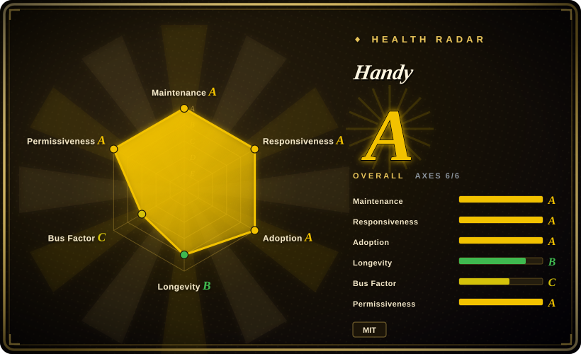
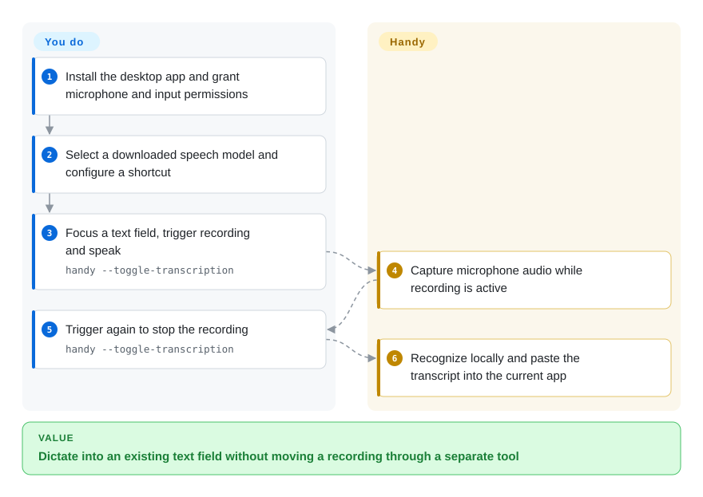
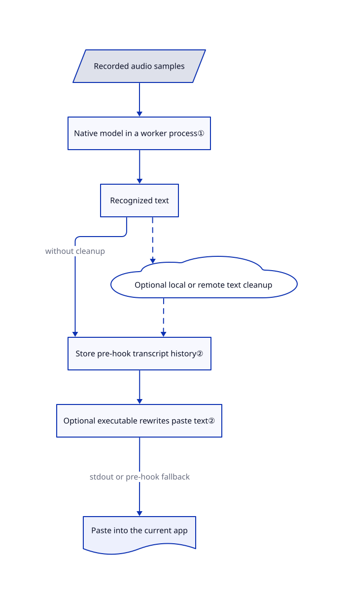

# Handy

You keep switching from a prompt box to a recorder and back just to dictate a paragraph. Handy records from a shortcut, recognizes speech locally and pastes the words into the app you are using.

## When to use

You write issue reports, chat messages or coding-agent prompts on a desktop and want to speak without uploading microphone audio. Instead of recording a file and running a transcription script, you install Handy, choose a local speech model and dictate straight into the focused text field. Choose it over a whole voice studio when your job is input, not cloned speech output; choose it over a bare recognition library when shortcuts, microphone selection and pasting are the work you want removed.

You can also adapt the Rust desktop application or attach a small executable that rewrites the resulting text. The deciding tradeoff is owning the local model and input path, while accepting operating-system permission work, model storage and app-specific paste testing. This is a desktop application, not a shared transcription server.

## When NOT to use

- **A folder of recordings needs subtitle files.** Prefer [Whisper](../media-processing/video-audio/speech-and-subtitles/whisper.md) for its explicit file-to-transcript/subtitle command. Handy's dictation workflow is centered on inserting text, not that export pipeline.
- **You need speech back from an agent.** Prefer [Voicebox](voicebox.md) when cloned-voice output and a speech API matter. Handy solves the microphone-to-text half, not a voice-generation studio.
- **You need an embedded native inference engine without a desktop shell.** Evaluate [whisper.cpp](https://github.com/ggml-org/whisper.cpp). Handy includes permissions, a webview, global shortcuts and persistent history that a library integration does not need.
- **Your policy forbids retaining recordings or sending text to external providers.** Use Whisper in a controlled file lifecycle, or a native engine wrapper you operate. Handy saves WAV recordings and history; optional LLM cleanup can send the transcript to your selected provider. A paste hook runs after history is written, so it is not a storage-redaction barrier.
- **Wayland must work without configuring desktop-specific input tools.** Prefer a file-based Whisper workflow until you can validate input injection. Handy documents compositor-dependent shortcuts, extra typing utilities and overlay focus interference; its Linux support is not uniform across desktops.

## Comparison

| Alternative | In index | Our verdict | Tradeoff |
|---|---|---|---|
| [OpenAI Whisper](../media-processing/video-audio/speech-and-subtitles/whisper.md) | Indexed | Choose Whisper for repeatable batch transcripts and subtitle outputs; choose Handy for speaking into an existing desktop text field. | Whisper exposes a Python/file workflow; Handy provides microphone controls and paste integration, but adds desktop permissions and retained app state. |
| [Voicebox](voicebox.md) | Indexed | Choose Voicebox when an agent must speak in a cloned voice as well as accept dictation; choose Handy when text input is the whole requirement. | A broader voice studio adds synthesis engines and service integration; Handy keeps the user journey focused on local dictation. |
| [whisper.cpp](https://github.com/ggml-org/whisper.cpp) | not indexed | Choose whisper.cpp when building a native application or controlled recognition service; choose Handy when you do not want to build the recorder and text-insertion UI. | Lower-level C/C++ integration leaves lifecycle and input handling to you. Not added in this tab batch. |

## Quick start

For desktop use, download a release, grant microphone and accessibility permissions, select a speech model and configure a shortcut. On macOS, the README also lists `brew install --cask handy`; that cask is community-maintained. For development, [BUILD.md](https://github.com/cjpais/Handy/blob/82dfab9fda18c4bc24e1f6e56d36474d38eca0bc/BUILD.md#L75-L102) specifies Rust, Bun and platform build prerequisites, then `bun install` and `bun tauri dev`; CONTRIBUTING also specifies the bundled Silero VAD resource. You provide the hardware, model files, permissions and receiving text field; Handy records, recognizes and inserts text, with no speech API key needed for local recognition. Keep optional provider-based cleanup disabled for the local-only path, and test the result in each target app before dictating commands or sensitive material.

<!-- flow-steps:begin (generated from flows/handy.json by tools/flow_card.py — do not edit) -->

Text version of the flow

1. **You**: Install the desktop app and grant microphone and input permissions
2. **You**: Select a downloaded speech model and configure a shortcut
3. **You**: Focus a text field, trigger recording and speak — `handy --toggle-transcription`
4. **Handy**: Capture microphone audio while recording is active
5. **You**: Trigger again to stop the recording — `handy --toggle-transcription`
6. **Handy**: Recognize locally and paste the transcript into the current app

**Value**: Dictate into an existing text field without moving a recording through a separate tool

<!-- flow-steps:end -->

## Key techniques

<!-- mechanism:begin (generated from mechanisms/handy.json by tools/mechanism_card.py; do not edit) -->

Text version of the mechanism

- Recorded audio samples
- Native model in a worker process①
- Recognized text
- Optional local or remote text cleanup
- Store pre-hook transcript history②
- Optional executable rewrites paste text②
- Paste into the current app

- Recorded audio samples → Native model in a worker process①
- Native model in a worker process① → Recognized text
- Recognized text → Store pre-hook transcript history② (without cleanup)
- Recognized text → Optional local or remote text cleanup [optional/fallback]
- Optional local or remote text cleanup → Store pre-hook transcript history② [optional/fallback]
- Store pre-hook transcript history② → Optional executable rewrites paste text②
- Optional executable rewrites paste text② → Paste into the current app (stdout or pre-hook fallback)

<!-- mechanism:end -->

### 1. Put the native speech engine in a worker process

- **Problem:** A native model or GPU driver can abort or hang outside Rust's ordinary error handling.
- **How:** The engine worker owns the transcribe.cpp model and session. It reads requests on a dedicated stdin thread and sends typed replies on a reserved output stream; native stdout is redirected away from that protocol. Closing the parent's input exits the worker immediately, including when native work is stuck.
- **Limits:** This is process-lifecycle separation, not a security sandbox or a promise of successful GPU inference. Model support and acceleration still depend on the bundled native backend and platform build.
- **Source:** [Worker protocol, initialization and session loop](https://github.com/cjpais/Handy/blob/82dfab9fda18c4bc24e1f6e56d36474d38eca0bc/src-tauri/src/engine_supervisor/worker.rs#L32-L189), [platform backend features](https://github.com/cjpais/Handy/blob/82dfab9fda18c4bc24e1f6e56d36474d38eca0bc/src-tauri/Cargo.toml#L126-L178).

### 2. Separate saved history from the final paste hook

- **Problem:** Custom text transformations should not require modifying the recognizer or losing its original output.
- **How:** The action saves the recording and stores recognized text plus optional LLM output in history, then invokes `hooks/transcription` with the final text on stdin. The hook's stdout becomes the pasted text; one trailing newline is removed, and an empty result suppresses the paste. Errors or a 30-second timeout fall back to the pre-hook text.
- **Limits:** The hook is an executable with the user's permissions, not isolated code. It cannot redact the history already saved, and failure falls back to the original text rather than blocking disclosure. Optional provider cleanup occurs before the hook and can already have sent the transcript over HTTP.
- **Source:** [Recording, history and hook order](https://github.com/cjpais/Handy/blob/82dfab9fda18c4bc24e1f6e56d36474d38eca0bc/src-tauri/src/actions.rs#L731-L845), [hook execution and timeout](https://github.com/cjpais/Handy/blob/82dfab9fda18c4bc24e1f6e56d36474d38eca0bc/src-tauri/src/transcription_hook.rs#L13-L64), [provider HTTP request](https://github.com/cjpais/Handy/blob/82dfab9fda18c4bc24e1f6e56d36474d38eca0bc/src-tauri/src/llm_client.rs#L419-L475).

## Tech stack

- Rust with Tauri 2 for the desktop shell and native controls; React 18, TypeScript, Vite and Tailwind CSS for settings.
- `transcribe-cpp` for local model inference, `handy-recorder` for audio capture and SQLite through `rusqlite` for history. This snapshot uses transcribe.cpp, not a Python Whisper installation.
- Platform-specific Metal or Vulkan backend features; Intel macOS and Windows ARM builds select CPU-only features in the manifest.

## Dependencies

- A microphone, supported desktop system, model files and enough local memory/storage for the chosen model. Models must be downloaded or provisioned before offline use; no database server is required.
- Release packages include native application resources. Development requires Rust, Bun, Tauri prerequisites and native compiler tooling; Windows and Linux builds have additional Vulkan/toolchain requirements in BUILD.md.
- Linux needs GTK/WebKitGTK and `gtk-layer-shell`; text insertion can require `xdotool`, `wtype`, `dotool` or `ydotool`, depending on the display server and compositor.
- Optional text cleanup requires the selected local or remote provider and its credentials when applicable. The application's MIT license does not automatically cover downloaded model weights or Handy branding.
- The development install has a `postinstall` script that can invoke `bunx bun2nix` when its lockfile hash changes. Review that tool-execution path before installing dependencies in a restricted build environment; this research did not run it.

## Ops difficulty

**Low to medium for one desktop; medium for source builds and Linux integration.** No server fleet or Python environment is needed for a release install. The recurring work is permission repair after local rebuilds, native backend compatibility, model downloads and testing paste behavior. The standard clipboard path restores the previous clipboard after a delay; the README documents stale-content races and a beta reliable-paste mode on macOS and Windows.

Recordings live under the application data directory alongside `history.db`. The default retention policy keeps five unsaved dictations; saved entries and imported-file transcriptions are excluded from automatic count/time cleanup. Quit the tray instance before uninstalling, review recordings and history separately, and do not assume deleting the application clears model caches or sensitive text. [History cleanup source](https://github.com/cjpais/Handy/blob/82dfab9fda18c4bc24e1f6e56d36474d38eca0bc/src-tauri/src/managers/history.rs#L435-L554).

## Health & viability

- **Maintenance, 2026-11-02:** GitHub lists release v0.10.0 and an active, non-archived default branch. CONTRIBUTING explicitly prioritizes bug fixes and freezes unsolicited features; this is a stability constraint, not a promise that a proposed feature will land.
- **Governance:** The repository belongs to CJ Pais's personal account; the sampled contributor list shows 599 contributions from cjpais versus 22 from the next contributor. CONTRIBUTING describes a small team, and the README lists sponsors. Sponsorship is not foundation governance or a support SLA.
- **Age and adoption:** Created 2025-02-13, roughly 20 months old, with approximately 37k stars at verification. [Inference: based on repository age and present activity] Active development is encouraging, but the short history gives a weaker durability prior than a long-maintained recognition engine; stars do not establish dictation quality.
- **License boundary:** The actual LICENSE grants MIT terms with CJ Pais's copyright. The README separately excludes the name, logo, icon and brand assets from its open-source grant; redistributed forks must use their own branding. Native dependencies and downloaded weights retain their own terms.

## Caveats (unverified)

- [Unverified: upstream execution and model downloads were outside this research scope] Recognition accuracy, latency, microphone behavior and paste reliability were not measured on any platform. Commands are documented paths, not a successful local reproduction.
- [Unverified: only the application and selected source paths were reviewed] The full dependency/model license chain and all network behavior were not audited. Local recognition does not mean every optional feature is offline.
- [Unverified: release binaries were not inspected] Implementation details refer to fixed default-branch commit `82dfab9fda18c4bc24e1f6e56d36474d38eca0bc`, not a verified feature inventory of the v0.10.0 release package.
- [Inference: based on creation date, contributor sample and current activity] Long-term maintenance remains less proven than mature engine projects; the sampled contributor counts do not establish contractual bus-factor guarantees.
