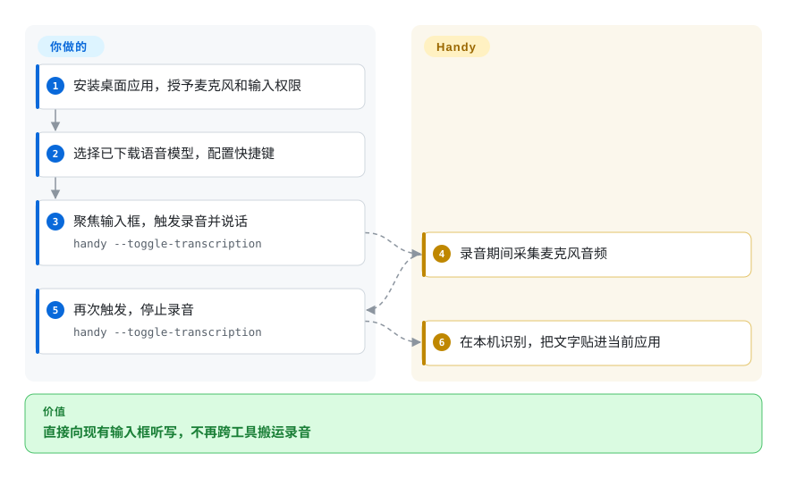
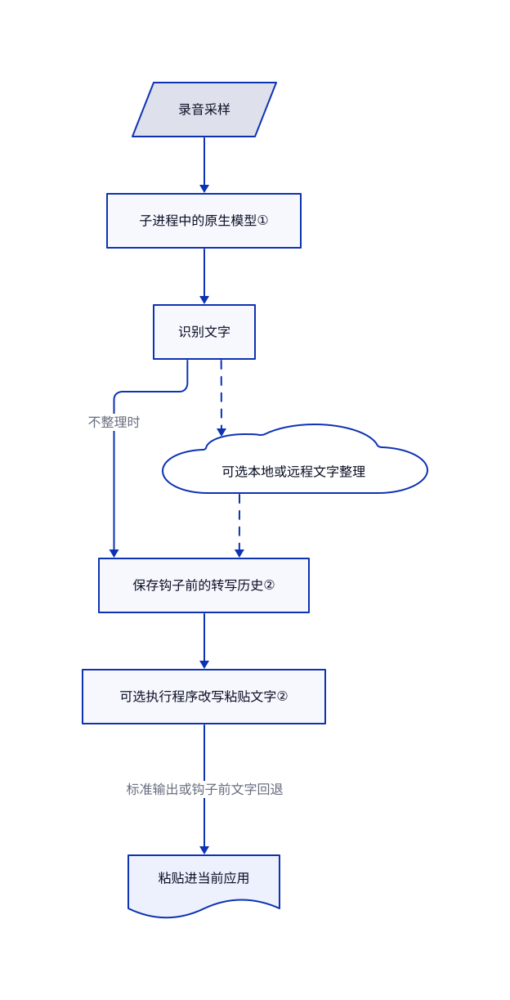

# Handy

你只想口述一段提示词，却得切到录音工具再复制回来。Handy 用快捷键录音，在本机识别，再把文字贴进当前应用。

## 何时使用

你经常在桌面写问题报告、聊天消息或编程助手提示词，又不想上传麦克风录音。与其先录文件再跑转写脚本，你安装 Handy，选一个本地语音模型，直接对当前输入框听写。只需要文字输入、不需要克隆语音输出时，它比整套语音工作室更聚焦；不想自己做快捷键、麦克风选择和粘贴时，它比裸识别库省集成工作。

你也可以修改 Rust 桌面应用，或挂一个改写文字的小程序。关键取舍是自己掌握本地模型和输入链，代价是处理系统权限、模型存储和逐应用粘贴测试。它是桌面应用，不是多人共享的转写服务器。

## 何时不用

- **要把一批录音生成字幕文件。** 优先用 [Whisper](../media-processing/video-audio/speech-and-subtitles/whisper.zh.md)，它明确提供文件到文字稿和字幕的命令。Handy 的听写主路径围绕文字插入，不是这套导出流水线。
- **要让编程助手开口回答。** 需要克隆语音输出和语音接口时，优先看 [Voicebox](voicebox.zh.md)。Handy 处理麦克风到文字的一半，不是声音生成工作室。
- **只要嵌入本地推理，不要桌面外壳。** 评估 [whisper.cpp](https://github.com/ggml-org/whisper.cpp)。Handy 带有权限、网页视图、全局快捷键和持久历史，这些不是库集成所必需的。
- **政策禁止保存录音或向外部服务发送文字。** 用自己控制文件生命周期的 Whisper，或自建原生引擎封装。Handy 会保存 WAV 和历史；可选模型后处理能把文字发给所选服务。粘贴钩子在历史写入后才执行，不能充当存储脱敏屏障。
- **要求 Wayland 不做桌面专项配置就可靠工作。** 在验证输入注入前，优先用基于文件的 Whisper。Handy 文档明确列出桌面相关快捷键、额外输入工具和悬浮窗抢焦点问题，不能把 Linux 支持视为所有桌面一致。

## 横向对比

| 替代品 | 是否收录 | 我们的评价 | 取舍 |
|---|---|---|---|
| [OpenAI Whisper](../media-processing/video-audio/speech-and-subtitles/whisper.zh.md) | 已收录 | 批量转写和字幕输出选 Whisper；直接向现有桌面输入框口述选 Handy。 | Whisper 暴露 Python 和文件流程；Handy 包办录音控制和粘贴，但增加桌面权限与持久状态。 |
| [Voicebox](voicebox.zh.md) | 已收录 | 助手既要接收听写又要用克隆声音回答时选 Voicebox；只需要文字输入时选 Handy。 | 语音工作室增加合成引擎和服务集成；Handy 把使用路径集中在本地听写。 |
| [whisper.cpp](https://github.com/ggml-org/whisper.cpp) | 未收录 | 自建原生应用或受控识别服务时选 whisper.cpp；不想自己做录音和文字插入界面时选 Handy。 | 底层 C/C++ 集成把生命周期与输入处理交还给你。本轮标签页批次未补录。 |

## 快速上手

桌面使用先下载发布包，授予麦克风和辅助功能权限，选择语音模型并配置快捷键。macOS 的 README 也列出 `brew install --cask handy`，但此软件包由社区维护。开发路径见 [BUILD.md](https://github.com/cjpais/Handy/blob/82dfab9fda18c4bc24e1f6e56d36474d38eca0bc/BUILD.md#L75-L102)：准备 Rust、Bun 和平台构建依赖，再运行 `bun install` 与 `bun tauri dev`；贡献文档还要求准备随包的 Silero 人声检测资源。你提供硬件、模型、权限和接收文字的输入框，Handy 负责录音、识别和插入；本地识别不需要语音服务密钥。纯本地路径应关闭可选服务商后处理，在口述命令或敏感内容前，逐个测试目标应用。

<!-- flow-steps:begin (generated from flows/handy.json by tools/flow_card.py — do not edit) -->

流程文字版

1. **你**：安装桌面应用，授予麦克风和输入权限
2. **你**：选择已下载语音模型，配置快捷键
3. **你**：聚焦输入框，触发录音并说话 — `handy --toggle-transcription`
4. **Handy**：录音期间采集麦克风音频
5. **你**：再次触发，停止录音 — `handy --toggle-transcription`
6. **Handy**：在本机识别，把文字贴进当前应用

**价值**：直接向现有输入框听写，不再跨工具搬运录音

<!-- flow-steps:end -->

## 技术要点

<!-- mechanism:begin (generated from mechanisms/handy.json by tools/mechanism_card.py; do not edit) -->

机制文字版

- 录音采样
- 子进程中的原生模型①
- 识别文字
- 可选本地或远程文字整理
- 保存钩子前的转写历史②
- 可选执行程序改写粘贴文字②
- 粘贴进当前应用

- 录音采样 → 子进程中的原生模型①
- 子进程中的原生模型① → 识别文字
- 识别文字 → 保存钩子前的转写历史②（不整理时）
- 识别文字 → 可选本地或远程文字整理〔可选／兜底〕
- 可选本地或远程文字整理 → 保存钩子前的转写历史②〔可选／兜底〕
- 保存钩子前的转写历史② → 可选执行程序改写粘贴文字②
- 可选执行程序改写粘贴文字② → 粘贴进当前应用（标准输出或钩子前文字回退）

<!-- mechanism:end -->

### 1. 把原生识别引擎放进独立进程

- **解决：** 原生模型或显卡驱动可能直接崩溃或卡住，无法靠普通 Rust 错误返回恢复。
- **做法：** 引擎子进程持有 transcribe.cpp 模型和会话，专门用一个线程读取标准输入请求，再通过独立保留的输出流返回有类型的响应。原生代码的标准输出被移开，避免污染协议；父进程关闭输入后，子进程立即退出，即使原生任务还卡着。
- **边界：** 这是进程生命周期隔离，不是安全沙箱，也不保证显卡推理成功。模型支持和加速仍取决于原生后端及平台构建。
- **源码：** [子进程协议、初始化与会话循环](https://github.com/cjpais/Handy/blob/82dfab9fda18c4bc24e1f6e56d36474d38eca0bc/src-tauri/src/engine_supervisor/worker.rs#L32-L189)、[平台后端编译选项](https://github.com/cjpais/Handy/blob/82dfab9fda18c4bc24e1f6e56d36474d38eca0bc/src-tauri/Cargo.toml#L126-L178)。

### 2. 把历史保存和最终粘贴钩子分开

- **解决：** 自定义文字变换不应要求修改识别器，也不应丢掉识别器的原始输出。
- **做法：** 动作先保存录音，并把识别文字及可选模型后处理结果写入历史，再把最终文字从标准输入传给 `hooks/transcription`。钩子的标准输出作为粘贴内容，去掉一个末尾换行；空结果不粘贴。出错或超过 30 秒时，回退为调用钩子前的文字。
- **边界：** 钩子以用户权限执行，不隔离代码。它不能脱敏已保存的历史，失败时也不是阻断披露，而是回退原文字。可选服务商后处理早于钩子执行，此时文字可能已经通过 HTTP 发出。
- **源码：** [录音、历史与钩子的顺序](https://github.com/cjpais/Handy/blob/82dfab9fda18c4bc24e1f6e56d36474d38eca0bc/src-tauri/src/actions.rs#L731-L845)、[钩子执行与超时](https://github.com/cjpais/Handy/blob/82dfab9fda18c4bc24e1f6e56d36474d38eca0bc/src-tauri/src/transcription_hook.rs#L13-L64)、[服务商 HTTP 请求](https://github.com/cjpais/Handy/blob/82dfab9fda18c4bc24e1f6e56d36474d38eca0bc/src-tauri/src/llm_client.rs#L419-L475)。

## 技术栈

- 桌面外壳与原生控制使用 Rust、Tauri 2；设置界面使用 React 18、TypeScript、Vite 和 Tailwind CSS。
- 本地模型推理用 `transcribe-cpp`，采集用 `handy-recorder`，历史通过 `rusqlite` 存入 SQLite。此源码快照不是运行 Python Whisper 环境。
- 平台分别启用 Metal 或 Vulkan 后端；清单为 Intel macOS 与 Windows ARM 选择纯 CPU 编译选项。

## 依赖

- 麦克风、受支持的桌面系统、模型文件，以及所选模型需要的本地内存和磁盘。离线使用前要下载或预置模型，不需要独立数据库服务器。
- 发布包带原生应用资源。开发需 Rust、Bun、Tauri 前置依赖和原生编译工具；Windows、Linux 还要满足构建文档中的 Vulkan 和工具链要求。
- Linux 需要 GTK、WebKitGTK 与 `gtk-layer-shell`；文字插入可能依赖 `xdotool`、`wtype`、`dotool` 或 `ydotool`，具体看显示服务与桌面合成器。
- 可选文字整理需要所选本地或远程服务，必要时需密钥。应用的 MIT 许可不会自动覆盖下载模型和 Handy 品牌素材。
- 开发安装含 `postinstall` 脚本，锁文件哈希变化时能调用 `bunx bun2nix`。受限构建环境应先审阅这条工具执行路径；本次研究没有执行。

## 运维难度

**单机安装低到中等；源码构建和 Linux 集成为中等。** 发布包不需要服务器集群或 Python 环境。持续成本是本地重构建后的权限修复、原生后端兼容、模型下载和粘贴测试。标准剪贴板路径会延迟恢复旧内容；README 记录了误贴旧内容的竞争问题，并为 macOS、Windows 提供测试版可靠粘贴模式。

录音与 `history.db` 位于应用数据目录。默认保留五条未收藏听写，收藏条目和导入文件转写不参与自动按数量或时间清理。卸载前退出托盘实例，单独检查录音和历史，不要假定删除应用就清除了模型缓存或敏感文字。[历史清理源码](https://github.com/cjpais/Handy/blob/82dfab9fda18c4bc24e1f6e56d36474d38eca0bc/src-tauri/src/managers/history.rs#L435-L554)。

## 健康度与可持续性

- **维护，截至 2026-11-02：** GitHub 列出 v0.10.0 发布，默认分支持续更新且未归档。贡献文档明确优先修复缺陷，冻结未经社区支持的新功能；不能把活跃开发理解为一定接纳新需求。
- **治理：** 仓库归 CJ Pais 的个人账号。贡献者抽样显示 cjpais 有 599 次贡献，下一位有 22 次。贡献文档自述小团队，README 列有赞助方；赞助不等于基金会治理或服务承诺。
- **年龄与采用：** 2025-02-13 建库，约 20 个月，核验时约 3.7 万星。[推断：依据仓库年龄与当前活动] 持续开发值得关注，但历史短于长期维护的识别引擎，星数不能证明听写质量。
- **许可边界：** 实际 LICENSE 是 CJ Pais 署名的 MIT。README 单独排除了名称、标志、图标和品牌素材，要求再分发分支使用自己的品牌。原生依赖与下载权重仍遵守各自条款。

## 存疑（未验证）

- [未验证：本次范围禁止执行上游与下载模型] 未测识别准确率、延迟、麦克风或跨平台粘贴可靠性。命令来自文档，不代表已在本机跑通。
- [未验证：仅审阅应用与选定源码链] 未完整审计所有依赖和模型的许可链，也未穷尽全部联网行为。本地识别不代表每个可选功能都离线。
- [未验证：没有检查发布包二进制] 实现细节对应固定默认分支提交 `82dfab9fda18c4bc24e1f6e56d36474d38eca0bc`，不代表已经核对 v0.10.0 发布包的功能清单。
- [推断：依据创建日期、贡献者抽样与当前活动] 长期维护能力尚未像成熟引擎一样得到时间验证；抽样贡献数不能证明任何契约化人员保障。
