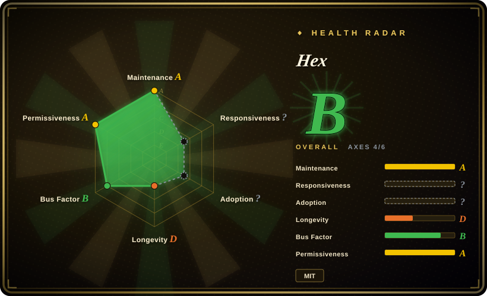
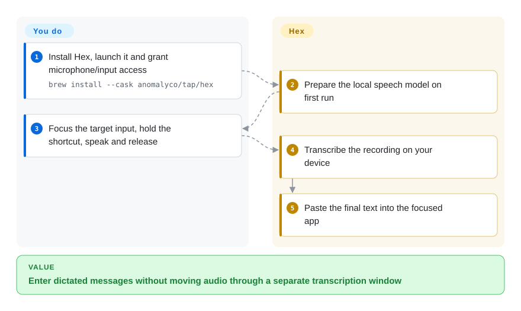
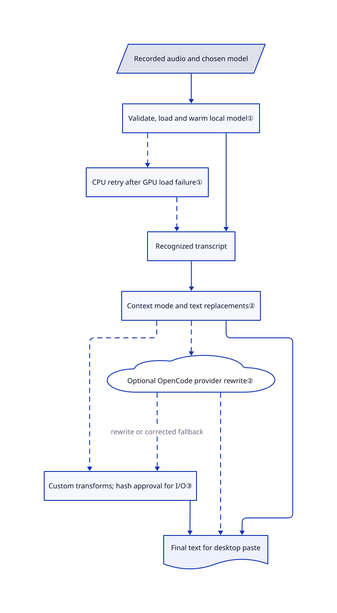

# Hex

You keep moving between an editor, chat and browser to type the same long explanations. Hex records while you hold a shortcut, transcribes locally, and pastes the result into the focused app.

## When to use

You write issue descriptions, messages and coding prompts across desktop apps, and do not want to upload each recording to a speech API. You want a held shortcut to end with text already in the input field, rather than an audio file and another transcription window. Choose Hex for that desktop handoff, with selectable local speech models and per-app text-processing modes, instead of wiring a recognition library to microphone capture, shortcuts and paste yourself.

The deciding tradeoff is a native Rust dictation app rather than a Python voice-production stack. Basic recognition needs no paid speech account. Optional OpenCode rewriting and custom transformations broaden the workflow, but introduce separate network, provider-cost and code-trust decisions. Windows and Linux have their own beta requirements; they are not feature-identical to macOS.

## When NOT to use

- **You are processing a folder of interviews into subtitle files.** Choose [OpenAI Whisper](../media-processing/video-audio/speech-and-subtitles/whisper.md) for its file-oriented transcription and subtitle outputs. Hex's shortcut-to-paste journey does not replace that batch workflow.
- **You need your assistant to speak in a cloned voice.** Choose [Voicebox](voicebox.md) for combined dictation, voice synthesis and agent speech. Hex's core payoff is text input, not a voice-cloning studio.
- **You need video dubbing and audiobook production.** Choose [VoiceStudio](voicestudio.md), accepting its heavier engine stack and separate code/weight licensing, instead of stretching a dictation app into a production studio.
- **You cannot grant desktop input access or meet the Linux graphics requirements.** Use Whisper's file CLI rather than Hex's global hotkey and paste path. Linux builds need glibc 2.39+, x86_64 needs AVX2, and even CPU inference still leaves a Vulkan requirement for the window; Wayland paste depends on compositor/portal support.
- **You want an npm-only, drop-in recording component.** Use Whisper behind a host-owned service if you need that integration boundary today. Hex's TypeScript SDK requires an explicitly supplied native helper; its embedded path leaves recording and microphone consent to your app, and desktop-assisted capture is currently macOS-only.

## Comparison

| Alternative | In index | Our verdict | Tradeoff |
|---|---|---|---|
| [OpenAI Whisper](../media-processing/video-audio/speech-and-subtitles/whisper.md) | ✅ | Choose Whisper for recordings that must become transcript/subtitle files; choose Hex for a shortcut that puts words into the app you are already using. | Whisper exposes the reference model and Python/CLI pipeline; Hex supplies desktop capture, model selection and paste, but not Whisper's batch-output workflow. |
| [Voicebox](voicebox.md) | ✅ | Choose Voicebox when the same local workflow must also synthesize an agent's reply; choose Hex when speech-to-text entry is the actual job. | Voicebox adds cloning and a Python speech server; Hex concentrates the desktop input path in Rust rather than operating a voice studio. |
| [VoiceStudio](voicestudio.md) | ✅ | Choose VoiceStudio for dubbing and audiobook assembly; choose Hex for everyday dictated messages without assembling that production stack. | VoiceStudio brings editing and many speech engines under AGPL with model-specific terms; Hex's own code is MIT, while its downloaded models still have separate licenses. |

## Quick start

On an Apple-silicon Mac, the README documents `brew install --cask anomalyco/tap/hex`; other supported desktops have download links. Launch Hex, grant the requested microphone and input-access permissions, and let first-run setup prepare a speech model. Select the language and shortcut, focus the destination field, then hold, speak and release; Hex handles recording, local recognition and paste. You supply the microphone, compatible hardware and a review of the pasted text, including names and numbers. Developers can alternatively use `@kitlangton/hex` in a trusted Node.js 20.3+ host with an explicit `service --embedded` command; that path returns transcripts instead of capturing or pasting for you. The SDK is not a bundled native distribution, and optional model-provider rewriting is separate from local recognition.

<!-- flow-steps:begin (generated from flows/hex.json by tools/flow_card.py — do not edit) -->

Text version of the flow

1. **You**: Install Hex, launch it and grant microphone/input access — `brew install --cask anomalyco/tap/hex`
2. **Hex**: Prepare the local speech model on first run
3. **You**: Focus the target input, hold the shortcut, speak and release
4. **Hex**: Transcribe the recording on your device
5. **Hex**: Paste the final text into the focused app

**Value**: Enter dictated messages without moving audio through a separate transcription window

<!-- flow-steps:end -->

## Key techniques

<!-- mechanism:begin (generated from mechanisms/hex.json by tools/mechanism_card.py; do not edit) -->

Text version of the mechanism

- Recorded audio and chosen model
- Validate, load and warm local model①
- CPU retry after GPU load failure①
- Recognized transcript
- Context mode and text replacements②
- Optional OpenCode provider rewrite②
- Custom transforms; hash approval for I/O③
- Final text for desktop paste

- Recorded audio and chosen model → Validate, load and warm local model①
- Validate, load and warm local model① → CPU retry after GPU load failure① [optional/fallback]
- Validate, load and warm local model① → Recognized transcript
- CPU retry after GPU load failure① → Recognized transcript [optional/fallback]
- Recognized transcript → Context mode and text replacements②
- Context mode and text replacements② → Optional OpenCode provider rewrite② [optional/fallback]
- Optional OpenCode provider rewrite② → Custom transforms; hash approval for I/O③ (rewrite or corrected fallback) [optional/fallback]
- Context mode and text replacements② → Custom transforms; hash approval for I/O③ [optional/fallback]
- Context mode and text replacements② → Final text for desktop paste
- Optional OpenCode provider rewrite② → Final text for desktop paste [optional/fallback]
- Custom transforms; hash approval for I/O③ → Final text for desktop paste

<!-- mechanism:end -->

### 1. Select a local model and recover from GPU failures

- **Problem:** A model can fit the language while failing to load on a particular GPU or driver.
- **How:** The loader validates the selected artifact, loads it through transcribe.cpp, checks its architecture/language capabilities and warms it on silence. Device selection consults recorded GPU health; a GPU load failure retries the same model on CPU.
- **Limits:** CPU recovery does not guarantee interactive speed. Streaming is capability- and device-dependent; unsupported or failed streams use whole-clip recognition, not a universal live-caption promise.
- **Source:** [Model loading and fallback](https://github.com/anomalyco/hex/blob/974b18818c3d9077ffe41814113771d9b43e2648/src/transcription/local_transcriber.rs#L228-L383), [streaming contract](https://github.com/anomalyco/hex/blob/974b18818c3d9077ffe41814113771d9b43e2648/docs/features/dictation.md#L646-L710).

### 2. Apply contextual modes without discarding the transcript on rewrite failure

- **Problem:** An email and a coding prompt need different wording, but a failed rewrite should not lose what you dictated.
- **How:** The processor selects a matching browser-host mode before an app mode, then the default. It applies global and mode replacements before optional OpenCode rewriting; a rewrite failure returns the corrected transcript and logs the fallback.
- **Limits:** This preserves text availability, not meaning or numeric accuracy. Rewriting can use an external model provider; selecting a local speech model does not make that later stage local.
- **Source:** [Mode selection and correction/rewrite path](https://github.com/anomalyco/hex/blob/974b18818c3d9077ffe41814113771d9b43e2648/src/dictation/processor.rs#L269-L385).

### 3. Bind custom-command approval to the loaded configuration

- **Problem:** A text transformation can turn into a network call or local program invocation after its configuration changes.
- **How:** Hex hashes loaded module names and contents, stores approval outside the config folder, and compares that hash before granting fetch/process capabilities. The trust display lists literal hosts/programs and marks incomplete lists when values are constructed dynamically.
- **Limits:** This is consent tracking, not an OS sandbox or a destination allowlist. Approved handlers and npm dependencies run with normal user permissions; fetch can contact HTTP/HTTPS endpoints and commands can execute programs.
- **Source:** [Content hash and capability summary](https://github.com/anomalyco/hex/blob/974b18818c3d9077ffe41814113771d9b43e2648/src/personal_commands/trust.rs#L21-L154), [approval check](https://github.com/anomalyco/hex/blob/974b18818c3d9077ffe41814113771d9b43e2648/src/personal_commands.rs#L654-L668), [security boundary](https://github.com/anomalyco/hex/blob/974b18818c3d9077ffe41814113771d9b43e2648/SECURITY.md).

## Tech stack

- Rust 2024 desktop app; Rune/rune-kit native UI with wgpu, OS-specific audio/input integration, and CPAL audio support.
- transcribe.cpp GGUF speech inference with a pinned Anomaly fork; Metal on macOS and Vulkan on Linux/Windows x64, with CPU paths. Parakeet, Whisper, Qwen3-ASR and other model families are catalogued rather than trained here.
- Embedded QuickJS with TypeScript parsing for transformations; optional OpenCode rewriting; an ESM TypeScript SDK with Promise and optional Effect interfaces.

## Dependencies

- A microphone and desktop permissions. macOS downloads target Apple silicon; Windows has x64 and ARM64 packages; Linux has x86_64 and ARM64 packages. Windows ARM64 inference is CPU-only in the reviewed manifest.
- Initial model download and local storage: pinned examples range from SenseVoice at 252,684,608 bytes to Cohere at 2,410,655,232 bytes. Model choice determines language support and memory use; catalog compatibility is not a quality guarantee for arbitrary imports.
- Linux published binaries require glibc 2.39+, ALSA-compatible audio, a Vulkan driver for the UI, and the matching Wayland/X11 input/paste facilities. x86_64 Linux/Windows requires AVX2.
- No cloud speech service is required for base dictation. Downloads and update checks use the network; optional rewriting needs its configured provider, and custom commands may add endpoints or local programs.
- The root MIT license covers Hex's own source, not every model or dependency. Third-party notices retain Lucide ISC/Feather MIT attribution and identify Parakeet Ultra as CC-BY-4.0; check the selected model's own terms before redistribution.

## Ops difficulty

**Low for supported desktop dictation; medium for integration and Linux deployment.** You manage permissions, shortcut conflicts, model disk/memory use and updates, not a database or cloud speech server. Linux adds graphics-driver, compositor and portal compatibility; SDK consumers own native helper packaging/signing, recording consent and process cleanup. Closing the Linux window does not stop its user process; use its Quit action when you intend to stop recording availability. Windows uninstall preserves settings, logs, history and models under `%APPDATA%\hex`, so uninstalling the app is not transcript erasure.

## Health & viability

- **2026-11-02 maintenance:** v3.2.0 was published on November 1, following several 3.1.x releases that day; the reviewed default-branch commit is from November 2. This is rapid iteration, not a frozen dictation utility. The recent issue sample includes GPU prewarm and Linux settings/rewrite fixes; a closed issue is not evidence every installed stable build includes its fix.
- **Governance:** Anomaly owns the canonical repository. [CONTRIBUTING](https://github.com/anomalyco/hex/blob/974b18818c3d9077ffe41814113771d9b43e2648/CONTRIBUTING.md) explicitly declines external PRs and asks for issues/patch snippets instead. Contributor counts concentrate in kitlangton and thdxr, so visible contributors do not imply distributed roadmap control.
- **Age and adoption:** created July 17, 2026, about three and a half months old, with roughly 3.8k stars at verification. [Inference: repository age and release history] Active maintenance is encouraging, but the project has not earned a long Lindy track record; stars do not establish transcription accuracy or deployment reliability.
- **License and trust:** its own code is MIT with an explicit third-party notice file. Model-specific licensing, rapidly evolving platform ports, optional provider egress and unsandboxed custom handlers matter more to selection than the star count. The automated radar covers four of six axes; `no_window_signal` and `no_package_structural` are scorer gaps, not proof of no responses or no users.

## Caveats (unverified)

- [Unverified: no app installation or upstream execution was authorized] Microphone capture, paste behavior, signed installers, model accuracy, latency, RAM/VRAM demand and offline network behavior were not reproduced; this entry is based on the pinned source and documentation, not a benchmark.
- [Inference: repository age and release history] The short maintenance history limits the long-term viability prior; contributor totals do not reveal internal staffing, funding or all review activity.
- [Unverified: no exhaustive third-party rights audit] Root MIT and the explicit notices were read, but rights across every downloaded weight, transitive dependency and imported capture asset were not independently audited.
