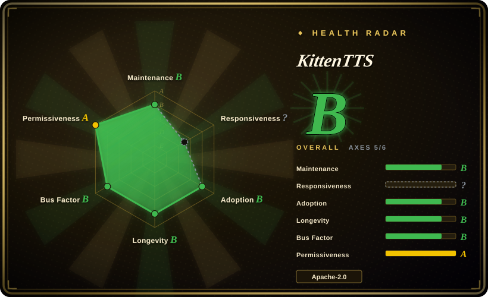
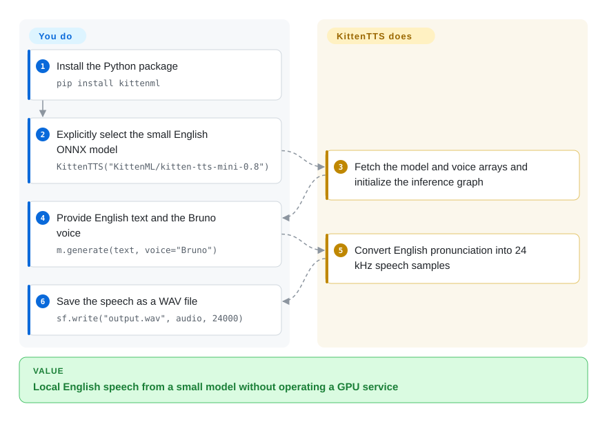
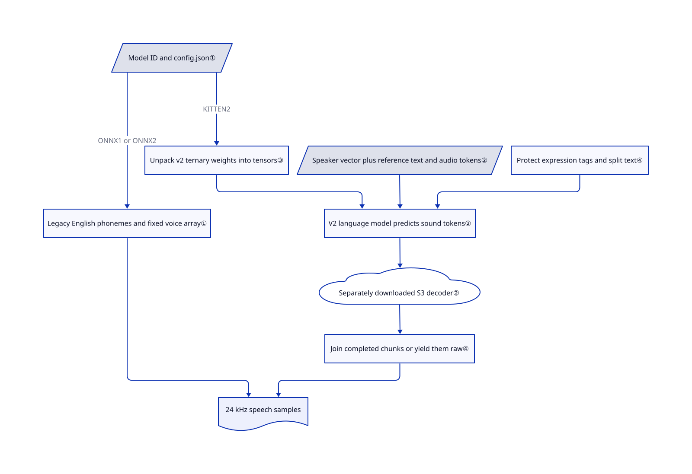

# KittenTTS

Your desktop app needs to read text aloud without reserving a GPU. KittenTTS offers tiny English models for that job, plus a larger voice-cloning model with different hardware and licensing costs.

## When to use

You're adding spoken notifications or short narration to a local app. A GPU service is excessive for “Your export is ready,” and shipping a multi-gigabyte speech model defeats the app's footprint budget. Choose the 0.8 ONNX family when eight fixed English voices suffice: its 15M–80M models use 25–80 MB weight files and have an explicit CPU execution path. Unlike the 82M Kokoro model, this family includes a 15M option; it gives up multilingual phonemization and reference-audio cloning.

You can instead select KittenTTS 2 for cloned speech or expression tags through the same Python entry point. It is a separate 1.7B model, not a feature upgrade to the tiny ONNX graph. Choose that path only after accepting its community weight license and measuring the selected backend; the repository's CPU-real-time headline is not a latency guarantee for ordinary PyTorch inference.

## When NOT to use

- **You require unrestricted commercial cloning weights.** Prefer [VoxCPM](voxcpm.md). KittenTTS code is Apache-2.0, but [KittenTTS 2's license](https://huggingface.co/KittenML/kitten-tts-2/blob/1f00fee525c7b2e30bbe9ca9ba67529734fce9c9/LICENSE.md) requires commercial registration. Its commercial grant terminates above USD 1 million annual revenue or cumulative funding, including affiliates; separate permission then becomes necessary. Distribution also requires notices and “Powered by KittenML”; model/output distillation into other models is restricted.
- **You need Chinese or Japanese from a 25 MB English engine.** Prefer [Kokoro](https://github.com/hexgrad/kokoro) for its explicit language pipelines, or VoxCPM for multilingual cloning. The legacy phonemizer hardcodes `en-us`. V2 has multilingual references, but its English-tuned normalizer must be disabled with `normalize=False` for non-English text. Supply a matching-language reference and its transcript when cloning: the automatic Whisper transcription path forces English.
- **You need speech to start while an LLM is still emitting words.** Evaluate [VibeVoice-Realtime](vibevoice.md) for English incremental-text speech. KittenTTS 2 streaming returns a completed audio chunk, not individual generated sound tokens; short text produces one chunk only.
- **You want guaranteed real-time cloning on a small CPU.** Use legacy KittenTTS or Kokoro if fixed voices suffice. V2's fast CPU recommendation points to the separate beta C++ repository, while the Python package also needs PyTorch and a separate vocoder checkpoint. Compressed download size is not peak RAM.
- **You need a permissive fine-tuning workflow for one speaker.** Evaluate [GPT-SoVITS](gpt-sovits.md) instead. This repository exposes inference and cloning; its tree does not include the v2 training pipeline. Cloning capability also does not grant permission to copy a person's voice.

## Comparison

| Alternative | In index | Our verdict | Tradeoff |
|---|---|---|---|
| [Kokoro](https://github.com/hexgrad/kokoro) | not indexed | Choose Kokoro for small fixed-voice speech across explicit language pipelines; choose legacy KittenTTS when a 15M English model is the footprint priority. | Kokoro supplies an 82M model and language-specific text handling; KittenTTS's smallest family sacrifices that breadth. Not added in this tab batch. |
| [VoxCPM](voxcpm.md) | ✅ | Choose VoxCPM when commercial multilingual cloning must avoid a revenue/funding license threshold; choose legacy KittenTTS for tiny CPU-only English prompts. | VoxCPM offers permissive weights and voice design, but asks for a much heavier inference environment than legacy ONNX. |
| [GPT-SoVITS](gpt-sovits.md) | ✅ | Choose GPT-SoVITS for a speaker-specific training workflow and WebUI; choose KittenTTS for embedding a direct generation call without that training workbench. | GPT-SoVITS adds dataset and adaptation tooling; KittenTTS's small ONNX path has no cloning, while its v2 cloning adds a custom weight license. |
| [VibeVoice](vibevoice.md) | ✅ | Choose VibeVoice-Realtime when streamed English text must become speech before the full sentence is ready; choose KittenTTS when local file generation or reference cloning matters more. | VibeVoice-Realtime has fixed voices rather than open cloning; KittenTTS 2's streaming waits for whole chunks. |

## Quick start

Use Python 3.10 or newer, as required by the manifest and PyPI, despite the README's older Python floor. Install with `pip install kittenml`, then explicitly choose `KittenTTS("KittenML/kitten-tts-mini-0.8")` for the small CPU path. Provide English text and a voice such as `Bruno`; `m.generate(text, voice="Bruno")` returns audio samples, and `sf.write("output.wav", audio, 24000)` saves them. The package fetches model assets and performs synthesis; you own the playback, input cleanup, version pinning and license review. The standard install also pulls PyTorch for v2; the [ONNX guide](https://github.com/KittenML/KittenTTS/blob/d737634c7b91ee1589820ed74ff203494454db24/docs/onnx-models.md) describes a manual reduced-dependency install if deployment size matters.

<!-- flow-steps:begin (generated from flows/kitten-tts.json by tools/flow_card.py — do not edit) -->

Text version of the flow

1. **You**: Install the Python package — `pip install kittenml`
2. **You**: Explicitly select the small English ONNX model — `KittenTTS("KittenML/kitten-tts-mini-0.8")`
3. **KittenTTS**: Fetch the model and voice arrays and initialize the inference graph
4. **You**: Provide English text and the Bruno voice — `m.generate(text, voice="Bruno")`
5. **KittenTTS**: Convert English pronunciation into 24 kHz speech samples
6. **You**: Save the speech as a WAV file — `sf.write("output.wav", audio, 24000)`

**Value**: Local English speech from a small model without operating a GPU service

<!-- flow-steps:end -->

## Key techniques

<!-- mechanism:begin (generated from mechanisms/kitten-tts.json by tools/mechanism_card.py; do not edit) -->

Text version of the mechanism

- Model ID and config.json①
- Legacy English phonemes and fixed voice array①
- Unpack v2 ternary weights into tensors③
- Speaker vector plus reference text and audio tokens②
- Protect expression tags and split text④
- V2 language model predicts sound tokens②
- Separately downloaded S3 decoder②
- Join completed chunks or yield them raw④
- 24 kHz speech samples

- Model ID and config.json① → Legacy English phonemes and fixed voice array① (ONNX1 or ONNX2)
- Legacy English phonemes and fixed voice array① → 24 kHz speech samples
- Model ID and config.json① → Unpack v2 ternary weights into tensors③ (KITTEN2)
- Unpack v2 ternary weights into tensors③ → V2 language model predicts sound tokens②
- Speaker vector plus reference text and audio tokens② → V2 language model predicts sound tokens②
- Protect expression tags and split text④ → V2 language model predicts sound tokens②
- V2 language model predicts sound tokens② → Separately downloaded S3 decoder②
- Separately downloaded S3 decoder② → Join completed chunks or yield them raw④
- Join completed chunks or yield them raw④ → 24 kHz speech samples

<!-- mechanism:end -->

### 1. Dispatch to two different inference architectures

- **Problem:** A tiny fixed-voice synthesizer and a voice-cloning model have incompatible costs and capabilities.
- **How:** The constructor reads the model repository's `config.json`. `ONNX1`/`ONNX2` selects an English phoneme-to-waveform graph with fixed voice arrays; `KITTEN2` selects the speech language model. Lazy imports separate backend loading, and config-based file filtering avoids downloading every v2 weight variant.
- **Limits:** A shared constructor does not give ONNX cloning, expression tags or multilingual phonemization. Lazy imports do not make the default pip dependency set small; always specify the model ID because the no-argument constructor still defaults to legacy nano.
- **Source:** [Dispatcher:15–112](https://github.com/KittenML/KittenTTS/blob/d737634c7b91ee1589820ed74ff203494454db24/kittenml/get_model.py#L15-L112), [English ONNX inputs:43–115](https://github.com/KittenML/KittenTTS/blob/d737634c7b91ee1589820ed74ff203494454db24/kittenml/kittentts_legacy/onnx_model.py#L43-L115).

### 2. Condition v2 on both speaker identity and reference speech

- **Problem:** Text alone does not specify the voice that should speak it.
- **How:** V2 projects a 512-number speaker identity vector into the language model's first input position. A second route puts the reference transcript and encoded reference audio into its prompt. The model predicts discrete sound tokens, then the S3 decoder converts them into 24 kHz samples.
- **Limits:** Automatic reference transcription loads Whisper large-v3 and forces English; provide `reference_text` for non-English clips or constrained machines. The S3 decoder separately downloads from `ResembleAI/chatterbox-turbo`, contradicting the README's claim that all required weights live in one model repository.
- **Source:** [Speaker injection and transcription:47–165](https://github.com/KittenML/KittenTTS/blob/d737634c7b91ee1589820ed74ff203494454db24/kittenml/kittentts2/speaker.py#L47-L165), [reference prompt:10–56](https://github.com/KittenML/KittenTTS/blob/d737634c7b91ee1589820ed74ff203494454db24/kittenml/kittentts2/prompt.py#L10-L56), [decoder and download](https://github.com/KittenML/KittenTTS/blob/d737634c7b91ee1589820ed74ff203494454db24/kittenml/kittentts2/vocoder.py).

### 3. Pack ternary weights without promising ternary runtime memory

- **Problem:** Storing three possible weight values in a 16-bit format wastes download space.
- **How:** The packed v2 checkpoint stores five base-three values per byte and preserves each group's scale. Non-ternary tensors stay unchanged. The Torch loader expands this representation back into tensors; `emb4` additionally quantizes the dense token embedding and is lossy.
- **Limits:** Storage compression is not a guarantee of low RAM or fast CPU arithmetic. The README recommends a separate C++ backend for CPU speed. The optional student decoder also trades fidelity for footprint rather than guaranteeing a speedup.
- **Source:** [Ternary pack/unpack:1–120](https://github.com/KittenML/KittenTTS/blob/d737634c7b91ee1589820ed74ff203494454db24/kittenml/kittentts2/ternary.py#L1-L120), [weight loading:30–71](https://github.com/KittenML/KittenTTS/blob/d737634c7b91ee1589820ed74ff203494454db24/kittenml/kittentts2/weights.py#L30-L71), [student decoder tradeoff:1–24](https://github.com/KittenML/KittenTTS/blob/d737634c7b91ee1589820ed74ff203494454db24/kittenml/kittentts2/student_flow.py#L1-L24).

### 4. Protect expression tags and bound each generation chunk

- **Problem:** Text normalization can read stage directions aloud, while long single-pass speech can repeat or truncate.
- **How:** V2 temporarily protects ten emotion tags, ten vocal-event tags and emphasis spans before normalization. It splits text near sentence boundaries, generates and decodes each piece, then trims edge silence and fades joins for the non-streaming result.
- **Limits:** Unknown bracketed text is rewritten, not treated as a supported control. The sentence splitter recognizes Western punctuation rather than Chinese full stops. Streaming yields raw whole chunks and does not apply the same joins; expression steering is beta, not an exact acting instruction.
- **Source:** [Tag protection:30–82 and chunk/join logic:270–411](https://github.com/KittenML/KittenTTS/blob/d737634c7b91ee1589820ed74ff203494454db24/kittenml/kittentts2/text.py), [generation and streaming:468–570](https://github.com/KittenML/KittenTTS/blob/d737634c7b91ee1589820ed74ff203494454db24/kittenml/kittentts2/model.py#L468-L570).

## Tech stack

- Python package `kittenml`, setuptools, NumPy and SoundFile; legacy inference uses ONNX Runtime and espeak-ng through `phonemizer`.
- V2 uses PyTorch, Transformers, S3 audio tokens and a vendored Chatterbox-derived decoder. Optional MLX targets Apple Silicon; optional vLLM targets Linux CUDA machines.
- The legacy family has 15M, 40M and 80M variants with eight fixed voices. V2 is 1.7B and supports reference cloning, not just those eight voices.

## Dependencies

- Python ≥3.10, confirmed by both package manifests and [PyPI 0.9.6 metadata](https://pypi.org/project/kittenml/0.9.6/). The default dependency set includes Torch ≥2.6, torchaudio, Transformers ≥4.55, ONNX Runtime, espeak loader and phonemizer.
- Legacy weights and voice arrays come from Hugging Face. Mini-0.8's card declares Apache-2.0; its model tree has no standalone LICENSE file, so retain the card and revision when documenting that declaration.
- V2 downloads its selected language-model files, voice assets, speaker embedding, and a separate Chatterbox decoder. Cloning without a transcript additionally loads Whisper large-v3. Pre-stage all of these before planning an offline deployment.
- The README estimates about 6 GB RAM for v2 CPU use or roughly 8 GB free CUDA memory; these are upstream estimates, not measured here. MLX uses the Mac GPU and is not a CPU-only benchmark.
- Language evidence conflicts as of 2026-10-22: GitHub advertises 20 languages and 47 voices; its detailed guide describes ten languages. The pinned [HF model card](https://huggingface.co/KittenML/kitten-tts-2/blob/1f00fee525c7b2e30bbe9ca9ba67529734fce9c9/README.md) lists 16 named languages, and its [voice manifest](https://huggingface.co/KittenML/kitten-tts-2/blob/1f00fee525c7b2e30bbe9ca9ba67529734fce9c9/voices/voices.json) contains 115 entries. Use the selected artifact's manifest, not a universal language-count promise.

## Ops difficulty

**Low for a pinned legacy English integration; medium for v2.** Legacy inference needs no database, GPU or hosted speech API, but the all-in-one pip install is much larger than its model file. V2 adds multiple checkpoint sources, backend-specific hardware, custom commercial terms and audible-output acceptance tests. Pin the Python package and model snapshots separately: the constructor has no model-revision argument, but it accepts a prepared local model directory. Do not load untrusted optional student checkpoints: the loader uses `torch.load(..., weights_only=False)`.

## Health & viability

- **Maintenance, 2026-10-22:** the default branch was updated on 2026-10-21; PyPI 0.9.6 was uploaded that day. GitHub's latest release is still 0.8.1 from 2026-02-24, so GitHub release tags do not represent the current package line. [Release history](https://github.com/KittenML/KittenTTS/releases) and [PyPI](https://pypi.org/project/kittenml/0.9.6/) support that distinction.
- **Governance and backing:** KittenML is an organization account, with commercial support routed to Stellon Labs. The contributor API lists six contributors; the leading account has 46 of 71 listed contributions. No governance or security policy file appears in the reviewed tree. This is vendor-led rather than foundation governance.
- **Age and durability:** created 2025-08-05, about 14 months old and actively updated. [推断：based on repository age and recent releases] This is useful maintenance evidence but a weak Lindy prior; pin an accepted artifact rather than relying on a stable long-term roadmap.
- **Adoption and risks:** 16,285 stars and 970 forks show attention, not production validation. The automated license axis reads repository metadata; it must not override v2's separate commercial restrictions. The PyPI/manifest Python floor, README language count, model voice count and hidden decoder download already require source-level reconciliation.

## Caveats (unverified)

- [未验证：model execution and weight downloads were explicitly excluded] CPU real-time performance, v2 peak RAM, cloning similarity and multilingual audio quality were not measured. All such upstream claims require tests on the chosen backend, language and machine.
- [未验证：the legacy HF tree contains no standalone license text] Mini-0.8 declares Apache-2.0 in its model card; redistribution obligations beyond that declaration were not independently established. Do not extend that declaration to every legacy checkpoint without checking it.
- [未验证：conflicting upstream documentation and no synthesis run] The 20-language headline is not a tested support matrix. The 115-entry voice manifest and 16-language model-card list prove available references, not reliable generation in each language.
- [推断：based on age, releases and vendor-controlled ownership, not a support commitment] Long-term durability remains unproven despite current activity.
